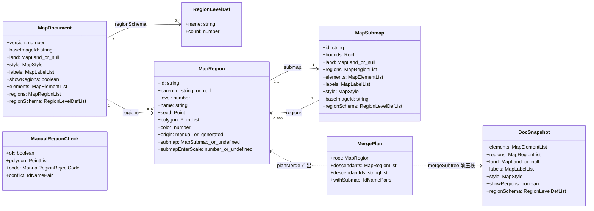
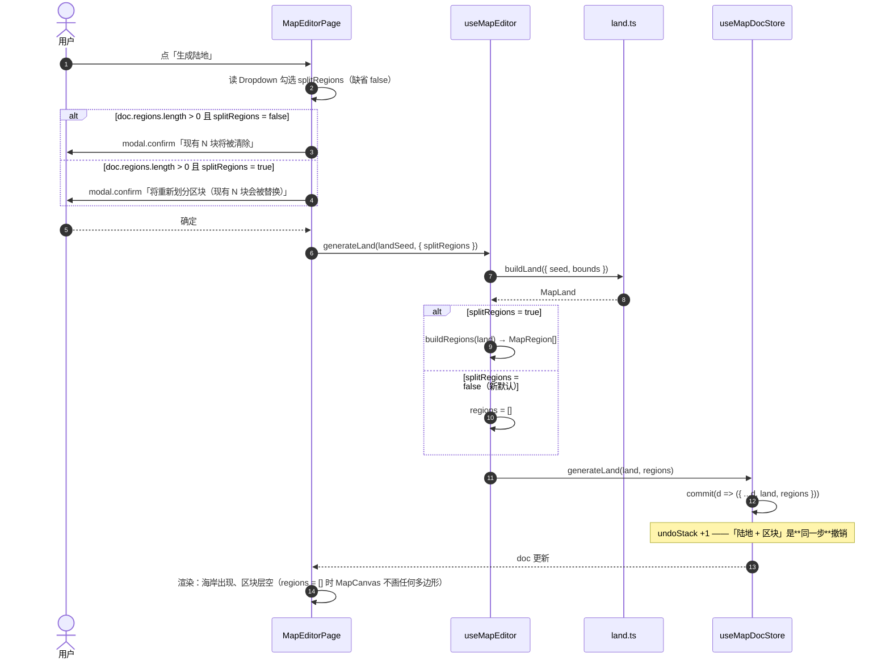
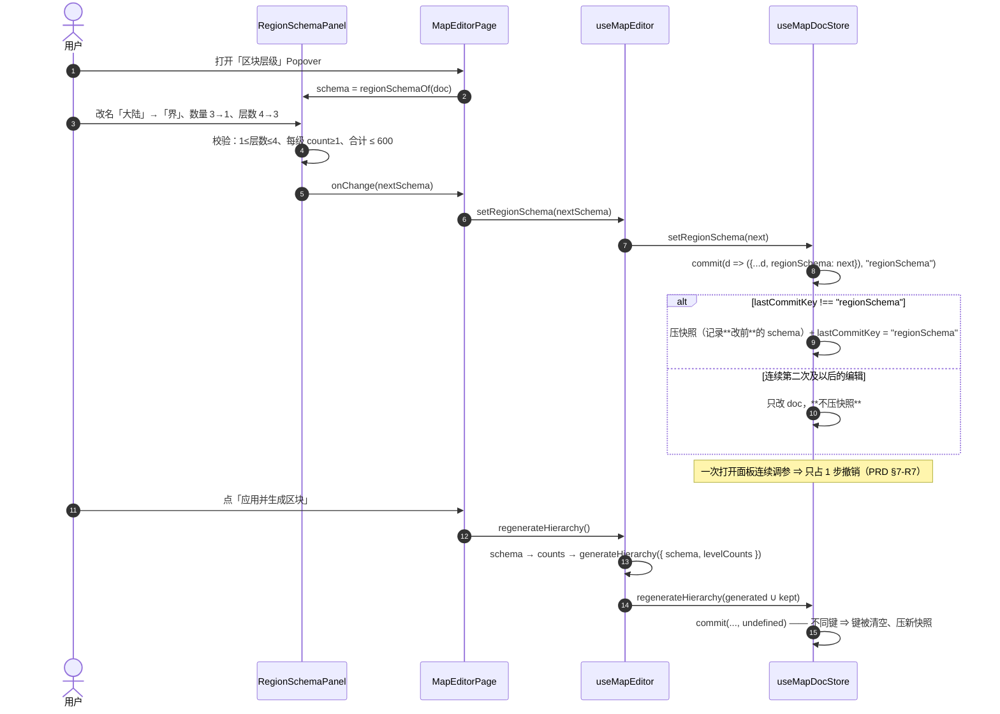
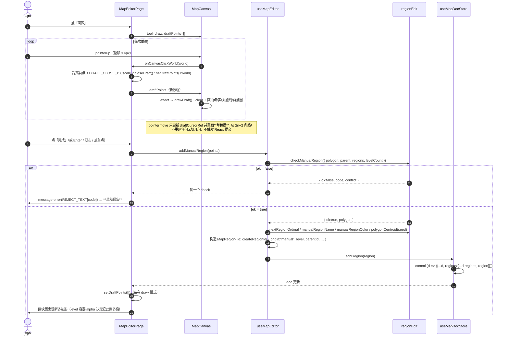
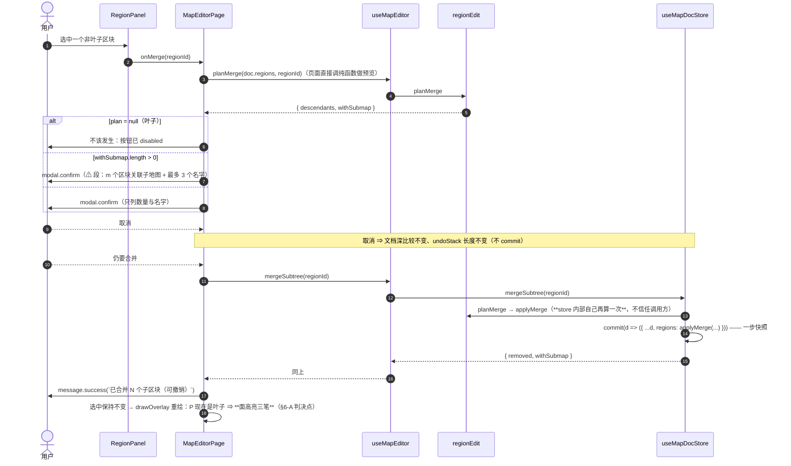
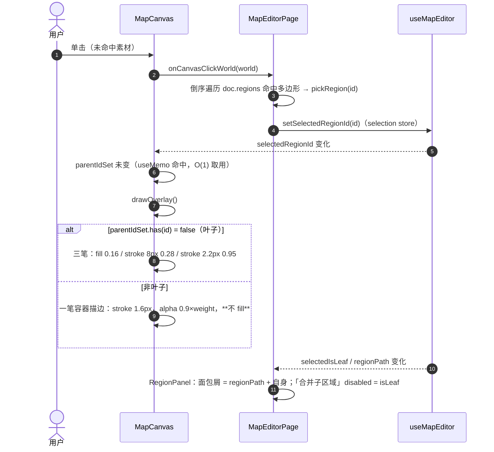
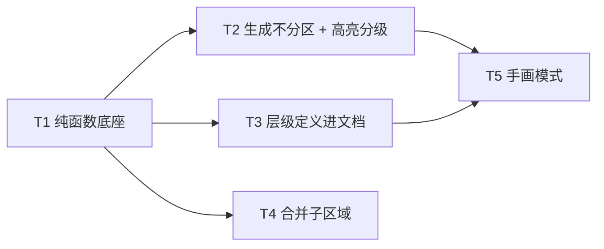

# 区域编辑 · 增量架构设计与任务分解

> **已归档 · 2026-11-05**：T1~T5 全部落地（**2.19.0**），R-REG-01~05 五条 P0 闭环。
> 未闭环的是 PRD 的 P1/P2 项（R-REG-06~14），仍在
> [`region-editing.md`](../../prd/prd-map-render/region-editing.md) §3.2/§3.3 跟踪。
> 本文 §6 的 10 条风险**多数已收敛**，保留作决策依据；归档后不再修改正文。

> 状态：**已实现**（2.19.0）。T1~T5 全部落地，QA 独立验证 9 处变异 8 红（第 9 处抓出一个假守卫并已补强），
> 另有 2 处轻微缺陷在验收期修掉（重复确认弹层 / `migrateDoc` 未剔除非法 `regionSchema`）。
> 本文保留为**决策依据**：§6 记录的 10 条风险与「待明确」多数已在实现中收敛，未收敛的见文末。
> 输入：`region-editing.md`（PRD，5 条 P0 已拍板）+ 代码基线 `MapEditorPage/{regions,lod,types}.ts`、
> `hooks/useMapEditor.ts`、`store/useMapDocStore.ts`、`components/{MapCanvas,RegionPanel}`
> 基线：**2.18.0**（嵌套子图 Phase 2 / 2.4 已落地）
> 边界：PRD §5（数据模型增量）、§6（冲突裁决 A/B/C/D）、§7（风险与不做）是**已定约束**，
> 本文只把它们翻成实现方案，不改结论。

---

## §0 方案速览

| 需求 | 落点文件 | 新增 / 修改的函数与组件 | 复杂度 |
|---|---|---|---|
| **R-REG-02** 生成陆地不连带分区 | `index.tsx`、`hooks/useMapEditor.ts` | `handleGenerateLand`（加 `splitRegions` 分支与文案）、`generateLand(seed?, {splitRegions})` | S |
| **R-REG-05** 高亮分级 | `components/MapCanvas/index.tsx`、`components/RegionPanel/index.tsx`、`hooks/useMapEditor.ts` | `buildParentIdSet`（T1 产出）、`drawOverlay` 增叶子分支、`REGION_CONTAINER_PX`、`RegionPanel` 面包屑（`regionPath` / `isLeaf` props） | S |
| **R-REG-01** 层级定义进文档 | `regions.ts`、`types.ts`、`store/useMapDocStore.ts`、`hooks/useMapEditor.ts`、`index.tsx`、**新建** `components/RegionSchemaPanel/` | `RegionLevelDef` / `DEFAULT_REGION_SCHEMA` / `normalizeRegionSchema` / `regionSchemaOf` / `levelLabelOf`、`MapDocument.regionSchema`、`commit(mutate, coalesceKey)`、`setRegionSchema`、层级配置 Popover、删除 `levelDepth` | M |
| **R-REG-04** 合并子区域 | `regionEdit.ts`（T1 产出）、`store/useMapDocStore.ts`、`hooks/useMapEditor.ts`、`components/RegionPanel/index.tsx`、`index.tsx` | `planMerge` / `applyMerge`、`mergeSubtree(rootId)`、`handleMergeRegion`（页面弹窗）、「合并子区域」按钮 | M |
| **R-REG-03** 手动划分（画多边形） | **新建** `regionEdit.ts`（T1）、`index.tsx`、`components/MapCanvas/index.tsx`、`hooks/useMapEditor.ts`、`store/useMapDocStore.ts` | `checkManualRegion` 等 8 个纯函数、画区状态机（页面 useState）、`draftLayer` + `drawDraft`（画布）、`addRegion` / `addManualRegion` | L |

**一句话**：先把**纯函数底座**（T1）铺出来，再按"不引入新交互模式"的四个需求（T2/T3/T4）完成数据与视觉，
最后接唯一的交互增量——手画模式（T5）。

---

## §1 分层与文件清单

分层沿用现状：**纯函数层**（`regions.ts` / `lod.ts` / `coords.ts`，无 React/Pixi/DOM）→
**数据层**（`store/*`，文档 + 快照）→ **编排层**（`hooks/useMapEditor.ts`，跨 store 串联 + 派生）
→ **渲染层**（`components/MapCanvas`）→ **装配层**（`pages/MapEditorPage/index.tsx` + 面板组件）。

| 相对路径 | 新建/修改 | 职责（一句话） |
|---|---|---|
| `MapEditorPage/regionEdit.ts` | **新建** | **区块"编辑域"纯函数**：树索引 / 子树 / 线段求交 / 手画校验 / 手画命名取色。无副作用、无 React/Pixi。 |
| `MapEditorPage/regions.ts` | 修改 | 生成器本体不动；新增层级定义类型与读取出口（`RegionLevelDef` / `DEFAULT_REGION_SCHEMA` / `normalizeRegionSchema` / `regionSchemaOf` / `levelLabelOf`），导出 `hslToRgb`，`MapRegion` 加 `origin?`，`GenerateHierarchyOptions` 加 `schema?`。 |
| `MapEditorPage/types.ts` | 修改 | 文档模型加 `MapDocument.regionSchema?` / `MapSubmap.regionSchema?`；加 `createRegionId()`。 |
| `MapEditorPage/store/useMapDocStore.ts` | 修改 | `DocSnapshot` 扩容（含 `regionSchema`）；`commit` 支持**合并键**；新增 `addRegion` / `mergeSubtree` / `setRegionSchema`。 |
| `MapEditorPage/hooks/useMapEditor.ts` | 修改 | 派生 `schema` / `regionPath` / `selectedIsLeaf`；`generateLand` 加 `splitRegions`；新增 `setRegionSchema` / `mergeSubtree` / `addManualRegion`；`buildRegions` 读 schema。 |
| `MapEditorPage/index.tsx` | 修改 | 工具栏：画区模式开关 + 画区动作区、层级配置 Popover 入口、「生成陆地」下拉的「同时划出区块」；画区状态机；合并确认弹窗。**删除** `levelDepth` 组件状态。 |
| `MapEditorPage/components/RegionSchemaPanel/index.tsx` | **新建** | 层级配置面板（Popover 内容）：层数 Slider + 逐级「名称 / 目标数量」+ 合计校验 + 重置。 |
| `MapEditorPage/components/RegionSchemaPanel/index.scss` | **新建** | 面板样式（沿用现有 panel 的 BEM 风格）。 |
| `MapEditorPage/components/RegionPanel/index.tsx` | 修改 | 顶部层级面包屑；「合并子区域」按钮（叶子 disabled + Tooltip）；`isLeaf` / `regionPath` / `onMerge` 新 props。 |
| `MapEditorPage/components/MapCanvas/index.tsx` | 修改 | `drawOverlay` 增叶子分级（容器态）；新增 `draftLayer`（第 8 个 z 层）+ `drawDraft`；新增 `draftPoints` / `onDraftClose` props；双击在草稿态改投闭合。 |
| `MapEditorPage/components/MapCanvas/render-stack-guard.test.ts` | 修改 | 7 层 → 8 层；改为**具名清单**驱动（见 §6-1）。 |
| `MapEditorPage/components/MapCanvas/index.test.tsx` | 修改 | 取 overlay 的方式从"最后一个子节点"改为具名索引/类型查找。 |
| `MapEditorPage/regionEdit.test.ts` | **新建** | 纯函数单测（QA 主战场）。 |
| `MapEditorPage/store/useMapDocStore.test.ts` | **新建** | 快照粒度（合并键）与 store action 契约。 |
| `MapEditorPage/regions.test.ts` | 修改 | 补 schema 相关断言；既有 name 前缀断言改读 `DEFAULT_REGION_SCHEMA`。 |
| `MapEditorPage/hooks/useMapEditor.test.tsx` | 修改 | 补 `generateLand({splitRegions})` / `mergeSubtree` / `addManualRegion` 三组用例。 |
| `MapEditorPage/index.test.tsx` | 修改 | 改写「生成陆地：出现 seed 与区块」「层级数可调」两条既有用例（见 §4 各任务验收）。 |

> **为什么不把编辑函数塞进 `regions.ts`**：`regions.ts` 是一个自洽的**生成器**（Voronoi + 崎岖化 + 噪声），
> 文件头明确"边界：纯函数模块"，1170 行已被算法占满。编辑域的不变量（手画多边形合法性、子树删除）
> 与生成域的不变量（父子边界逐点严丝合缝）毫不相干；混在一处会让 `regions.test.ts` 变成 1500 行杂物间，
> 也让"改合并逻辑"与"改崎岖化参数"产生同一文件的并发冲突。`regionEdit.ts` 只**复用**
> `regions.ts` 已导出的 `pointInPolygon` / `polygonArea` / `polygonCentroid` / `hslToRgb`，不复制实现。

---

## §2 数据结构与接口

### 2.1 类型与模块关系



### 2.2 纯函数层 · `regions.ts`（修改）

```ts
/** 一级区域的定义（顺序即层级序号，0 起）。字段名按 PRD §5.1 用 name。 */
export interface RegionLevelDef {
  /** 展示名：进 region.name 前缀、工具栏层级胶囊、面板文案。空串回落为 `L{level+1}` */
  name: string;
  /** 目标数量：生成时用；手画模式下仅作参考（不参与校验） */
  count: number;
}

/**
 * 默认层级定义（老文档的回落值，也是"未改过 schema"的等价基准）。
 *
 * 【label ↔ name 的唯一适配点】`REGION_LEVELS` 的字段叫 `label`（历史），PRD 的
 * `RegionLevelDef` 叫 `name`。改字段名要动 8 个消费点 + `regions.test.ts` 5 处断言，
 * 风险远大于收益 —— 保留双名，只在这一行做适配，两处注释互指。
 */
export const DEFAULT_REGION_SCHEMA: readonly RegionLevelDef[];

/** 最多支持的层级数（不改：`DEFAULT_REGION_SCHEMA.length` === 4） */
export const REGION_MAX_LEVELS: number;

/**
 * 规范化外部数据（落库文档 / 子图 / 用户输入）。合法 → 返回**新数组**；任一不合法 → `null`。
 * 校验：数组、长度 ∈ [1,4]、每项 `count` 为正整数、`name` 为 string（空串合法，读时回落 `L{n}`）。
 * 【为什么要它】`migrateDoc` 不写白名单，脏 schema 会一路穿到生成器（`count: NaN` ⇒ 生成空数组）。
 */
export function normalizeRegionSchema(raw: unknown): RegionLevelDef[] | null;

/**
 * **读时回落的唯一出口**：文档 / 子图 → 有效 schema。
 * 缺失、非数组、非法 ⇒ `DEFAULT_REGION_SCHEMA`（同一份引用，避免每次新数组）。
 * 【为什么回落放在这里而不是 store 初始化】① 回落只有一处实现、一处断言；
 * ② 老文档 `doc` 形状一字不改（`regionSchema` 不写值），"改前逐字节一致"才可证；
 * ③ 子图缺 schema 时继承调用方传进来的那份，不需要第二条回落链。
 */
export function regionSchemaOf(
  source: { regionSchema?: readonly RegionLevelDef[] } | null | undefined,
): readonly RegionLevelDef[];

/** 层级名：越界 / 空名一律回落 `L{level+1}`（不抛错、不留空白段） */
export function levelLabelOf(schema: readonly RegionLevelDef[] | undefined, level: number): string;

/** HSL → 0xRRGGBB（原私有，手画取色复用同一条规则；h 度 / s,l ∈ [0,1]） */
export function hslToRgb(h: number, s: number, l: number): number;

export interface GenerateHierarchyOptions {
  seed: number;
  bounds: RegionBounds;
  /** 每级区块数；**优先级高于 schema.count**（逐岛加权分配要用它） */
  levelCounts?: readonly number[];
  /** 层级定义（只为**取名字**）。缺省 = DEFAULT_REGION_SCHEMA */
  schema?: readonly RegionLevelDef[];
  container?: Point[];
  idPrefix?: string;
}

export interface MapRegion {
  // …既有字段不变…
  /** 来源；缺省读作 `"generated"`（老数据全是生成的）。手画落库时写 `"manual"` */
  origin?: "generated" | "manual";
}
```

#### 2.2.1 `REGION_LEVELS` 的全部消费点（迁移清单，一个不漏）

> 用 `grep -rn "REGION_LEVELS" src/` 核对，共 **9 处代码引用 + 2 个测试文件**。`REGION_LEVELS` 本身**不删**
> （生成器内部与测试夹具继续用它作为"默认 4 级"的来源），只把**面向用户的读取**换成 `levelLabelOf(schema, level)`。

| # | 位置 | 现状 | 改成 |
|---|---|---|---|
| 1 | `regions.ts:966` `buildChildren` | `REGION_LEVELS[level]?.label` 作 `name` 前缀 | `levelLabelOf(options.schema, level)`（**不碰 rng**） |
| 2 | `regions.ts:1100` `generateHierarchy` | `levelCounts ?? REGION_LEVELS.map(l=>l.count)` | 保持不动（`levelCounts` 仍是显式优先；调用方已改成传 schema 的 counts） |
| 3 | `useMapEditor.ts:241` `buildRegions` | `REGION_LEVELS.slice(0,depth).map(l=>l.count)` | `schema.slice(0,depth).map(l=>l.count)` |
| 4 | `useMapEditor.ts:466` `carveSubmap` | 同上 | `schema.slice(0,depth).map(l=>l.count)`（子图暂不写自己的 schema，读父文档的） |
| 5 | `index.tsx:303` `elementCountsByLevel` | `REGION_LEVELS[level]?.label` | `levelLabelOf(schema, level)` |
| 6 | `index.tsx:597` 层级胶囊 Tooltip | `REGION_LEVELS[v.level].label` | `levelLabelOf(schema, v.level)` |
| 7 | `index.tsx:604~605` 层级胶囊正文 | 同上 | 同上 |
| 8 | `index.tsx:902` 画布提示 | `REGION_LEVELS[currentLevel].label` | `levelLabelOf(schema, currentLevel)` |
| 9 | `RegionPanel:54` `levelLabel` | `REGION_LEVELS[region.level]?.label` | `levelLabelOf(schema, region.level)`（`schema` 由 props 传入） |

**"渲染与生成结果与改前逐字节一致"的证明路径（三条，缺一不可）**

1. `DEFAULT_REGION_SCHEMA` 与 `REGION_LEVELS` **逐项等价**（length / name===label / count 相同的显式断言）。
2. `generateHierarchy({seed,bounds})` 与 `generateHierarchy({seed,bounds,schema:DEFAULT_REGION_SCHEMA})` **`toEqual` 相等**（递归比较所有顶点浮点值，这是"逐字节"在本项目里的可执行版本）。
3. `regions.test.ts` 的既有 60 余条断言（每级数量、兄弟共享边恰好两次、面积和、种子落在自块内、自交占比…）**全部保持绿**——它们钉的是改前的确切数值行为。

**零写入原则**：`createEmptyDocument()` **不写** `regionSchema`（保持空文档形状一字不改），`migrateDoc` 也**不写**（只做"非法则剔除"）。
老文档 `doc` 深比较相等的判据因此成立；写值只发生在用户真的改了配置之后。

### 2.3 纯函数层 · `regionEdit.ts`（新建）

> 本文件全部是**纯函数**（同输入必同输出，禁读 `Date.now()` / `Math.random()` / 全局随机流）。
> 它是 QA 的主要测试面：错误码枚举化，文案由页面映射，不在这里返回中文。

```ts
/* ── 1) 树索引（叶子判定 / 祖先链）──────────────────────────── */

/** parentId → 直接子节点 id 列表。**悬空 parentId 归入 `null` 键**（PRD §6-C.9：按顶层处理） */
export function buildRegionChildIndex(regions: readonly MapRegion[]): Map<string | null, string[]>;

/**
 * 有子节点的区块 id 集合 —— **叶子判定的全部依据**。
 * O(n) 一次建好；`doc.regions` 不变时结果可复用（见 §2.6 的 useMemo 约定）。
 */
export function buildParentIdSet(regions: readonly MapRegion[]): Set<string>;

/** 叶子判定：没有任何区块以它为 parentId。⚠️ 判据是结构，不是 `level === maxLevel`（PRD §6-A） */
export function isLeafRegion(regionId: string, parentIds: ReadonlySet<string>): boolean;

/** 祖先链（根 → 父，**不含自身**）。遇环或悬空即停，绝不死循环 */
export function ancestorPathOf(regions: readonly MapRegion[], regionId: string): MapRegion[];

/* ── 2) 子树（合并）──────────────────────────────────────────── */

/** 全部后代（前序，**不含自身**）。id 不存在 / 无后代 ⇒ `[]`；遇环去重 */
export function collectDescendants(regions: readonly MapRegion[], rootId: string): MapRegion[];

export interface MergePlan {
  root: MapRegion;
  /** 将被删除的后代（前序，不含 root） */
  descendants: MapRegion[];
  /** 后代 id（顺序同 descendants）。用**数组**而不是 Set：便于 `toEqual` 深比较断言 */
  descendantIds: string[];
  /** 后代中 `submap != null` 的（弹窗 ⚠ 段用） */
  withSubmap: Array<{ id: string; name: string }>;
}

/** 合并计划。root 不存在、或 root 已是叶子 ⇒ `null`（UI 据此 disabled，store 据此不 commit） */
export function planMerge(regions: readonly MapRegion[], rootId: string): MergePlan | null;

/**
 * 按计划删除后代，root **原样保留（引用不变、polygon 逐点不变）**。
 * 返回新数组，不修改入参；返回顺序 = 原顺序过滤后（渲染 z 序不变）。
 */
export function applyMerge(regions: readonly MapRegion[], plan: MergePlan): MapRegion[];

/* ── 3) 几何谓词（自己写，禁引第三方几何库）────────────────── */

/** 线段真相交（不含端点接触、不含共线重叠）。`eps` 缺省 1e-9 */
export function segmentsProperlyIntersect(
  a1: Point, a2: Point, b1: Point, b2: Point, eps?: number,
): boolean;

/** 多边形自交：任意两条**不相邻**的边真相交。相邻边（含首尾）共享端点不算 */
export function polygonSelfIntersects(polygon: readonly Point[], eps?: number): boolean;

/** 两多边形是否有任何一对边真相交（不做包含判定） */
export function polygonsEdgesCross(a: readonly Point[], b: readonly Point[], eps?: number): boolean;

/** 点是否在多边形内**或边界上**（边界用"到边距离 ≤ eps"判定，避免贴边误判为外） */
export function pointInPolygonOrOnEdge(p: Point, polygon: readonly Point[], eps?: number): boolean;

/**
 * 两多边形是否重叠 = 边相交 ∨ a 有顶点落在 b 内 ∨ b 有顶点落在 a 内。
 * 三种形态都覆盖（穿越 / 完全包含 / 一角落在内）。
 */
export function polygonsOverlap(a: readonly Point[], b: readonly Point[], eps?: number): boolean;

/* ── 4) 手画校验 ─────────────────────────────────────────────── */

export type ManualRegionRejectCode =
  | "too-few-points"      // 顶点 < 3
  | "degenerate-edge"     // 相邻顶点重合（距离 ≤ eps）
  | "self-intersect"      // 自交
  | "overlap-sibling"     // 与同父兄弟相交
  | "overlap-ancestor"    // 与祖先链上任一区块相交
  | "outside-parent"      // 有边/顶点越出父多边形（容差外）
  | "level-out-of-range"  // parent.level + 1 > levelCount - 1
  | "total-limit";        // 现有区块数 ≥ limit

export type ManualRegionCheck =
  | { ok: true; polygon: Point[] }
  | { ok: false; code: ManualRegionRejectCode; conflict?: { id: string; name: string } };

export interface ManualRegionCheckInput {
  /** 草稿顶点（世界坐标，首尾**不**重复） */
  polygon: readonly Point[];
  /** 选中的区块 = 新块的父；`null` = 画顶层（level 0） */
  parent: MapRegion | null;
  /** 当前文档的全部区块（含 sibling / ancestor，函数内部自己筛） */
  regions: readonly MapRegion[];
  /** `regionSchemaOf(doc).length` —— 层级上限的唯一来源 */
  levelCount: number;
  /** 总数护栏，缺省 `REGION_TOTAL_LIMIT` */
  limit?: number;
}

/**
 * 手画多边形落库前的**唯一校验入口**。校验顺序（短路，第一个失败即返回）：
 *   degenerate-edge → too-few-points → total-limit → level-out-of-range
 *   → self-intersect → overlap-ancestor → overlap-sibling → outside-parent
 * 顺序不是随意的：先做 O(n²) 以上的开销判断，再进 O(n·m) 的空间判断。
 */
export function checkManualRegion(input: ManualRegionCheckInput): ManualRegionCheck;

/* ── 5) 落库字段（纯，确定性）────────────────────────────────── */

/** 该层级的序号 = 现有同层区块数 + 1（不从 name 里解析，避免被将来的重命名功能污染） */
export function nextRegionOrdinal(regions: readonly MapRegion[], level: number): number;

/** 展示名 `{层级名} {序号}`，与生成区同一口径（名字只来自 schema） */
export function manualRegionName(
  schema: readonly RegionLevelDef[] | undefined, level: number, ordinal: number,
): string;

/** 0xRRGGBB → HSL（手画的"继承父色相"必须能反解） */
export function rgbToHsl(rgb: number): { h: number; s: number; l: number };

/**
 * 手画取色（确定性，**不用 rng**）：
 *   · 有父色 → 父色相 ±(ordinal%5-2)×REGION_WOBBLE.hueSpread（±6°），s=0.13, l=0.62；
 *   · 无父色 → 黄金角分散 `ordinal × 137.508`，s=0.13, l=0.62（与生成器 level 0 同式）。
 * 【为什么不用 rng】生成器的 rng 是**串行流**，多取一个数会把整张图重排（见 regions.ts :1078）。
 */
export function manualRegionColor(input: { parentColor: number | null; ordinal: number }): number;
```

#### 2.3.1 相交检测的算法选型与复杂度（为什么不上空间索引）

**结论：O(n²) 线段两两求交 + AABB 粗筛，不建空间索引。**

| 判定 | 输入规模（实测/上限） | 朴素开销 | 粗筛后 |
|---|---|---|---|
| 自交 `polygonSelfIntersects` | 手画顶点 `n`（正常 3~30，耐心上限约 200） | `n²/2` 次线段测试，n=200 ⇒ **2 万次**（每次约 20 flops）→ 亚毫秒 | 无需（n 本来就小） |
| 与兄弟/祖先相交 `polygonsOverlap` | 兄弟 ≤ 160、祖先 ≤ 3；**每个生成区块的 polygon 有数百顶点**（崎岖化后） | 最坏 163 × 30 × 400 ≈ **200 万次**线段测试 → 十几~几十毫秒 | 先比 AABB：兄弟在空间上分区，绝大多数**一个盒子都不相交** ⇒ 候选通常 1~5 个，降到 **万级** |

**不做空间索引的理由（代价 > 收益）**

1. 调用频率是"**闭合那一刻一次**"，不是每帧：几十毫秒对一次显式落笔动作完全可接受（用户此时本来就在等一个 `message` 反馈）。而 R-tree / 网格桶省下的是这几十毫秒。
2. 索引的生命周期会**立刻**变脏：`doc.regions` 在生成 / 合并 / 撤销 / 重做 / 手画落库后全部变化，索引必须缓存且必须知道何时失效 —— 一个失效判据写漏就是"明明重叠却通过了"（静默脏数据），比多花 30ms 糟得多。
3. 项目铁律禁新依赖，网格桶要自己写，还要写自己的单测与失效用例 —— 成本落在最不产生用户价值的地方。

**阈值判断（写进注释，避免将来"顺手优化"）**：若某天手画顶点数常态超过 **500**，或区块总数上限从 600 抬到 5000，再回来评估；本批不动。

### 2.4 数据层 · `store/useMapDocStore.ts`（修改）

```ts
export interface DocSnapshot {
  elements: MapElement[];
  regions: MapDocument["regions"];
  land: MapLand | null;
  labels: MapLabel[];
  style: MapStyle;
  showRegions: boolean;
  /** ★ 新增：schema 进撤销栈（PRD §7-R7 / R-REG-01 验收④） */
  regionSchema: MapDocument["regionSchema"];
}

interface MapDocState {
  doc: MapDocument;
  undoStack: DocSnapshot[];
  redoStack: DocSnapshot[];
  /** 上一次 commit 用的合并键；用于"连续同类编辑只记一步" */
  lastCommitKey: string | null;

  /**
   * 提交一次文档变更（自动入撤销栈）。
   * @param coalesceKey 与**上一次** commit 的键相同 ⇒ 不压新快照（第一次已经记了"改前"）。
   *   任何不同键的 commit、`undo`、`redo`、`commitDragStart`、reset 都会把键清空。
   */
  commit: (mutate: (doc: MapDocument) => MapDocument, coalesceKey?: string) => void;

  // …既有 action 不变…

  /** 手画区块落库（一次 commit）。region 由 hook 构造好，store 只做追加 */
  addRegion: (region: MapRegion) => void;

  /** 合并子树：删 root 的全部后代，root 字段与引用均不变 */
  mergeSubtree: (rootId: string) => { removed: number; withSubmap: number };

  /** 改写层级定义（coalesceKey = "regionSchema"：同一面板连续编辑只压一步） */
  setRegionSchema: (schema: RegionLevelDef[]) => void;
}
```

**为什么这三个 action 放 store 而不是 hook**：本项目的既有分工是"store 管数据 + 快照，hook 管跨 store 编排"
（见 `useMapDocStore.ts` 头部注释的边界声明）。三个 action 都只是**对 `doc.regions` / `doc.regionSchema`
的一次不可变更新 + 一次 commit**，没有任何 viewport/selection 参与 —— 与既有的 `embedSubmap` / `clearRegions`
完全同类。放进 hook 会让 `commit` 的两个调用方（hook 与 store）各自记账，快照边界立刻不可推理。
**构造 `MapRegion` 的编排**（层级、父、名字、颜色、校验）留在 hook，因为那需要 `selectedRegionId`（selection store）。

#### 2.4.1 撤销快照粒度：为什么是"合并键"而不是 debounce 或 begin/end 事务

现有代码里已经有**一个**可复用的能力：`commitDragStart(doc)` —— 它在拖拽开始时压一次快照，之后
`moveElementBy` 只改文档不记账，于是"一次拖拽 = 一步撤销"。但它的记账与动作是**手工配对**的
（调用方必须记得先 `commitDragStart`）。schema 编辑需要同一效果，三种做法比较：

| 备选 | 做法 | 失败模式 | 判定 |
|---|---|---|---|
| **A 合并键（选定）** | `commit(mutate, "regionSchema")`：与上一次键相同则不压新快照；异类 commit / undo / redo / commitDragStart / reset 清空键 | 最坏"多压一两步"（无副作用，用户多按一次 Ctrl+Z 而已） | ✅ |
| B begin/end 事务配对 | 面板打开 `begin()`、关闭 `end()` | 漏 `end()` 的入口至少有 5 个（点浮层外关闭 / Esc / 组件卸载 / 导出期重渲染 / 面板切走）⇒ 事务泄漏后**其他所有编辑都不压快照**，撤销彻底失灵 | ❌ 失败模式太贵 |
| C debounce 定时提交 | 改完等 300ms 再 commit | ① 改完立刻 Ctrl+Z 时快照还没压 ⇒ 撤销会跳过一个状态；② 关窗/切页要在卸载时 flush，漏了就丢快照；③ 测试必须 fake timers | ❌ 快照边界不该是**时间** |

**选定 A 的关键理由**：快照边界应当由**交互动作**（"我在改层级配置"）决定，而不是由计时器决定；
而合并键把"我做的是哪类动作"这件事写成**调用点上的一个字面量**，没有任何需要配对的隐式状态。
它的唯一新增状态是 `lastCommitKey: string | null`，且**四处清空点都是既有的 public 方法**（见 §6-8 的核对清单）。

### 2.5 编排层 · `hooks/useMapEditor.ts`（修改）

```ts
/* 派生（全部 useMemo，按依赖最小化） */
/** 当前文档的有效层级定义（读时回落，见 regionSchemaOf） */
schema: readonly RegionLevelDef[];
/** 选中区块的祖先链（根→父）+ 自身，供面包屑；`[]` = 未选中 */
regionPath: MapRegion[];
/** 选中区块是否叶子（决定画布画三笔还是容器态、面板「合并」是否 disabled） */
selectedIsLeaf: boolean;

/* 动作 */
/** 重新生成区块树。`levelCount` 可选：给定时临时截断到 N 级（既有 hook 用例的杠杆，UI 不再传） */
regenerateHierarchy: (levelCount?: number) => void;

/**
 * 生成陆地。`splitRegions`（缺省 false）= 是否同时在陆地内划出区块（R-REG-02）。
 * 【签名变更理由】旧签名第二参是 `levelCount`，而"层级从哪来"在 T3 之后只由 schema 决定；
 * 留着它会变成第二事实源。层级深度改为内部读 schema，旧的显式深度需求由
 * `regenerateHierarchy(levelCount)` 覆盖。
 */
generateLand: (seed?: number, options?: { splitRegions?: boolean }) => void;

/** 改写层级定义（转 store.setRegionSchema） */
setRegionSchema: (schema: RegionLevelDef[]) => void;

/** 合并子树（转 store.mergeSubtree），返回删除量供页面 message 使用 */
mergeSubtree: (rootId: string) => { removed: number; withSubmap: number };

/**
 * 手画落库：校验 → 构造 MapRegion → store.addRegion。
 * 返回 check 结果：`ok:false` 时页面据此 `message.error(文案)` 并**保留草稿**。
 * 【为什么编排在这里】level 要读 schema、parentId 要读选中区块（跨 store）、
 * name/color 要读同层现有区块 —— 三者齐全的地方只有本 hook。
 */
addManualRegion: (polygon: readonly Point[]) => ManualRegionCheck;
```

`buildRegions` 内部改动（保留原有多岛加权逻辑，只换数据源）：

```ts
const depth = clamp(schema.length, 1, REGION_MAX_LEVELS);
const counts = schema.slice(0, depth).map((l) => l.count);
generateHierarchy({ seed, bounds, levelCounts: counts, schema, container, idPrefix });
```

`regenerateHierarchy` 内部**预留**手画保留点（T3 写入、T5 生效）：

```ts
const generated = buildRegions(doc.land, levelCount);
// T5 之前 kept 恒为空数组 —— 这里先写好过滤，避免 T5 再回来改一次同一段
const kept = doc.regions.filter((r) => r.origin === "manual");
store.regenerateHierarchy(kept.length > 0 ? [...generated, ...kept] : generated);
```

### 2.6 渲染层 · `components/MapCanvas/index.tsx`（修改）

```ts
/** 新增 props */
/** 手画草稿的世界坐标顶点（首尾不重复）；`null`/缺省 = 不在画区模式 */
draftPoints?: readonly Point[] | null;
/** 双击请求闭合（草稿非空时 dblclick 改投这里，不再触发地名编辑） */
onDraftClose?: () => void;

/** 新增导出常量：闭合判定半径（屏幕像素）。页面与画布**共用同一个数** */
export const DRAFT_CLOSE_PX = 10;
/** 草稿线宽（屏幕像素） */
const DRAFT_LINE_PX = 1.5;
/** 非叶子选中时的容器描边宽度（屏幕像素，PRD §4.4 的 1.6px） */
const REGION_CONTAINER_PX = 1.6;
```

内部新增：

```ts
/** 叶子判定索引：只在 doc.regions 变时重算 O(n)。❗绝不放进 drawOverlay —— 它在 scale 变化时每格都会跑 */
const parentIdSet = useMemo(() => buildParentIdSet(doc.regions), [doc.regions]);

/** 草稿层（world 的第 8 个子节点，压在 overlay 之上）*/
const draftLayerRef = useRef<Graphics | null>(null);
/** 光标预览点（世界坐标）。❗只在事件/effect 里写，绝不进 React state —— 见 §2.7 性能底线 */
const draftCursorRef = useRef<Point | null>(null);
/** 草稿重绘函数（事件与 effect 共用，同 drawOverlay 的模式）*/
const drawDraftRef = useRef<() => void>(() => {});
```

`drawOverlay` 的改动（**三笔逐参数不变**，只加分支）：

```ts
const weight = levelAlphas[picked.level] ?? 1;
if (weight > 0.02) {
  const px = 1 / Math.max(1e-6, viewport.scale);
  const flat = toFlatPoints(picked.polygon);
  if (!parentIdSet.has(picked.id)) {
    // 叶子：现状三笔（填充 0.16 / 外发光 8px 0.28 / 白线 2.2px 0.95）逐参数不动
    …
  } else {
    // 非叶子：容器态 —— 只一笔强调描边，不铺面、不加外发光
    overlay.poly(flat);
    overlay.stroke({ width: REGION_CONTAINER_PX * px, color: REGION_PICK_COLOR, alpha: 0.9 * weight, alignment: 0.5 });
  }
}
```

#### 2.6.1 草稿层为什么是"world 里的独立 Graphics"，而不是屏幕空间覆盖层

| 备选 | 代价 |
|---|---|
| **A 新 `Graphics` 挂在 `world` 下（选定）** | 顶点直接就是**世界坐标**（落点来自 `screenToWorld`，闭合后原样成为 `polygon`，**零换算**）；平移/缩放时 Pixi 自动跟随，无需重画；线宽用 `px / scale`（与 overlay 完全同一口径）。代价：world 的子节点从 7 变 8，`render-stack-guard.test.ts` 的 `toHaveLength(7)` 与 `index.test.tsx` 的 `children.at(-1)` 要跟着改（见 §6-1，已在 T2/T5 排入）。 |
| B 屏幕空间容器（挂在 `stage` 下） | 每次指针移动 / 每次缩放都要把 n 个世界坐标 `worldToScreen` 一遍；顶点与文档多边形之间多一层换算，闭合时还要反映射回去 —— 这是"同一件事算两遍"的经典来源（本项目 2.x 已因双重换算出过两次报障）。 |
| C 复用 `overlay` 这个 Graphics | `overlay` 上还画着选中框；`clearOverlay()`（导出用）会把草稿一起清掉；且每次 mousemove 都要连带重画选中框与整片高亮 —— 违反"只重画草稿层"。 |
| D 每帧用 DOM/SVG 覆盖层画 | 又一套坐标系与渲染器，且与"顶点是世界坐标"直接冲突。 |

**z 序位置：`overlay` 之后（最后一个）**。理由：画子区块时父块常处于选中态（正在被高亮），
草稿线若压在高亮之下会被 0.16 的填充盖淡 —— 而草稿是**用户此刻正在操作的线**，必须是最高优先级。
代价是 `index.test.tsx` 里"`world.children.at(-1)` 就是 overlay"的两处断言失效 → 改为取 `WORLD_LAYER_ORDER.indexOf("overlay")`。

**性能底线（硬要求，写进 T5 验收）**：一次 `mousemove` 只允许 `draftLayer.clear()` + 重写 **≤ 2n+2** 条线段（n = 已落点数），
**不得**触碰 `doc.regions`、不得重跑填充/边界 effect、不得触发 React 提交。判据：连续 20 次 `pointermove` 后
区块层 `poly()` 调用次数不变、`doc.regions` 引用不变。

### 2.7 装配层 · 画区状态机（`index.tsx`）

```ts
type MapTool = "select" | "draw";

/** 当前工具（与 pendingLabel / pendingSpriteId 三者互斥） */
const [tool, setTool] = useState<MapTool>("select");
/** 已落顶点（世界坐标）。一次单击 = 一次提交（可接受）；光标预览点**不进这里** */
const [draftPoints, setDraftPoints] = useState<Point[]>([]);
```

| 事件 | 前置 | 动作 |
|---|---|---|
| 点「画区」 | — | `setTool("draw")`；`setDraftPoints([])`；`setPendingLabel(false)`；`setPendingSpriteId(null)` |
| 点「选择」 | — | `setTool("select")`；`setDraftPoints([])`（丢草稿，**不产生快照**） |
| 画布单击（world） | `tool==="draw"` | 若 `points.length ≥ 3` 且 `dist(world, points[0]) ≤ DRAFT_CLOSE_PX / viewport.scale` → `closeDraft()`；否则 `setDraftPoints([...p, world])`。**此分支必须在 `pendingLabel` / `pendingSpriteId` 之前** |
| 「撤销上一点」 | `points.length > 0` | `setDraftPoints(points.slice(0, -1))`（退到 0 仍留在 draw 模式） |
| 「完成」 | `points.length ≥ 3` | `closeDraft()`（< 3 时 disabled） |
| `Enter` | `tool==="draw"` 且 `points.length ≥ 3` | `closeDraft()` |
| `dblclick` | `draftPoints` 非空 | 画布回调 `onDraftClose` → `closeDraft()` |
| `Esc` | `points.length > 0` | 只清草稿，**不清选中**（画到一半按 Esc 不该丢父块选中）；否则 `tool==="draw"` → 回 select；否则走既有 Esc 分支 |
| `closeDraft()` | — | `const r = editor.addManualRegion(points)`；`r.ok` → 清空 `draftPoints` 并**留在 draw 模式**（连续画）；否则 `message.error(REJECT_TEXT[r.code])` 且**保留草稿** |

---

## §3 调用流程

### 3.1 生成陆地不再连带分区（R-REG-02）



### 3.2 层级配置保存（R-REG-01 · 合并快照）



### 3.3 手画落库（R-REG-03）



### 3.4 合并确认 → 一次快照（R-REG-04）



### 3.5 选中 → 高亮分级判定（R-REG-05）



---

## §4 任务列表

**依赖图**



**分批**：批 1 = T1→T2→T3→T4（先铺数据与视觉底座）；批 2 = T5（唯一引入新交互模式的一条）。
T1 单独成任务而不是并进 T2/T3/T4：它是三个需求共同的前置，且**纯函数、零 UI、可独立验收**——
先让它绿，后面三个任务的用例才有能站的地基。

---

### T1 · 编辑域纯函数 + 层级定义类型

| 项 | 内容 |
|---|---|
| 落点文件 | **新建** `regionEdit.ts`、`regionEdit.test.ts`；修改 `regions.ts`、`types.ts`、`regions.test.ts` |
| 依赖 | 无 |
| 规模 | **M**（5 个文件、新增 ~420 行 + 测试 ~350 行） |
| 优先级 | P0 |

**要做的事（逐条可执行）**

1. `regions.ts`：新增 `RegionLevelDef` / `DEFAULT_REGION_SCHEMA` / `normalizeRegionSchema` / `regionSchemaOf` / `levelLabelOf`；把 `hslToRgb` 改为 `export`；`MapRegion` 加 `origin?`；`GenerateHierarchyOptions` 加 `schema?`。
2. `regions.ts` 的 `buildChildren`（:966）：`const label = REGION_LEVELS[level]?.label` → `levelLabelOf(options.schema, level)`。**不得改动任何 `rng()` 调用次数与顺序**。
3. `types.ts`：`MapDocument` 加 `regionSchema?: RegionLevelDef[]`；`MapSubmap` 加 `regionSchema?: RegionLevelDef[]`；新增 `createRegionId()`，前缀 `rgm_`（**不用 `rg_`**：生成器的 id 是 `rg_<seed36>_<n>`，`seed36` 的字符集含 `m`，前缀会歧义）。
4. `regionEdit.ts`：按 §2.3 实现全部 15 个导出（索引 / 子树 / 谓词 / 校验 / 落库字段），全部纯函数，不引任何第三方几何库。
5. `regionEdit.test.ts` 覆盖：8 个 `code` 各一条 + 四个"不该拒"的反例（贴父边界、共线邻边、顺/逆绕向、极小多边形）+ `planMerge`/`applyMerge` 的"root 引用与 polygon 不变" + `ancestorPathOf` 的环防御。
6. `regions.test.ts`：既有 5 处 `REGION_LEVELS[r.level].label` 改读 `DEFAULT_REGION_SCHEMA`；新增 3 条（见下）。

**验收判据**

- `normalizeRegionSchema` 对 `null` / `[]` / 5 项 / `count: 0` / `count: NaN` / `name: 123` 一律返回 `null`；对"合法 3 项"返回等值新数组。
- **逐字节等价证据**：`expect(generateHierarchy({ seed: 42, bounds: B })).toEqual(generateHierarchy({ seed: 42, bounds: B, schema: DEFAULT_REGION_SCHEMA }))`（`toEqual` 递归比全部顶点浮点值）。
- `DEFAULT_REGION_SCHEMA` 与 `REGION_LEVELS` 逐项等价：`length === 4`、`[1].name === "洲"`、`[3].count === 160`。
- `checkManualRegion` 对"完全落在父块内但**贴着**父边界"的多边形返回 `ok: true`（容差生效）；对"跨出父边界 1 个世界单位"返回 `outside-parent`。
- `polygonSelfIntersects` 对正五边形返回 `false`、对"8"字形返回 `true`、对"相邻边共享端点"返回 `false`。
- `applyMerge` 后 `root` 的引用 `===` 合并前的对象（不只是深比较）。
- 既有 `regions.test.ts` 全绿（这是"生成结果未被改动"的主证据）。

**禁止**：在 `regionEdit.ts` 里 `import` React / Pixi / `Date` / `Math.random`。

---

### T2 · R-REG-02（生成陆地不连带分区）+ R-REG-05（高亮分级）

| 项 | 内容 |
|---|---|
| 落点文件 | `index.tsx`、`hooks/useMapEditor.ts`、`components/MapCanvas/index.tsx`、`components/RegionPanel/index.tsx`、`index.test.tsx`、`components/MapCanvas/index.test.tsx`、`components/MapCanvas/render-stack-guard.test.ts`、`hooks/useMapEditor.test.tsx` |
| 依赖 | T1（`buildParentIdSet` / `isLeafRegion` / `ancestorPathOf`） |
| 规模 | **S**（两条都是 S；合计约 7 个文件、净增 ~120 行） |
| 优先级 | P0 |

**要做的事**

1. `useMapEditor.generateLand(seed?, { splitRegions })`：`splitRegions` 为假时 `regions = []`；为真时走原 `buildRegions` 路径（**一字不改**，保证回归等价）。`levelCount` 参数**此处不引入**（留给 T3 统一处理 schema）。
2. `index.tsx` `handleGenerateLand`（:432）：确认弹窗按 `splitRegions` 二分文案——关 ⇒「现有 N 块将被清除」，开 ⇒ 保留现状文案「将重新划分区块（现有 N 块会被替换）」。入口改为 `Dropdown`：菜单项「同时划出区块」(`Switch`)，点「生成陆地」按钮即按当前勾选态执行。
3. `MapCanvas`：`useMemo(() => buildParentIdSet(doc.regions), [doc.regions])`；`drawOverlay` 加叶子/非叶子分支；新增 `REGION_CONTAINER_PX = 1.6`。
4. `RegionPanel`：新增 `regionPath: MapRegion[]` / `isLeaf: boolean` props；顶部面包屑（`ancestorPathOf` 的结果由 hook 传入）；面包屑段**跳过 name 为空的项**（不出现空段）。`levelLabel` 本任务**先不动**（T3 改，避免同一行被两个任务改）。
5. `render-stack-guard.test.ts`：把 `STACK` 改成导出常量 `WORLD_LAYER_ORDER`（8 项，`draftLayer` 暂不加入——T5 再加），断言改为"数组驱动 + 顺序正则"，**不再出现 `toHaveLength(7)` 这类魔数**。

**验收判据**

- `useMapEditor.test.tsx` 新增：`generateLand(42, { splitRegions: false })` → `doc.land !== null && doc.regions.length === 0`；`{ splitRegions: true }` 与 `generateLand(42)`（旧调用）产出 `regions` 深比较相等。
- 页面用例「生成陆地」改写为两条：①默认不勾 ⇒ `landLabel` 有 seed、`regionLabel() === ""`；②勾选后 ⇒ `regionLabel()` 匹配 `已生成 \d+ 块`。
- `MapCanvas/index.test.tsx` 新增：叶子选中 ⇒ overlay `polys` 长度 3（回归）；非叶子选中 ⇒ `polys` 长度 1 且**没有** `fill` 调用（FakeGraphics 需补 `fills: unknown[]` 探针，把 `fill()` 记一笔）。
- 「判决用例」（PRD §6-A，**必须写**）：构造 `level 2` 的国家 + 两个 `level 3` 的子郡 → 先断言选中父块只有 1 笔 → 把子郡从 `doc.regions` 里去掉（模拟合并后）→ 同一父块再选中 ⇒ `polys` 长度 3。
- `RegionPanel` 面包屑：选中 `level 0` 区块 ⇒ 面包屑只有一段；选中孙节点 ⇒ 三段且顺序为 根→父→自身。
- 既有 `index.test.tsx`（除被改写的那条）与 `MapCanvas/index.test.tsx` 其余用例全绿。

---

### T3 · R-REG-01 层级定义进文档（`regionSchema`）

| 项 | 内容 |
|---|---|
| 落点文件 | **新建** `components/RegionSchemaPanel/{index.tsx,index.scss}`、`store/useMapDocStore.test.ts`；修改 `store/useMapDocStore.ts`、`hooks/useMapEditor.ts`、`index.tsx`、`components/RegionPanel/index.tsx`、`index.test.tsx`、`hooks/useMapEditor.test.tsx` |
| 依赖 | T1 |
| 规模 | **M**（9 个文件、净增 ~330 行） |
| 优先级 | P0 |

**要做的事**

1. `useMapDocStore`：`DocSnapshot` 加 `regionSchema`；`snapshotOf`/`applySnapshot` 同步；`commit(mutate, coalesceKey?)` + `lastCommitKey`（在 `undo`/`redo`/`commitDragStart`/`resetMapDocStore` 里清空）；新增 `setRegionSchema`（`coalesceKey = "regionSchema"`）。**本任务只加 `setRegionSchema`**：`addRegion` 归 T5、`mergeSubtree` 归 T4，不提前留空壳（空壳 action 没有任何调用点，也没法断言）。
2. `useMapEditor`：`schema` / `regionPath` / `selectedIsLeaf` 三个 `useMemo`；`setRegionSchema`；`buildRegions` 改读 schema（`carveSubmap` 里的 `REGION_LEVELS.slice` 同样改 `schema.slice`）；`regenerateHierarchy` 加"保留手画块"的过滤（T5 前恒为空）。
3. 新建 `RegionSchemaPanel`：层数 `Slider`(1~4) + 逐级一行（`Input` 名称 + `InputNumber` 数量）+ 合计 `N / 600`（超限标红、`应用并生成区块` 禁用 + Tooltip）+「重置为默认」。**全部 antd v6**；`Popover` 默认挂 body，**不得**设 `getPopupContainer`。层数 `InputNumber` 加 `aria-label="层数"`（既有页面用例按 role 取它）。
4. `index.tsx`：删 `levelDepth` useState；「更多」里的「区块层级」`InputNumber` 换成打开 Popover 的按钮；「生成区块」→ `editor.regenerateHierarchy()`；「生成陆地」的深度来源改为 schema（内部）；`elementCountsByLevel`（:303）、层级胶囊（:597/604/605）、画布提示（:902）全部改 `levelLabelOf(schema, level)`。
5. `RegionPanel`：`levelLabel` 改 `levelLabelOf(schema, region.level)`，`schema` 由 props 传入（保持组件不读 store）。
6. `store/useMapDocStore.test.ts` 新建：快照粒度与 `setRegionSchema` 契约。

**验收判据**

- 连续三次 `setRegionSchema` → `undoStack.length === 1`；再调一次 `setStyle` 后再 `setRegionSchema` → `undoStack.length === 3`（键被异类 commit 清空）。
- `undo` 一次后 `doc.regionSchema` 回到改前（`undefined`，**不是**默认数组）；`redo` 恢复。
- `undo` 之后紧接 `setRegionSchema` → 仍然压新快照（`lastCommitKey` 已在 undo 里清空）。
- 页面用例：改名「界/域/城」+ 层数 3 → 点「生成区块」→ `regionLabel()` 匹配 `\d+ 块`；且 `doc.regions.every(r => r.name.startsWith(matching))` 该断言改为**通过页面文本**：层级胶囊显示「界 ↔ 域」这类文案。
- 老文档等价：`resetMapStores()` 后 `doc.regionSchema === undefined`；`regenerateHierarchy()` 产出与 T1 里"显式传 DEFAULT_REGION_SCHEMA"深比较相等。
- 既有「层级数可调：改成 2 级只切出大陆与洲」改写为：`getByRole("spinbutton", { name: "层数" })` 设为 2 → 生成 → `已生成 15 块`。

> ⚠️ **不要改 `levelCountsOf(regions)` 作事实源**（PRD §5.4）。`levelAlphas` / 素材 `level` / 子图 LOD 全部继续用实际区块数。
> 唯一例外：`buildRegions` 的 **counts 来源**从 `REGION_LEVELS` 换成 `schema`（这是"生成时的目标数量"，本来就是 schema 的语义，不是事实源）。

---

### T4 · R-REG-04 合并子区域

| 项 | 内容 |
|---|---|
| 落点文件 | `store/useMapDocStore.ts`、`hooks/useMapEditor.ts`、`components/RegionPanel/index.tsx`、`index.tsx`、`hooks/useMapEditor.test.tsx`、`index.test.tsx` |
| 依赖 | T1、T3（`RegionPanel` 同一文件的按钮区与 `schema` prop） |
| 规模 | **M**（约 6 个文件、净增 ~180 行） |
| 优先级 | P0 |

**要做的事**

1. `useMapDocStore.mergeSubtree(rootId)`：内部 `planMerge` → 叶子/不存在则**直接 return `{removed:0,withSubmap:0}` 且不 commit** → 否则 `commit(d => ({...d, regions: applyMerge(d.regions, plan)}))`。
2. `useMapEditor.mergeSubtree(rootId)`：转调 + 返回计数（不再叠加任何逻辑）。
3. `RegionPanel`：按钮区在「聚焦此区域」之后、「移除子图」之前插入「合并子区域」；`disabled = isLeaf`，`Tooltip`「该区块没有子区域」；新增 `onMerge` prop。
4. `index.tsx`：`handleMergeRegion(regionId)` → 纯函数 `planMerge` 取预览 → `modal.confirm`（内容按 §3.4 分四态：叶子不会进这里 / 无子图 / 有子图带 ⚠ 段 / P 自身有 submap 额外一行）→ 确认后 `editor.mergeSubtree` + `message.success`。

**验收判据**

- 构造 `P`（level 2）+ 3 个直接子 + 5 个孙：`mergeSubtree(P.id)` → `removed === 8`、`regions.length` 减少 8、`regions.filter(r => r.parentId === P.id).length === 0`。
- `P` 合并前后 `toEqual` 相等（含 `polygon` 逐点、`level`、`name`、`color`、`seed`、`submap`、`submapEnterScale`）。
- 子树含 2 个 `submap != null` ⇒ 弹窗正文包含 `2`；点「取消」后 `doc` 深比较不变且 `undoStack.length` 不变。
- `undo` 一次 ⇒ 8 块全回来（`id` 全等），`undoStack.length` 减 1。
- 叶子区块：`planMerge` 返回 `null`、`mergeSubtree` 返回 `{removed:0,...}` 且**不产生快照**、按钮 disabled。
- 脏数据：`parentId` 指向不存在 id 的区块不影响合并（构造 3 条脏行跑一遍，断言不抛错且脏行被正常处理为顶层）。

---

### T5 · R-REG-03 手动划分（画多边形）

| 项 | 内容 |
|---|---|
| 落点文件 | `index.tsx`、`components/MapCanvas/index.tsx`、`hooks/useMapEditor.ts`、`store/useMapDocStore.ts`、`components/MapCanvas/{index.test.tsx,render-stack-guard.test.ts}`、`hooks/useMapEditor.test.tsx` |
| 依赖 | T1（校验与谓词）、T3（`schema` 定层级名与上限）、T2（`drawOverlay` 的分级结构、工具栏布局） |
| 规模 | **L**（约 7 个文件、净增 ~420 行） |
| 优先级 | P0 |

**要做的事**

1. `useMapDocStore.addRegion(region)`：`commit(d => ({...d, regions:[...d.regions, region]}))`。
2. `useMapEditor.addManualRegion(polygon)`：取 `parent = selectedRegion`、`levelCount = schema.length` → `checkManualRegion` → `!ok` 直接返回 → `ok` 时构造 `MapRegion`（`level = parent ? parent.level+1 : 0`、`parentId`、`name = manualRegionName`、`color = manualRegionColor({ parentColor: parent?.color ?? null, ordinal })`、`seed = polygonCentroid(polygon)`、`origin:"manual"`、`panorama` 无）→ `store.addRegion`。
3. `MapCanvas`：新增 `draftLayer: Graphics` 作为 world 的**第 8 个子节点（overlay 之后）** 一次性 `addChild`（仍在同一个 `world.addChild(...)` 调用里，满足"只允许出现一次"的守卫）；`draftPoints` / `onDraftClose` props；`drawDraft()`；`pointermove` 里更新 `draftCursorRef` 并重画；`borderScale` 跨档时重画一次（复用现有 `useMemo`）；`handleDoubleClick` 在 `draftPoints` 非空时改投 `onDraftClose`。
4. `index.tsx`：§2.7 的完整状态机 + 工具栏「选择 / 画区」`Segmented`（或两个 `Button`）+ 画区态右侧动作区（`撤销上一点` / `完成` / `取消`）+「层级：L{n} {名称}」只读指示 +「已画 N 点 · 已用 M/600」。
5. `render-stack-guard.test.ts`：`WORLD_LAYER_ORDER` 加 `draftLayer`，补一条"草稿层必须在 overlay 之后"的顺序断言。

**验收判据**

- 画 5 点闭合 → `doc.regions` +1、`origin === "manual"`、`polygon.length === 5`、`level === 0`（未选中任何区块时）。
- 选中 level 1 区块后画 → 新记录 `parentId === 父.id`、`level === 父.level + 1`。
- 跨出父边界 → 不新增记录 + 出现提示 + **草稿保留**（`draftPoints.length` 不变）。
- 自交多边形 → 不新增 + 提示 + 草稿保留。
- 层级封顶：`levelCount = 2` 时选中 level 1 区块再画 → `level-out-of-range` 提示「已达最深层级（共 2 级）」。
- 撤销一次 → 新画的整条消失（**一步**）；重做 → `id` 与 `polygon` 逐点相同。
- 生成区块后 `origin === "manual"` 的区块仍在（`regenerateHierarchy` 的 kept 过滤生效），确认弹窗文案含「将保留 N 个手动区块」。
- **性能底线**（必须有一条用例）：`draftPoints` 有 4 点时连续 20 次 `pointermove` → `doc.regions` 引用不变、区块层 fill/border 的 `poly()` 调用次数不变（用 FakeGraphics 探针计数），只有 `draftLayer` 被 `clear()`。
- 画布层：`draftPoints` 变化 ⇒ `draftLayer.polys.length === 已落点数 + 2`（预览虚线 + 首点圈各算一笔，允许实现细节微调，断言"≥ n"）。

---

### 4.6 测试策略矩阵（哪条需求压在哪一层）

三层各管一段，**不要互相代偿**：纯函数层便宜、变异可验证；渲染层只能靠 `FakeGraphics` 探针（`polys` / `rects` / 新增 `fills`）；
hook 层跨 store 编排。页面级最贵（生成 223 块 ≈ 3.5s），只用来验"入口与文案"。

| 需求 | 纯函数单测（`regionEdit.test.ts` / `regions.test.ts`） | 渲染探针（`MapCanvas/index.test.tsx`） | hook / store 级 | 页面级（只验入口与文案） |
|---|---|---|---|---|
| R-REG-02 | `generateHierarchy` 等价（T1 已给） | `regions=[]` ⇒ 区块层两个 Graphics 均无 `poly()` | `generateLand({splitRegions:false})` → `regions.length===0` | 「生成陆地」不勾 ⇒ seed 有 / `已生成` 文本为空；勾选 ⇒ 有块 |
| R-REG-05 | `buildParentIdSet` / `isLeafRegion`（含悬空 parentId） | **`叶子⇒polys=3` / `非叶子⇒polys=1 且 fills=0`** / **判决用例（合并后的浅层叶子⇒polys=3）** | — | 面包屑三段（选孙节点） |
| R-REG-01 | `normalizeRegionSchema` 6 组非法输入 + `levelLabelOf` 越界/空名 | — | `useMapDocStore.test.ts`：**连续 3 次 = 1 步快照**、`undo` 后回落 `undefined`、`undo` 后紧接编辑仍压步 | Popover 改名 + 层数 3 → 生成后胶囊显示新名 |
| R-REG-04 | `planMerge` / `applyMerge` / `collectDescendants`（含环、悬空 id） | — | `mergeSubtree` 的 `removed` 计数、叶子不 commit、`undo` 一步回全树 | 弹窗含子图数量；取消不产生快照 |
| R-REG-03 | **`checkManualRegion` 的 8 个 code + 4 个不该拒的反例**（QA 主战场） | 草稿层笔数；**mousemove 20 次后区块层 poly 次数不变** | `addManualRegion` 四态（自绘/子块/越界/封顶）、`origin`/`level`/`parentId`、undo 一步 | 「画区」按钮进模式、动作区出现、Esc 退出 |

**逐条需求 → 用例名（工程师直接照写）**

| 用例名 | 文件 |
|---|---|
| `checkManualRegion：8 个拒绝码各命中一次（参数化 it.each）` | `regionEdit.test.ts` |
| `checkManualRegion：贴父边界 / 共线邻边 / 逆绕向 / 极小三角形 都不该拒` | `regionEdit.test.ts` |
| `planMerge：叶子返回 null，非叶子返回整棵后代且 order 为前序` | `regionEdit.test.ts` |
| `applyMerge：root 引用与 polygon 逐点不变，返回新数组` | `regionEdit.test.ts` |
| `ancestorPathOf：悬空 parentId / 环 都不死循环` | `regionEdit.test.ts` |
| `polygonsOverlap：穿越 / 完全包含 / 一角在内 三种形态都判重叠` | `regionEdit.test.ts` |
| `generateHierarchy：不传 schema 与显式传 DEFAULT_REGION_SCHEMA 产出完全相等` | `regions.test.ts` |
| `DEFAULT_REGION_SCHEMA 与 REGION_LEVELS 逐项等价` | `regions.test.ts` |
| `选中非叶子区块：不铺面（fills 为 0）且只描一笔` | `MapCanvas/index.test.tsx` |
| `判决用例：合并掉全部子块后（level 不是最深）出现面高亮三笔` | `MapCanvas/index.test.tsx` |
| `草稿层独立：连续 20 次 pointermove 不重建区块几何` | `MapCanvas/index.test.tsx` |
| `setRegionSchema：连续三次编辑只压一步快照` | `store/useMapDocStore.test.ts` |
| `setRegionSchema：undo 之后立即编辑仍压新快照` | `store/useMapDocStore.test.ts` |
| `mergeSubtree：删完后代 root 字段全等，撤销一步全回来` | `hooks/useMapEditor.test.tsx` |
| `addManualRegion：四态 + origin/level/parentId` | `hooks/useMapEditor.test.tsx` |
| `generateLand：splitRegions=false 时 regions 为空` | `hooks/useMapEditor.test.tsx` |
| `生成陆地：默认不分区 / 勾选后等价回归`（改写既有） | `index.test.tsx` |
| `层级配置：改名生效 + 层数 2 ⇒ 15 块`（改写既有） | `index.test.tsx` |

---

## §5 共享知识 / 跨文件约定

**单位与换算**

1. **线宽一律"屏幕像素"，世界里画时乘 `1 / scale`**。唯一出处：`REGION_BORDER_PX`(1.2) / `REGION_PICK_PX`(2.2) / `REGION_PICK_GLOW_PX`(8) / 新增 `REGION_CONTAINER_PX`(1.6) / 新增 `DRAFT_LINE_PX`(1.5)。**禁止**在 `Graphics.stroke` 里直接写世界单位线宽（除 `sheet` 的纸边，那是既有例外）。
2. **几何一律世界坐标**，`polygon` 首尾不重复、绕向不保证（`polygonArea` 取绝对值）。**禁止**在文档里存屏幕坐标。
3. **容差**：几何谓词默认 `eps = 1e-9`；"贴边算在内"另用固定**世界单位容差** `1e-6`（`distToSegment ≤ 1e-6` 视为落在边上）。**不做按比例放宽**（比例容差会让"真的画出去一点"也通过，数据就脏了）。

**颜色常量出处**

| 常量 | 位置 | 用途 |
|---|---|---|
| `REGION_FILL_ALPHA` / `REGION_BORDER_*` | `regions.ts` | 区块面与边界（生成/手画共用） |
| `REGION_PICK_COLOR` / `REGION_PICK_PX` / `REGION_PICK_GLOW_PX` / `REGION_CONTAINER_PX` | `MapCanvas/index.tsx` 顶部常量区 | 选中态（叶子三笔 / 非叶子容器） |
| `DRAFT_*` | `MapCanvas/index.tsx` | 手画草稿 |

**禁止事项（违反即返工）**

4. **禁止 consume 生成器的随机流**：`createRng` 是串行流，多取一个数会把整张图重排（`regions.ts:1078` 有专项注释）。手画取色/命名/序号必须**确定性**。
5. **禁止在渲染期读/写 ref**。`drawDraft` 的调用点只允许：`useEffect`、指针事件回调、初始化 effect。
6. **禁止在 `drawOverlay` / `drawDraft` 内部建索引或遍历全部区块**。`drawOverlay` 的依赖含 `viewport.scale`（滚轮每格会跑）—— 索引只能来自 `useMemo([doc.regions])`。
7. **禁止 `mousemove` 触发 React 提交**：光标预览点只进 `draftCursorRef`。
8. **禁止原生 `button/input/textarea/select`**；一律 antd v6；`Modal` / `message` 从 `App.useApp()` 取；浮层挂 body（**不要**设 `getPopupContainer`）。
9. **禁止新增第三方依赖**（几何库 / polygon union 一律不引）。
10. **禁止改 `levelCountsOf(regions)` 作事实源**（PRD §5.4）。
11. **`migrateDoc` 的 `version` 保持 2**：`regionSchema` 是可选字段，不 bump。

**文案映射（唯一出处，页面只查表）**

| `code` | 文案 |
|---|---|
| `too-few-points` | `至少需要 3 个顶点` |
| `degenerate-edge` | `有两个顶点重合了，请撤销上一点重画` |
| `self-intersect` | `边线交叉了（区块不能自交），请撤销后重画` |
| `overlap-sibling` | `与「{name}」重叠` |
| `overlap-ancestor` | `与上级区块「{name}」重叠` |
| `outside-parent` | `超出「{name}」的范围` |
| `level-out-of-range` | `已达最深层级（共 {N} 级）` |
| `total-limit` | `区块总数已达上限 {REGION_TOTAL_LIMIT}，请先合并或清除` |

**测试纪律**

12. 源码级守卫**不要断死一整行**（格式化会拆行假红），用 `[\s\S]{0,N}?` 容错连接（`render-stack-guard.test.ts` 头部有专项说明）。
13. 页面级用例**贵**（一条"生成 223 块"≈3.5s）：能用 `regenerateHierarchy(1)`（3 块）就用它；纯函数行为一律进 `regionEdit.test.ts`。
14. 探针断言要"反向对照"（如：既断言 `w !== baseWidth`，也断言 `w === baseWidth × factor`），否则漏乘/恒等的错误实现也能通过（见 `MapCanvas/index.test.tsx:534`）。

---

## §6 风险与待明确事项（架构层面新增，不重复 PRD）

1. **`render-stack-guard.test.ts` 与 `MapCanvas/index.test.tsx` 用魔数位置取图层**：`toHaveLength(7)`、`children[4]`、`children.at(-1)`。加 `draftLayer` 必然连带红，且失败信息是"长度不对"，很容易被误判成新功能写错。**对策（写进 T2/T5）**：把顺序抽成导出的 `WORLD_LAYER_ORDER` 常量，测试一律"按名字取索引"，禁止再出现裸下标。

2. **`RegionPanel` 是纯展示组件，但面包屑与"是否叶子"都需要 `doc.regions`**。不能让它读 store（会破坏现有"面板只吃 props"的范式）。**对策**：`regionPath` / `isLeaf` / `schema` 三个都从 hook 以 props 传入：`useMapEditor` 已有 `doc.regions`，多三个 `useMemo` 的成本可忽略。

3. **手画"落在父块内"的判定会被生成器自身的残余缺陷打脸**：`regions.ts` 模块头承认实测有 **0.6% 的子块顶点越出父块**（最大 3.2 世界单位）。用户贴着父边界画（最常见的画法）时，即使完全在父块内、也可能因为父块边界本身的浮点/曲线细节被判"越出"。**对策**：`outside-parent` 判定用"点在多边形内 **或** 到边距离 ≤ `eps`"（`pointInPolygonOrOnEdge`），且 `eps` 用一个**与世界尺度不相干的小量**（1e-6）。**不做**按比例放宽（那会让"真的画出去一点"也通过，数据变脏）。这条必须有一条专门的反例用例（见 T1 验收）。

4. **合并会让"层级数量事实源"与"元素层级"立刻错位，而且是最常见操作**：合并掉某国的全部郡后，`levelCountsOf(regions)` 的郡级归零 → `levelAlphas.length` 从 4 变 3 → 该级素材被 `resolveElementLevel` clamp 到 level 2，**尺寸因子当场从 1/8 变 1/4、视觉上放大 2 倍**。PRD §7-R3 把这条描述成"合并掉整层"的边角，实际上"合并一个国家"就触发。**架构决定：照 PRD 接受**（不改事实源），但**必须有一条用例把这个行为记录下来**（`useMapEditor.test.tsx`：合并后 `levelAlphas.length` 减少、素材 clamp 结果符合预期），否则 QA 会当新 bug 报，且会误改 `lod.ts`。

5. **手画块与"之后重新生成"的区块会重叠**：生成器不知道手画块存在，`regenerateHierarchy` 保留手画块后，两套多边形可能叠加（PRD §6-D 的"禁止重叠"只约束**手画落笔那一刻**）。后果：填充 α 叠加变深、命中取最上层。**P0 接受**，T5 的验收只要求"手画块仍在 `doc.regions` 里"，不断言不重叠。若要根治需给生成器喂"禁区多边形"，属新需求。

6. **`generateLand` 的第二参数从 `levelCount` 变成 options 对象，是**破坏性签名变更**：已核实无测试按位置传第二参（`useMapEditor.test.tsx` 与页面都不传），但**将来**若有代码写 `generateLand(seed, 3)`，会静默把 3 当成 options 对象（`opts.splitRegions` 为 `undefined` ⇒ 走"不分区"，不报错）。**对策**：直接删掉旧参数、不留兼容重载；T2 的实现必须是"改签名 + 全仓搜一遍调用点"，并让类型系统成为唯一护栏。

7. **`levelDepth`（组件 useState）删除后，页面级"层级数可调"的杠杆只剩 schema**：既有用例 `screen.getByRole("spinbutton")` 会变成"多个 spinbutton"（每级一个数量框）。**对策**：层数的 `InputNumber` 加 `aria-label="层数"`，用例改 `getByRole("spinbutton", { name: "层数" })`；这条改写必须与 T3 同批完成，否则页面用例会以"found multiple elements"这种与被测行为无关的原因变红。

8. **`commit(mutate, coalesceKey)` 引入了一个新状态 `lastCommitKey`**，它与 `undoStack` 必须同步演进：`undo` / `redo` / `commitDragStart` / `resetMapDocStore` **四处都要清空**。漏一处 = "撤销之后改 schema 不压快照"（撤销栈少一步，用户按 Ctrl+Z 会跳过一个状态，且只在"撤销后再改 schema"这个顺序下复现）。**对策**：不强制抽公共辅助（会改动既有四处实现），但要求 `useMapDocStore.test.ts` 覆盖"`undo` 之后立即 `setRegionSchema` 仍压新快照"这条用例，并在四处各写一行注释指向本节的编号。

9. **子图内部的区域编辑在本轮没有可达路径**：`selectedRegionId` 只指向 `doc.regions`，`submapRender` 也没有命中测试，子图区块**不可选中**。因此 PRD R-REG-05 边界条件③「子图内部同样适用本规则」在 P0 **真空满足**。**对策**：`isLeafRegion` / `buildParentIdSet` / `planMerge` 全部写成作用于任意 `MapRegion[]` 的纯函数（不假设顶层），将来子图选区接通即可直接复用；**不在 `submapRender.ts` 里预先实现**（无消费点的代码 = 无测试的代码）。`MapSubmap.regionSchema` 同理：只加类型字段，不加消费逻辑。

10. **体裁差异（对下游的说明）**：项目 `docs/README.md` 规定"一个主题一组文档、组内统一前缀"，且 `docs/prd/` 下只放被索引的文档。因此本设计的 Mermaid 图**内联在正文 §2/§3**，不额外产出独立的 `*.mermaid` 文件（那会成为未被索引的孤儿文件，也与同目录既有 PRD 稿的写法不一致）。

---

## 附：与既有文档的引用关系

- 数据模型与子图：`nested-submap-main.md` §2（`MapSubmap` 挂在 `MapRegion.submap`）
- 要素层级语义与 clamp：`nested-submap-elements.md` + `lod.ts` 的 `resolveElementLevel`
- 区块渲染与层级淡入：`MapCanvas` 的 `levelAlphas` / `drawOverlay` / `levelLayersRef`
- 本文的上游：`region-editing.md`（PRD，§5/§6/§7 为已定约束）
- 落点：`regionEdit.ts`（新建）、`regions.ts` / `types.ts` / `lod.ts`（`lod.ts` 不改）、
  `store/useMapDocStore.ts`、`hooks/useMapEditor.ts`、`components/{MapCanvas,RegionPanel,RegionSchemaPanel}`、
  `pages/MapEditorPage/index.tsx`
