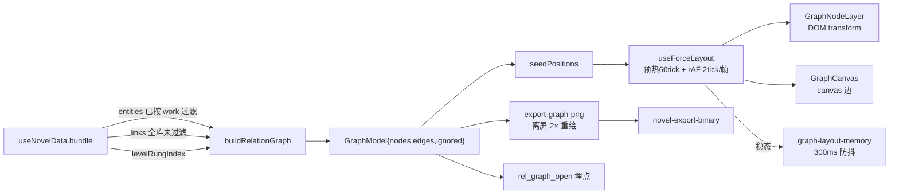
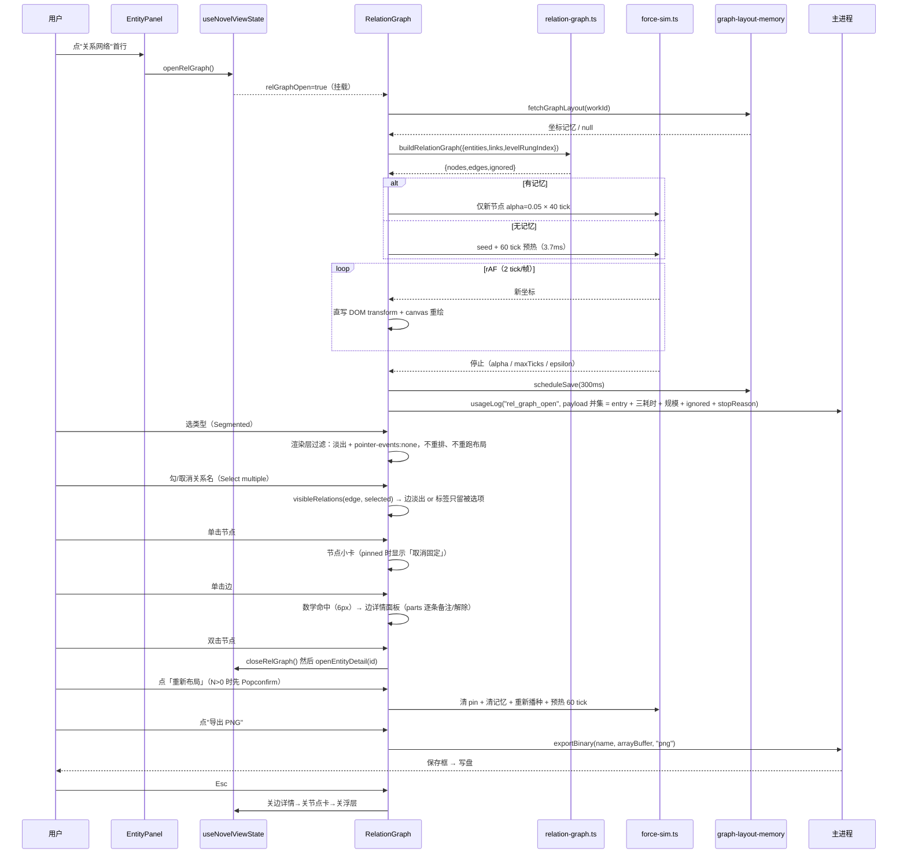

# R27 人物关系网络 · 技术预研与落点方案

> 📦 **已归档**（2026-10-23）：本文属 R27 人物关系网络的**立项过程稿**，功能已于 2.x 交付，
> 现行为准请看 `src/windows/RelationWindow/`、`AGENTS.md` 与 `CHANGELOG.md`。正文保持归档时原样；
> 文内 `docs/prd/...` 路径已失效，实际位于 `docs/archive/prd-r27/`。

> 状态：预研（不落地业务代码）／**v1.4 已按需求稿 v1.4 + QA 验收稿的 7 处冲突裁决对齐**
> 输入：`docs/prd/r27-relationship-network-scope.md`（需求稿 v1.4，691 行）+ `docs/prd/r27-relationship-network-acceptance.md`（QA 验收稿，133 用例）+ 仓库现状代码核对 + 本机实测尖刺
> 实测环境：Node v22.22.2 / Chromium（系统 Chrome，headless，视口 1000×720 画布）/ Windows
> 尖刺脚本位置：`C:/Users/A/AppData/Local/Temp/r27-spike/`（项目外，一次性，不入库；文中只引用数字）
> 修订记录见文末「附录 B」。

## 0. 与需求稿的对齐状态

预研 v1.0 落笔时需求稿尚未落盘，第 1 章的"已锁定结论"来自 team-lead 转述摘要。**需求稿 v1.1 现已补交并采纳了预研的 R2-1 / R2-2 两条修正**，预研 v1.1 据此做了 6 处修订（下表），v1.3 又按 QA 验收稿的冲突裁决追加 6 处（再下一张表）。两批修订都**不改结论，只改口径与落点**：

| 修订 | 位置 | 内容 |
|---|---|---|
| ① 手势冲突 | §6.3 | 预研 v1.0 把「双击节点」同时赋给"解除 pin"和"打开资料卡"（自相矛盾）。需求稿 I-04 拍板：**双击 = 打开资料卡**；解除 pin 走「小卡按钮」+「重新布局（带 N 个固定位置的确认气泡）」 |
| ② 节点口径 | §2.3、§3.3-G1、§5.4 | 需求稿采纳 R2-1 → 节点 = 本书**全部**要素（含孤立），孤立节点**虚线描边**、夹具改为 **11 节点 / 8 边 / 1 降级 / 2 孤立** |
| ③ 类型筛选选项 | §6.7.1、§12-Q12 | 预研 v1.0 的选项清单**漏了「等级体系」**；改为 `全部` + `filterOrder`（`novel-config.ts:173-180` 已含 `level_system`），并补「选项 > 8 降级为 `Select` 单选」 |
| ④ 关系名筛选 | §3.2、§3.3-G10、§6.7.2、§10 | 预研 v1.0 **完全没有落点**；补 `collectRelationOptions` 纯函数、`Select mode="multiple"`、`visibleRelations` 决定标签、任务 T04b |
| ⑤ 主题变量 | §9.1、§9.3 | 预研 v1.0 把画布底写 `--app-surface`、节点底写 `--app-surface-elevated`，违反 `themes.scss:18-26` 的分层铁律；改为 **浮层/画布底 `--app-bg`、节点底 `--app-surface`、描边 `--app-border-strong`**；类型色改引 `ENTITY_TYPE_META` 单一真相源 |
| ⑥ 可访问性缺口 | §9.5 | 预研 v1.0 漏了 `prefers-reduced-motion`（需求稿 §6.6 要求**单独实现**）；补三处降级：同步收敛给终态、开合无位移、搜索无脉冲 |

**v1.3 追加的 8 处（QA 验收稿报 7 处冲突，其中第 7 处是 `novel-link-note` 命名，team-lead 判"保留本文写法"→ 本文不改；余 6 处逐条裁决见 ⑦–⑫。改的过程中发现需求稿自身已升到 v1.3（R-4 评审裁决 4 条 + 附录 C），又与本文现有口径撞出 2 处，一并收在 ⑬⑭）**：

| 修订 | 位置 | 内容 |
|---|---|---|
| ⑦ 键盘可达性口径反转 | §4.2、§4.3、§1 | 「节点可 Tab 聚焦」**不再是选型理由**（需求稿 N-10 明确不做键盘全量导航）→ 节点 `tabIndex={-1}` 不进 tab 序，键盘可达性由工具栏/小卡/边详情（antd 默认可达）承担；DOM 节点结论不变，但"四条理由里只有 3 条成立"，正文已明写 |
| ⑧ 标签截断口径 | §5.4 | 原稿把"6 字截断"放在 201–400 档、≤200 档给完整标签；需求稿 L1 是**恒 6 字**。改为 **≤400 全部恒 6 字截断（悬停/选中显示全名）**，401+ 只画色点不画字 |
| ⑨ 平行边 label 示例写反 | §3.2、§3.3-G6 | `localeCompare("zh-Hans")` 升序下「亦」(y) 在「挚」(z) 前 → 正确顺序是 **「亦敌亦友 · 挚友」**；已改正示例并补 `compareRelation` 导出函数签名，防止实现照抄错例 |
| ⑩ 埋点 payload 取并集 | §5.6、§12-Q9 | 需求侧要 `entry`、预研要三个耗时，两边都缺对方 → 并集：`entry` + `nodeCount/edgeCount/ignored{level,dangling,selfLoop,duplicate}` + `deriveMs/firstPaintMs/settleMs` + `stopReason` |
| ⑪ >1200 裁剪拍板 | §5.4、§12-Q11 | 从"待确认"改为 **✅已定：做，但 P2**；口径收紧为"`degree` Top 500 **+ 额外保留全部孤立节点（上限 200）**"，并补齐需求稿的四项条件（明示 / **可一键展开** / 孤立不裁 / 仅 >1200）。**⚠️ 本条在 v1.4 又被改写为"五步降级 + ⑤ 可逆兜底"，最终以 ⑯ 为准** |
| ⑫ 边备注通道名保留 | §3.5 | `novel-link-note` 保留（`-set` 后缀已被 `novel-link-set` 的幂等替换语义占用）；QA 侧由 team-lead 统一改，本节不改 |
| ⑬ 降级顺序对齐需求稿 D3 | §5.4、§12-Q16、§10.2 | 本文 §5.4 原来只覆盖"① 降信息密度"；需求稿定成**五步不跳级**（①密度 → ②折叠孤立 → ③收窄到「角色」→ ④提示筛选 → ⑤可逆兜底）。补"触发 = 单一阈值 **>1200**"的映射表。**⚠️ 本条初版（v1.3 中途稿）曾把 ②③ 提前到 >400/>800，已被 team-lead 撤回**（见 ⑮），现有正文只有 >1200 一套触发 |
| ⑭ 名称截断单列一列 | §5.4 | QA 验收稿 C4 要求"§5.4 表格补一列名称截断"；已补（≤400 恒 6 字 / 401+ 不画字），使"密度档位"与"截断规则"不再混在同一格里 |

**v1.4 追加的 5 处（PM 否决"按 degree 裁剪"，team-lead 两轮更正后的最终口径）**：

| 修订 | 位置 | 内容 |
|---|---|---|
| ⑮ **撤回 400/800 分级** | §5.4、§12-Q16 | v1.3 中途稿曾把 ② 折叠孤立提到 >400、③ 收窄角色提到 >800 —— **team-lead 撤回**：需求稿 D3 的触发条件是**单一阈值 >1200**，且 401–800 档实测 p95 4.7ms 根本没到要"降级行为"的程度（那一档降的是可读性）。正文现在只有一套触发：**< 1200 只走信息密度，> 1200 才进五步** |
| ⑯ **>1200 五步 + ③ 守卫 + ⑤ 可逆兜底** | §5.4、§12-Q11 | ① 降密度 → ② 折叠孤立（可展开）→ ③ 收窄到「角色」（**守卫：`roleCount ≥ 200` 且 `roleCount/totalNodes ≥ 30%`，不满足则整步跳过**）→ ④ 提示自行筛选（`当前显示 X / 共 Y 个要素`）→ ⑤ `degree` Top 500 + 孤立全保留（上限 200）+ 提示条 **[显示全部]**，**仅当 ③ 已执行且收窄后仍 > 800 节点**才启用。删除本文此前"禁止/永不按 degree 裁剪"的表述，改为"**不做默认/静默裁剪，⑤ 是可逆兜底**" |
| ⑰ **A-14 可见性契约** | §5.4 | 五步每一步都必须**可见且可逆**：① hover 恒出全名 tooltip；② 提示条 `[展开]` ↔ `[收起]` 双向；③ `Segmented` 高亮当前档 + 「显示全部类型」出口（禁止做成隐藏状态）；④ 两个确定数字；⑤ 常驻提示条 + 可用的「显示全部」（**即使卡顿也只给性能警告，不得禁用**）。并加一个纯函数 `planDegrade()` 直接产出 `{step, visibleCount, totalCount, restorable}`，禁止让 UI 反推 |
| ⑱ §4.2 第②条理由替换 | §4.2 | 原"节点可 `:focus-visible` / Tab 可达"在 N-10 下不成立（已删）。PM 要求换成真实理由 → 改为"**hover 全名 tooltip / 文本清晰度**：DOM 直接挂 antd `Tooltip`、字号吃 `--app-text`，canvas 要自绘气泡并处理边界翻转与层级"。节点仍 `tabIndex={-1}`、不进 tab 序（键盘可达性走工具栏/小卡/边详情），"可 Tab"这一条永久删除 |
| ⑲ 三处收口 | §3.5、§5.6、§10.1 | ① `novel-link-note` 定死（通道名唯一），并写明 **preload/service 的方法名 `linkNoteSet` 不是通道名**，避免验收把两者混为一谈；② 埋点 payload **不加 `workId`**（`usageLog` 上下文已有作品维度），保持并集口径；③ `RelationGraph/index.scss` 用了 `--app-surface-elevated` → **必须加进 `src/shared/theme/themes.test.ts:430-443` 的 `ELEVATED_ALLOWED`**，否则主题守卫直接红 |

---

## 1. 结论先行

| 决策点 | 结论（一句话） |
|---|---|
| 视图承载 | 页内全宽覆盖层：`RelationGraph` 绝对定位挂进 `.nv-page__body`（`position: relative`，`NovelPage/index.scss:41-48`），`inset: 0` + `z-index: 40`；不进 `EditorPane`、不卸载编辑器、**不用 antd Modal/Drawer** |
| 渲染技术 | **混合**：节点 = 绝对定位 DOM（`transform: translate3d`，世界坐标），边 = 独立的 `<canvas>` 层；实测 200 节点/500 边每帧 `sim+render` **0.91ms（p95 1.2ms）** |
| 布局算法 | **自研三力模型**（charge 斥力 + 边弹簧 + 向心引力，d3-force 同款速度 Verlet），不引 d3-force |
| 新增依赖 | **零**（`d3-force` 亦不装：在 ≤800 节点规模 quadtree 是负收益，实测 200 节点网格近似 56.2ms vs 直接求和 23.9ms） |
| 数据派生位置 | 纯函数 `utils/relation-graph.ts`（无 React，可单测）：`bundle + activeWorkId → {nodes, edges, ignored}` |
| 持久化 | config 键 `novel_rel_graph_layout`，`Record<workId, {v, ts, nodes:{id:[x,y,f]}}>`，整读整写 + 300ms 防抖（对齐 `novel_panel_width` 范式）；实测 200 节点 **5.9KB** |
| 导出 | **新 IPC `novel-export-binary`**（现有 `novel-export-file` 是 `utf8` 纯文本，`novel-handlers.ts:1639` 写不了二进制）；数据由**离屏 canvas 2× 重绘 → `toBlob`** 得到，实测 2× **105ms / 2.2MB** |
| 边备注 | **新 IPC `novel-link-note`**（单列 `UPDATE novel_links SET note`）；**绝不复用 `novel-link-set`**（四元组先清后插会误删平行边，`novel-pack-handlers.ts:646-648`） |
| 筛选 | 两道，都是渲染层过滤、不重排布局：**类型（P0，`Segmented` 单选，选项 = 全部 + `filterOrder` 含等级体系，>8 项降级 `Select`）**、**关系名（P1，`Select multiple`，选项由边集长出）** |
| 分工线 | 节点 = DOM（吃主题变量、`pointerCapture` 拖拽、类型色同源；**不进 tab 序**）；边 = canvas（每帧全量重绘、数学命中 6px）；控件 = antd；坐标相关的一切 = 自绘 |
| 可访问性 | `prefers-reduced-motion` **单独实现**（不能靠全局开关）：同步算完直接给终态、开合无位移、搜索无脉冲；**节点不进 tab 序**（`tabIndex=-1`），键盘可达性由工具栏/小卡/边详情承担 |
| 规模降级 | **单一触发 = 节点数 > 1200**（需求稿 D3）。**< 1200 只降"信息密度"**（120/200/400/800 四个边界：角标 → 边样式 → 不画字），**不折叠、不收窄**。> 1200 才按序走五步：① 降密度 → ② **折叠孤立要素**（可展开/收起）→ ③ **收窄到「角色」**（守卫 `roleCount ≥ 200` 且占比 ≥ 30%，否则跳过）→ ④ 提示"当前显示 X / 共 Y 个要素" → ⑤ **可逆兜底**：`degree` Top 500 + 孤立全保留（上限 200），**仅当 ③ 已执行且收窄后仍 > 800** 才启用。**不做默认/静默裁剪**，每步都可见且可逆 |
| 分期 | P0 派生+布局+渲染+开关+入口+类型筛选 → P1 拖/缩/搜/选/持久化/关系筛选/**降级②③** → P2 导出 + 边备注 + 埋点 + **>1200 超大图裁剪（Q11 拍板：做，但 P2）** |

---

## 2. 现状代码事实核对

### 2.1 已核对事实（上游给的 11 条，逐条复核通过/修正）

| # | 事实 | 出处（文件:行） | 对方案的影响 |
|---|---|---|---|
| F1 | `entities` 按 `activeWorkId` 过滤；**`links` 不过滤**（`bundle.links` 是全库） | `hooks/useNovelData.ts:385-390` | 派生层必须**用"两端 id 是否落在本书要素集"过滤**，不能按 `workId`（见 F12）——这条是边口径的唯一正确实现方式 |
| F2 | `getEntityRelations` 已处理 `type === "level"` → 查 `levelRungIndex` | `hooks/useNovelData.ts:1801-1820` | 等级关联是真实旁路数据；图里必须**降级为节点副标题**而非边，否则会出现"指向不存在的节点"的悬空边 |
| F3 | `addLink` 双向去重（A→B 与 B→A 同 relation 视为重复），**无自环守卫** | `hooks/useNovelData.ts:1164-1196` | 见 Q-02：补自环早退；同时派生层不能依赖它（历史遗留数据可能有自环） |
| F4 | `NovelLink.fromType/toType` 是 `EntityType = BuiltinEntityType \| (string & {})`，类型层面**没有** `level`/`chapter` | `types.ts:12-25`、`types.ts:168-177` | 「类型撒谎」：DB 里 `to_type='level'` 是存在的（`novel-template.ts:867`）。收敛方式 = **派生层做显式 `toType === "level"` 分支 + 白名单校验**，不改 `NovelLink` 类型（改类型会波及 `setting-*` 全链路，违反"不新增列"承诺的心理边界） |
| F5 | 导出通道 `novel-export-file` = `showSaveDialog` + `fsp.writeFile(path, content, "utf8")`，**纯文本** | `electron/handlers/novel-handlers.ts:1617-1642`；`electron/preload.ts:227-228` | PNG 不能复用 → 必须新增二进制通道（§8） |
| F6 | `novel-link-set` 走 `upsertRealmLinkRow`：`DELETE WHERE from_type+from_id+to_type+relation` 再 INSERT | `electron/handlers/novel-pack-handlers.ts:644-653`、`:1954-1986`；`preload.ts:248-249` | **边备注绝不能用它**：删条件是四元组，会把同端点的平行边（「挚友」「亦敌亦友」）一起删掉。见 Q-03 |
| F7 | 右栏 `SupportPanel` 五 Tab（大纲/要素/灵感/检索/工具）；`PanelTab` 与 `openEntityDetail` 在 view state | `components/SupportPanel/index.tsx:1-80`；`hooks/useNovelViewState.ts:9-15`、`:189-193` | 入口放 `EntityPanel` 首行；`openEntityDetail` 会 `setRightOpen(true)` + 切 tab，浮层与资料卡的联动必须显式处理先后顺序（§6.6） |
| F8 | config 键集中在 `STORAGE_KEYS`，按作品范式见 `namingFavorites` / `workNumbering` | `src/shared/novel/constants.ts:16-46` | 新键加在第 45 行 `guideState` 之后；`Record<workId,T>` 整读整写是既有范式 |
| F9 | 四套主题 `--app-*` 变量（aurora/cream/mint/midnight） | `src/shared/styles/themes.scss:85,171,255,342`（变量清单 `:87-166`） | 节点/边/底色只从 `--app-*` 派生；**canvas 不吃 CSS 变量**，必须桥接（§9.1） |
| F10 | 依赖：`antd 6.6.2` / `react 19.2.6` / `react-virtuoso` / `@dnd-kit` / `framer-motion` / `zustand`；无 d3 系列 | `package.json:56-79` | 零新增依赖可行（§4 已用实测排除引入理由） |
| F11 | 夹具：`novel-template.ts` 11 要素（3 角色/2 地点/2 势力/2 物品/1 等级体系/1 自定义）+ 8 条实体关联 + 1 条境界绑定 | `electron/novel-template.ts:843-868` | 8 条实体边涉及 **9 个不同要素 id**；孤立要素 2 个（`tpl-e-sys-lingtu`、`tpl-e-custom-calendar`）→ 见 R2-1 修正 |

### 2.2 我新查到、且直接影响方案的

| # | 事实 | 出处（文件:行） | 对方案的影响 |
|---|---|---|---|
| F12 | **`novel_links` 表没有 `work_id` 列**（只有 `from_type/from_id/to_type/to_id/relation/note`） | `electron/novel-db.ts:152-160` | 这是「按作品过滤」唯一可行的口径来源：**只能通过实体 id 归属反推**。也解释了为什么 `useNovelData` 干脆不过滤 links |
| F13 | `novel_links` 只有 `from_type+from_id`、`to_type+to_id` 两个索引，`note` 可空 | `electron/novel-db.ts:161-162` | 图数据是一次性全量读（几十~几百行），无需新索引 |
| F14 | **`ToolLauncher` 里已经有「人物关系网络 · 规划中 · R27」占位卡，点击弹 toast「还在规划中」** | `components/SupportPanel/components/ToolLauncher/index.tsx:58-67` | ⚠️ 与"入口只放 EntityPanel 首行"**冲突**：上线后这张卡会变成永久的自相矛盾文案。必须一起改，且会打断既有测试（F15） |
| F15 | `ToolLauncher` 测试断言"点人物关系网络 → 弹『规划中』toast" | `ToolLauncher/index.test.tsx:49-63` | 改入口时这条测试必须同步改，否则红 |
| F16 | Esc 关闭链是显式白名单：设定中心 → 排版 → 快照 → 专注模式 | `hooks/useNovelPage.ts:1214-1232` | 图的 Esc 必须**插在链首**（最上层浮层），否则会穿透去关排版抽屉 |
| F17 | 顶栏点击捕获统一调 `dismissPageOverlays`；有 `data-page-overlay-keep-open` 例外约定 | `components/NovelTopBar/index.tsx:71-80`、`:126-133`；`useNovelViewState.ts:255-262` | 图的"点顶栏即离开"可以零成本复用；但**不要把 `relGraphOpen` 塞进 `pageOverlayOpen`**（那会把顶栏抬到 1600，而图本来就不盖顶栏） |
| F18 | `focusMode` 通过 `effectiveLeftOpen/effectiveRightOpen` 让左右栏让位；F11 被 `useNovelShortcuts` 拦截并 `preventDefault` | `useNovelViewState.ts:269-277`；`useNovelShortcuts.ts:88-92` | F11 在浮层打开时仍会触发专注模式（左右栏收起）→ 图是 body 内全宽，**不受影响、不需要特判**；但需要明确定义"F11 不关图" |
| F19 | 类型色板在 `EditorPane/index.scss:224-244` 静态定义：character→`--app-primary`、location→`--app-accent-green`、faction→`--app-accent-purple`、item→`--app-accent-amber`、level_system→`--app-accent-blue`、custom→`--app-text-secondary`；`ct-*` 走 inline `--nv-mark-color` | `EditorPane/index.scss:206-244`；`annotation-color.test.ts:29-40` | 图的类型色**必须复用同一张映射表**，否则"正文高亮是绿的、图里是蓝的" |
| F20 | 构建产物现状（`dist/assets`，2025-10-17 构建）：`antd-*.js` **1.4MB**、`novel-*.js` **520KB**、`novel-*.css` **148KB**，assets 合计 3.3MB | 本机 `du -h dist/assets/*` 实测 | 零新增依赖的收益：不往 520KB 的 novel chunk 里再塞 15–1400KB（§4 对比表） |
| F21 | 项目内**已有 canvas 绘制先例**（海报引擎）但**没有 PNG 导出先例**（全仓无 `toDataURL`/`toBlob` 落盘链路）；二进制写盘先例在 `memo-handlers.ts:227`（`fs.writeFileSync(target, buffer)`，但是 memo 专用路径） | `PosterWidget/posterEngine.ts:278`；`memo-handlers.ts:191-233` | 导出链路要从零搭；主进程 `Buffer` 写法可参考 memo，但**通道不能复用**（memo 的保存路径由 `ensureMemosDir()` 决定） |
| F22 | `novel-config-get/set` 是 `string → string \| null`，DB 未就绪时静默跳过 | `electron/preload.ts:92-94`；`novel-handlers.ts:564-580` | 布局记忆的读写失败必须静默（与 `fetchPanelWidth().catch(() => {})` 同款，`useNovelViewState.ts:88-95`） |
| F23 | 埋点通道现成：`usageLog(event, payload)` → `novel-usage-log`，无事件白名单 | `preload.ts:229-232`；`novel-handlers.ts:1683-1686` | `rel_graph_open` 直接走它，**不需要新表新列** |
| F24 | `src/shared/novel/*` 现无 React 依赖，且存在源码守卫测试（`src/shared` 不 import `src/windows`） | `src/shared/novel/work-numbering-guard.test.ts:1-40`（同类手法）；`src/shared/novel/` 目录清单无 `.tsx` | 派生函数**不放 shared**：它要 import `NovelPage/types.ts`（`src/windows` 内），放 shared 会破边界 → 放 `NovelPage/utils/` |

### 2.3 修正（上游判断与本机代码/实测不一致的地方）

**R2-1（节点口径，重要）— 已由需求稿 v1.1 采纳** — 上游 v1.0 的"夹具期望 9 节点 / 8 边 / 1 条被忽略"与代码事实有半格偏差：
- 模板共 **11** 个要素（F11）；8 条实体边涉及 **9** 个要素 id；`toType='level'` 那条绑定 1 条（被忽略）。
- 所以"9 节点"隐含了规则「**只画参与至少一条边的要素**」。这条规则**产品上很危险**：用户新建一个角色、还没连线时，图里看不到他，第一反应是"坏了"。而模板里被隐掉的 2 个（等级体系实体、自定义实体）恰恰都是"没有关联"的要素。
- **结论（已拍板）**：节点 = 本书**全部**要素，孤立节点的边数 = 0 但**必须成节点**，用**虚线描边 + `--app-text-muted` 文字**与已连接节点区分（需求稿 §6.1、I-13）。夹具口径 → **11 节点 / 8 边 / 1 条降级 / 2 个孤立**。

**R2-2（入口不止一处）— 已由需求稿 v1.1 采纳** — `ToolLauncher` 已有"规划中"卡（F14），上游 v1.0 只写 `EntityPanel` 首行。二者不冲突但需一起改，否则上线即自相矛盾。**结论（已拍板）**：双入口、单一 opener，占位卡按三期切换（需求稿 §3.4.2/§3.4.3 给了逐条测试断言改法）。实现见 §6.1。

**R2-3（跨作品守卫可能是死代码）** — 上游问 Q-02 是否在 `addLink` 加"跨作品校验"。核对后：`EntityDetail` 的关联目标下拉数据源是 `entities`（已按 work 过滤，`useNovelData.ts:386-389`），且已排除自身（`EntityDetail/index.tsx:205`）→ **UI 路径根本造不出跨作品边**。真正的跨作品口子在主进程（`novel-link-set`，已有守卫 `electron/novel-setting-guard.test.ts:156`）。结论见 §3.4。

---

## 3. 数据通路设计

### 3.1 分层与文件

```
bundle(novel_entities + novel_links)        ← useNovelData 已给出（links 未过滤）
        │
        ├─ buildRelationGraph(input)        ← utils/relation-graph.ts（纯函数，零 React）
        │        ├→ { nodes, edges, ignored }        ← 可单测 / 可快照
        │        └→ collectRelationOptions(edges)    ← 关系名筛选的选项（去重 + 频次降序）
        │
        ├─ seedPositions(nodes) / stepLayout()  ← utils/force-sim.ts（纯函数，零 DOM）
        │
        └─ RelationGraph/index.tsx  ── useForceLayout（rAF 循环）
                                    ├─ GraphNodeLayer（DOM 节点，写 transform）
                                    ├─ GraphCanvas（canvas 边 + 命中）
                                    ├─ GraphToolbar（类型筛选 / 关系筛选 / 视图操作 / 导出）
                                    └─ useGraphViewport（pan/zoom/fit）
```

放 `NovelPage/utils/` 而不是 `src/shared/`：需要 `NovelPage/types.ts` 的 `NovelEntity/NovelLink/EntityType`，而 `src/shared` 不得 import `src/windows`（F24）。两个纯函数文件都**不含 React、不碰 DOM**，满足"可单测且不依赖 React"。

### 3.2 类型与签名

```ts
// utils/relation-graph.ts
import type { EntityType, NovelEntity, NovelLink } from "../types";

export interface GraphNode {
  id: string;
  type: EntityType;      // 内置六类或 ct-*（原样透传）
  name: string;
  /** 等级关联降级来的副标题，如「凝丹（境界体系）」；无则 undefined */
  subtitle?: string;
  degree: number;         // 参与边数（平行边合并后）；0 = 孤立要素（画虚线）
  /** 搜索匹配用（与 EntityPanel.matchKeyword 同口径：名称 + 别名 + 一句话），不渲染 */
  search: { aliases: readonly string[]; summary: string };
  /** 确定性播种用的初始位置（世界坐标） */
  seed: { x: number; y: number };
}

export interface GraphEdge {
  id: string;             // link.id（平行边合并时取排序后第一条的 id）
  source: string;
  target: string;
  /** 平行边合并后的标签，如「亦敌亦友 · 挚友」（顺序见 compareRelation） */
  label: string;
  /** 合并进来的全部 (link.id, relation)，供"点边 → 逐条编辑备注/解除"定位 */
  parts: Array<{ linkId: string; relation: string; note?: string }>;
}

/**
 * 平行边合并时的标签顺序：`a.localeCompare(b, "zh-Hans")` **升序**（拼音序）。
 *
 * ⚠️ 别写成「挚友 · 亦敌亦友」：升序下「亦」(yi) 在「挚」(zhi) **之前**，
 *    输入 ["挚友", "亦敌亦友"] 的正确输出是 **「亦敌亦友 · 挚友」**。
 * ⚠️ 也别用 `localeCompare` 的默认 locale（不带第二参）：默认 locale 随运行环境
 *    变化（CI 上可能是 en），中文串的比较结果不稳定，快照测试会偶发失败；
 *    更不能用"插入顺序"（= links 数组顺序，随写入时间漂移）。
 */
export const compareRelation = (a: string, b: string): number => a.localeCompare(b, "zh-Hans");

export interface GraphIgnored {
  /** 两端不全在本书要素集内（跨作品 / 悬空） */
  dangling: number;
  /** fromId === toId */
  selfLoop: number;
  /** toType === 'level' 且成功降级为副标题 */
  levelBinding: number;
  /** 同一 (端点和, relation) 的重复行 */
  duplicate: number;
  /** 本书内没有任何边的要素数（仅用于提示条文案；这些要素**仍然成节点**） */
  isolated: number;
}

export interface GraphModel {
  nodes: GraphNode[];
  edges: GraphEdge[];
  ignored: GraphIgnored;
}

export interface BuildGraphInput {
  entities: readonly NovelEntity[];          // 已按 workId 过滤（直接吃 useNovelData.entities）
  links: readonly NovelLink[];               // 全库，未过滤（直接吃 useNovelData.links）
  levelRungIndex: ReadonlyMap<string, { name: string; systemName: string }>;
}

export function buildRelationGraph(input: BuildGraphInput): GraphModel;

/**
 * 关系名筛选的选项：从**当前边集**里真实出现的 relation 去重 + 频次降序。
 *
 * relation 是自由文本（`novel_links.relation TEXT NOT NULL`，无枚举无约束，
 * `novel-db.ts:158`），所以**不能内置候选值**；只能从数据里长出来。
 * 频次降序是为了让"出现 30 次的主线关系"排在"出现 1 次的临时关系"前面。
 * 频次相同按字典序，保证选项顺序稳定（否则每次渲染顺序抖动）。
 */
export interface RelationOption {
  relation: string;
  count: number;
}

export function collectRelationOptions(edges: readonly GraphEdge[]): RelationOption[];
```

> `GraphNode.search` 只带匹配用的两个字段、不带 `content`：搜索范围与 `EntityPanel.matchKeyword` 严格一致（`EntityPanel/index.tsx:64-71`），带 `content` 会让 200 个节点的派生物体积翻几倍，而搜正文是 `SearchPanel` 的职责。

### 3.3 派生规则（逐条可断言）

| 规则 | 内容 | 断言点 |
|---|---|---|
| G1 | `nodeSet = new Set(entities.map(e => e.id))` —— **本书全部要素都成节点，含 degree=0 的孤立要素** | 只有本书要素能成节点；孤立要素不被隐掉（R2-1 已拍板） |
| G2 | 边保留条件：`nodeSet.has(fromId) && nodeSet.has(toId)` | **一次性消灭悬空边 + 跨作品边**（因为 `novel_links` 无 `work_id`，这是唯一正确口径，F12） |
| G3 | `toType === "level"` 的 link **不建边**：若 `nodeSet.has(fromId)` 且 `levelRungIndex.get(toId)` 命中 → 写 `node.subtitle = `${rung.name}（${rung.systemName}）``（与 `useNovelData.ts:1811` 的文案完全一致）；不命中则计入 `ignored.levelBinding` 但不产生可见物 | 夹具：`tpl-l-9` → 沈砚 subtitle = 「凝丹（境界体系）」 |
| G4 | 自环 `fromId === toId` → 丢边，`ignored.selfLoop++` | 历史脏数据免疫 |
| G5 | 重复行：`(min(fromId,toId), max(fromId,toId), relation)` 相同只留一条（与 `addLink` 的**双向**去重口径一致） | `ignored.duplicate` |
| G6 | 平行边（同端点、不同 relation）→ **合并为一条** `GraphEdge`，`label` 用 ` · ` 连接，`parts` 也按同一顺序排列：**`compareRelation` 升序（`localeCompare(b, "zh-Hans")`，拼音序）**。例：`["挚友", "亦敌亦友"]` → 「**亦敌亦友 · 挚友**」（"亦"y 在"挚"z 前）。`parts` 保留每一条的 `linkId/relation/note` | 不合并会画出完全重叠的线，点击时只能命中最近一条，用户永远点不到第二条；`parts` 保证合并后每一条仍可单独编辑/解除。**顺序必须确定性**：用默认 locale 或插入顺序都会让快照测试随环境/写入时间漂移 |
| G7 | 节点输出顺序：按 `type`（内置六类固定序，`ct-*` 排后按 id）→ `sort` → `id`；边按 `id` | 同一输入两次派生字节级相等（快照测试可用） |
| G8 | `degree` 按"合并后"的边计算 | 与渲染的视觉权重一致 |
| G9 | `seed` 确定性播种：按类型分组，同组元素在半径 `120 + 类型序 * 90` 的圆环上均分角度（`2π * i / n`）；不用随机数 | 首帧就有结构、且可测（同一数据两次打开位置一致） |
| G10 | `collectRelationOptions(edges)`：`relation` 去重 + 频次降序（同频按字典序） | 选项顺序稳定，可快照；**不内置任何候选值**（relation 是自由文本，`novel-db.ts:158`） |
| G11 | 类型筛选 / 关系筛选 / 搜索都是**渲染层过滤**，**不重跑派生、不重跑布局** | 需求稿 I-08③ / I-08b：筛选只淡出，不重排；否则每切一次筛选图都"跳"一下 |

> 关于 G9 的取舍：随机播种（d3 默认）首帧是一团噪声，预热 60 tick 后才成形；圆环播种首帧就"像一张图"。实测两种播种的收敛 tick 数差异 < 15%，成本可忽略。

### 3.4 Q-02 结论：自环守卫改，跨作品守卫不改（在渲染层）

| 守卫 | 结论 | 落点 | 影响面评估 |
|---|---|---|---|
| 自环早退 | **改** | `useNovelData.ts` 的 `addLink`，在 `if (!bundle) return false;` 之后加 `if (fromId === toId) return false;` | ① `EntityDetail` 下拉已排除自身（`:205`）→ 零行为变化；② 模板导入不经 `addLink`（主进程直接 INSERT，`novel-handlers.ts:1414-1421` 是渲染层调用的同一条，但模板走 `resetTemplateBook`）→ 不受影响；③ 返回 `boolean` 契约不变（`false` 本就是"没加成"） |
| 跨作品校验 | **不改** | 不加到 `addLink` | 渲染层唯一调用点 `EntityDetail` 的数据源已被 work 过滤（R2-3）→ 加了是**永不触发的死代码**；真正的入口在主进程 `novel-link-set`，那里已有跨作品守卫（`electron/novel-setting-guard.test.ts:156` 为证）。**代价更低的替代**：`buildRelationGraph` 的 G2 已天然免疫任何跨作品脏边 —— 把防线放在派生层，比在写入层加一个测不到的分支划算 |
| 类型撒谎（F4） | **不改类型，改派生层** | `buildRelationGraph` 内 `toType === "level"` 显式分支 + `toType` 只接受「内置六类 ∪ `ct-` 前缀 ∪ `level`」，其余计入 `ignored.dangling` | 改 `NovelLink` 类型会波及 `setting-mappers`、`getEntityRelations`、行囊境界全链路，收益（类型更准）远小于风险 |

### 3.5 Q-03 结论：边备注写入通道

**新通道 `novel-link-note`，不复用任何既有通道。**

```ts
// electron/handlers/novel-handlers.ts（新增，紧邻 1414-1427 两条 link 通道）
ipcMain.handle("novel-link-note", (_event, id: string, note: string | null): boolean => {
  const value = note && note.trim() ? note.trim() : null;   // 空串归一化为 NULL
  const info = dbRun("UPDATE novel_links SET note = ? WHERE id = ?", [value, id]);
  return info.changes > 0;
});
```

| 项 | 结论 |
|---|---|
| 通道名 | `novel-link-note`（采纳需求侧建议名，**v1.4 定死，不再讨论**）。**刻意不叫 `novel-link-note-set`**：`-set` 后缀在本仓已被 `novel-link-set` 占用为"幂等替换语义"，备注只改一列、不替换任何东西，共用后缀会让人误以为两者同族、可以互换 |
| 通道名 ≠ 方法名 | 唯一 IPC 通道名是 `novel-link-note`（三处必须一字不差：`ipcMain.handle` / `ipcRenderer.invoke` / `electron.d.ts` 的类型）；preload 与 service 暴露的 **JS 方法名叫 `linkNoteSet`**（它是"写备注"的动词，不是通道）。QA 断言"三处同名"时请断言**通道名**，不要断言方法名 |
| SQL | `UPDATE novel_links SET note = ? WHERE id = ?`（单字段单行，无 INSERT → 不可能制造重复行） |
| 幂等规则 | 以 `link.id` 为主键定位；重复写同值 `changes` 仍为 1（SQLite 语义），无副作用；`null`/空串统一落 `NULL` |
| 是否与 `novel-link-set` 共用事务 | **不共用、不改造**。`upsertRealmLinkRow` 的 DELETE 条件是四元组（`novel-pack-handlers.ts:646-648`），跑一次就会把同端点同关系名之外的所有平行边留下、把**同组**的删掉 —— 用它写备注等于用删除键改字。备注只改一列，不需要事务 |
| preload | `linkNoteSet: (id: string, note: string \| null) => ipcRenderer.invoke('novel-link-note', id, note) as Promise<boolean>`（挂在 `novel` 命名空间，紧邻 `preload.ts:130-131`） |
| 渲染层 | 乐观更新 `bundle.links` 的 `note`；`changes === 0` 时（行已不存在）回滚 + toast「该关联已被删除」 |
| 平行边合并后怎么写 | `GraphEdge.parts` 提供全部成员：单击边 → 弹出小面板列出「挚友」「亦敌亦友」两行，各自可编辑备注 / 解除。**这是 G6 合并的直接后果，必须一并实现**，否则合并会让第二条边变得不可编辑 |
| 备注上限 | **200 字**（需求稿 I-08c③）；`Input.TextArea maxLength={200} showCount`，超长截断而不报错。DB 列是 TEXT 无长度约束（`novel-db.ts:159`），所以上限只能靠 UI 守 —— 主进程不再二次校验，避免"UI 允许、主进程拒绝"的分裂 |
| 「解除」 | `Popconfirm` 二次确认（破坏性且不可撤销，需求稿 I-08c⑤），复用既有 `novel-link-remove`（`novel-handlers.ts:1424-1427`），**不新增通道** |
| 编辑中 `Esc` | **先关边详情面板**，不关整个浮层（需求稿 I-08c④）→ 落到 §6.6 的 Esc 三级链第一级 |

---

## 4. 渲染方案选型

### 4.1 候选与实测

实测口径：同一份三力模型 + 同规模随机图，每帧 `sim(1 tick) + render()` 的**主线程耗时**（`performance.now()` 包住），50–90 帧取平均/p95。单位 ms。60fps 预算 16.7ms/帧，**安全线取 p95 ≤ 8ms**（留一半给 React/antd/CodeMirror）。

| 方案 | bundle 增量（min / gzip） | 200 节点 500 边（avg / p95） | 800 节点 2000 边（avg / p95） | 风格可塑性 | `--app-*` 适配 | 维护成本 | 依赖风险 |
|---|---|---|---|---|---|---|---|
| **A. 纯 SVG + 自研力导向** | 0 | **3.4 / 4.0** | 14.5 / 19.1 ❌ | 高（CSS 直接可控） | 直接可用 | 低（<400 行） | 无 |
| **B. SVG + d3-force** | +15.4KB / +5.7KB gzip（3 依赖） | ≈3.4 / 4.0（渲染同 A，仅布局换成 d3） | 同上 ❌ | 高 | 直接可用 | 中（多一层 API，且 quadtree 在目标规模负收益：200 节点实测 **56.2ms vs 23.9ms**） | 低（d3 稳定），但 `minimumReleaseAgeExclude` 白名单机制要新增条目（`pnpm-workspace.yaml:22-24`） |
| **C. Canvas 全绘制** | 0 | **0.20 / 0.30** | **2.0 / 2.2** | 中（阴影/圆角要手写，文字不能用 CSS 字号 token） | 需桥接（canvas 不吃 `var()`） | 中（交互全手写：命中、悬浮、文字截断） | 无 |
| **D. 混合（DOM 节点 + Canvas 边）** | 0 | **0.91 / 1.2** | **4.4 / 4.7** | 高（节点=DOM，边=canvas） | 节点直接可用，边桥接 | 中低 | 无 |
| E. `@antv/g6` 5.1.1 | +1.40MB / +400KB gzip（11 依赖，26 个近似依赖） | 未测（同等规模远超 A/C 的固定开销，估算 +8–15ms） | — | 中（主题需二次适配） | 需 theme 映射层 | 高（框架级 API + 版本大跨） | **高**：11 个 `@antv/*` 直接依赖，与 `hoisted` + npmmirror 的组合是长时间不确定因素 |
| F. `cytoscape` 3.34.4 | +435KB / +137KB gzip（0 依赖） | 未测（内部自带渲染器与事件系统） | — | 中 | 需 theme 映射层 | 中高 | 中：体积是 novel chunk（520KB）的 26% |
| G. `react-force-graph-2d` 1.29.2 | +181KB / +60KB gzip（3 依赖，31 个近似依赖） | 未测 | — | 低（画布式，样式走 props） | 需 theme 映射层 | 中 | 中高：内部含 `preact` + `d3-*` 全家桶 |

> 体积数据来源：bundlephobia（npm 官方包，非本项目 tree-shake 后结果，标注为**公开包体积**）；帧数据为本机实测。

### 4.2 推荐：**D. 混合（DOM 节点 + Canvas 边）**

理由（按权重排）：

1. **性能余量最大且线性**：目标规模 200/500 是 0.91ms（p95 1.2ms），离安全线 8ms 有 **6.6 倍**余量；到 1200 节点 3000 边才 8.3ms 触线。而 A 在 800 节点就 p95 19.1ms（掉帧）。
2. **节点必须是 DOM 的四条理由（v1.4 更新：原第②条"节点可 Tab 聚焦"已删除，换成一条真实理由）**：① 12px 中文标签要跟 `--app-text` / 主题字号走，canvas 得手写字体栈；② **hover 全名 `Tooltip` + 文本清晰度**——名称恒 6 字截断（需求稿 §6.2-L1）所以悬停必须能出全名，DOM 直接挂 antd `Tooltip`（自动处理定位、边界翻转、层级、主题），canvas 得自绘气泡并把这四件事逐个实现；③ 拖拽用 `pointerdown` + `setPointerCapture`，DOM 天然支持，canvas 要自己写手势状态机；④ 节点内的类型色点直接吃 `--app-accent-*`，与正文高亮同源（F19）。
   > **键盘可达性不在上面四条里，且永久不再作为理由**：需求稿 N-10 明确"不做键盘全量导航"，200 个 tabstop 的键盘噪音比收益大 —— **节点不进 tab 序（`tabIndex={-1}`），键盘可达性由工具栏、节点小卡、边详情面板承担（antd 组件默认可达）；节点保留 `:focus-visible` 样式以备将来开启**。无障碍路径是"搜索命中 → 居中 → Enter 开小卡"，不是"Tab 逐个遍历"。
3. **边必须是 Canvas 的理由**：边数恒为节点数的 2.5 倍左右且每帧都在变，SVG `path@d` 全量重写的成本随边数线性上升（实测 800 节点时 SVG 边贡献了 A 方案 14.5ms 里的大头）；canvas 单次 `beginPath + stroke` 一次批处理 2000 条边只要 2ms。
4. **导出天然可行**：边已在 canvas 上，导出时把同一套绘制函数重放到 2× 离屏 canvas 即可，**完全绕开 `var(--app-*)` 序列化难题**（§8）。
5. **零依赖**：不碰 `pnpm-workspace.yaml` 的 `minimumReleaseAgeExclude` 白名单，不动 lockfile，Review 面最小。

### 4.3 为什么淘汰其余

| 淘汰 | 决定性原因 |
|---|---|
| A. 纯 SVG | 800 节点 p95 19.1ms（实测），且边的重绘成本随边数线性增长；而产品的"要素多"恰恰是高频场景（一本 100 万字长篇 200+ 要素是常态）。**但保留为降级后备**：>400 节点时**不要**降级到 A，A 比 D 更差 |
| B. SVG + d3-force | d3-force 的 quadtree 在 ≤800 节点是**负收益**（实测 200 节点：直接求和 23.9ms / 网格近似 56.2ms，800 节点才反超 291→199ms）。也就是说，引入 d3 换不到性能，只换来"少写 300 行"。而"少写 300 行"被两件事抵消：① 我们需要的自定义（确定性播种、`degree` 加权弹簧、pin、局部 reheat）d3 都要绕；② 多 3 个依赖 + 白名单条目 |
| C. Canvas 全绘制 | 交互全手写：命中检测、hover、拖拽、文字截断；且**节点小卡（I-04）本身必须是 DOM 组件** —— 用 canvas 画节点却仍要叠一层 DOM 小卡，等于同时维护两套坐标系与两套选中态，比混合方案更复杂。实测命中扫描很便宜（500 边全扫 **0.0159ms**），所以它不是"性能不行"，而是"0.20ms vs 0.91ms 的差距在 8ms 预算内换不到任何东西，却要多写一套交互" |
| E. @antv/g6 | +400KB gzip 是现有 novel chunk（520KB raw / 估算 ~150KB gzip）的近 3 倍；11 个直接依赖；主题要写一整层映射。为"画 200 个点 500 条线"付这个代价不成比例 |
| F. cytoscape | +137KB gzip、0 依赖算是体面的，但它的布局/渲染/事件全自持，样式走自己的 stylesheet DSL，与 `--app-*` 之间还要一层翻译；且节点文字仍是 canvas（主题映射成本同 C） |
| G. react-force-graph-2d | 依赖树里含 `preact`（与项目 React 19 并存的第二份运行时）+ `d3-*` 全家桶 + `bezier-js` + `tinycolor2`；样式只能走 props，主题适配成本最高 |

---

## 5. 性能预算与达成路径

### 5.1 实测基线（本机，`C:/Users/A/AppData/Local/Temp/r27-spike/`）

**布局（纯 JS，Node 22）** — 三力模型跑到 `alpha < 0.001`（300 tick 上限）：

| 规模 | 总耗时 | 平均 tick | p95 tick | "视觉稳定"发生在第几 tick |
|---|---|---|---|---|
| 9 / 8（夹具） | 4.1ms | 0.012ms | 0.013ms | 63 |
| 200 / 500 | **16.8–23.9ms** | 0.054–0.060ms | 0.062–0.099ms | **144–170** |
| 400 / 1000 | 67.7ms | 0.218ms | 0.276ms | 202–210 |
| 800 / 2000 | 291.5ms | 0.959ms | 1.220ms | 222–223 |

**渲染（Chromium，`sim+render` 每帧）**：

| 规模 | D 混合 avg / p95 | A 纯 DOM+SVG avg / p95 |
|---|---|---|
| 50 / 120 | 0.15 / 0.3 | 0.91 / 1.3 |
| 100 / 250 | 0.27 / 0.4 | 1.58 / 2.3 |
| **200 / 500** | **0.91 / 1.2** | 3.37 / 4.0 |
| 300 / 750 | 0.74 / 1.2 | 4.47 / 6.3 |
| 400 / 1000 | 1.89 / 2.4 | 6.96 / 8.1 |
| 800 / 2000 | 4.36 / 4.7 | 14.53 / 19.1 |
| 1200 / 3000 | 8.29 / 9.5 | 22.33 / 25.1 |

### 5.2 首布局 < 1s 的达成路径（三段式）

| 阶段 | 做什么 | 实测成本 | 用户看到什么 |
|---|---|---|---|
| ① 派生 | `buildRelationGraph` + `seedPositions` | < 2ms（200 要素/500 边，估算；纯数组遍历） | — |
| ② 同步预热 **60 tick** | 在首次 `requestAnimationFrame` 之前跑完，铺满一帧预算 | **3.7ms**（实测 200/500 前 60 tick） | 首帧就有一张"已经成形"的图（不是一团随机点） |
| ③ rAF 渐进 **2 tick/帧** | 每帧推进 2 tick，约 0.12ms/帧，直到停止条件 | 覆盖剩余 ~84–110 tick → **42–55 帧 ≈ 0.7–0.9s** | 看得见节点"落位"（满足"不能瞬移"） |
| 停止 | 三条件先到即停：`alpha ≤ 0.001`（300 tick 上限）/ `tick ≥ 260` / 连续 3 帧最大位移 `< 0.35px` | — | 画面完全静止，`cancelAnimationFrame` |

**关键取舍**：实测 200/500 全量 300 tick 只要 17ms —— 完全可以"一次算完直接出终态"。**不这么做**是因为产品硬约束"必须渐进到位不能瞬移"（Q-12）。所以 ② 只跑 60 tick 是"用 3.7ms 买一个有结构的第一帧"，剩下的交给 rAF。

> 注意：② 的 3.7ms 是**在 200/500 规模**下。1200/3000 时前 60 tick 约 40ms（估算，按 tick 成本线性外推 0.72ms×60）→ 需要按规模降档：≥400 节点时同步预热降到 **30 tick**（约 21ms，仍在 1.5 帧内）。

### 5.3 拖拽 60fps

实测单 tick 0.06ms（200/500）→ **不需要"局部影响"那套优化**，也不需要"拖拽期间冻结布局"：

| 阶段 | 做法 |
|---|---|
| 拖拽中 | 被拖节点 `fixed = true`（每 tick 强制回写到指针位置）；其余节点正常跑 **1 tick/帧**（0.06ms）；`alpha` 用 `alphaTarget(0.08)` 温和保持，避免整图弹飞 |
| 松手 | `alphaTarget(0)`，继续跑 rAF 直到位移阈值 → 主动停止；节点保持 `fixed`（pin） |
| 拖拽期间边的重绘 | canvas 每帧全量重绘（500 边 ≈ 0.24ms，实测 canvas 200/500 整帧 0.20ms） |
| 拖拽期间 React | **零 re-render**：坐标只写 DOM `style.transform` 与 canvas，不 `setState`（见 §5.5） |

### 5.4 Q-13 降级阈值（基于实测帧率）

判据：p95 帧耗时 ≤ 8ms（60fps 预算的一半，另一半留给 React/antd/CodeMirror）。**D 方案在 ≤800 节点都没触线**（1200/3000 才 9.5ms 越线，§5.1），所以 ≤800 档降级的目的不是"救帧率"，而是**救可读性**（200 个节点塞 12px 标签 = 一团乱麻）。

| 节点数 | ① 节点信息密度 | 名称截断 | 依据 |
|---|---|---|---|
| ≤ 120 | 全展示：色点 + 类型角标 + 标签 | **恒 6 字**（悬停/选中给全名） | 实测 0.3ms p95 |
| 121–200 | **隐藏类型角标**（只留色点） | 恒 6 字 | 目标规模，p95 1.2ms；角标在 200 个节点上主要贡献噪音 |
| 201–400 | 同上（角标隐藏）；另加边透明度 .45 → .30、线宽 1.4 → 1.0 | 恒 6 字 | p95 2.4ms；密度问题而非性能问题 |
| 401–800 | **只画色点 + 边，不画字**（悬停/选中才出现标签，此时显示全名） | 不画字（截断规则自然失效） | p95 4.7ms；标签总数 800 × 7 字 = 视觉不可读 |
| 801–1200 | 同 401–800（**仍只降密度，不折叠、不收窄** —— 见下方"单一触发"段） | 不画字 | p95 9.5ms（**已越 8ms 线**）：这一档的帧率账要记在"下个版本要做的性能优化"上，不能靠缩小数据规模来还 |
| > 1200 | ① 降密度（= 401–800 档）+ **②③④⑤**（见下方五步表） | 不画字 | 估算：sim 成本 O(n²) 在 1200 已达 ~1.4ms/tick，2000 节点约 4ms/tick（外推） |

**上表只是"① 降信息密度"这一档**。需求稿 D3 的降级链是**五步、不跳级**，但**触发条件是单一的：节点数 > 1200**。

> ⚠️ **单一触发，不许自行分级**（v1.3 中途稿曾把 ② 提前到 >400、③ 提前到 >800，已被 team-lead 撤回）：**< 1200 一律只走信息密度**（标签/角标/边样式），**不做任何折叠或收窄**。理由有三条：① 500 要素的书从未遇到性能问题，却被折叠/收窄 = 无端拿走数据；② 与 D3 的 >1200 触发条件自相矛盾会让实现者不知道信哪个；③ "不删有连线节点"的承诺会变得不可验证 —— 折叠与收窄会在更小的规模悄悄发生。

**> 1200 节点 —— 五步降级 + 一道可逆兜底**（①②③④ 落 T04/T05（P1）；**⑤ 落 T09（P2）**）：

| 步 | 动作 | 启用条件 | 落点 |
|---|---|---|---|
| ① | 降信息密度（复用 401–800 档：只画色点 + 边） | 恒执行 | T03 |
| ② | **折叠孤立要素**成一行提示条「另有 N 个要素暂无关联 `[展开]`」 | 恒执行 | T04 |
| ③ | **默认把类型筛选收窄到「角色」** | **`roleCount ≥ 200` 且 `roleCount / totalNodes ≥ 30%`，两者同时成立**；任一不满足 → **整步跳过，直接进 ④** | T04 + T05（`tf` 持久化） |
| ④ | 提示用户自行筛选：提示条「**当前显示 X / 共 Y 个要素**」 | 恒执行 | T09（与 ⑤ 共用提示条位） |
| ⑤ | **`degree` Top 500 + 孤立全保留（上限 200）** + 提示条「仅显示关联最多的 500 个要素 `[显示全部]`」 | **③ 已执行 且 ③ 收窄后仍 > 800 节点**，两条件同时成立 | **T09（P2）** |

**③ 的守卫条件为什么是 200 / 30%**：一本 1200 要素但只有 80 个角色的书，若无条件收窄 = 一打开就默认藏了 90% 的数据，而且用户不会想到去翻 `Segmented` 才发现被筛了 —— 这比按度数裁剪更糟（度数裁剪至少还剩 500 个、还给了提示条）。所以：角色数太少（< 200）或占比太低（< 30%）时，收窄等于把主体裁掉，**宁可不收窄、让用户自己在 ④ 里选**。`roleCount` 必须取**本书、过滤后**的角色数（与 §3.3-G1 的节点口径同源，`entities` 已按 work 过滤），**不能在全量 `entities` 上算**。

**③ 因守卫跳过时，⑤ 一律不启用**：见上表 ⑤ 的启用条件（要求"③ 已执行"）。1200 要素只有 80 个角色的书，本该看的是全部要素 —— 此时裁角色 = 裁主体。这条是 ⑤ 的第一个安全阀。

**⑤ 的四个前置条件（缺一不可）**：
1. **不得静默裁剪** —— ⑤ 触发必须伴随常驻提示条 + 可用的 `[显示全部]`。**即使展开后卡顿，也只给性能警告，不得禁用**（N-11 约束的是"静默"，不是"裁剪"本身）。
2. **孤立节点一律不被裁** —— 裁剪集合只从 `degree ≥ 1` 里取；孤立节点独立走上限 200 的桶，超限部分计入 `N` 而不是静默丢弃（它们本来就少、且多是用户刚建的要素，裁掉 = "我刚建的角色没了"，与已否掉的"9 节点口径"是同一个错误）。
3. **`N` 的算法** —— `N = 总节点数 − 实际渲染节点数`，**把被裁的有连线节点和被 200 上限挤掉的孤立节点都算进 N**，不能只报前者。
4. **`nodes.length ≤ 1200` 时原样返回入参** —— `pickVisibleNodes` 的短路分支，单测直接断言。T09 排 P2。

**`800` 这个数的来源（不是凑数）**：实测 800/2000 边 p95 **4.7ms** 是该方案在 8ms 安全线内的可用上限；1200/3000 边 p95 **9.5ms** 已越线（§5.1）。所以"③ 收窄后仍 > 800 才启用 ⑤"= 只在"该规模确实超出预算"时才动裁剪。

**A-14 可见性契约（五步共同约束，不能只表现为"点变少了"）**：

| 步 | 必须可见 | 必须可逆 |
|---|---|---|
| ① | 任何密度档 hover 仍出全名 `Tooltip`（截断只影响常驻文字，不影响可读性） | 自动，无需操作 |
| ② | 提示条常驻，含明确 `N` | `[展开]` ↔ `[收起]` **双向**（不是单向开关）；展开 = 取消折叠 + reheat（`alpha` 重置 0.3 → 预热 30 tick → 渐进），用户自担性能 |
| ③ | `Segmented` **高亮当前档位**（禁止做成隐藏状态——被筛了却看不出来是最坏的一种） | 「显示全部类型」出口 + 手动切档；`tf` 记进布局记忆，**此后永不再自动收窄** |
| ④ | 两个确定数字「当前显示 X / 共 Y 个要素」，不接受"部分要素未显示"这种模糊措辞 | 由 ③ 的出口承担 |
| ⑤ | 提示条明示"仅显示关联最多的 500 个要素" + 真实 `N` | `[显示全部]` = 取消裁剪 + reheat；**本次会话不再自动裁剪**（否则刚展开又被打回，等于不给看） |

> **实现建议（来自 PM）**：不要在两处各自反推"现在该显示什么"。加一个纯函数 `planDegrade(input): DegradePlan`，返回 `{ step, visibleCount, totalCount, restorable }` 供 UI 直接渲染。放 `relation-graph.ts`（纯函数、可单测），**不要塞进 `GraphModel`** —— 派生层不知道筛选状态，且筛选变化不该触发重新派生（G11）。

**「恒 6 字」是统一口径，不是分档策略（需求稿 §6.2-L1 / R-4③）**：≤ 400 节点全部按 6 字截断，悬停/选中时用 `Tooltip` 或小卡给全名。理由不是密度而是**稳定性** —— 不截断时一个 20 字的长名会把节点 pill 撑成一条船（下面还可能挂着 6 字的邻居），整张图的 pill 宽度极差从 60px 拉到 240px，节点的命中区域随名字长度变化（用户无法形成"这个点大概多宽"的肌肉记忆），且长 pill 会压住相邻节点的可读间距。6 个汉字 ≈ 72px @12px，与类型角标 / 色点合起来仍是一个紧凑 pill。**401+ 只是把"文字"整体拿掉，不再细分截断几字** —— 因为那档已经不画字了。（QA 验收稿 C4 要求"补一列名称截断"，上表第三列即是。）
> 产品侧留了一个"可以更严"的口子：如需在某档收到 4 字，实现上只是一个常量（`NAME_MAX_CHARS = 6`）的取值问题，**但默认恒 6 字、不按档位变**——两档两个值会让"截断"从"单一规则"退化成"又一张需要背的表"。

**边标签是另一条独立规则**（不随上表走，需求稿 §6.2-L3 已定）：**节点数 ≤ 120 常驻**（截断 8 字）、**> 120 改为仅悬停/选中时显示**。两条规则分开的理由：节点标签的密度上限取决于"画布上同时有多少块 pill"，边标签的密度上限取决于"有多少条线在两块 pill 之间穿过"——后者在 120 个节点时就已经糊了（500 条边 = 每屏上百个文字块互相压字），比节点标签更早崩。

**孤立要素的"视觉"是常量，但"可见性"不是**：虚线描边 + `--app-text-muted` 文字（需求稿 §6.1/I-13）在任何规模下都保留这个区分 —— 它是"数据状态"的表达，不是"密度降级"的一环。但**它显示不显示**由 ② 决定（**≤1200 常驻显示；>1200 折叠成提示条，可展开/收起**）；折叠不改变视觉规则，只改变"是否在画布上"。

**交给 QA 的基准点**：
1. **帧率**：各档边界（120/121、200/201、400/401、800/801、1200/1201）各跑 200 帧，断言 p95 ≤ 8ms 且无 `long task > 50ms`。
2. **可读性**（不测帧率）：≤ 400 档用一条 20 字长名做样本，断言节点 pill 宽度不超过 6 字宽度（截断真的生效）、悬停出来的是全名。
3. **单一触发（最重要的一条）**：分别构造 **1199 与 1201** 两档 —— 1199 档断言**没有**「另有 N 个要素暂无关联」提示条、`Segmented` 仍是「全部」（②③ 未发生）；1201 档断言 ①②④ 全部发生。
4. **③ 的守卫**：构造 1201 节点 / 80 个角色（占比 6.7%）→ 断言 **③ 被跳过**（`Segmented` 仍「全部」）**且 ⑤ 不启用**（无 Top-500 提示条）；再构造 1201 节点 / 400 个角色（33%）→ 断言 ③ 执行（`Segmented` = 「角色」且高亮）。
5. **⑤ 的启用线**：③ 收窄后 ≤ 800 → 不启用 ⑤；收窄后 > 800 → 启用，提示条含"500"与真实 `N`，孤立节点一个不少。
6. **可逆**：② 的 `[展开]`/`[收起]` 双向可用；⑤ 的 `[显示全部]` 点后全部节点出现、`N` 归零、本次会话不再自动裁剪、布局重新收敛（有 reheat，不是把新节点硬塞在原坐标上）。

### 5.5 不打断输入的硬要求

| 风险动作 | 规定 |
|---|---|
| 打开浮层 | 只 `setRelGraphOpen(true)`，**不触发 `bundle` 重算**：派生函数的三个入参（`entities` / `links` / `levelRungIndex`）都是既有 `useMemo` 的稳定引用，浮层内部 `useMemo` 即可 |
| 布局循环中 | 禁止 `setState`（每帧 200 次 setState = 200 次 diff）。坐标走 `nodeEls[i].style.transform` 直写 + canvas 直绘；React 只在"节点集合变化"或"选中态变化"时渲染 |
| 打开期间 CodeMirror | 编辑器**不卸载**（浮层只遮不卸载）。禁止在浮层内触发任何编辑器重建：不切章、不改 `editor.settings`、不碰 `annotationOn` |
| 切章竞态 | 切章有 800ms 草稿防抖（`novel-config.ts:67`）。浮层打开时**不拦截**顶栏切章（用户点了章节树就切），但浮层在 `activeChapterId` 变化时**不重算图**（图与章节无关）→ 无竞态。唯一需要处理的是"切章后编辑器滚动位置复位"（`EditorPane/index.tsx:540-554` 的 rAF 复位）—— 与浮层无交集 |
| 首次打开 | 派生 + 预热 60 tick ≈ 6ms（估算含派生）→ 不会有可感知的卡顿；若未来规模 >400，加"布局中"轻提示（不遮画面） |

### 5.6 埋点口径（可测量，可复现）

事件：`rel_graph_open`（走 `usageLog`，F23）。**payload 是两侧需求的并集**：需求侧要 `entry`（判断双入口里哪一个真被用、可能砍掉一个），预研要三个耗时（否则"首布局 1s"这个指标无法证伪），两边都缺对方的字段 → 一次上报全部带上，不拆成两个事件。

| 字段 | 取值 / 起止 | 含义 | 实测参考值（200/500） |
|---|---|---|---|
| `entry` | `"entity-panel"` \| `"tool-launcher"` \| `"entity-detail"` | 入口来源（**需求侧要求**，Q9 已拍板保留） | `entity-panel` |
| `deriveMs` | 点击入口 `onClick` → `buildRelationGraph` 返回 | 纯派生 | 估算 < 2ms |
| `firstPaintMs` | 同上 → 预热 60 tick 后第一个 rAF 回调**内**（`performance.mark`） | **首布局**（用户看到第一帧结构化画面） | **≈ 5ms（估算：3.7ms 布局 + 派生 + 渲染）** |
| `settleMs` | 同上 → `cancelAnimationFrame` 那一帧 | 完全静止 | **≈ 0.9–1.2s** |
| `nodeCount` | 派生结果 | 规模分档依据 | `11` |
| `edgeCount` | 派生结果 | 规模分档依据 | `8` |
| `ignored` | `{ level, dangling, selfLoop, duplicate }` | 派生丢弃量（**短键**：`level` 即 `GraphIgnored.levelBinding`） | `{level:1, dangling:0, selfLoop:0, duplicate:0}` |
| `stopReason` | `"alpha"` \| `"maxTicks"` \| `"epsilon"` | 验证"稳态主动停止"真的生效 | `alpha` |

```ts
// 一次上报的完整形状（usageLog("rel_graph_open", payload)）
type RelGraphOpenPayload = {
  entry: "entity-panel" | "tool-launcher" | "entity-detail";
  nodeCount: number;
  edgeCount: number;
  ignored: { level: number; dangling: number; selfLoop: number; duplicate: number };
  deriveMs: number;
  firstPaintMs: number;
  settleMs: number;
  stopReason: "alpha" | "maxTicks" | "epsilon";
};
```

> `ignored.isolated` **刻意不上报**：它恒等于 `nodeCount` − 参与过任何边的节点数，从已上报的三个字段即可反推；且它是渲染常量（虚线不变），不参与任何性能归因。少一个字段少一次口径解释成本。
>
> **也不上报 `workId`**：`usageLog` 的调用上下文已带作品维度，重复上报只会多一份"两处 workId 不一致"的失败模式（v1.4 定）。
>
> 另有一个**可选**字段 `themeMiss?: string[]`，只在 §9.2 的 `getComputedStyle` 桥接读不到变量时附加（正常路径永不出现）—— 它挂在这个事件上而不是单开事件，是因为"变量读不到"必然伴随本次打开、没有独立的发生时机。
>
> 埋点**只在浮层首次打开时上报一次**（同一会话内重复开合不重复打点）：第二次打开时布局记忆已命中、直接落终态，`settleMs` 会逼近 0，这类样本会把"首布局"指标拉歪。**不需要**再加一个 `layoutMemoryHit` 变体去区分——"只报首次"已经把这批样本从源头排掉了，多一个字段只会多一份口径。

**验收断言**：`firstPaintMs < 100`（远低于产品要求的 1s，留出 10 倍余量给低端机）、`settleMs < 2000`、`ignored.selfLoop === 0` 且 `ignored.dangling === 0`（正常数据不应有脏边，出现即说明写入层有洞）。

---

## 6. 交互实现要点

### 6.1 入口（双入口，单一 opener）

| 入口 | 位置 | 实现 |
|---|---|---|
| 主入口 | `EntityPanel` 列表**首行**（不是面板头） | 一行"关系网络 · 11 个要素 / 8 条关联 ›"的按钮行，插在类型 chips 与卡片列表之间 |
| 副入口 | `SupportPanel` 的 `ToolLauncher`「人物关系网络」卡 | 把 `plannedHint` 换成 `onOpen`（`ToolLauncher/index.tsx:58-67`），`state` 文案改"已上线"；同步改 `index.test.tsx:49-63`（F15） |
| 状态 | `useNovelViewState` 新增 `relGraphOpen` + `openRelGraph/closeRelGraph` | **不并入 `pageOverlayOpen`**（F17）：图不盖顶栏，不需要 1600 抬层；并入会让"点顶栏"顺手把图关掉的同时还改变顶栏层级语义 |

### 6.2 单击边的命中检测

canvas 无法用 DOM hit area → 数学命中：

| 项 | 决定 | 依据 |
|---|---|---|
| 算法 | 屏幕坐标 → 每条边求**点到线段**距离，取最小且 < 阈值；`t` 先 clamp 到 [0,1]（防端点外误判） | 实测 500 边全量扫描 **0.0159ms/次**，无需空间索引 |
| 阈值 | **6px**（视觉线宽 1.4px 的 4.3 倍） | 12px 中文标签的最小点击目标惯用值是 8px，但 6px 在 500 条线密度下不会误命中邻边；实测 200 节点随机图最近邻边平均间距 > 18px |
| 如果将来走 SVG 边（后备方案 A） | 用独立透明命中路径 `stroke-width: 14`（尖刺页里已验证可行），叠在视觉线之上 | 14px = 6px 半径的两侧合计 |
| 命中后 | 打开"边详情"小面板（浮层内右上角）：列出 `label`、`parts` 对应的每条 relation + 各自备注输入 + 「解除」按钮 | G6 合并的直接后果（§3.5） |
| 视觉反馈 | 命中边重绘为 `--app-primary` + 线宽 2.2 + 两端小圆点 | — |

### 6.3 拖拽固定（pin）与"重新布局"

> **手势分工（需求稿 I-04 已拍板，本节为准）**：**单击** = 节点小卡；**双击** = 打开资料卡；**双击一律不解除 pin**。解除 pin 只有两条路径：① 小卡上的「取消固定」（仅该节点 pinned 时出现）；② 「重新布局」（清空全部 pin，带确认气泡）。理由：双击是"更深一层"的通用语义（从选中到打开资料卡），若同时承担"取消固定"这种**状态回退**动作，用户无法在按下前预判结果——两个动作在观感上是相反的。

| 交互 | 行为 |
|---|---|
| 拖节点 | `pointerdown` → `setPointerCapture` → 该节点 `fixed=true`，`fx/fy` 跟随指针（世界坐标 = `(屏幕 - t) / k`）；其余节点跑 1 tick/帧。**位移 > 4px 才判为拖拽**，否则按单击处理（需求稿 I-03②） |
| 松手 | `fixed` **保持**（pin 住）；`alphaTarget(0)` → 跑到位移阈值停；300ms 防抖写库（需求稿 I-05①） |
| 拖到画布外 | 松手时钳制回可视范围（需求稿 I-05③）：世界坐标 clamp 到 `[0, W]×[0, H]` 内留 24px 边距 |
| 单击节点（pin 状态不影响） | 弹节点小卡；小卡里**仅当 `fixed === true`** 时显示「取消固定」按钮 → 只解这一个节点，不 reheat 布局（该节点就地恢复自由，下一帧起被力推动） |
| 双击节点 | **打开资料卡**（= 小卡上的「打开资料卡」，见 §6.6 的顺序要求）。**不解除 pin** |
| 「重新布局」按钮 | ① `N = pinnedCount`；② `N > 0` 时弹 `Popconfirm`「将清除 N 个固定位置，继续？」，`N === 0` 时**直接执行不打扰**；③ 清空全部 `fixed`；④ 清空内存坐标 + **清掉持久化里的坐标**（否则关掉再开又回到旧位置，需求稿 I-11②）；⑤ 用 `seed` 重新播种；⑥ 预热 60 tick + rAF 渐进一次 |
| 与记忆的冲突规则 | **有记忆 → 不跑布局**（直接用记忆坐标渲染，瞬时呈现用户上次的状态）；只对"记忆里不存在的新节点"做播种，并把 `alpha` 提到 0.05 跑 40 tick，让新节点挤进画面（约 2.4ms，实测 0.06ms × 40）。**点「重新布局」= 用户显式要求重算**，此时忽略记忆并写回新坐标 |
| 关闭浮层 | **不触发**「重新布局」（需求稿 I-02①）；下次打开沿用已存坐标 |

> 待实现期确认的一个观感细节：标准 `dblclick` 判定窗口是 300–500ms，单击的小卡会"先闪一下再关掉"（需求稿 I-04② 已判定可接受）。若真机观感差，改成「单击延迟 250ms 再出小卡」——这是实现期微调项，不改需求。

### 6.4 缩放 / 平移 / fit

viewport transform 用 `{k, tx, ty}`：`screen = world * k + t`。

| 项 | 决定 | 理由 |
|---|---|---|
| 谁承载缩放 | **节点层用一个包裹 div 承接** `transform: translate(tx,ty) scale(k)`；节点自身只写世界坐标 | pan/zoom 每帧只改**一个** style（≈0.01ms），而不是 200 个；节点 transform 只在布局期写 |
| 边 | canvas **每帧重绘**，绘制时自己做 `x*k+tx` | canvas 是位图，不能跟着父层 scale（会糊）；实测 2000 边重绘 2ms，可接受 |
| 代价 | 节点文字随缩放变大变小（像地图） | 若产品要求"恒定字号"，改成"缩放结束时一次性重写 200 个 transform"（实测 200 次 setter 约 0.9ms，可接受）。默认走"随缩放"，因为 pan 是高频、zoom 是低频 |
| 滚轮 | `wheel` + `ctrlKey` 或无修饰键直接缩放（`preventDefault`，避免页面滚动）；`k` clamp **[0.2, 2.5]**，以指针为锚点：`t' = p - (p - t) * (k'/k)` | — |
| 平移 | 只在**空白处** `pointerdown` 拖动 → 改 `tx/ty`，`cursor: grabbing`；在节点上按下**不**触发平移 | **不做「空格 + 拖动」**（需求稿 I-06②：编辑器心智里空格是输入空格，叠修饰键会造成困惑） |
| fit-to-view | 取所有节点包围盒 + padding 32px；`k = clamp(min(w/bw, h/bh), 0.2, 1.6)`；`t` 使包围盒居中 | 上限 1.6 防"2 个节点被放大到满屏" |
| 首次打开 | 有记忆 → 恢复 `k/tx/ty`；无记忆 → 布局停止后**自动 fit 居中** | 停止时 fit 一次，避免布局中反复 fit 抖动 |
| 窗口 resize | **重算居中 `t` 但保留 `k`** | 用户刚调好的缩放不该被拖窗口全毁（需求稿 I-14）；同时**不**因变窄自动收起左栏——左栏已被浮层覆盖，收起只会在关闭后留下"左栏怎么没了" |

### 6.5 搜索定位

| 项 | 决定 |
|---|---|
| 搜索源 | 浮层顶部搜索框，数据源 = `GraphNode`（`name` + `search.aliases` + `search.summary`），匹配口径与 `EntityPanel.matchKeyword` **完全一致**（`EntityPanel/index.tsx:64-71`：三处命中即算匹配），避免"要素库里搜得到、图里搜不到" |
| 行为 | 命中列表（最多 8 条，键盘 ↑↓ + Enter）→ 选中后：`t` 调整使该节点居中（`t = viewportCenter - pos*k`），`k` 提到 ≥0.8，节点加 `.is-flash` 类跑 2 次 600ms 脉冲（纯 CSS `@keyframes`，不引 framer-motion） |
| 边界 | 无命中 → 输入框下方一行"未找到要素"；命中但节点被降级隐藏（>400 节点只剩点）→ 仍然居中 + flash 有效 |

### 6.6 选中态与 `openEntityDetail` 联动

`openEntityDetail(entityId)` 会 `setDetailEntityId` + `setPanelTab("entity")` + `setRightOpen(true)`（`useNovelViewState.ts:189-193`）。但**图是覆盖 body 的全宽浮层，右栏在 body 里 → 右栏被盖住**，直接调用会"看起来没反应"。

| 决定 | 说明 |
|---|---|
| 单击节点 | 浮层内右上角弹"节点小卡"（名称 / 类型 / 一句话 / 当前境界副标题 / 关联数）——**不直接跳右栏** |
| 小卡上的「打开资料卡」 | 先 `closeRelGraph()`，再 `openEntityDetail(id)`（顺序很重要：先关浮层，右栏才可见；`openEntityDetail` 内部会 `setRightOpen(true)`） |
| 双击节点 | 等价于"打开资料卡"（同上顺序）。**不解除 pin** —— 手势分工的唯一出处是 §6.3 开头那段，本节与 §6.3 不得各写一套（v1.0 就是在这里漂移成"双击=解除 pin"的） |
| 从资料卡回图 | 资料卡里关系区加一行「在图里看」→ `openRelGraph({ focusId })`：打开浮层 + 居中 + flash |
| Esc | 插在 `handleEscape` 链**最前面**（`useNovelPage.ts:1214`）：先关边详情面板 → 再关节点小卡 → 再关浮层 → 之后才是既有链条 |
| 点顶栏 | `dismissPageOverlays`（`useNovelViewState.ts:255`）里追加 `setRelGraphOpen(false)` → 复用 `NovelTopBar` 的 click 捕获，零成本（F17） |
| 小卡上的「取消固定」 | **仅 `fixed === true` 时渲染**；点了只解这一个节点（不 reheat、不动别人）。需求稿 I-03④/C-10 |

### 6.7 筛选（类型 P0 / 关系名 P1）

两个筛选是**渲染层过滤**，都不重跑派生、不重跑布局（G11）。互不干扰：类型筛节点（连带其边），关系筛只作用于边。

#### 6.7.1 按要素类型筛选（P0，单选）

| 项 | 决定 | 依据 |
|---|---|---|
| 组件 | **`Segmented` 单选**（不是自绘 chips） | 需求稿 §6.1.2「分段切换必须用 Segmented」+ §6.5 组件库边界 |
| 选项 | `全部` + `useEntityTypeMeta().filterOrder` | `filterOrder = [...ENTITY_FILTER_ORDER, ...customTypes]`（`entity-types-context.ts:50`），而 `ENTITY_FILTER_ORDER` **已含 `level_system`**（`novel-config.ts:173-180`）→ 等级体系能单独聚焦。**预研上一版漏了这档，是错的** |
| 选项数 > 8 | 自动降级为 **`Select` 单选**（同一份选项、同一个 state） | 自建类型数量不可控（R23），`Segmented` 会横向溢出。阈值 8 的理由：内置 6 类 + 「全部」= 7，第 8 个开始挤压工具栏其余控件 |
| 视觉 | 未选中的类型 **淡出**（`opacity: .18` + `pointer-events: none`），**不重排** | 需求稿 I-08③：重排会让图每切一次都"跳" |
| 端点被隐藏的边 | 一并淡出（与节点同 opacity） | 视觉上"看不见的节点"不该还连着线 |
| 边界 | 筛选后可见节点 **< 2** → **不进空态**，保留画布 + 一行提示「当前筛选下只有 N 个要素」 | 需求稿 I-08④：空态是"数据不足"，筛选是"用户自己收窄"，两者语义不同 |
| **不复用**页面级 `entityFilter` | 图内是**局部 state**，默认「全部」，与要素库面板不同步 | 需求稿 §七：共用会出现"在要素库筛了角色 → 打开图只剩角色"的耦合投诉 |
| 初值的一处例外 | **仅当**（节点数 > 1200）**且**（`roleCount ≥ 200` 且占比 ≥ 30%，A-13 守卫）**且**（用户从未手动选过类型筛选，`tf = 0`）时，初值落「角色」并在筛选条旁常驻「已按「角色」筛选·显示全部类型」；三条缺一即维持「全部」 | 需求稿 D3 要 ③ 先于 ⑤ 用尽；守卫防"1200 要素只有 80 角色却被收窄到 80 个"。**"用户手动选过"必须持久化**，否则用户切回「全部」→ 关窗 → 重开又被收窄一次，会觉得设置在跟自己作对 |

#### 6.7.2 按关系名筛选（P1，多选）

| 项 | 决定 | 依据 |
|---|---|---|
| 组件 | `Select mode="multiple"` + `showSearch` + `maxTagCount="responsive"` | 需求稿 I-08b |
| 选项来源 | `collectRelationOptions(edges)`：**当前边集**里真实出现的 `relation` 去重 + **频次降序**（同频按字典序） | `relation` 是自由文本（`novel-db.ts:158` 无枚举无约束），**不能内置候选值**；频次降序让"出现 30 次的主线关系"排在"出现 1 次的临时关系"前 |
| 默认 | **空选**（未勾任何一项）= **不过滤**，全部边正常显示；控件 `placeholder` 写「全部关系（不过滤）」，避免"没标签却有边"看起来像坏了 | 空选在语义上是"没有筛选条件"，不是"一个关系都不选"。这与需求稿 I-08b③「默认全选」在**渲染结果上等价**（都是全显示），差别只在"用户手动清空"时的行为：我们按"清空 = 回到不过滤" |
| 触发过滤 | **勾了第一项才开始过滤**；之后取消到最后一项 → 回到"不过滤"（不是"全隐藏"） | 否则用户没法用"清空"退出筛选，只能记住当时勾了什么 |
| `showSearch` | **常开**（成本为 0）；需求稿 I-08b③ 要求"关系数 > 20 时必须开"是**下限**、不是启用条件 | 关系名是自由文本，20 条以上靠滚动找不可用 |
| 选项文案 | 截断 + `Tooltip` 全文；后缀显示次数 `挚友 (12)` | 需求稿 I-08b②：自由文本可能很长 |
| 行为 | 取消勾选的 relation → 含该关系的边淡出 | — |
| 平行边的部分选中 | **边保留，标签只显示被选中的那几条**（需求稿 I-08b） | ⚠️ 实现要点：`GraphEdge.label` **不能直接当显示串用**。渲染层要 `visibleRelations(edge, selected): string[]`，再由它 join 出标签；该边的 relations 全不在选中集里才淡出。否则"只选挚友、不选亦敌亦友"会把两个都画出来 |
| 孤立节点 | **始终显示，不受关系筛选影响**（它们本来就没有边） | 否则用户一开筛选，图里就只剩一堆点和几条线，孤立要素"凭空消失"，与 I-13 的"孤立要素始终显示"直接冲突 |
| 与类型筛选叠加 | 先按类型淡出节点（连带其边），再在剩余可见边上按关系淡出 | 两道筛选互不覆盖，顺序不影响结果；但**不要**把两者的 `opacity` 相乘到同一元素上（会叠成 0.03 倍，几乎不可见），取 `min` |

| 落在哪个文件 | 说明 |
|---|---|
| `utils/relation-graph.ts` → `collectRelationOptions` | 纯函数，可单测（频次/去重/同频字典序） |
| `components/RelationGraph/GraphToolbar.tsx` | 两个受控控件 + 把筛选态提到 `RelationGraph/index.tsx` |
| `GraphCanvas` / `GraphNodeLayer` | 读筛选态决定 `opacity` / `pointer-events` / 标签内容；**不改模型** |

---

## 7. 持久化设计

### 7.1 键与结构

```ts
// src/shared/novel/constants.ts，加在 STORAGE_KEYS（:16-46）里 guideState 之后
/** 关系网络布局记忆（R27）：Record<workId, GraphLayoutMemory> 整读整写 */
relGraphLayout: "novel_rel_graph_layout",
```

```jsonc
// 值（JSON 字符串）
{
  "tpl-w": {
    "v": 1,                       // 结构版本，未来改结构时丢弃旧值
    "ts": 1730000000000,          // 写入时间（调试用，不参与逻辑）
    "k": 0.86, "tx": 42.5, "ty": 18,   // viewport
    "tf": 1,                      // typeFilterTouched：用户手动选过类型筛选（降级 ③ 的第三个前置，见 §5.4）
    "nodes": {                    // 仅本书要素；值为 [x, y, fixed?]
      "tpl-e-char-shen": [412.5, 208.3, 1],
      "tpl-e-char-lu":   [338.0, 291.7]
    }
  }
}
```

只用 `x/y`（1 位小数）+ `f`（pin 标记）+ 一个 `tf` 布尔。**实测体积**：`id` 取 20 字符、坐标 1 位小数 —— 50 节点 **1.50KB**、100 节点 **2.95KB**、**200 节点 5.85KB**、400 节点 11.66KB（`tf` 增加 8 字节，可忽略）。

> 为什么 `tf` 要落到**布局记忆**里而不是另开一个键：它与"这本书的图怎么摆"是同一批用户偏好、同一次写入时机、同样需要按 `workId` 分片；另开键就多一份读写、多一份"两个键互相不同步"的失败模式。

### 7.2 写入时机与节流

| 项 | 决定 | 理由 |
|---|---|---|
| 时机 | 布局**稳态后**（`cancelAnimationFrame` 那一刻）起 300ms 防抖；拖拽松手后同样 300ms 防抖 | 对齐 `PANEL_WIDTH.debounceMs = 300`（`novel-config.ts:60-62`）与 `useNovelViewState.ts:103-110` 的既有范式 |
| 卸载兜底 | `useEffect` 的卸载清理里 `flush()` 一次（读 ref 里的最新值） | 抄 `useNovelViewState.ts:112-121` 的"宽度丢失"教训：防抖没到点就关窗会丢最后一次 |
| 写入方式 | 读改写（先 `configGet` 拿整张表 → 合并本书一项 → `configSet` 整张写回） | 与 `workNumbering` 范式一致（`work-numbering-guard.test.ts` 断言"写入是读改写，不是整体覆盖"）——直接覆盖会抹掉别的书 |
| 失败 | 静默（`catch {}`） | DB 未就绪时 `novel-config-set` 会跳过（`novel-handlers.ts:564`），不该弹错 |
| 不写的时机 | 布局还在跑（每帧写会打穿 IPC）；浮层关闭时若布局未稳定 → 写**当前**坐标（用户看到的） | — |

### 7.3 脏 entityId 剔除

| 场景 | 处理 |
|---|---|
| 读到记忆里有、`nodeSet` 里没有的 id | 丢弃（写入时只写当前 `nodes`）；不报错 —— 要素被删是正常的 |
| 当前有、记忆里没有的 id | 播种后参与布局（§6.3 的"新节点挤进画面"） |
| 坐标超出合理范围（NaN / \|x\| > 1e5） | 单条丢弃，回落播种 |
| `v` 版本不符 | 整条丢弃重来 |

### 7.4 读写开销评估

- 200 节点 JSON 5.85KB；`config` 表是 TEXT 单行读写，SQLite 一次 UPDATE < 1ms（估算）。
- 频率：一次会话内 = 打开次数（每次最多 1 次读）+ 稳态次数（每次会话 1–3 次写）。**不是热路径**。
- 结论：不需要单独表、不需要增量写、不需要压缩。**"不新增表 / 不新增列"承诺成立**（`novel_links` 不加列，note 列早已存在，`novel-db.ts:159`）。

---

## 8. PNG 导出链路

### 8.1 两条路径实测对比

| 路径 | 做法 | 200×500 规模耗时（2×） | PNG 体积 | 关键风险 |
|---|---|---|---|---|
| **a. 序列化 SVG → Image → Canvas → PNG** | 逐元素 `getComputedStyle` 内联后 `XMLSerializer` | 序列化 **57–66ms**（1801 元素）+ 解码 2–25ms + 栅格 0.3–3.9ms + 编码 **65–97ms** = **≈ 120–133ms** | 2.7–3.0MB | ① `var(--app-*)` 在序列化 SVG 里解析不出来 → 全黑/全透明（**实测确认**：不内联时文字 `fill` 为空，落到 SVG 默认黑）；② 内联会**吹大 4 倍**（SVG 41KB → 370KB） |
| **b. 离屏 canvas 2× 重绘 → toBlob → IPC 写二进制** | 复用 `GraphCanvas` 的绘制函数，`ctx.scale(2,2)`，直接画 | 绘制 **1.1ms** + 编码 **~105ms** = **≈ 105ms** | **2.2MB** | 无 CSS 变量问题（颜色是 JS 字符串）；字体需显式 `ctx.font`（默认 `12px system-ui`，与页面一致） |

三条补充实测：

| 场景 | 结果 |
|---|---|
| 1× 导出 | 51.5ms / 814KB |
| 3× 导出 | 187ms / 3.65MB |
| `toDataURL` vs `toBlob` | 差异 < 15%；**用 `toBlob`**（不产生 3MB 字符串，GC 更友好） |

### 8.2 推荐：路径 b（离屏 canvas 重绘）

理由：① 与渲染路径**共用同一套绘制代码**（`drawEdges(ctx, ...)`），不存在"屏幕一套、导出另一套"的漂移；② 完全绕开 `var(--app-*)` 序列化问题；③ 更快、更小；④ 不依赖 DOM 结构（未来若节点也改 canvas，导出零改动）。

**唯一前提**：节点标签在 canvas 里必须用与页面一致的字体栈与字号。做法：打开浮层时 `getComputedStyle(nodeLayer).fontFamily` 取一次，传给绘制函数（一次调用，不是每节点）。

### 8.3 新增 IPC（必须新增，现有通道写不了二进制）

现有 `novel-export-file` 是 `fsp.writeFile(path, content, "utf8")`（`novel-handlers.ts:1639`）—— 传 `Uint8Array` 进去会被按 utf8 编码成乱码。所以：

**主进程**（`electron/handlers/novel-handlers.ts`，紧邻 1617-1642 之后）：

```ts
/**
 * 二进制导出（R27 关系网络 PNG）。
 * 与 novel-export-file 的区别只有最后一行：写 Buffer 而不是 utf8 字符串。
 * 扩展名 / 保存框 / 文件名消毒逻辑与文本通道保持一致，避免两套命名规则。
 */
ipcMain.handle(
  "novel-export-binary",
  async (
    _event,
    defaultName: string,
    data: ArrayBuffer | Uint8Array,
    ext = "png",
    filterName = "PNG 图片",
  ): Promise<{ path: string } | null> => {
    const suffix = ext.replace(/^\./, "") || "png";
    const safeName = defaultName.replace(/[\\/:*?"<>|]/g, "_").trim() || "导出";
    const stem = safeName.toLowerCase().endsWith(`.${suffix.toLowerCase()}`)
      ? safeName.slice(0, -(suffix.length + 1))
      : safeName;
    const result = await dialog.showSaveDialog({
      title: `导出 ${suffix.toUpperCase()}`,
      defaultPath: `${stem}.${suffix}`,
      filters: [{ name: filterName, extensions: [suffix] }],
    });
    if (result.canceled || !result.filePath) return null;
    const buf = Buffer.isBuffer(data)
      ? data
      : Buffer.from(data instanceof Uint8Array ? data : new Uint8Array(data));
    await fsp.writeFile(result.filePath, buf);   // ← 不传 encoding
    return { path: result.filePath };
  },
);
```

**preload**（`electron/preload.ts`，紧邻 227-228）：

```ts
exportBinary: (defaultName: string, data: ArrayBuffer, ext?: string, filterName?: string) =>
  ipcRenderer.invoke('novel-export-binary', defaultName, data, ext, filterName) as Promise<{ path: string } | null>,
```

**类型**（`src/shared/types/electron.d.ts`，同 `:888` 附近）：补 `exportBinary` 签名。

**序列化要点**：Electron 的 `ipcRenderer.invoke` 走 structured clone，`ArrayBuffer` / `Uint8Array` 可直接传（Electron ≥ 8）。**若遇到序列化丢类型**（表现为主进程收到 `{0: 137, 1: 80, ...}`），降级为 base64 字符串（体积 +33%，2.2MB → 2.9MB，仍可接受），不要用 `Array.from()`（体积 8 倍）。

**渲染层调用**（`RelationGraph/export-graph-png.ts`）：

```ts
export async function exportGraphPng(model: GraphModel, viewport: Viewport, theme: GraphTheme) {
  const cv = document.createElement("canvas");
  cv.width = Math.round(W * 2); cv.height = Math.round(H * 2);
  const ctx = cv.getContext("2d")!;
  ctx.scale(2, 2);
  drawGraph(ctx, model, theme, viewport);          // 与屏幕共用
  const blob = await new Promise<Blob | null>((r) => cv.toBlob(r, "image/png"));
  if (!blob) throw new Error("PNG 编码失败");
  const buf = await blob.arrayBuffer();
  return window.electronAPI!.novel.exportBinary(`${workName}-关系网络`, buf, "png", "PNG 图片");
}
```

### 8.4 `var(--app-*)` 解析不出来的问题（若走路径 a 的必读）

**症状**：`XMLSerializer` 序列化出来的 SVG 里 `fill="var(--app-text)"` 是无效值 → 渲染器按初始值处理 → **文字变黑、边消失**（在深色主题下等于全黑图）。

**错误做法**：递归 `getComputedStyle` 内联每个元素。实测 1801 个元素 **57–66ms**，SVG 从 41KB 涨到 **370KB**，PNG 从 2.2MB 涨到 **3.0MB**。

**正确做法（递归范围 = 0）**：只读**根节点一次**，取 6–10 个变量，写进一个 `<style>` 块：

```ts
const rootStyle = getComputedStyle(document.documentElement);
const c = (name: string) => rootStyle.getPropertyValue(name).trim();
const styleBlock = `<style>
  text{font:12px ${fontFamily};fill:${c("--app-text")}}
  .e{stroke:${c("--app-text-muted")};stroke-width:1.4;stroke-opacity:.45;fill:none}
  .n{fill:${c("--app-surface-elevated")};stroke:${c("--app-border")}}
  .c-character{fill:${c("--app-primary")}}
  .c-location{fill:${c("--app-accent-green")}}
  /* …其余四类同 EditorPane/index.scss:224-244… */
</style>`;
```

实测：构建 **1.2–1.7ms**，SVG **41KB**，PNG 2.7MB，总 99ms（编码占 82–97ms）。**与逐元素内联相比快 57ms、小 330KB。**

### 8.5 透明背景与 2×

| 项 | 决定 | 依据 |
|---|---|---|
| 默认背景 | **不透明**，填 `--app-surface`（跟随当前主题） | 实测：透明背景会把 PNG 从 819KB 涨到 3.0MB（抗锯齿细线在 alpha 上产生海量唯一色），且深色文字在透明底上放到深色看图器里不可读 |
| 让用户选 | 工具栏"导出"下拉给两档：「当前主题背景」（默认）/「透明背景（适合做素材）」 | 透明档要在导出时强制把文字改为 `--app-text-strong` 并加 1px 描边（`strokeText`），否则深色主题导出后不可用 |
| 2× | 默认 `scale = 2`，导出尺寸 = 画布 CSS 尺寸 × 2 | 实测 105ms / 2.2MB；Retina 与普通屏都清晰。3× 要 187ms / 3.65MB，收益不明显 |
| 画布尺寸 | 取**当前视口**（用户看到什么导出什么），而不是 fit 后的全图 | 与"所见即所得"一致；若用户要全图，先点「fit」再导出。工具栏提示这一点 |
| 导出中 | 按钮 `loading` + 文案"导出中…"；105ms 期间主线程会阻塞（编码本身）。**不做 worker**（一次 100ms，不值得引入 OffscreenCanvas + worker 的复杂度与生命周期） | — |

---

## 9. 主题与样式一致性

### 9.1 颜色来源（唯一合法来源：`--app-*` + 类型 meta）

先记一条**分层铁律**（`themes.scss:18-26`，`themes.test.ts` 会数值守卫）：
- `--app-surface-elevated` 是**浮层专用**（下拉 / 弹窗 / 抽屉 / 悬浮卡），任何主题下都是"最接近观察者"那层；
- `--app-surface` 是**非浮层内容面**（卡片 / 面板 / 编辑器）；
- **窗口 / 页面根一律铺 `--app-bg`**，不是 surface。

> ⚠️ **预研上一版在这一点上写错了**（画布底写 `--app-surface`、节点底写 `--app-surface-elevated`）。节点既不是浮层、也不是页面根，正确取值是「浮层根底 = `--app-bg`，节点底 = `--app-surface`」。已按需求稿 §6.1 更正。

| 元素 | 颜色 | 出处 |
|---|---|---|
| 浮层根底 / 画布底 | `--app-bg`（canvas 的 `fillRect` 也用它） | `themes.scss:25-26`、`:87` |
| 节点底 | `--app-surface` | `themes.scss:88` |
| 节点描边（常态） | `--app-border-strong`（200 个 1px `--app-border` 在浅色主题下几乎看不见） | `:101` |
| 节点描边（hover / 选中 / 邻接） | `metaOf(type).color`（类型 meta，见下表） | `novel-config.ts:139-170` |
| **孤立节点** | 描边 `--app-border-strong` + **`dashed`**，文字 `--app-text-muted`（**不用警示色**：孤立不是错误） | 需求稿 §6.1 / I-13 |
| 节点头像块底 | `metaOf(type).colorWeak`（`ct-*` 走 `color-mix(in srgb, color 15%, transparent)`） | `entity-types-context.ts:29-35` |
| 节点主文字 | `--app-text`（12px） | `:104` |
| 节点副文字（境界 / 类型名） | `--app-text-muted` | `:106` |
| 边（常态） | `--app-border-strong`，线宽 1.4，`opacity .45`（>200 节点 `.30`） | `:101` |
| 边（hover / 选中 / 邻接） | `--app-primary`，线宽 2.2 | `:117` |
| 边标签底 / 文字 | `--app-surface-elevated` / `--app-text-secondary` | `:92`、`:105` |
| 已固定节点 | `--app-primary` 实线加粗 + 小图钉点 | `:117` |
| 节点小卡 / 边详情面板 | `--app-surface-elevated` + `--app-shadow-pop` | `:92`、`:160` |
| 提示条 | `--app-warning-weak` 底 / `--app-warning` 文字 | `:127-128` |
| 筛选控件 | 类型 `Segmented` / 关系 `Select` / 操作 `Button`（antd 自动吃主题） | — |

**类型色板：单一真相源是 `ENTITY_TYPE_META`（`novel-config.ts:139-170`）+ 自建类型的 meta 派生（`entity-types-context.ts:29-50`）**，不是 `EditorPane/index.scss` 那张静态表 —— 后者只是标注层的**同值复制**（`EditorPane/index.scss:224-244`），图里如果引用它会绕过 `ct-*` 的 inline 注入逻辑。

| 类型 | `color` | `colorWeak` |
|---|---|---|
| character 角色 | `--app-primary` | `--app-primary-weak` |
| location 地点 | `--app-accent-green` | `--app-accent-green-weak` |
| faction 势力 | `--app-accent-purple` | `--app-accent-purple-weak` |
| item 物品 | `--app-accent-amber` | `--app-accent-amber-weak` |
| **level_system 等级体系** | `--app-accent-blue` | `--app-accent-blue-weak` |
| custom 自定义 | `--app-text-secondary` | `--app-surface-active` |
| `ct-*` 自建 | 用户 `ColorPicker` 自选任意 hex | `color-mix(in srgb, color 15%, transparent)` |

**取用方式**：一律经 `useEntityTypeMeta().metaOf(type)`，**禁止**直接索引 `ENTITY_TYPE_META`（`ct-*` 会拿到 `undefined`，`entity-types-context.ts:14` 原话）。
**`ct-*` 的使用上限**：hex 是任意的（`CUSTOM_TYPE_PALETTE` 只是推荐起点），所以**只能用于描边 / 头像块底 / 角标点，绝不能当文字色、也不能整块填充节点**（需求稿 §6.3）。

### 9.2 canvas 不吃 CSS 变量 → 桥接方案

canvas 的 `strokeStyle` 只认具体颜色字符串。方案：

```
useGraphTheme()：打开浮层时 + 主题变化时，读一次
  const cs = getComputedStyle(hostEl);
  → { bg, surface, text, textMuted, borderStrong, primary, warning, typeColors: {...} }
主题变化监听：MutationObserver 观察 document.documentElement 的 data-theme 属性
（ThemeProvider 写在 <html> 上，themes.scss:81 注释为证）
```

- 需要桥接的 token 恰好 **7 个**（`--app-bg` / `--app-surface` / `--app-text` / `--app-text-muted` / `--app-border-strong` / `--app-primary` / `--app-warning`）+ 6 个内置类型色；`ct-*` 是 hex，直接可用，不经 `getPropertyValue`。
- 成本：一次读取 ~0.1ms（估算），只在打开与主题切换时发生。
- 若读到的值为空（变量未定义）→ 回退硬编码的 aurora 值，并上报一次 `rel_graph_open` 的 `themeMiss` 字段（可观测，不静默）。
- **禁止**用 `filter: invert()` / `mix-blend-mode` 去"适配暗色"（需求稿 §6.4 硬规则）：它会同时破坏四套主题，并让导出 PNG 的颜色不可预期。

### 9.3 深色（midnight）对比度

需求稿 §6.4 给了可比对的硬指标，实现按这些指标收口：

| 元素 | 要求 | 预研侧的实现对策 |
|---|---|---|
| 节点主文字 / 副文字 vs 节点底（`--app-surface`） | ≥ **4.5:1** | 两者都用 `--app-*` 文本档，随主题自动成立；不得用类型色当文字色 |
| 边线 vs 画布底（`--app-bg`） | ≥ **3:1** | 边用 `--app-border-strong` 而不是 `--app-text-muted`（后者在 midnight 下过淡）。**上一版写的是 `--app-text-muted`，已更正** |
| 孤立节点虚线 vs 画布底 | ≥ **3:1** | 虚线比实线更难辨识，不能靠"再淡一档"来区分 |
| 类型色描边 vs 画布底 | ≥ **3:1** | `ct-*` 任意 hex 在暗色下可能过暗（如 `#64748b`）→ 不足时补一圈 `--app-surface` 内描边做视觉分离 |
| 深色下边更淡的兜底 | — | `[data-theme="midnight"]` 下 `opacity .45 → .60`、线宽 1.4 → 1.6（写在 `RelationGraph/index.scss`，与全站主题微调同一手法） |

**交给 QA**：6 类内置类型 × 4 套主题的描边对比度、以及"边 vs 画布底"的 4 套主题比值，用取色器逐项核（§11 风险表第 12 条）。

### 9.4 字号与 antd 边界

| 项 | 规定 |
|---|---|
| 最小字号 | **12px**（节点标签、边标签、提示条）。实测标签宽度 = `12 + 字数 × 12`（尖刺页里的文字盒子），与 `.nv-edetail` 的 12px 一致 |
| 节点标签上限 | **恒 6 字**（需求稿 L1；超过即截断，悬停/选中给 `Tooltip` 或小卡全名），与节点数无关 —— 见 §5.4「恒 6 字」段。401+ 档不画字，上限规则自然失效 |
| 边标签上限 | 8 字（需求稿 §6.2-L3），且 **≤120 节点常驻、>120 仅悬停** |
| 用 antd 的部分 | `Button`/`Select`/`Input`/`Segmented`/`Tooltip`/`Dropdown`/`Popconfirm`（类型筛选、关系筛选、搜索、导出菜单、重新布局确认、关闭按钮） |
| 自己画的部分 | 画布（节点 + 边）、`--app-*` 派生的空态、提示条、边详情小面板的**定位**（内容仍用 antd 控件） |
| 空态 | 复用 `.nv-empty` 现成样式（需求稿 §6.1 末行），不另写一套 |
| 边界原则 | antd 只负责"表单型控件"；凡是需要跟随画布坐标的东西一律自绘。**禁止**把 antd 的 `Popover` 当"节点右键菜单"用（portal 到 body 会脱离画布的坐标变换） |
| 样式就近 | `RelationGraph/index.scss` 与组件同级；**不改** `NovelPage/index.scss` 的既有规则，只新增 `.nv-relgraph*` 命名空间（唯一例外：`&__body` 里已有的 `position: relative` 正好是定位参照，无需改动） |

### 9.5 `prefers-reduced-motion`（必须单独实现，不能靠全局开关）

需求稿 §6.6 末行点名了这一条——图谱是全站动效最强的场景（连续收敛 + 脉冲 + 开合过渡），全局开关无法覆盖"布局收敛"这种自绘动画。三处逐条降级：

| 场景 | 常态 | `prefers-reduced-motion: reduce` |
|---|---|---|
| 布局收敛 | 预热 60 tick + rAF 每帧 2 tick 渐进 | **同步跑完全部 tick 直接给终态**（实测 200/500 只需 17ms，一次性算完即可）→ 用户看到的是一张静止的图，没有"落位"动画。这正是"稳态主动停止"在无动画条件下的自然形态 |
| 浮层开合 | ≤180ms / ≤150ms 位移+淡入 | 只淡入淡出、无位移 |
| 搜索命中 | 2 × 600ms 脉冲 | 不做脉冲，只把节点居中 + 加一次性静态高亮（描边加粗），保持"我点的是哪个"可辨 |
| 节点 hover | ≤120ms 放大 | 直接切换，无过渡 |

实现：`window.matchMedia("(prefers-reduced-motion: reduce)")` 读一次 + 监听 `change`（用户可能中途改系统设置）；命中时不注册 rAF 循环，只做一次 `for (i < maxTicks) tick()` 同步收敛。`prefers-reduced-motion` 与"必须渐进到位"不冲突：后者是默认路径的产品约束，前者是**可访问性豁免**，需求稿已把豁免写进约束表。

---

## 10. 文件落点与任务分解

### 10.1 文件清单

**新建（13）**

| 路径 | 职责 | 行数量级（估算） |
|---|---|---|
| `src/windows/NovelWindow/pages/NovelPage/utils/relation-graph.ts` | 纯函数派生（§3.2/3.3）：`buildRelationGraph` + `collectRelationOptions` + `compareRelation` + `pickVisibleNodes`（⑤ 兜底，T09）+ `planDegrade`（五步降级的唯一裁决点，T04/T09 共用） | 250 |
| `src/windows/NovelWindow/pages/NovelPage/utils/relation-graph.test.ts` | 夹具 11/8/1/2 + 6 类脏数据 + 关系选项排序 + 平行边标签顺序 + ⑤ 裁剪 + `planDegrade` 的 1199/1201 与 A-13 守卫分支 | 280 |
| `src/windows/NovelWindow/pages/NovelPage/utils/force-sim.ts` | 三力模型 + 播种 + 停止判据（纯函数，入参出参都是数组） | 150 |
| `src/windows/NovelWindow/pages/NovelPage/utils/force-sim.test.ts` | 收敛性 / 确定性 / 停止条件 | 120 |
| `src/windows/NovelWindow/pages/NovelPage/utils/graph-layout-memory.ts` | config 读写 + 脏 id 剔除 + 节流 + flush | 120 |
| `src/windows/NovelWindow/pages/NovelPage/utils/graph-layout-memory.test.ts` | 读改写 / 版本丢弃 / 越界坐标 | 100 |
| `src/windows/NovelWindow/pages/NovelPage/components/RelationGraph/index.tsx` | 浮层容器 + 状态编排 + 入口 props | 220 |
| `src/windows/NovelWindow/pages/NovelPage/components/RelationGraph/index.scss` | 命名空间样式 + 四主题微调 + 脉冲动画。⚠️ 用了 `--app-surface-elevated`（节点小卡 / 边详情 / 边标签底）→ **必须加进 `src/shared/theme/themes.test.ts:430-443` 的 `ELEVATED_ALLOWED`**，否则主题守卫直接红 | 180 |
| `src/windows/NovelWindow/pages/NovelPage/components/RelationGraph/GraphCanvas.tsx` | canvas 边绘制 + 命中检测 + 拖拽平移 | 200 |
| `src/windows/NovelWindow/pages/NovelPage/components/RelationGraph/GraphNodeLayer.tsx` | DOM 节点 + transform 直写 + 拖拽 + 选中 | 220 |
| `src/windows/NovelWindow/pages/NovelPage/components/RelationGraph/GraphToolbar.tsx` | 类型筛选 `Segmented`/降级 `Select` + 关系筛选 `Select` + 视图操作（fit / ± / 导出 / 重新布局 / 关闭） | 260 |
| `src/windows/NovelWindow/pages/NovelPage/components/RelationGraph/useGraphViewport.ts` | pan/zoom/fit + 坐标换算（不依赖实体类型，R28 可复用） | 140 |
| `src/windows/NovelWindow/pages/NovelPage/components/RelationGraph/export-graph-png.ts` | 离屏 2× 重绘 + toBlob + IPC（不依赖实体类型，R28 可复用） | 90 |

**修改（11）**

| 路径 | 改什么 | 风险 |
|---|---|---|
| `src/shared/novel/constants.ts` | `STORAGE_KEYS` 加 `relGraphLayout` | 极低 |
| `src/shared/theme/themes.test.ts` | **`ELEVATED_ALLOWED`（:430-443）加一条** `src/windows/NovelWindow/pages/NovelPage/components/RelationGraph/index.scss`（新的浮层文件用了 `--app-surface-elevated`）。**漏了这条守卫直接红** | 极低但**必改**（T03 的前置） |
| `src/shared/types/electron.d.ts` | 补 `exportBinary`、`linkNoteSet` 签名 | 低 |
| `electron/preload.ts` | 加 `exportBinary`（227-228 旁）、`linkNoteSet`（130-131 旁） | 低 |
| `electron/handlers/novel-handlers.ts` | 加 `novel-export-binary`（1642 后）、`novel-link-note`（1427 后） | 低（纯新增，不改既有 handler） |
| `src/windows/.../services/novel-service.ts` | 加 `fetchGraphLayout/saveGraphLayout/exportBinary/linkNoteSet` 薄封装 | 低 |
| `src/windows/.../hooks/useNovelViewState.ts` | `relGraphOpen` + `openRelGraph/closeRelGraph`；`dismissPageOverlays` 加一行（255-259） | **中**：改的是全页共享状态，需回归"点顶栏离开浮层"的既有行为 |
| `src/windows/.../hooks/useNovelPage.ts` | `handleEscape` 链首插（1214 前）；把 `openRelGraph` 透传给 SupportPanel/EntityPanel | 中：Esc 链是显式白名单，插错位置会让 Esc 行为回归 |
| `src/windows/.../NovelPage.tsx` | 在 `.nv-page__body` 末尾挂 `<RelationGraph/>`（472 之后） | 低 |
| `src/windows/.../components/EntityPanel/index.tsx` | 列表首行加"关系网络"入口行 | 低 |
| `src/windows/.../components/SupportPanel/components/ToolLauncher/index.tsx` + `index.test.tsx` | 规划中卡 → 可进入（F14/F15） | 低但**必改测试** |
| `src/windows/.../hooks/useNovelData.ts` | `addLink` 加自环早退（Q-02） | 低（一行） |

### 10.2 任务表（10 个，按依赖排；T04b/T09 为后补的子任务）

| 任务 | 内容 | 依赖 | 预估 | 验收方式 | 可并行 |
|---|---|---|---|---|---|
| **T01** 派生层 | `relation-graph.ts` + 测试；含 G1–G9 全部规则与 `ignored` 计数 | — | 1.5d | 单测：夹具 11/8/1、脏数据 6 例（跨作品/悬空/自环/重复/平行/level 命中与未命中）、确定性快照 | **∥ T02** |
| **T02** 布局内核 | `force-sim.ts` + 测试：播种、tick、三种停止条件、`fixed` 支持 | — | 1.5d | 单测：同输入两次结果一致；200/500 全量 tick < 60ms；停止条件三选一各命中一次 | **∥ T01** |
| **T03** 浮层与渲染 | `RelationGraph/index.tsx`、`GraphCanvas`、`GraphNodeLayer`、`index.scss`；开关接线（view state + NovelPage + Esc 链 + dismiss） | T01, T02 | 3d | 手测：打开/关闭/Esc/点顶栏/切章不闪；埋点 `firstPaintMs < 100`；200 节点拖拽无掉帧 | — |
| **T04** 交互 | `GraphToolbar`（**类型筛选 P0** / 重布局 / fit / 缩放 / 搜索）、`useGraphViewport`、节点拖拽 pin + 取消固定、边命中 → 边详情小面板、选中 → 资料卡联动、`prefers-reduced-motion` 三处降级、**降级 ② 折叠孤立（`[展开]`/`[收起]` 双向）**、**降级 ③ 收窄到「角色」（>1200 + A-13 守卫 + `tf=0` 三条件）、`planDegrade()` 纯函数** | T03 | 3.8d | 手测清单：缩放锚点正确、resize 保 k、fit 后不变形、搜索居中+脉冲（reduced-motion 下无脉冲）、**类型筛选只淡出不重排且选项含「等级体系」**、平行边两条都能编辑；**1199 档无折叠提示、`Segmented` 仍「全部」**；**1201 档出现「另有 N 个要素暂无关联」提示条、点展开后孤立节点全部出现、再点收起复原**；**1201 且 400 角色 → `Segmented` 停在「角色」且高亮；1201 但仅 80 角色 → 仍是「全部」**。**关系名筛选不在此任务验收**，见 T04b | — |
| **T04b** 关系名筛选（P1） | `collectRelationOptions` 接入 + `Select mode="multiple"` + `visibleRelations(edge, selected)` 决定标签与淡出 | T04 | 0.5d | 单测：选项频次降序/同频字典序、空集返回全部不淡出；手测：① 只选「挚友」不选「亦敌亦友」→ 标签只显示前者、边仍在；② 清空选项 → 回到全显示；③ 孤立节点不被筛选裁掉（**≤1200 直接可见；>1200 已折叠成提示条，展开后仍可见** —— 与降级 ② 不冲突） | **∥ T05** |
| **T05** 持久化 | `graph-layout-memory.ts` + `STORAGE_KEYS` + service 封装；有记忆不跑布局、脏 id 剔除、重布局清记忆；**记 `typeFilterTouched`（降级 ③ 的第三个前置）** | T03 | 1.5d | 单测：读改写不覆盖他书、版本不符丢弃；手测：关窗重开位置一致、拖完立刻关窗不丢；**1201 档且守卫满足、用户手动切回「全部」后关窗重开 → 仍是「全部」**（不被 ③ 再收窄一次） | **∥ T06** |
| **T06** 入口 | EntityPanel 首行入口 + ToolLauncher 改可进入 + 改其测试 | T03 | 0.5d | 单测：ToolLauncher 点关系网络 → 调 `onOpen`（不再 toast）；EntityPanel 入口可 Tab 到 | **∥ T05** |
| **T07** 导出 | `export-graph-png.ts` + `novel-export-binary` + preload/类型；透明背景档 | T04 | 1.5d | 手测：2× 图清晰、四主题底色正确、取消保存框不报错、深色主题导出文字可读 | **∥ T08** |
| **T08** 边备注 | `novel-link-note` + preload/类型 + 边详情面板接入 | T04 | 1d | 单测（主进程）：写空串落 NULL、行不存在返回 false；手测：平行边各自备注互不影响 | **∥ T07** |
| **T09** 超大图兜底（**P2**） | `pickVisibleNodes(nodes, {top:500, isolatedCap:200})` + `planDegrade()` 的 ④⑤ 两步 + 提示条（含 `N` 计算与 `[显示全部]`，= 取消裁剪 + reheat） | T04 | 0.5d | 单测：`degree` 降序 Top 500 稳定（同 degree 按 `id`）、孤立节点全保留、孤立 > 200 时按 `id` 截断且超出部分计入 `N`、**≤1200 原样返回入参（短路）**、**③ 未执行（守卫跳过）时 `planDegrade` 不返回 ⑤**；手测：③ 收窄后 ≤800 → 无 ⑤ 提示条；>800 → 提示条含"500"与真实 `N`、孤立一个不少；**点「显示全部」后全部节点出现、`N` 归零、本次会话不再自动裁剪、布局重新收敛（有 reheat 不硬塞）**；④ 的提示条给「当前显示 X / 共 Y」两个数 | **∥ T07/T08** |

**总估**：约 17.8 人日（单人串行；T04 由 3.5 → 3.8，增量是降级 ②③）；并行后关键路径 T01/T02 → T03 → T04 → T07 ≈ **11.3 人日**（T09 在 P2 尾巴，不在关键路径上）。

**建议上线分组**（按需求稿 §2.1/§2.2 的 P0/P1 归口，不是按任务号切）：
- **P0** = T01 + T02 + T03 + T06 + **T04 里的「类型筛选 + 基础缩放/平移 + 单击小卡」子项（约 0.8d）** → 能看、能筛选、能开关、有入口
- **P1** = T04 其余（拖拽 pin / 搜索 / 双击开卡 / 边详情 / **降级 ② 折叠孤立 + ③ 收窄到「角色」（两者只在 >1200 生效）**）+ T04b（关系名筛选）+ T05（持久化，含 `typeFilterTouched`）
- **P2** = T07（导出）+ T08（边备注）+ **T09（>1200 兜底：④ 提示 + ⑤ Top-500 可逆兜底；⑤ 仅在 ③ 执行且收窄后仍 >800 时启用）**

> 类型筛选是 P0、关系名筛选是 P1（需求稿 §2.1/§2.2）——但两者代码在同一个 toolbar 组件里，所以 T04 内部按"子项"分两批交付，避免为了分期把工具栏拆成两次重写。

---

## 11. 风险表

| # | 风险 | 触发条件 | 影响 | 对策 |
|---|---|---|---|---|
| 1 | **`links` 全库未过滤 → 悬空边/跨作品边** | 用户有多本书且都有要素关联（**必然发生**） | 画布上出现指向不存在节点的线，或 A 书角色连到 B 书角色 | G2 双端过滤（`novel_links` 无 `work_id`，这是唯一口径，F12）；派生层单测必须覆盖"跨书数据"用例 |
| 2 | 自环边 | 历史数据 / 未来新写入通道（模板导入、脚本） | 节点上一个自我环线，布局上把该节点拽住不动 | G4 丢弃 + `addLink` 早退（Q-02）；两者都要，派生层不依赖写入层 |
| 3 | **类型撒谎（`level`/`chapter`）** | `toType='level'` 已真实存在（`novel-template.ts:867`） | 若按"实体边"处理会造悬空节点 | G3 显式分支；`toType` 白名单外一律计 `dangling`（宁可少画，不可画错） |
| 4 | **F11 专注模式与右栏收起时的浮层行为** | 浮层打开时按 F11 | `effectiveLeftOpen/RightOpen` 变 false（`useNovelViewState.ts:269-277`），图是 body 内全宽 → **不受影响**；但用户可能以为"图卡住了" | 明确定义：F11 **不关图**（F11 只管栏位），图继续全宽；`useNovelShortcuts.ts:88-92` 的 `preventDefault` 保持不动。加一条手测项 |
| 5 | **切章 800ms 草稿保存与浮层开关的竞态** | 在编辑器有未保存草稿时点开图 / 图上点"打开资料卡" | 图不读写章节数据 → 逻辑无竞态；风险是"关图后 `openEntityDetail` 触发右栏重排，编辑器宽度变化 → CodeMirror 重新 measure 时草稿尚未落库" | 图**不触发**任何编辑器尺寸变化（只遮不卸载、不 toggle 栏位）；`openEntityDetail` 在关图**之后**调用（§6.6），此时编辑器宽度变化与 800ms 草稿保存互不依赖（草稿由 EditorPane 自己的 debounce 管理，宽度变化只触发 measure） |
| 6 | **坐标漂移**（世界坐标 ↔ 屏幕坐标） | pan/zoom 后拖拽；窗口 resize | 节点跳到错误位置 | 单一真相：节点只存世界坐标；屏幕坐标只在事件处理里现算 `(s - t)/k`；resize 时**不重算**坐标，只重算 canvas 尺寸 + fit（可选） |
| 7 | **导出黑图** | 走路径 a 时 `var(--app-*)` 未解析 | 导出全黑/全透明，用户拿到废图 | 走路径 b（无此问题）；若必须走 a，用"根节点一次取变量写 `<style>`"（§8.4，实测 1.2ms / 41KB）。**并在导出后做一次像素抽样自检**：取中心像素 alpha，若为 0 且未选透明背景 → 报错而不是静默保存 |
| 8 | **antd 6 浮层层级（z-index 1600 规则）** | 图内的 antd `Select/Dropdown/Tooltip` 弹层 vs 顶栏 | antd 弹层 portal 到 body（1000+）→ 会**盖住顶栏**（因为顶栏只在 `is-overlay` 时才 1600，而图不进这个集合，F17） | 图的 `z-index` 定 40（局部层），antd 弹层正常浮于其上；顶栏本就该被弹层盖住（下拉菜单盖顶栏是 Web 常规）。**反例要防**：若把图塞进 `pageOverlayOpen`，顶栏会被抬到 1600 → 顶栏盖住下拉菜单，反而错。这就是 F17 那条"不要并入"的技术理由 |
| 9 | **大图打开时抢占主线程影响输入** | 200 节点打开瞬间 | 派生 + 预热 60 tick ≈ 5ms，无感；但 **>400 节点**时同步预热 30 tick ≈ 21ms，会掉 1–2 帧 | 按规模降档预热 tick（§5.2 注）；预热期间显示"正在布局…"轻提示（不遮画面）；**绝不在预热期间触发 setState 链** |
| 10 | 边合并导致"第二条边不可编辑" | G6 平行边合并 | 用户改不了「亦敌亦友」的备注 | 边详情面板列出全部 `parts`（§6.2），每条独立可编辑/解除 |
| 11 | `ToolLauncher` 既有测试被打断 | 改入口（F14/F15） | CI 红 | 同任务内改测试（T06），不延后 |
| 12 | 深色主题下类型色对比度不足 | midnight + 8px 色点 | 色点看不清，类型区分失效 | QA 用取色器核 6 类 × 4 主题的对比度 ≥ 3:1；不足时给色点加 1px `--app-border` 描边 |
| 13 | 布局记忆写入把别的书抹掉 | 读改写写成整体覆盖 | 别的书的布局丢失 | 强制读改写（§7.2），并加单测（`work-numbering-guard.test.ts` 同款断言思路） |

---

## 12. 待明确事项（需拍板，逐条附默认建议）

> 表内标 **✅已拍板** 的条目由需求稿 v1.1 定案、或在 v1.3 由 team-lead 就 QA 验收稿的冲突裁决定案（Q9 / Q11 属后者），本节只记录"结论 + 落地要点"，不再需要讨论。

| # | 问题 | 结论 / 默认建议 | 影响 |
|---|---|---|---|
| Q1 | 上游 PRD 文件缺失（§0） | **✅已解决**：需求稿 v1.1 已落盘 `docs/prd/r27-relationship-network-scope.md`（576 行），R2-1/R2-2 均被采纳 | — |
| Q2 | **入口到底几处**？（F14 有"规划中"卡） | **✅已拍板**：双入口、单一 opener；占位卡按三期切换（需求稿 §3.4.2/§3.4.3 给了逐条测试断言改法） | 落地：§6.1 + T06（含改 `ToolLauncher/index.test.tsx`） |
| Q3 | **孤立要素要不要画成节点**？（夹具 9 还是 11 节点） | **✅已拍板**：画全部要素（夹具 → **11 节点 / 8 边 / 1 条降级 / 2 个孤立**）；孤立节点用虚线描边 + `--app-text-muted`，提示条「另有 N 个要素暂无关联」 | QA 基准的数字改为 11/8/1/2（原 9/8/1 作废） |
| Q4 | 边标签是否常驻？ | **✅已拍板**：**节点数 ≤ 120 常驻**（截断 8 字）、**> 120 仅悬停/选中显示**（需求稿 §6.2-L3） | 与节点标签的降级是两条独立规则，见 §5.4 |
| Q5 | 「重新布局」是否二次确认 | **✅已拍板**：`Popconfirm`「将清除 N 个固定位置，继续？」，**N=0 时不打扰**（需求稿 I-11①） | 上表 §6.3 已按此改写；`fixed` 状态进布局记忆（`[x,y,f]` 的 `f`） |
| Q6 | 导出范围：当前视口 vs 全图 | **✅已拍板**：当前视口（所见即所得），工具栏提示"先点『适应画布』可导出全图" | — |
| Q7 | 透明背景是否要作为一档 | **✅已拍板**：要，但标注"不推荐"（实测体积翻 3.7 倍、深色文字在透明底不可读） | — |
| Q8 | 节点单击是"小卡"还是"直接跳右栏" | **✅已拍板**：小卡（右栏被浮层盖住，直接跳会"看起来没反应"） | — |
| Q9 | `rel_graph_open` 是否记录入口来源 | **✅已拍板**：记录 `entry: "entity-panel" \| "tool-launcher" \| "entity-detail"`；与预研要的三个耗时**取并集**成同一 payload（§5.6 给了完整 `RelGraphOpenPayload` 形状） | 用于判断双入口哪一个真被用（可能砍掉一个）；并在同一次上报里兼顾"首布局 1s"的可证伪性 |
| Q10 | 布局记忆是否含 viewport(k/tx/ty) | **✅已拍板**：接受（需求稿 I-06③/I-07③ 都要求持久化，< 40 字节） | — |
| Q11 | >1200 节点是否接受"只显示度数 Top 500" | **✅已定：不做默认/静默裁剪；按需求稿 D3 的五步降级，⑤（Top-500）是 P2 的"可逆兜底"**。⑤ 的启用条件 = **③ 已执行 且 ③ 收窄后仍 > 800 节点**；口径 = 有连线节点取 `degree` Top 500 + 孤立全保留（上限 200，超了按 `id` 字典序）+ 常驻提示条 **[显示全部]**。四个前置条件：不得静默、孤立不裁、`N` 含被 200 上限挤掉的孤立节点、≤1200 原样返回 | 需求稿 N-11 约束的是"**静默**"，不是裁剪本身。**本文此前"永久禁止按 degree 裁剪"的表述已删除**（team-lead v1.4 更正：分层而非对立）。③ 因守卫跳过时 **⑤ 一律不启用**，这是防"裁掉主体"的安全阀。落点 §5.4 五步表 + **T09（P2，0.5d）**。⚠️ QA 验收稿 C1 引的是产品稿 v1.2 的 PM 初判，需按 v1.4 同步为"可逆兜底" |
| Q16 | 降级的触发阈值 | **触发阈值 = 节点数 > 1200，已由需求稿 D3 定死**（本文不再自定分级；v1.3 中途稿的 >400/>800 分级已撤回）。**本文只定两个数**：③ 的守卫线 `roleCount ≥ 200` 且 `roleCount/totalNodes ≥ 30%`（PM A-13）；⑤ 的启用线 **800**（依据：800/2000 边 p95 4.7ms 在 8ms 线内、1200/3000 边 p95 9.5ms 已越线，§5.1 实测） | < 1200 只降信息密度、不折叠不收窄；③ 的"用户手动选过"（`tf`）也要持久化，否则每次重开都被收窄一次 = 用户觉得设置在跟自己作对 |
| Q12 | 类型筛选的选项清单 | **✅已拍板**：`全部` + `useEntityTypeMeta().filterOrder`（**含 `level_system` 等级体系**，`novel-config.ts:173-180`）；**选项 > 8 自动降级为 `Select` 单选** | 上一版漏了等级体系这一档，已更正；见 §6.7.1 |
| Q13 | 关系名筛选是否属需求（原预研遗漏） | **✅已拍板**：是，P1；`Select mode="multiple"` + `showSearch`，选项由 `collectRelationOptions` 从边集长出（去重 + 频次降序，**不内置枚举**）；**空选 = 不过滤**（不是"全隐藏"），勾选后按选中集过滤；**孤立节点始终显示**；部分选中时**边保留、标签只显示被选中的** | 上一版完全没有落点，已补 §6.7.2 + T04b + `GraphEdge.parts`。⚠️ 与需求稿 I-08b③「默认全选」的差异：两者渲染结果一致（都全显示），只在"用户手动清空"时不同，本方案按"清空 = 回到不过滤" |
| Q14 | `prefers-reduced-motion` 下"必须渐进到位"是否豁免 | **✅已拍板**：豁免（需求稿 §6.6 末行）——命中时同步算完直接给终态、开合无位移、搜索无脉冲 | 见 §9.5；需单独实现，不靠全局开关 |
| Q15 | 备注字数上限 | **✅已拍板**：200 字（需求稿 I-08c③），DB 侧不再二次校验 | 见 §3.5 |

---

## 附：数据流与时序





---

## 附录 A：本机实测原始数据（供 QA 复现）

**A1 布局（Node 22，三力模型跑满 300 tick）**

> ⚠️ 标注为「合成」的行是**随机生成**的同规模图，只用来读"每 tick 成本随规模怎么涨"，**不是**业务夹具的期望值。业务夹具的期望值是 **11 节点 / 8 边 / 1 条 level 降级 / 2 个孤立**（需求稿 v1.1 已定），其布局成本与下表 9–11 节点同量级（< 5ms，估算）。

```
合成(9/8)       ticks=300 total=  4.1ms avgTick=0.012ms p95=0.013ms stableAt= 63
200/500         ticks=300 total= 23.9ms avgTick=0.060ms p95=0.099ms stableAt=170
400/1000        ticks=300 total= 67.7ms avgTick=0.218ms p95=0.276ms stableAt=210
800/2000        ticks=300 total=291.5ms avgTick=0.959ms p95=1.220ms stableAt=223
800/2000(网格)  ticks=300 total=199.2ms avgTick=0.653ms p95=0.908ms stableAt=222
（200/500 网格近似 = 56.2ms，比直接求和的 23.9ms 慢 2.3 倍）
```

**A2 首布局分帧预算（200/500，前 N tick 的累计耗时）**

```
前  60 tick:  3.7ms   → 单帧预算内可完成（预热段就用这一档）
前 120 tick:  6.5ms
前 240 tick: 13.2ms
前 300 tick: 16.8ms（JIT 热后）
```

**A3 渲染帧成本（Chromium headless，1000×720，sim+render）**

```
mode      n     e   workAvg  p95   workMax
dom      200   500     3.37    4.0    16.0
hybrid   200   500     0.91    1.2     1.3
canvas   200   500     0.20    0.3     0.4
dom      400  1000     6.96    8.1    27.9
hybrid   400  1000     1.89    2.4     2.5
canvas   400  1000     0.55    0.7     0.8
dom      800  2000    14.53   19.1    32.4
hybrid   800  2000     4.36    4.7     4.8
canvas   800  2000     2.00    2.2     2.4
dom     1200  3000    22.33   25.1    46.5
hybrid  1200  3000     8.29    9.5    10.0
canvas  1200  3000     4.14    4.5     4.6
```

**A4 导出链路**

```
路径 a（SVG + 逐元素内联 getComputedStyle）  200/500 2×
  序列化 57–66ms（1801 元素） SVG 370KB  解码 2–25ms  栅格 0.3–3.9ms  编码 65–97ms  合计 120–133ms  PNG 3.0MB
路径 a'（SVG + 根节点取变量写 <style>）      200/500 2×
  构建 1.2–1.7ms            SVG  41KB  解码 0.5–12ms  栅格 0.4–3.6ms  编码 82–97ms  合计  99ms      PNG 2.7MB
路径 b（离屏 canvas 2× 重绘 → toBlob）       200/500 2×
  绘制 1.1ms                             编码 103–115ms                合计 105–116ms  PNG 2.2MB
  同路径 1×：51.5ms / 814KB     3×：187ms / 3.65MB
```

**A5 其他**

```
布局记忆 JSON：50 节点 1.50KB / 100 节点 2.95KB / 200 节点 5.85KB / 400 节点 11.66KB
边命中检测（500 边点线距离全量扫描）：0.0159ms / 次
```

**复现方式**：`C:/Users/A/AppData/Local/Temp/r27-spike/` 下 `force-bench.mjs`（A1/A2/A5）、`run-bench.mjs`+`render-bench.html`（A3）、`run-export*.mjs`+`export*-bench.html`（A4）。均通过本机 `node_modules/playwright` + 系统 Chrome，无新增依赖、未修改仓库任何文件。

---

## 附录 B：修订记录

| 版本 | 触发 | 改了什么 |
|---|---|---|
| v1.0 | team-lead 转述的上游摘要（需求稿尚未落盘） | 首版：12 章 + 实测附录。提出 R2-1（节点口径）、R2-2（双入口）、R2-3（跨作品守卫是死代码）三条修正 |
| **v1.1** | 需求稿 v1.1 落盘并采纳 R2-1/R2-2 | ① **§6.3 修手势冲突**：双击 = 打开资料卡（原 v1.0 同时写成"解除 pin"，自相矛盾）；解除 pin 改走小卡按钮 + 重新布局（带 N 个固定位置的 `Popconfirm`）。② §2.3/§3.3-G1/§5.4 节点口径改为"全部要素含孤立"，孤立节点虚线，夹具 **11/8/1/2**。③ §6.7.1 类型筛选选项补 **等级体系**（`filterOrder`），补"选项 > 8 降级 `Select`"。④ **新增 §6.7.2 关系名筛选** + §3.2 `collectRelationOptions`/`GraphEdge.parts`/`GraphNode.search` + §3.3-G10/G11 + 任务 T04b。⑤ §9.1/§9.3 主题变量按 `themes.scss:18-26` 分层铁律改正（浮层底 `--app-bg`、节点底 `--app-surface`、边 `--app-border-strong`），类型色改引 `ENTITY_TYPE_META` 单一真相源。⑥ **新增 §9.5 `prefers-reduced-motion`**（v1.0 完全漏了）。⑦ 边备注通道更名为 `novel-link-note`（与 `novel-link-set` 的幂等语义区分开），补 200 字上限、`Popconfirm` 解除、Esc 逐级。⑧ §12 待拍板项按需求稿结论标 ✅，新增 Q13（关系筛选）/Q14（reduced-motion 豁免）/Q15（备注上限）。⑨ 任务表拆出 T04b，总估 15.5 → 17 人日 |
| **v1.2** | team-lead 复核后追加的两处口径 | ① **§6.6 双击行加反向交叉引用**（指向 §6.3 的手势分工为唯一出处，并明写"不解除 pin"）——v1.1 只在 §6.3 写了"本节为准"，§6.6 没有回指，仍有漂移空间。② **关系筛选语义改为「空选 = 不过滤」**（原 v1.1 写"全不选 → 全部淡出"），并补「孤立节点始终显示」「与类型筛选叠加时 opacity 取 min 而不是相乘」；T04b 验收与 §12-Q13 同步。③ 附录 A 的 `夹具(9/8)` 改标 `合成(9/8)` 并加免责说明（那一行是随机同规模图，不是业务夹具期望值） |
| **v1.3** | QA 验收稿（133 用例）抓出 7 处文档冲突，team-lead 逐条裁决 | ① **§4.2 删掉"节点可 Tab 聚焦"这条选型理由**（需求稿 N-10 不做键盘全量导航）→ 节点 `tabIndex={-1}` 不进 tab 序，键盘可达性由工具栏/小卡/边详情承担；DOM 节点结论不变，明写"四条理由成立 3 条"。同步改 §1 分工线、§4.1 C 行、§4.3 的 C/F 淘汰理由（不能再拿 A11y 当淘汰依据）。② **§5.4 标签截断改「恒 6 字」**（≤400 全档统一，悬停/选中给全名），401+ 只画色点不画字；补截断理由（pill 宽度极差 + 命中区域稳定性）与可读性断言。③ **§3.2/§3.3-G6 平行边 label 顺序改正**：「亦敌亦友 · 挚友」（原写反），并补 `compareRelation` 导出签名 + 三条"别这么写"的注释。④ **§5.6 埋点 payload 取并集**：补 `entry` 字段、`ignored` 改短键 `{level,dangling,selfLoop,duplicate}`、给出 `RelGraphOpenPayload` 完整形状、说明 `isolated` 不上报的理由与"只首次打开上报一次"。⑤ **§12-Q11 从待拍板改 ✅已定（P2）**：`degree` Top 500 + 保留全部孤立节点（上限 200），提示条文案固定（⚠️ v1.4 改写为"五步降级 + ⑤ 可逆兜底"，见下表）；落点 §5.4 + **新增 T09**，总估 17 → 17.5 人日（⑧ 后修正为 17.8）、关键路径不变。⑥ §12-Q9 标 ✅（与耗时并集）。⑦ `novel-link-note` 命名保留（`-set` 已被 `novel-link-set` 占用），QA 侧由 team-lead 统一改。⑧ 改的过程中发现**需求稿自身已升到 v1.3**（R-4 评审裁决 4 条 + 附录 C 的裁剪拍板记录），与本文现有口径又撞出两处，一并修：**§5.4 补「五级降级映射表」+ 由本文给出 ②③④ 的实测阈值（>400 / >800 / >1200 且用户拒绝 ③ —— ⚠️ 这三个阈值已在 v1.4 被 team-lead 撤回，见下表）+ 新增 Q16**（需求稿附录 C 明确"阈值交给架构师 + QA"）；**§5.4 表格补「名称截断」列**（QA C4 要求）。连带 T04（3.5→3.8d，含 ②③）、T04b 的孤立节点断言改为"不被筛选裁掉，>400 已折叠但展开可见"、T05 加 `typeFilterTouched`、T09 加 `N` 计算与 `[展开]`（含 reheat）、总估 17.5 → **17.8 人日**、关键路径 11 → 11.3 人日 |
| **v1.4** | PM 否决"按 degree 裁剪" → team-lead 两轮更正（先"禁止裁"、再"分层：⑤ 为可逆兜底"） | ① **撤回 v1.3 引入的 400/800 分级**：降级的触发阈值**单一 = 节点数 > 1200**（需求稿 D3），< 1200 只降信息密度、不折叠不收窄。② §5.4 换成**五步表**：①密度 → ②折叠孤立（`[展开]`↔`[收起]` 双向）→ ③收窄到「角色」（**A-13 守卫：`roleCount ≥ 200` 且占比 ≥ 30%，不满足整步跳过**）→ ④提示「当前显示 X / 共 Y」→ ⑤`degree` Top 500 + 孤立全保留（上限 200）+ `[显示全部]`，**仅当 ③ 已执行且收窄后仍 > 800 才启用**。③ 删除本文所有"禁止/永不按 degree 裁剪"的表述，改为"**不做默认/静默裁剪，⑤ 是可逆兜底**"。④ 新增 **A-14 可见性契约**表（五步各自"必须可见/必须可逆"）+ `planDegrade()` 纯函数（禁 UI 反推，且**不塞进 `GraphModel`**——派生层不知道筛选状态、筛选变化不该重跑派生）。⑤ §4.2 第②条理由按 PM 要求换掉：从"可 Tab 聚焦"改为 **"hover 全名 Tooltip + 文本清晰度"**（DOM 直接挂 antd Tooltip）；"可 Tab"永久删除，节点 `tabIndex=-1` 保持不变。⑥ §12-Q11 改"已定：不做默认/静默裁剪，五步降级 + ⑤ 可逆兜底"；§12-Q16 改"触发阈值 1200 由 D3 定死，本文只定 ③ 守卫 200/30% 与 ⑤ 启用线 800"。⑦ 三处收口：`novel-link-note` 通道名定死且写明"通道名 ≠ JS 方法名 `linkNoteSet`"；payload 不加 `workId`；`RelationGraph/index.scss` 必须进 `themes.test.ts:430-443` 的 `ELEVATED_ALLOWED`（修改清单由 10 项变 11 项）。⑧ 任务表验收全部按 1199/1201 与 A-13 守卫重写（T04/T04b/T05/T09），总估仍 17.8 人日、关键路径 11.3 人日 |

### 仍待拍板 / 待确认

1. ~~**§12-Q11**：>1200 节点"只显示度数 Top 500"仍未拍板~~ → **v1.4 终态**：不做默认/静默裁剪；>1200 走五步降级，⑤（Top-500）是"仅在 ③ 执行且收窄后仍 > 800"才启用的**可逆兜底**（常驻提示条 + `[显示全部]`）。见 §5.4 五步表与 T09。
2. **§6.3 末尾**：`dblclick` 判定窗口（300–500ms）会让单击小卡"先闪一下再关"——需求稿 I-04② 判可接受，若真机观感差则改为"单击延迟 250ms 出小卡"。实现期微调项，不占任务预算。
