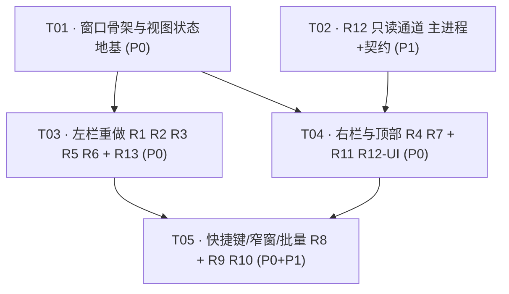
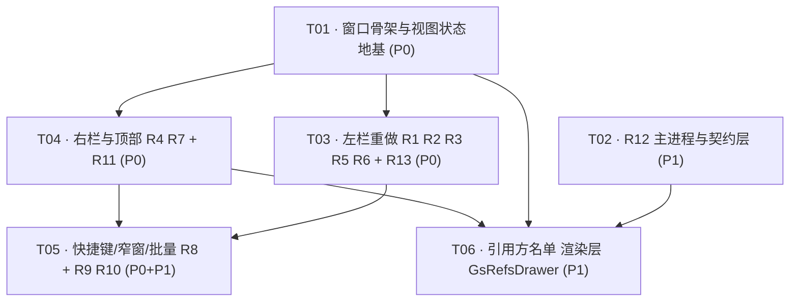

# 系统设计 · 全局设定中心窗口（GlobalSettingWindow）UI 与交互重设计

| 项 | 内容 |
|---|---|
| 设计者 | 高见远（架构师） |
| 输入 | `docs/prd-global-setting-window-redesign.md`（PM 定稿）+ team-lead 范围变更 |
| 技术栈 | Electron + React + TypeScript + antd 6 + SCSS（沿用本仓现有栈） |
| 架构开关 | `novelArch: compat`（AGENTS.md §6.7）—— 不改表结构、不写迁移 |
| 改动范围 | **主战场仍是 `src/windows/GlobalSettingWindow/`**；另有 5 处**最小、可选、只读**的共享/主进程挂载点（§2.2，附书本侧回归风险清单） |
| 新依赖 | **零**（新增 1 条 IPC 通道，不引入任何三方包） |
| 版本 | 2.0（按放宽后的范围重做裁决） |

> **v2 变更摘要**：范围放宽到「可改任意窗口 + 共享层」后，我重新评估了方案 A / B / C。**结论仍是 A⁺（窗口私有外壳），方案 C 否决**，理由见 §1.4（新增能力 100% 是全局窗口特有，共享测试已把书本侧 DOM 钉死）。范围放宽带来的实际收益有两条：① R10 的共享 `LevelSequence` 改造不再需要审批（A-1 解除）；② R12 引用方名单解禁（新增 1 条只读 IPC）。另：B-1 冲突解除（§1.6）。

---

## 0. 结论速览（TL;DR）

| 决策 | 结论 |
|---|---|
| **方案选型** | **方案 A⁺**：继续以 shared `useSettingCenter(props)` 为唯一状态机，窗口侧自绘外壳（左栏 + 影响面条 + 工具头 + 空态引导 + 窗口私有 view hook），右栏复用 `CategoryCard` / `LevelSequence`，三个弹窗由窗口侧挂载。 |
| **方案 C 否决** | 新布局是**全局窗口特有**，不是共享能力；放进共享等于在 book 路径上留一段永不执行的分支，且必然要改共享测试里已钉死书本侧 DOM 的用例（§1.4）。 |
| **书本侧不回归的证明方式** | **不改动** `SettingCenter/index.tsx` / `index.scss` / `setting-center-shared.ts` / `useSettingCenter.ts` / `CategoryList` / `CategoryCard` / `SettingPanelHead` 这 7 处（共享 40 个用例一行不改、全绿）。共享层只动 2 处**带默认值的可选**挂载点（§2.2 + §3 回归风险清单）。 |
| **R12 解禁** | 新增 1 条**只读**通道 `novel-global-setting-refs`（handler / preload / electron.d.ts 三处同步），SQL 就是 `countGlobalRefs` 去掉 COUNT + join `novel_works`。已核实**不会触发** `novel-db-split.test.ts` / `global-setting-guard.test.ts` / `preload-listener.test.ts` / `global-setting-qa.test.ts` 四条守卫（§6.3）。 |
| **B-1 采纳（团队批复）** | R11② 的追加提示**不下沉到确认框**，改为落在影响面条的 **⚠ 强调标记 + Tooltip** 上（≥3 档）。`useGlobalSetting.ts` **本次一个字不动**，确认框口径保持唯一（§1.6）。 |
| **待裁决** | D-1：`variant="panel"` 改革后将无消费方，是否回收（建议保留，§8）。 |

---

# Part A · 系统架构设计

## 1. 实现方案（三选一裁决）

### 1.1 三个方案的形态

| 方案 | 做法 | 共享层改动 |
|---|---|---|
| **A⁺** | 窗口私有外壳（`GsBody`）；自绘左栏；新增影响面条 / 工具头 / 空态引导 / view hook；右栏原样复用 `CategoryCard` + `LevelSequence`；三个弹窗由窗口挂载 | **2 处最小可选挂载点**（`LevelSequence` 3 个可选 prop；`electron.d.ts` 1 个类型）+ 主进程只读通道 |
| **B** | 窗口自写全部状态机，只用共享纯函数 | 同上，但窗口侧重写 787 行状态机 |
| **C** | 直接改共享 `SettingCenter`，把新布局做成形态可配置（靠 `source` / `variant` 分流），全局窗口开启、书本侧保持原样 | **结构性改造** `index.tsx` + `CategoryList` + `index.scss` |
| C-min（C 的最小切片） | 抽 `SettingCenterBody` + `renderSidebar` 插槽，窗口复用共享编排 | 抽组件 + 加插槽 prop |

### 1.2 关键判断一：新布局是「全局特有」还是「书本侧也该有」

我逐项核了书本侧的现状，**结论是：100% 全局特有，书本侧一条都不该有。**

| 新能力 | 全局侧语义 | 书本侧现状（已核代码） | 是否共享 |
|---|---|---|---|
| **R4 影响面条**（被 N 部书引用 / 改动即时同步） | 「**谁在引用我**」—— 改动会波及 N 本书 | 书本侧是**反向**语义「**我引用了谁**」，且**已有**完整表达：`CategoryCard` 上的 `SETTING_REF_SYNC_BADGE`（「全局 · 自动同步」）+ `referenced` 只读态 + `LevelSequence` 的「引用自全局中心 · 只读」提示 | ❌ **全局特有**。两侧语义方向相反，共享只能靠 `source` 分支塞进 book 路径 |
| **R3 左栏引用徽标** | 「N 部书引用 / 暂无引用」 | 左栏是**本书自己的**分类，没有「被引用」概念；引用信息在右栏卡上表达（`is-ref` 徽标只在 `isGlobal` 时渲染，`CategoryCard/index.tsx:71`） | ❌ 全局特有 |
| **R1 搜索 / R2 筛选 / R13 排序** | 全局库跨书共享、**持续积累**，PRD 痛点原文是「分类上到 20+ 后只能凭记忆滚动定位」 | 本书设定中心是**单作品**的境界 / 功法 / 丹药，量级是个位数；且 PRD §6 Out of scope 第 2 条明确「不碰本书设定中心、不改 `source="book"` 的任何呈现与文案」 | ❌ 全局特有（放进共享 = book 永远走不到的分支） |
| **R5 双击改名 / R6 右键菜单** | 全局库高频维护 | 书本侧左栏 tip 明确写着「重命名与删除在右侧卡片的『编辑 / 删除』按钮」，**这是 FR-05 特意订正过**的文案，且共享用例 `it("FR-05 提示保留：重命名与删除指向右侧卡片按钮（勿回潮到「右键 / 行尾菜单」）")` 把它钉死了 | ❌ 全局特有（改了就回归 FR-05） |
| **R7 空态引导** | 需要讲清「全局库是什么 / 跨书共享意味着什么 / 建完怎么被书引用」 | 书本侧空态是 `Empty` + `EMPTY_CTA_COPY.settingEmpty`，用例 `it("空分类时给出引导而不是空白")` 已钉住 | ❌ 全局特有 |
| **R12 引用方名单** | 「哪几本书引用了我」 | 书本侧无此概念 | ❌ 全局特有 |

> **一句话**：书本侧的「引用关系」问题在 1.45.0 已经用 `referenced` + 只读态 + 自动同步徽标解决了；本次要解决的是**全局侧反向的**「我影响了谁」。这是两条不同的语义，不是同一个能力的两份实现。

### 1.3 关键判断二：方案 C 的回归面能否被测试兜住

先看共享测试现在钉住了什么（`src/shared/components/SettingCenter/index.test.tsx`，约 40 个用例）：

| 用例 | 钉住的书本侧事实 | 方案 C 会不会撞 |
|---|---|---|
| `UI-05：左栏用常识化分组名「等级序列」并给出人话说明` | 左栏必须有「等级序列」标题 + 说明段 | **会撞**（新左栏是搜索框 + 筛选器，没有那个标题位） |
| `UI-05：分类为空时，左栏分组说明与右栏空态引导同时保留` | 左栏空态与分组说明共存 | **会撞** |
| `FR-05 提示保留：重命名与删除指向右侧卡片按钮（勿回潮到「右键 / 行尾菜单」）` | 左栏底部 tip 的**原文** | **会撞**（PRD Q5 要求把这句换成「双击改名 · 右键更多操作」） |
| `source=book（缺省）：标题带作品名、提示语本书口径、无引用计数徽标` | book 形态的标题 / 提示语 / 徽标 | 会撞（影响面条插进右栏会改变右栏结构） |
| `source=book（缺省）：动作区保留「另存为模板」` | `SettingPanelHead` 的「⋯」菜单项 | 会撞（工具头被替换） |
| `空分类时给出引导而不是空白` / `模板库列出内置预设` 等 | 右栏空态结构 | 会撞 |
| `本书接线（T04：引用 / 上架）` 一组 6 条 | 引用 / 上架 / 冲突确认链路 | 不直接撞，但同文件改动会牵连 |

**结论**：方案 C 必然要**改写**这些用例。而「改测试」本身就是「书本侧 DOM/文案/交互路径发生了变化」的证据 —— 这与「书本侧行为、呈现、文案、交互路径逐项不变」直接冲突。

反过来，**A⁺ 下这 40 个用例一行都不用改、全部保持绿色** —— 这才是「书本侧不回归」最硬的证明（比任何人工回归清单都硬）。

关于 `App.test.tsx` 的 `.ant-modal` 反面断言：
- A⁺ 下**仍成立**（窗口不套 Modal 外壳，`.gs-shell` 直接铺在内容区）；
- C 下也成立（`variant="panel"` 本来就不套 Modal）。
→ 这条**不构成方案区分度**。但要注意它的**作用域**：R12 用 antd `Drawer`（挂 `.ant-drawer`，不是 `.ant-modal`），不会误伤；而模板库 / 批量生成 / 拆分 / 删除确认打开时 body 必然出现 `.ant-modal`，那些用例要改用「标题为 XXX」的正向断言（§9）。

### 1.4 裁决：**方案 A⁺**；C（含 C-min）否决；B 否决

**选 A⁺ 的理由**

1. **书本侧风险 = 0**：共享 `SettingCenter` 的**结构**一行不动，只开 2 个带默认值的可选挂载点。40 个共享用例不改一行、全绿，这就是最硬的回归证明。
2. **新布局 100% 全局特有**（§1.2）。放进共享 = 在 book 路径上留一段永不执行的分支 —— 这既违反 PRD「不碰本书设定中心」，也是本仓 AGENTS.md 反复警告的「形态开关堆砌 / 一处改两处漂移」。
3. **回归面最小**，工期与 v1 评估一致（净新增约 1000–1200 行）。

**否掉 C 的理由**

- 收益（少写约 150 行父组件编排）**小于**代价（共享 `index.tsx` 结构性改造 + 必改共享测试 + book 路径死分支 + 长期维护成本）。
- 那 150 行是**机械透传**，不是逻辑 —— 逻辑全在 `useSettingCenter` 里，两边共享的是同一个 hook，不会漂移（真正会漂移的是状态机，而不是透传清单）。
- A⁺ 唯一的真实风险「漏挂三个弹窗」可以用**三条窗口单测**钉死（§9），不需要拿共享结构去换。

**否掉 C-min（抽 `SettingCenterBody` + `renderSidebar`）的理由**

- 它确实能消掉那 150 行透传，但要动 `index.tsx` 的结构（把 `content` 抽成组件 + 加插槽 prop），而 `index.tsx` 的注释里明确写着「拆成变量而不是复制一份 JSX —— 复制的话标题 / 空态 / 四个弹窗会在两条形态里各自漂移」。抽组件正是把 `content` 变成公共路径，**book 侧 DOM 虽可保持不变，但改动落在这份被 40 个用例钉住的核心文件上**，风险/收益不划算。
- 且插槽会让 `SettingCenter` 退化成「可配置一切」的双头组件，正是 C 的毛病，只是程度轻一点。

**否掉 B 的理由**：需求全是外壳与视图态层面，没有一条需要改写状态机的提交语义；重写 787 行状态机的回归面不可接受。

### 1.5 方案 A 可行性验证（六问，范围放宽后重核）

| # | 验证项 | 结论 | 证据 |
|---|---|---|---|
| 1 | `useSettingCenter` 与 Modal 外壳耦合？ | **不耦合**。`open` 只在 1 处被读：`useEffect(() => { if (open) return; /* 清草稿 */ }, [open])`（`useSettingCenter.ts:318-342`）。无 `onClose` 调用、无 `destroyOnHidden` / `getContainer` / 遮罩 / Esc 等浮层专属副作用。**绕法：传常量 `open={true}`，该 effect 恒不触发** | `useSettingCenter.ts:154/318` |
| 2 | return 字段够不够？ | **够**。`SettingCenterController` 显式导出 60+ 字段：`sorted` / `activeIdResolved` / `active` / `orderedLevels` / `categoryDraft` / `levelDraft` / `editingLevelId` / `insertAt` / `insertName` / `dragId` / `dropIndex` / `sensors` / `handleDragStart\|Over\|End\|Cancel` / `libraryOpen` / `openLibrary` / `closeLibrary` / `applyPreset` / `startSplit` / `startEditCategory` / `submitCategoryDraft` / `beginEditLevel` / `submitLevelDraft` / `setActiveId` / `handleCreateCategory` / `newCategoryName` … | `useSettingCenter.ts:42-143 / 697-786` |
| 3 | 可直接 import？ | **可以**，`export function useSettingCenter(props: SettingCenterProps): SettingCenterController`（第 152 行） | — |
| 4 | 受控子组件隐含依赖？ | **只有 `DndContext` 一处**。`LevelSequence` 的 `SortableLevelRow` 用 `useSortable({ id: lvlId(level.id) })` + 自带 `SortableContext`，没有祖先 `DndContext` 会抛错；`CategoryCard` **无** dnd 依赖 | `LevelSequence/index.tsx:33-58` |
| 5 | id 前缀约定？ | `setting-center-shared.ts:166-167`：`catId(id)=\`cat:${id}\`` / `lvlId(id)=\`lvl:${id}\``。`handleDragEnd` 按前缀分流（`lvl:` 重排或跨栏搬移 / `cat:` 分类重排）。窗口自绘左栏**必须沿用 `catId()`** | `useSettingCenter.ts:647-693` |
| 6 | `formatReferenceCountLabel` 位置？ | `src/shared/novel/setting-reference.ts:14`，`export function formatReferenceCountLabel(count: number): string` | — |

### 1.6 两个原阻塞点的处置（范围放宽后）

- **A-1（R10 改共享 `LevelSequence`）→ 自动解除**。现在可直接改。仍坚持**只加 3 个带默认值的可选 prop**（`selectable` / `selectedIds` / `onToggleSelect`），不传即等于今天的行为 —— 这是「可选 prop」这条路，不是「形态分流」。
- **B-1（R11② 删除确认追加提示 vs 确认口径唯一）→ 采纳团队批复：提示不下沉到确认框。**
  - 做法：≥3 档时在**影响面条**上加一枚 **⚠ 强调标记 + Tooltip**（文案「影响面较大，建议先确认这些书是否需要同步改名」），**常驻可见**；
  - 删除确认框**保持 `useGlobalSetting.onDeleteCategory` 原文案**，口径唯一；**`useGlobalSetting.ts` 本次一个字不动**；
  - 团队补的裁决理由（记录在案）：确认框文案是「引用语义」的权威表述，为分档提示去动它属于**用一次性弹窗解决常驻可见性问题，方向反了**。
  - 由此 `gs-view-utils` 的对应纯函数是 `impactWarningOf`（返回 Tooltip 文案，≥3 档非空），**不是**传进确认框的参数。

---

## 2. 文件清单

### 2.1 主战场：`src/windows/GlobalSettingWindow/`（新增/修改 21 个文件）

| # | 相对路径 | 新/改 | 职责 |
|---|---|---|---|
| 1 | `App.tsx` | 改 | 窗口根：`WindowHeader` + `modalContextHolder` + loading/loadError/`GsBody` 三态分流；删除不再使用的 `closeWindow` |
| 2 | `index.scss` | 改 | `.gs-shell` flex 列 + `.gs-body` 两栏 grid + 三档媒体查询 + 对 shared `.nv-sc__*` 的窄窗降级覆盖 |
| 3 | `App.test.tsx` | 改 | 冒烟：panel 断言改钉 `.gs-shell`，**保留 `.ant-modal` 反面断言**，补 body 清理与「装载失败不退化空态」 |
| 4 | `hooks/gs-view-utils.ts` | 新 | 纯函数：关键词归一 / 过滤 / 排序 / 空态判定 / 影响面分档与文案 / 焦点判定 / 选中移动 |
| 5 | `hooks/gs-view-utils.test.ts` | 新 | 上述纯函数单测（R1/R2/R11 口径钉死） |
| 6 | `hooks/useGlobalSettingView.ts` | 新 | 窗口私有 view 态：keyword / filter / sortMode / 就地改名 / 选中移动 / 批量勾选 |
| 7 | `hooks/useGsShortcuts.ts` | 新 | 全局键盘快捷键编排（R9）+ 输入 / 弹层守卫 |
| 8 | `components/GsBody/index.tsx` | 新 | 主体：调 `useSettingCenter` 组装 controller + `GsToolbar` + `DndContext` + 两栏 grid + 右栏三块 + **三个弹窗挂齐** |
| 9 | `components/GsBody/index.scss` | 新 | `.gs-shell` / `.gs-body` / `.gs-main` 布局与滚动链 |
| 10 | `components/GsToolbar/index.tsx` | 新 | 工具头：跨书共享提示语 + 模板库 + 新建分类 + 「⋯」（导出两项 / 转为普通分类） |
| 11 | `components/GsToolbar/index.scss` | 新 | 工具头样式（44px，右对齐动作区） |
| 12 | `components/GsCategorySidebar/index.tsx` | 新 | 左栏：搜索框 + 筛选 Select + 排序 Select + 命中计数 + 分类行列表 + 新建输入 + 快捷键提示 + 空态 |
| 13 | `components/GsCategorySidebar/index.scss` | 新 | 左栏 flex 列 + 内部滚动 + 窄窗压缩 |
| 14 | `components/GsCategoryRow/index.tsx` | 新 | 分类行：色点 + 名称（双击就地改名）+ 等级数 + 引用徽标 + 拖拽把手 + 右键菜单 |
| 15 | `components/GsCategoryRow/index.scss` | 新 | 行样式（自带造型 → `Button` 承载 + 清零点 mixin） |
| 16 | `components/GsImpactBar/index.tsx` | 新 | 影响面条：引用计数 + 同步后果 + 分档强调标记 + 删除入口 +（R12）「查看引用方 ▸」 |
| 17 | `components/GsImpactBar/index.scss` | 新 | 影响面条样式（单行省略 + 弱底） |
| 18 | `components/GsEmptyGuide/index.tsx` | 新 | 右栏空库引导卡：说明 +「套用内置预设」+「新建空白分类」 |
| 19 | `components/GsEmptyGuide/index.scss` | 新 | 引导卡样式 |
| 20 | `components/GsRefsDrawer/index.tsx` | 新（R12） | 引用方名单抽屉：antd `Drawer` 列书名；`refCount === 0` 时入口不渲染 |
| 21 | `components/GsRefsDrawer/index.scss` | 新（R12） | 抽屉样式（挂 `classNames={{ wrapper/body }}`，不写 `:hover`） |
| 22 | `components/GsLevelBatchBar/index.tsx` | 新（P1/R10） | 「已选 N 项」工具条 +「删除所选」+ 二次确认 |
| 23 | `components/GsLevelBatchBar/index.scss` | 新（P1/R10） | 批量工具条样式 |
| 24 | `hooks/useGlobalSetting.ts` | **不改** | 数据层保持不动（B-1 裁决：确认框口径唯一，不为分档提示动它） |
| 25 | `hooks/useGlobalSettingRefs.ts` | 新（R12） | 窗口私有的**只读**取数 hook：`refs` / `loading` / `error` / `open(categoryId)` / `close()` / `retry()`（附录 §A.5） |

### 2.2 共享 / 主进程的 5 处最小挂载点（**全部带默认值或纯新增**）

| # | 相对路径 | 改动 | 性质 |
|---|---|---|---|
| S-1 | `src/shared/components/SettingCenter/components/LevelSequence/index.tsx` | 加 3 个**可选** prop + 行首 Checkbox（约 15 行） | 可选 prop，不传 = 完全等价于现状 |
| S-2 | `src/shared/components/SettingCenter/components/LevelSequence/index.scss` | `is-selectable` 的 7 轨模板（约 6 行） | 新增类，不传 prop 时不出现 |
| S-3 | `src/shared/types/electron.d.ts` | 加 1 个方法类型 `globalCategoryRefs` | 纯类型 |
| S-4 | `electron/preload.ts` | 加 1 个 invoke 方法 | 新增方法，不动既有 |
| S-5 | `electron/handlers/novel-setting-shared.ts` | 加只读函数 `listGlobalRefs`（约 12 行） | 新增函数，既有函数体不动 |
| S-6 | `electron/handlers/novel-global-setting-handlers.ts` | 注册 1 个只读通道 `novel-global-setting-refs` | 新增通道 |
| S-7 | `electron/global-setting-guard.test.ts` | 加 2 条守卫（通道接线存在 + refs 通道体只读） | 新增用例 |

### 2.3 明确**一个字不动**的共享文件（即使范围已放宽）

| 文件 | 为什么不动 |
|---|---|
| `SettingCenter/index.tsx` | 父组件编排；40 个用例钉死。改动 = book 侧回归风险 |
| `SettingCenter/index.scss` | 布局骨架（`.nv-sc__body-grid` / `.nv-sc--panel`），book 弹窗在用 |
| `SettingCenter/setting-center-shared.ts` | `SettingCenterProps` 契约；动了本书侧调用方一起动 |
| `SettingCenter/hooks/useSettingCenter.ts` | 状态机；两形态共用，动了两边一起动 |
| `SettingCenter/components/CategoryList/**` | book 侧左栏；FR-05 tip 与 UI-05 分组名被用例钉死 |
| `SettingCenter/components/CategoryCard/**` | book / global 共用右栏卡 |
| `SettingCenter/components/SettingPanelHead/**` | book 侧工具头（只被 shared index 使用；全局窗口改用 `GsToolbar`，不再渲染它） |
| `SettingCenter/components/{TemplateLibrary,BatchGenerate,SplitLevel,SaveTemplate}Modal/**`、`GlobalCategoryPicker/**` | 原样复用 / 不渲染 |

> `src/windows/NovelWindow/**` 全程零改动。

---

## 3. 书本侧回归风险清单（**本次评审重点**）

共享 `SettingCenter` 只有两个消费方（已核）：
1. `src/windows/NovelWindow/pages/NovelPage/NovelPage.tsx:625` —— `source="book"`，**不传 `variant`** → 走 `"modal"` 形态
2. `src/windows/GlobalSettingWindow/App.tsx` —— `source="global" variant="panel"`（改革后不再用它）

| # | 改动点 | 对 book 形态的影响 | 如何证明不影响 |
|---|---|---|---|
| **S-1/S-2** | `LevelSequence` 加 `selectable` / `selectedIds` / `onToggleSelect` + `is-selectable` 样式 | book 侧（`NovelPage.tsx`）**不传**这三个 prop → `selectable` 为 falsy → 不渲染 Checkbox、不加 `is-selectable` 类、行网格仍是 6 轨 → **DOM 逐节点一致**，交互路径完全不变 | ① 现有约 40 个共享用例**一行不改、全绿**；② 新增 2 条反向断言：`不传 selectable 时不出现 checkbox`、`不出现 is-selectable 类`；③ `pnpm typecheck` 绿（可选 prop 不强制传） |
| **S-3** | `electron.d.ts` 加 `globalCategoryRefs` 类型 | 纯类型声明，零运行时 | `pnpm typecheck` 绿；book 侧不调用 |
| **S-4** | `preload.ts` 加 `globalCategoryRefs` invoke | 新增一个方法，既有方法签名 / 实现不动；book 侧不调用 | `preload-listener.test.ts`（只钉 `windowAPI.on/off` 的 wrapper 注销）全绿；`global-setting-guard.test.ts` 对 preload 是 `toContain` **正向**断言，加通道不破 |
| **S-5** | `novel-setting-shared.ts` 加只读 `listGlobalRefs` | 只新增函数；`countGlobalRefs` / `countGlobalRefsBatch` / 同步 / 固化 / 上架的**函数体一行不动** | `global-setting-qa.test.ts` 对 `countGlobalRefs` 的源码断言全绿；新增守卫「refs 通道体不含 INSERT / UPDATE / DELETE」证明只读 |
| **S-6** | handler 注册 `novel-global-setting-refs` | 只读通道，不开关事务、不写库；book 侧不调用 | `novel-db-split.test.ts` 只扫 `novel-handlers.ts` / `novel-pack-handlers.ts` 的 import，**不涉及** `novel-global-setting-handlers.ts`；且 `novel-setting-shared.ts` 的 `dbAll` 本来就 import 自 `../novel-db`（已核实第 23–28 行），符合「novel handler 只能从 `electron/novel-db.ts` 取写通道」 |
| **窗口私有** | 新增 `hooks/useGlobalSettingRefs.ts` + 8 个 `Gs*` 组件；`useGlobalSetting.ts` **不动** | **窗口私有文件**，book 侧根本 import 不到（AGENTS §2.2.0 窗口间禁止互相导入） | 天然隔离；`useGlobalSettingRefs` 新增单测；`useGlobalSetting.test.tsx` 一行不改、全绿 |
| **窗口私有** | 新增 8 个 `Gs*` 组件 | 只在 `GlobalSettingWindow/` 内被引用 | 窗口间禁止互相导入，天然隔离 |
| **不改动** | §2.3 列的 8 个共享文件 | 零影响 | 共享 40 用例 + `NovelPage` 相关用例全绿且不改一行 |

**额外两条书本侧防回归断言（建议补进 `SettingCenter/index.test.tsx`）**：
- `it("书本侧不传 selectable：等级行不出现 Checkbox，行网格不加 is-selectable")` —— 钉住「新增能力默认关闭」；
- `it("书本侧左栏仍是 CategoryList：不出现窗口私有的搜索 / 筛选控件")` —— 钉住「新左栏没回流到 book 形态」。

---

## 4. 数据结构与接口

### 4.1 类图

```mermaid
classDiagram
    class GlobalSettingWindowApp {
        +render() JSX
        -loading: boolean
        -loadError: string
    }

    class useGlobalSetting {
        +settings: SettingCategory[]
        +loading: boolean
        +loadError: string
        +modalContextHolder: ReactNode
        +reload() void
        +onDeleteCategory(id) void
        +onPatchCategory(id, patch) void
        +onCreateCategory(name, kind, color) void
        +onReorderCategories(ids) void
        +onAddLevel(catId, name, index) void
        +onBatchAddLevels(catId, names) void
        +onPatchLevel(levelId, patch) void
        +onDeleteLevel(levelId) void
        +onReorderLevels(catId, fromId, toIndex) void
        +onSplitLevel(levelId, n, pattern) void
        +onMergeLevel(levelId) void
        +onExport(catId, format) void
        +onApplyPreset(presetId) void
    }

    class GsBody {
        -newCategoryInputRef: InputRef
        +props: GsBodyProps
        +render() JSX
    }

    class useSettingCenter {
        +sorted: SettingCategory[]
        +activeIdResolved: string
        +active: SettingCategory
        +orderedLevels: SettingLevel[]
        +sensors: Sensors
        +setActiveId(id) void
        +handleDragStart(e) void
        +handleDragOver(e) void
        +handleDragEnd(e) void
        +handleDragCancel() void
        +startEditCategory() void
        +submitCategoryDraft() void
        +beginEditLevel(level) void
        +submitLevelDraft() void
        +startSplit(level) void
        +applyPreset(id) void
        +openLibrary() void
        +handleCreateCategory() void
    }

    class useGlobalSettingView {
        +keyword: string
        +setKeyword(v) void
        +clearKeyword() void
        +filter: GsCategoryFilter
        +setFilter(v) void
        +sortMode: GsSortMode
        +setSortMode(v) void
        +visible: SettingCategory[]
        +visibleIds: string[]
        +emptyKind: GsEmptyKind
        +canDrag: boolean
        +renamingId: string
        +beginRename(id) void
        +commitRename(value) void
        +cancelRename() void
        +moveSelection(delta) void
        +selectedLevelIds: string[]
        +toggleLevelSelected(id) void
        +clearLevelSelection() void
    }

    class useGsShortcuts {
        +bind(handlers, enabled) void
    }

    class gs_view_utils {
        <<module>>
        +normalizeKeyword(raw) string
        +visibleCategories(list, kw, filter, mode) SettingCategory[]
        +emptyKindOf(total, visible) GsEmptyKind
        +impactTierOf(refCount) GsImpactTier
        +impactTextOf(refCount) string
        +impactWarningOf(refCount) string
        +isTypingTarget(el) boolean
        +nextIdInList(ids, currentId, delta) string
    }

    class GsToolbar {
        +active: SettingCategory
        +onOpenLibrary() void
        +onFocusNewCategory() void
        +onExport(format) void
        +onUnsetRealm() void
    }

    class GsCategorySidebar {
        +categories: SettingCategory[]
        +activeId: string
        +view: GsView
        +canDrag: boolean
        +onSelect(id) void
        +onRename(id, name) void
        +onDelete(id) void
        +onToggleKind(id) void
        +inputRef: RefObject
    }

    class GsCategoryRow {
        +category: SettingCategory
        +isOn: boolean
        +canDrag: boolean
        +renaming: boolean
        +onSelect() void
        +onBeginRename() void
        +onCommitRename(name) void
        +onCancelRename() void
        +onDelete() void
        +onToggleKind() void
    }

    class GsImpactBar {
        +refCount: number
        +tier: GsImpactTier
        +onDelete() void
        +onOpenRefs() void
    }

    class GsRefsDrawer {
        +open: boolean
        +categoryName: string
        +refs: Array~Ref~
        +onClose() void
    }

    class GsEmptyGuide {
        +onApplyPreset() void
        +onFocusNewCategory() void
    }

    class GsLevelBatchBar {
        +count: number
        +onDeleteSelected() void
        +onClear() void
    }

    class CategoryCard {
        <<shared 复用>>
        +active: SettingCategory
        +categoryDraft: CategoryDraft
        +onStartEdit() void
        +onSubmitDraft() void
    }

    class LevelSequence {
        <<shared 复用 + 3 个可选 prop>>
        +active: SettingCategory
        +orderedLevels: SettingLevel[]
        +editingLevelId: string
        +selectable: boolean
        +selectedIds: string[]
        +onToggleSelect(id) void
        +onDeleteLevel(id) void
    }

    class listGlobalRefs {
        <<主进程 只读>>
        +listGlobalRefs(globalCategoryId) Array~Ref~
    }

    GlobalSettingWindowApp --> useGlobalSetting : 调用
    GlobalSettingWindowApp --> GsBody : 渲染
    GsBody --> useSettingCenter : 组装 props 后调用
    GsBody --> useGlobalSettingView : 调用
    GsBody --> useGsShortcuts : 调用
    GsBody --> GsToolbar : 渲染
    GsBody --> GsCategorySidebar : 渲染
    GsBody --> GsImpactBar : 渲染
    GsBody --> CategoryCard : 渲染(受控)
    GsBody --> LevelSequence : 渲染(受控)
    GsBody --> GsEmptyGuide : 渲染
    GsBody --> GsLevelBatchBar : 渲染(P1)
    GsImpactBar --> GsRefsDrawer : 打开(R12)
    GsCategorySidebar --> GsCategoryRow : 渲染多行
    GsCategorySidebar --> gs_view_utils : 引用
    useGlobalSettingView --> gs_view_utils : 引用
    GsImpactBar --> gs_view_utils : 引用
    GsBody ..> useGlobalSetting : props.data
    useGlobalSetting ..> listGlobalRefs : IPC novel-global-setting-refs
```



### 4.2 关键接口签名

```ts
// ── 窗口私有 · 视图枚举与纯函数 ────────────────────────────────
// src/windows/GlobalSettingWindow/hooks/gs-view-utils.ts

export type GsCategoryFilter =
  | "all" | "realm" | "custom" | "referenced" | "unreferenced";
export type GsSortMode = "name" | "refCount" | "custom";
export type GsEmptyKind = "none" | "no-category" | "no-match";
export type GsImpactTier = "none" | "low" | "high";

/** R11 阈值单一口径：0 → none；1–2 → low；≥3 → high */
export const GS_IMPACT_THRESHOLD = { high: 3 } as const;

export function normalizeKeyword(raw: string): string;
export function matchesKeyword(c: SettingCategory, kw: string): boolean;   // 名 + note，忽略大小写
export function matchesFilter(c: SettingCategory, f: GsCategoryFilter): boolean;
export function filterCategories(list, kw, f): SettingCategory[];
export function sortCategories(list, mode: GsSortMode): SettingCategory[];
/** 先过滤再排序（唯一入口，组件只许调它） */
export function visibleCategories(list, kw, f, mode): SettingCategory[];
export function emptyKindOf(total: number, visibleCount: number): GsEmptyKind;
export function impactTierOf(refCount: number | undefined): GsImpactTier;
/** R4 影响面文案：计数部分由 formatReferenceCountLabel 唯一产出 */
export function impactTextOf(refCount: number): string;
/** R11② 追加提示（≥3 档非空，其余空串）—— 只用于影响面条的 ⚠ Tooltip，不进确认框 */
export function impactWarningOf(refCount: number): string;
export function isTypingTarget(el: EventTarget | null): boolean;
export function nextIdInList(ids: string[], currentId: string, delta: number): string | null;
```

`impactTextOf` 保证「引用计数文案只由 `formatReferenceCountLabel` 唯一产出」：
```ts
export function impactTextOf(refCount: number): string {
  const n = Math.max(0, Math.floor(refCount) || 0);
  if (n === 0) return "暂无作品引用 · 改动只影响全局库";
  return `被 ${formatReferenceCountLabel(n)} · 改动会即时同步到这 ${n} 部书`;
}
```
→ n=5 得「被 5 部书引用 · 改动会即时同步到这 5 部书」，与 PRD 文案逐字一致。

```ts
// ── 窗口私有 · view hook ──────────────────────────────────────
export interface GsViewParams {
  categories: SettingCategory[];   // 传 c.sorted（已按 sortOrder）
  activeId: string;                // 传 c.activeIdResolved
  onSelect: (id: string) => void;  // 传 c.setActiveId
}
export interface GsView {
  keyword: string; setKeyword(v: string): void; clearKeyword(): void;
  filter: GsCategoryFilter; setFilter(v: GsCategoryFilter): void;
  sortMode: GsSortMode; setSortMode(v: GsSortMode): void;
  visible: SettingCategory[]; visibleIds: string[];
  emptyKind: GsEmptyKind;
  /** 只有「自定义顺序 + 无搜索词 + 无筛选」才允许拖拽 */
  canDrag: boolean;
  renamingId: string | null;
  beginRename(id: string): void;
  commitRename(value: string): void;   // 空 / 纯空白 → 取消
  cancelRename(): void;
  moveSelection(delta: number): void;
  batchSelecting: boolean; setBatchSelecting(v: boolean): void;
  selectedLevelIds: string[]; toggleLevelSelected(id: string): void;
  clearLevelSelection(): void;
}
export function useGlobalSettingView(params: GsViewParams): GsView;

// ── 窗口私有 · 快捷键 hook ────────────────────────────────────
export interface GsShortcutHandlers {
  onFocusSearch(): void; onMove(delta: number): void;
  onRename(): void; onDelete(): void; onEscape(): void;
}
export function useGsShortcuts(handlers: GsShortcutHandlers, enabled: boolean): void;

// ── 主体与子组件 ──────────────────────────────────────────────
export interface GsBodyProps { data: GlobalSettingController; }

export interface GsToolbarProps {
  active: SettingCategory | null;
  onOpenLibrary(): void; onFocusNewCategory(): void;
  onExport(format: "json" | "markdown"): void; onUnsetRealm(): void;
}
export interface GsCategorySidebarProps {
  categories: SettingCategory[]; total: number; activeId: string;
  view: GsView; canDrag: boolean; dragId: string | null;
  newCategoryName: string; onNewCategoryNameChange(v: string): void; onCreate(): void;
  onSelect(id: string): void; onRename(id: string, name: string): void;
  onDelete(id: string): void; onToggleKind(id: string): void;
  inputRef: RefObject<InputRef | null>;
}
export interface GsCategoryRowProps {
  category: SettingCategory; isOn: boolean; canDrag: boolean;
  isDragSource: boolean; renaming: boolean;
  onSelect(): void; onBeginRename(): void; onCommitRename(v: string): void;
  onCancelRename(): void; onDelete(): void; onToggleKind(): void;
}
export interface GsImpactBarProps {
  refCount: number; tier: GsImpactTier;
  onDelete(): void; onOpenRefs(): void;
}
export interface GsRefsDrawerProps {
  open: boolean; categoryName: string; refs: GlobalCategoryRef[]; onClose(): void;
}
export interface GsEmptyGuideProps { onApplyPreset(): void; onFocusNewCategory(): void; }
export interface GsLevelBatchBarProps {
  count: number; onDeleteSelected(): void; onClear(): void;
}
```

### 4.3 `useSettingCenter` 组装口径（照抄，别漏项）

```tsx
const c = useSettingCenter({
  open: true,              // ⚠️ 常量 true：open 只用于「关闭清草稿」的 effect，面板形态恒不触发
  workName: "跨书共享",
  settings: data.settings,
  focusCategoryId: null,
  source: "global",
  onClose: NOOP_CLOSE,     // 面板形态下不生效（关窗只走窗口三键），仅满足必填契约
  onCreateCategory: data.onCreateCategory,
  onPatchCategory: data.onPatchCategory,
  onDeleteCategory: data.onDeleteCategory,
  onReorderCategories: data.onReorderCategories,
  onAddLevel: data.onAddLevel,
  onBatchAddLevels: data.onBatchAddLevels,
  onPatchLevel: data.onPatchLevel,
  onDeleteLevel: data.onDeleteLevel,
  onReorderLevels: data.onReorderLevels,
  onSplitLevel: data.onSplitLevel,
  onMergeLevel: data.onMergeLevel,
  onExport: data.onExport,
  onApplyPreset: data.onApplyPreset,
  // 模板能力 5 props 一律不传（全局域不提供，N-04）
});
```

弹窗挂载：**必须挂** `TemplateLibraryModal`（`showTemplates={false}`）/ `BatchGenerateModal` / `SplitLevelModal`；**不挂** `SaveTemplateModal` / `GlobalCategoryPicker` / 上架冲突 Modal（全局域无此能力，挂了就是僵尸入口）。

### 4.4 R12 的契约（新增）

```ts
// src/shared/types/electron.d.ts（NovelAPI 内）
globalCategoryRefs: (categoryId: string) => Promise<Array<{ workId: string; workName: string }>>
```
```ts
// src/shared/types/electron.d.ts（NovelAPI 内）—— 详见附录 §A.3
globalCategoryRefs: (categoryId: string) => Promise<Array<{ workId: string; workName: string }>>
```
```ts
// src/windows/GlobalSettingWindow/hooks/useGlobalSettingRefs.ts（新增，窗口私有只读）
export interface GlobalCategoryRef { workId: string; workName: string }
export interface GsRefsState {
  refs: GlobalCategoryRef[];
  loading: boolean;
  /** 失败原因（null = 正常）；非空即渲染 Alert + 重试，不白屏、不静默 */
  error: string | null;
  open: (categoryId: string) => void;
  close: () => void;
  retry: () => void;
}
```
> ⚠️ **`useGlobalSetting.ts` 本次一个字不动**：R12 的取数走新增的窗口私有 `useGlobalSettingRefs`，R11② 的提示走影响面条的 Tooltip。既有的 `onDeleteCategory` 确认框口径保持唯一。

---

## 5. 程序调用流程

### 5.1 时序图 (a)：搜索 / 筛选 → 选中 → 就地改名 → 写后重载 → 广播回灌

```mermaid
sequenceDiagram
    autonumber
    actor U as 作者
    participant SB as GsCategorySidebar
    participant ROW as GsCategoryRow
    participant V as useGlobalSettingView
    participant UT as gs-view-utils
    participant BODY as GsBody
    participant C as useSettingCenter
    participant D as useGlobalSetting
    participant IPC as window.electronAPI.novel
    participant MAIN as 主进程 (global-* handlers)

    Note over U,MAIN ── R1/R2 搜索与筛选：纯前端，零 IPC ──
    U->>SB: 输入「法」/ 切「已被引用」
    SB->>V: setKeyword("法") / setFilter("referenced")
    V->>UT: visibleCategories(sorted, kw, filter, sortMode)
    UT-->>V: 过滤（名+note 命中 ∩ 筛选）→ 排序
    V-->>SB: visible / visibleIds / emptyKind / canDrag=false
    SB-->>U: 左栏即时刷新 + 「N 条」；0 命中 → 专用空态 + 清空入口
    Note right of SB: 断言：此期间 globalCategoryOrder 调用次数 = 0

    Note over U,MAIN ── 选中 ──
    U->>ROW: 点击分类行
    ROW->>C: c.setActiveId(id)
    C-->>BODY: activeIdResolved / active 更新
    BODY-->>U: 右栏 CategoryCard + LevelSequence + 影响面条同步

    Note over U,MAIN ── R5 就地改名 ──
    U->>ROW: 双击分类名
    ROW->>V: beginRename(id)
    V-->>ROW: renamingId = id → 渲染 antd Input（非受控 + 原值全选）
    U->>ROW: 输入新名 + Enter
    ROW->>V: commitRename(rawValue)
    alt 空 / 纯空白
        V->>V: cancelRename()（保持原值退出）
    else 非空
        V->>BODY: onRename(id, trimmed)
        BODY->>D: data.onPatchCategory(id, { name })
        D->>IPC: globalCategoryUpdate(id, patch)
        IPC->>MAIN: ipcMain.handle('novel-global-setting-*')
        MAIN-->>IPC: ok
        IPC-->>D: resolved
        D->>D: reload()  —— 写后整表重载（不做本地乐观更新）
        D->>IPC: globalSettingLoad()
        IPC-->>D: { categories: [...含新 refCount] }
        D-->>BODY: setSettings(映射后)
        BODY-->>U: 左栏 + 右栏 + 影响面条同步刷新
    end

    Note over U,MAIN ── 跨窗口广播回灌（书侧建引用 / 上架也会触发）──
    MAIN-)D: 'global-setting-changed' 广播
    D->>D: reload()
    D-->>BODY: settings 更新 → 引用计数 / 影响面条同步
```

### 5.2 时序图 (b)：分类删除（含引用二次确认 + R11 追加提示 + R12 名单）

```mermaid
sequenceDiagram
    autonumber
    actor U as 作者
    participant BAR as GsImpactBar
    participant MENU as GsCategoryRow 右键菜单
    participant KB as useGsShortcuts
    participant BODY as GsBody
    participant D as useGlobalSetting
    participant MODAL as modal.confirm (contextHolder)
    participant R as useGlobalSettingRefs
    participant IPC as window.electronAPI.novel
    participant MAIN as 主进程 / novel.db

    Note over U,MAIN ── 三条入口共用同一个回调：data.onDeleteCategory ──
    alt 入口 1：影响面条「删除」
        U->>BAR: 点击「删除」
        BAR->>BODY: onDelete()
        BODY->>D: data.onDeleteCategory(id)
    else 入口 2：右键菜单「删除」（右键已先自动选中该分类）
        U->>MENU: 右键 → 删除
        MENU->>BODY: c.setActiveId(id) 先落选中
        MENU->>D: data.onDeleteCategory(id)
    else 入口 3：键盘 Delete（焦点不在输入控件）
        U->>KB: 按 Delete
        KB->>D: data.onDeleteCategory(id)
    end
    Note right of BAR: R11②「影响面较大」提示常驻在影响面条的 ⚠ 标记 + Tooltip 上，
    不进确认框 —— 确认框口径唯一，useGlobalSetting.ts 不动

    D->>IPC: globalCategoryDelete(id)  —— 先探引用
    IPC->>MAIN: COUNT(DISTINCT work_id)
    MAIN-->>IPC: { ok: false, refCount: N }
    IPC-->>D: first

    alt first.ok === true（无人引用，直接删）
        D->>D: reload()
        D->>IPC: globalSettingLoad()
        IPC-->>D: 新表
        D-->>BODY: settings 更新
    else first.refCount > 0（被引用 → 二次确认）
        D->>MODAL: modal.confirm({ title: "删除被引用的全局设定？",
        content: "该分类正被 N 部书引用。删除后这些书会把它就地固化为各自的本书副本（保留内容、不再同步）。确定删除？" })
        MODAL-->>U: 弹确认框（antd 实例方法，继承主题，暗色不掉色）
        alt 取消
            U-->>MODAL: 取消
            MODAL-->>D: resolve(false)
            D->>D: 中止，不写库
        else 确定删除
            U-->>MODAL: 确定删除
            MODAL-->>D: resolve(true)
            D->>IPC: globalCategoryDelete(id, true)  —— 固化删除
            IPC->>MAIN: 删分类 + 引用方就地固化
            MAIN-->>IPC: ok
            D->>D: reload()
            D-->>BODY: settings 更新 → 影响面条 / 徽标同步
        end
    end

    Note over U,MAIN ── R12 引用方名单（只读通道）──
    U->>BAR: 点「查看引用方 ▸」（refCount=0 时不渲染该入口）
    BAR->>R: refs.open(id)（useGlobalSettingRefs）
    D->>IPC: globalCategoryRefs(id)
    IPC->>MAIN: SELECT DISTINCT work_id JOIN novel_works 取名
    MAIN-->>IPC: [{workId, workName}]
    IPC-->>D: refs
    D-->>BAR: refs → 打开 GsRefsDrawer（antd Drawer，portal 挂 body）
    Note right of D: 与 countGlobalRefs 同一口径（source_global_id 匹配、已脱离的不计入）
    → 名单条数必须恒等于 refCount
```

---

## 6. R12 主进程实现规格（新增只读通道）

### 6.1 SQL（`electron/handlers/novel-setting-shared.ts`，紧挨 `countGlobalRefs`）

```ts
/**
 * 单个全局分类的引用方名单（R12）。
 *
 * 与 `countGlobalRefs` 同一口径：`source_global_id` 匹配、**已脱离的书不计入**
 * （U4）。`GROUP BY work_id` 保证名单条数恒等于 `countGlobalRefs` 的数字 ——
 * 两边口径不一致时，UI 会出现「说被 5 部书引用，名单里只有 3 本」。
 */
export function listGlobalRefs(globalCategoryId: string): Array<{ workId: string; workName: string }> {
  return dbAll(
    `SELECT c.work_id AS workId, w.name AS workName
       FROM novel_setting_categories c
       JOIN novel_works w ON w.id = c.work_id
      WHERE c.source_global_id = ?
      GROUP BY c.work_id, w.name
      ORDER BY w.name`,
    [globalCategoryId],
  ) as Array<{ workId: string; workName: string }>;
}
```
`dbAll` 已 import 自 `../novel-db`（第 23–28 行），`novel_works(id, name, created_at)` 字段已核实（`electron/novel-db.ts:70-74`）。

### 6.2 三处同步

| 处 | 改动 |
|---|---|
| `electron/handlers/novel-global-setting-handlers.ts` | 在 `registerNovelGlobalSettingHandlers` 内注册：`ipcMain.handle("novel-global-setting-refs", (_e, categoryId: string) => listGlobalRefs(categoryId))`。只读，不开关事务、不写库 |
| `electron/preload.ts` | `globalCategoryRefs: (categoryId: string) => ipcRenderer.invoke("novel-global-setting-refs", categoryId)` |
| `src/shared/types/electron.d.ts` | `globalCategoryRefs: (categoryId: string) => Promise<Array<{ workId: string; workName: string }>>` |

### 6.3 守卫测试兼容性（已逐条核实）

| 守卫 | 会不会被触发 | 依据 |
|---|---|---|
| `electron/novel-db-split.test.ts` | **不会** | 该守卫只扫 `novel-handlers.ts` 与 `novel-pack-handlers.ts` 的 import（第 88–107 行），**不涉及** `novel-global-setting-handlers.ts`；且新函数复用 `novel-setting-shared.ts` 既有的 `../novel-db` 通道 |
| `electron/global-setting-guard.test.ts` | **不会** | 对 preload / main 的断言是 `toContain` **正向**（`expect(PRELOAD).toContain("'novel-global-setting-load'")`、`expect(MAIN).toContain("registerNovelGlobalSettingHandlers")`），加通道不破 |
| `electron/global-setting-qa.test.ts` | **不会** | 它按函数名切片断言 `countGlobalRefs` / `countGlobalRefsBatch`；新增函数不改动这两段 |
| `electron/preload-listener.test.ts` | **不会** | 只钉 `windowAPI.on/off` 的 wrapper 注销逻辑，与 invoke 方法无关 |
| `electron/edition.ts` 打包清单 | 不涉及 | 不新增窗口 / 不新增依赖 |

**建议新增 2 条守卫**（`electron/global-setting-guard.test.ts`）：
```ts
it("preload 接线含新增的只读通道 novel-global-setting-refs", () => {
  expect(PRELOAD).toContain("'novel-global-setting-refs'");
});
it("novel-global-setting-refs 是只读通道（不写库）", () => {
  const body = globalBody("novel-global-setting-refs");
  expect(body).not.toMatch(/\bINSERT\b|\bUPDATE\b|\bDELETE\b/i);
});
```

---

## 7. 布局与响应式规格

### 7.1 骨架（`index.scss` / `GsBody/index.scss`）

```scss
// ── 窗口根：确定高度 + 自身不滚 ──────────────────────────────
.gs-shell {
  display: flex; flex-direction: column;
  box-sizing: border-box;   // ⚠️ 本仓无全局 box-sizing 重置，必须自己声明
  height: 100%; min-height: 0;
  overflow: hidden;         // 内部各栏自己滚，避免双滚动条
  padding: 16px 20px 20px;
}
.gs-toolbar { flex: 0 0 auto; }   // 44px

// ── 两栏 grid：列/行轨道都必须 minmax(0, 1fr) ────────────────
.gs-body {
  display: grid;
  grid-template-columns: 240px minmax(0, 1fr);
  grid-template-rows: minmax(0, 1fr);   // ⚠️ auto 行按内容计高，height 钳不住
  gap: 16px;
  flex: 1; min-height: 0;               // ⚠️ max-height 钳不住 grid 隐式轨道，会溢出
}
.gs-side {
  display: flex; flex-direction: column; gap: 8px;
  min-width: 0; min-height: 0;          // grid item 默认 min-height:auto，不归零会撑出轨道
  padding-right: 12px; border-right: 1px solid var(--app-border);
}
.gs-side__list { flex: 1; min-height: 0; overflow-y: auto; }
.gs-main { display: flex; flex-direction: column; gap: 12px; min-width: 0; min-height: 0; }
.gs-impact { flex: 0 0 auto; }   // 40px
```

### 7.2 滚动链（哪一层滚、哪一层 `min-height: 0`）

| 层 | overflow | 确定高度来源 | `min-height: 0` |
|---|---|---|---|
| `.window-shell__body`（shared） | — | `flex: 1` | ✅ |
| `.gs-shell` | `hidden`（不滚） | `height: 100%` | ✅ |
| `.gs-body`（grid） | — | `flex: 1` | ✅ |
| `.gs-side` | — | grid 行轨道 `minmax(0,1fr)` | ✅ |
| **`.gs-side__list`** | **`auto`（左栏唯一滚动区）** | `flex: 1` | ✅ |
| `.gs-main` | — | grid 行轨道 | ✅ |
| `.gs-impact` / `CategoryCard` | — | hug | — |
| **`LevelSequence` 的 `.nv-sc__rows`** | **`auto`（shared 已有）** | `flex: 1`（shared `is-grow`） | ✅（shared 已有） |

> 三档宽度下滚动区恒定只有这两个，窗口永不出现横向滚动条。

### 7.3 三档断点

| 档位 | 左栏宽 | 等级序列列 | grid 轨道 |
|---|---|---|---|
| **≥1080px**（默认 1240×860） | 240px | 全 6 列 | `240px minmax(0,1fr)` |
| **960–1079px** | 200px | 隐藏「别名」 | `200px minmax(0,1fr)` |
| **≤959px**（含 minWidth 920） | 160px | 隐藏「别名」「说明」 | `160px minmax(0,1fr)` |

```scss
@media (max-width: 1079px) {
  .gs-body { grid-template-columns: 200px minmax(0, 1fr); }
  .gs-body .nv-sc__col-alias:not(.ant-input) { display: none; }
  .gs-body .nv-sc__thead,
  .gs-body .nv-sc__row { grid-template-columns: 16px 28px minmax(0, 1.2fr) minmax(0, 2fr) 72px; }
}
@media (max-width: 959px) {
  .gs-body { grid-template-columns: 160px minmax(0, 1fr); }
  .gs-body .nv-sc__col-alias:not(.ant-input),
  .gs-body .nv-sc__col-note:not(.ant-input) { display: none; }
  .gs-body .nv-sc__thead,
  .gs-body .nv-sc__row { grid-template-columns: 16px 28px minmax(0, 1fr) 72px; }
  .gs-main .nv-sc__carry-row { flex-wrap: wrap; }   // 进位规则条换行，别撑出横向滚动条
}
// 编辑态兜底：含输入框的行恢复 6 轨，否则别名 / 说明的输入框会被挤没
.gs-body .nv-sc__row:has(.ant-input) {
  grid-template-columns: 16px 28px minmax(0, 1.2fr) minmax(0, 1.4fr) minmax(0, 2fr) 72px;
}
```

**为什么改 shared 的类名却写在窗口自己的 scss 里**（范围放宽后仍坚持）：这是**本窗口私有**的响应式策略 —— 书本弹窗固定 `width={1180}`，永远不会进这两档断点。挂在 `.gs-body` 作用域内，对 shared 零侵入、对其它窗口零影响；写进 shared 等于给 book 形态加两条永不生效的媒体查询。

### 7.4 影响面条（R8⑤）

```scss
.gs-impact__text {
  min-width: 0; overflow: hidden; text-overflow: ellipsis; white-space: nowrap;
}
```
全文走 `Tooltip title={impactTextOf(n)}`，Tooltip 挂 `classNames={{ popup: { root: "gs-impact__tip" } }}`。

---

## 8. Anything UNCLEAR / 待明确

| # | 事项 | 现状处理 |
|---|---|---|
| **D-1** | `variant="panel"` 改革后**无消费方**（全局窗口不再用 `<SettingCenter>`）。是否回收该分支？ | **建议保留不动**：回收要动 `SettingCenter/index.tsx` 与其测试，收益为零、风险非零。仅在此处登记为已知死分支。若你要求清理，另开一次改动 |
| Q-C1 | 左栏筛选控件形态（PRD Q6） | **定为 `Select`**：5 个筛选项在 160px 窄栏里 `Segmented` 必然挤爆；`Select` 把选项收进 portal 弹层，宽度恒定、键盘可达。排序同样用 `Select`。与 PRD 线框图的「chip 两行」有出入，理由是窄窗可用性优先 |
| Q-C2 | 就地改名是否要输入法守卫 | **要**，照抄 `TodoPage/components/EditableText` 三件套：非受控 `Input`（不传 `value`）+ `composingRef` + `skipBlurRef`（保证 Esc 先于 blur），并在 `onPressEnter` 里判 `e.nativeEvent.isComposing` |
| Q-C3 | 批量删除等级是否二次确认（PRD Q4） | **要**（破坏性且无撤销），文案「删除所选 N 个等级？删除后阶梯会自动重新编号。」由 `GsLevelBatchBar` 自持 `Modal.useModal()` 并把 `contextHolder` 渲染在自身内 |
| Q-C4 | 空库时右栏是「引导卡」还是「空态」 | 引导卡（`GsEmptyGuide`），**只在 `settings.length === 0` 时**；筛选 0 命中时右栏保持上一选中分类不变（左栏给「没找到…」空态），避免「筛掉就以为数据没了」 |
| Q-C5 | Esc 的级联顺序 | ① 行内改名编辑态 → ② 等级行编辑态（`c.endEditLevel`）→ ③ 行间插入态（`c.cancelInsert`）→ ④ 清空搜索。**由 `GsBody` 统一编排** |
| Q-C6 | R12 的名单条数与 `refCount` 不一致怎么办 | 主进程用 `GROUP BY work_id` 保证与 `COUNT(DISTINCT work_id)` 同口径；UI 侧若 `refs.length !== refCount` 以 `refCount` 为准显示计数、名单如实展示，并在抽屉顶部不额外解释（避免自造口径）。**建议补一条主进程守卫源码断言**钉住 `GROUP BY` |

---

# Part B · 任务分解

## 9. 依赖包清单

**零新增依赖。** 全部复用既有：

```
- react / react-dom（既有）
- antd@^6.6.2（既有）：Input / Select / Button / Dropdown / Checkbox / Tooltip
                     / Empty / Alert / Modal / Drawer / Segmented
- @ant-design/icons（既有）
- @dnd-kit/core + @dnd-kit/sortable（既有，shared SettingCenter 已在用）
- vitest + @testing-library/react（既有，devDependencies）
```
> 不引入状态管理库 / 虚拟化库。R12 只是 1 条 IPC，不需要任何新包。

## 10. 任务列表（按依赖顺序，5 个）

> 优先级按 team-lead 最新口径：**P0 = R1–R8；P1 = R9 / R10 / R11 / R12 / R13**。P1 部分集中在 T03–T05 的尾部，排期紧张时可整体裁剪而不影响 P0 交付。

### T01 · 窗口骨架与视图状态地基（P0）

| 项 | 内容 |
|---|---|
| **优先级** | P0 |
| **依赖** | 无 |
| **文件** | 改 `App.tsx`、`index.scss`、`App.test.tsx`；新增 `hooks/gs-view-utils.ts` + `.test.ts`、`hooks/useGlobalSettingView.ts`、`components/GsBody/index.tsx` + `index.scss` |
| **做什么** | ① `gs-view-utils.ts` 落地全部纯函数（§4.2）+ 单测；② `useGlobalSettingView` 落地 view 态；③ `GsBody` 组装 `useSettingCenter`（§4.3）+ `GsToolbar` 占位 + `DndContext` + 两栏 grid + 右栏 `CategoryCard` + `LevelSequence`（原样透传 shared 的字段清单）+ **三个弹窗挂齐**；④ `App.tsx` 三态分流改为渲染 `GsBody`（保留 `modalContextHolder` 与 `WindowHeader`）；⑤ `index.scss` 落地 `.gs-shell` / `.gs-body` 骨架与滚动链 |
| **验收** | `pnpm typecheck` 绿；`pnpm test` 窗口用例绿；**点「批量生成」「新增子层级」「模板库」三个弹窗都要真的出现**；`open` 必须传常量 `true` |
| **注意** | 别漏挂 `BatchGenerateModal` / `SplitLevelModal` / `TemplateLibraryModal`；`onClose` 传模块级 noop 并写注释 |

### T02 · R12 只读通道（主进程 + 契约层）（P1）

| 项 | 内容 |
|---|---|
| **优先级** | P1（可与 T01 并行） |
| **依赖** | 无 |
| **文件** | 改 `electron/handlers/novel-setting-shared.ts`、`electron/handlers/novel-global-setting-handlers.ts`、`electron/preload.ts`、`src/shared/types/electron.d.ts`、`electron/global-setting-guard.test.ts`、`hooks/useGlobalSetting.ts` + 其测试 |
| **做什么** | ① `listGlobalRefs`（§6.1）→ 通道注册 → preload → 类型；② 两条新守卫（接线存在 + 通道体只读）；③ 渲染层接线的完整实现见**附录 T06**（`useGlobalSettingRefs` + `GsRefsDrawer`） |
| **验收** | 四条既有守卫（`novel-db-split` / `global-setting-guard` / `global-setting-qa` / `preload-listener`）全绿；新 2 条守卫绿；`pnpm typecheck` 绿 |
| **注意** | 新函数只能用 `novel-setting-shared.ts` 既有的 `dbAll`（import 自 `../novel-db`）；只读，不写库 |

### T03 · 左栏重做：搜索 / 筛选 / 排序 / 徽标 / 就地改名 / 右键菜单（R1 R2 R3 R5 R6 + P1 的 R13）

| 项 | 内容 |
|---|---|
| **优先级** | P0（R13 段为 P1） |
| **依赖** | T01 |
| **文件** | 新增 `components/GsCategorySidebar/{index.tsx,index.scss}`、`components/GsCategoryRow/{index.tsx,index.scss}`；改 `components/GsBody/index.tsx`（换掉 shared `CategoryList`，接 `GsCategorySidebar`）、`hooks/useGlobalSettingView.ts` |
| **做什么** | `GsCategoryRow` 用 `Button` 承载 + `@include widget.ant-button-reset`（自带造型控件）；行内 `useSortable({ id: catId(category.id), disabled: !canDrag })`；`SortableContext items={categories.map(c => catId(c.id))}`；引用徽标走 `formatReferenceCountLabel(refCount ?? 0)`；右键用 antd `Dropdown trigger={["contextMenu"]}`（重命名 / 设为境界体系 ⇄ 转为普通分类 / 删除，删除 = `data.onDeleteCategory`）；就地改名照抄 `EditableText` 的 IME 三件套 + 原值全选。R13：排序 `Select`（按名称 / 按引用数 / 自定义顺序）+ 非自定义顺序下拖拽把手置灰并 Tooltip |
| **验收** | R1⑤ 搜索期间 `globalCategoryOrder` 调用次数 = 0；R2 筛选与搜索取交集且不落库；R3 左右栏计数一致；R5 空/纯空白不提交、Esc 优先于 blur；R6 右键先选中再操作 |
| **注意** | 拖拽 id 必须用 shared 的 `catId()`；`canDrag` 三条件与门 |

### T04 · 右栏与顶部：影响面条 / 空态引导 / 工具头 / 引用方抽屉（R4 R7 + P1 的 R11 R12-UI）

| 项 | 内容 |
|---|---|
| **优先级** | P0（R11 / R12-UI 段为 P1） |
| **依赖** | T01、T02 |
| **文件** | 新增 `components/GsImpactBar/{index.tsx,index.scss}`、`components/GsEmptyGuide/{index.tsx,index.scss}`、`components/GsToolbar/{index.tsx,index.scss}`、`components/GsRefsDrawer/{index.tsx,index.scss}`；改 `components/GsBody/index.tsx` |
| **做什么** | `GsImpactBar`：`impactTextOf` + `impactTierOf`，≥3 档加 **⚠ 强调标记 + Tooltip**（`impactWarningOf`，R11② 的唯一落点），删除 = `data.onDeleteCategory(id)`（口径唯一、不带额外参数），`refCount > 0` 时给「查看引用方 ▸」；`GsRefsDrawer`：antd `Drawer` 列书名（实现见附录 T06）；`GsEmptyGuide`：说明 +「套用内置预设」（`c.openLibrary()`）+「新建空白分类」（聚焦左栏输入框）；`GsToolbar`：提示语 + 模板库 + 新建分类 +「⋯」（导出 JSON / Markdown，转普通分类） |
| **验收** | R4 计数与后果文案随切换 / 广播同步；R7 空库引导卡两个动作可用、模板库能列出全部内置预设；**装载失败态不退化成空态**；R12 名单条数与 `refCount` 一致、`refCount === 0` 时不渲染入口 |
| **注意** | 工具头「新建分类」与空态「新建空白分类」都走同一个 `inputRef.current?.focus()`；Drawer 挂 `classNames={{ wrapper/body }}`，不写 `:hover` |

### T05 · 交互与响应式收口：快捷键 / 窄窗三档 / 批量选择（R8 + P1 的 R9 R10）

| 项 | 内容 |
|---|---|
| **优先级** | R8 = P0；R9 / R10 = P1 |
| **依赖** | T03、T04 |
| **文件** | 新增 `hooks/useGsShortcuts.ts`、`components/GsLevelBatchBar/{index.tsx,index.scss}`；改 `index.scss`（三档媒体查询）、`components/GsBody/index.tsx`（挂快捷键 + Esc 级联）、`hooks/useGlobalSettingView.ts`、`App.test.tsx`；**共享侧**：`SettingCenter/components/LevelSequence/index.tsx` + `index.scss`（3 个可选 prop） |
| **做什么** | ① 全局 `keydown`：`Ctrl/⌘+F` 聚焦搜索；`↑/↓` 在 `visibleIds` 内移动；`F2`/`Enter` 进改名；`Delete` 触发删除；`Esc` 按 Q-C5 级联；`isTypingTarget` / `closest('.ant-modal,.ant-drawer,.ant-dropdown,.ant-select-dropdown')` 命中则全部不响应；② 三档 media query（§7.3）；③ R10：`LevelSequence` 加 `selectable` / `selectedIds` / `onToggleSelect`（**带默认值，不传 = 现状**），窗口传参后出现「已选 N 项」工具条 →「删除所选」→ `Modal.useModal()` 二次确认 → **串行** `onDeleteLevel` → 全部结束后**只 `reload()` 一次** |
| **验收** | 三档下 `scrollWidth <= clientWidth`；焦点在输入框时快捷键不劫持；R10 断言 `globalLevelDelete` N 次而 `globalSettingLoad` 只多 1 次；**共享 40 个用例全绿且不改一行** + 新增 2 条书本侧反向断言 |
| **注意** | 快捷键 handler 用 `useRef` 存最新引用，`useEffect` 依赖只放 `enabled`；批量删除串行不并行 |

## 11. 共享知识（工程师照做）

### 11.1 命名与目录

- 组件全部落在 `src/windows/GlobalSettingWindow/components/Xxx/{index.tsx,index.scss}`，**目录即组件名**，样式与组件同级、由 `index.tsx` 自己 `import "./index.scss"`。
- CSS 类名前缀统一 **`gs-`**（`gs-shell` / `gs-body` / `gs-side` / `gs-main` / `gs-impact` / `gs-toolbar` / `gs-refs`），与 shared 的 `nv-sc` 区分开。
- 窗口私有的非渲染逻辑进 `hooks/`；纯函数进 `hooks/gs-view-utils.ts`（必须配单测）。

### 11.2 与 shared 的边界

- **允许 import 的 shared 符号清单**（只用这些）：`useSettingCenter` / `SettingCenterController` / `catId` / `lvlId` / `SettingCenterProps` / `CategoryDraft` / `LevelDraft` / `CategoryCard` / `LevelSequence` / `TemplateLibraryModal` / `BatchGenerateModal` / `SplitLevelModal` / `formatReferenceCountLabel` / `setting-types` / `setting-reference`。
- **禁止**再渲染 `SettingPanelHead`、`SaveTemplateModal`、`GlobalCategoryPicker`、上架冲突 `Modal`。
- **§2.3 列的 8 个共享文件一个字不动**。
- 改 `LevelSequence` 时**只能加带默认值的可选 prop**，不允许改既有 prop 语义、不允许改既有分支结构。

### 11.3 拖拽 id 与写后重载纪律

- sortable id 一律用 shared 的 `catId(id)` / `lvlId(id)`，**禁止**自拼 `` `cat:${id}` ``。
- 窗口侧必须自己包 `DndContext`（`LevelSequence` 的 `useSortable` 离不开它）；`sensors` 与 4 个 `handleDrag*` 全部来自 `c`，不要自己写。
- **写后重载**：所有写操作一律 `data.onXxx(...)` → 主进程 → `reload()`。**不做本地乐观更新**、不手工改 `settings`。
- `canDrag = sortMode === "custom" && keyword.trim() === "" && filter === "all"`。

### 11.4 颜色与控件（硬约束）

- 颜色**只**用 `themes.scss` 的 `--app-*`，**禁止硬编码色值（含 TSX 内联 `style`）**。本次会用到：`--app-text` / `--app-text-secondary` / `--app-text-muted` / `--app-text-disabled` / `--app-text-strong` / `--app-surface` / `--app-surface-alt` / `--app-surface-hover` / `--app-surface-active` / `--app-surface-elevated`（仅浮层）/ `--app-border` / `--app-border-strong` / `--app-accent-blue` / `--app-accent-blue-weak` / `--app-error` / `--app-error-weak` / `--app-warning-weak` / `--app-success` / `--app-success-weak` / `--app-radius-card` / `--app-radius-panel` / `--app-radius-chip` / `--app-radius-item` / `--app-radius-pill` / `--app-shadow-card` / `--app-shadow-pop`。
- 分层铁律：窗口根铺 `--app-bg`；`--app-surface-alt` 只许贴在 `--app-surface` 上；`--app-surface-elevated` 只给浮层。
- **UI 一律 antd**：`Input` / `Select` / `Button` / `Dropdown` / `Checkbox` / `Tooltip` / `Empty` / `Alert` / `Modal` / `Drawer` / `Segmented`。**禁止**原生 `<input>` / `<select>` / `<button>`。
- 自带造型的控件（整行可点的分类行、徽标按钮）**必须用 `Button` 承载 + 清零点 mixin**，且 `@include` 与控件自己的 `--ant-button-*` 变量必须写在**同一个 `.gs-xxx.ant-btn` 选择器**里：

  ```scss
  @use "../../../../shared/styles/widget" as widget;   // components/GsXxx/index.scss 的相对路径

  .gs-cat-row.ant-btn {
    @include widget.ant-button-reset;                  // 先清零
    --ant-button-default-bg: var(--app-surface);       // 再按需声明（同选择器内靠源码顺序覆盖）
    --ant-button-default-hover-bg: var(--app-surface-hover);
    width: 100%;
  }
  ```
  禁止拆成「公共类 + 组件类」两个类（打包顺序反了会静默失效）。
- 覆盖 antd 外观**只改组件级 `--ant-*` CSS 变量**，**禁止**自写 `:hover` / `:active` 状态选择器（特异性压不过）。
- antd 6：弹层样式写在组件根选择器之外，用 `classNames={{ popup: { root: "..." } }}` / Drawer 用 `classNames={{ wrapper, body }}` 挂类；**不要**给 `.ant-select-content` 加 border（边框画在根 `.ant-select` 上）。
- **不要在 `<button>` 里嵌 `<button>`**：分类行是「行容器承载外观 + 内部并列真按钮」。

### 11.5 React 纯度与依赖纪律

- 渲染期**禁止** `Date.now()` / `Math.random()`（会被 `react-hooks/purity` 拦）。
- `setState` 声明必须早于使用它的 `useEffect` / `useCallback`（`react-hooks/immutability`）。
- `setState` updater 必须是**纯函数**；逐字段比较，**不要比对象引用**。
- 凡「换分类才做」的副作用（清勾选 / 清改名态），依赖一律用 **`activeId` 这个 id**，不用 `active` 派生对象。
- 快捷键 handler 用 `useRef` 存最新引用，`useEffect` 依赖只放 `enabled`。

### 11.6 布局纪律（本仓踩过的坑）

- grid 行轨道必须 `minmax(0, 1fr)`；容器必须**确定高度**（`height` 或 `flex: 1` + `min-height: 0`）；**`max-height` 钳不住 grid 隐式轨道**，会溢出。
- 普通 `div` 自己声明 `box-sizing: border-box`（本仓无全局重置）。
- 「点外部关闭」用文档级 `mousedown` 分流，**绝不** `preventDefault` / `stopPropagation`。

### 11.7 数据域与命令

- **两个数据域两本库**：novel handler **只能从 `electron/novel-db.ts` 取读 / 写通道**（不得 import `../db`，否则数据会写回 checkin 库）。R12 的新函数复用 `novel-setting-shared.ts` 既有的 `dbAll`，不新增 import。
- **新增 IPC 通道必须同步改 handler / preload / `electron.d.ts` 三处**；改完需复核 `electron/novel-db-split.test.ts` / `global-setting-guard.test.ts` / `global-setting-qa.test.ts` / `preload-listener.test.ts` 四条源码守卫不被触发（本通道已复核，见 §6.3 与附录 A.4）。
- ⚠️ 已在附录 A.7 失效的**旧约束**（v1 遗留，勿再引用）：「不碰 `electron/**`、不新增 IPC、不改 `preload.ts` / `electron.d.ts` / `electron/handlers/**`」。
- 类型检查用 **`pnpm typecheck`**（= `tsc -b`）；**根 `tsconfig.json` 是解决方案式配置，跑 `--noEmit` 等于什么都没检查**。
- `pnpm build` 会被 vite 清 `dist/` 的 safe-delete 守卫拦下（阈值 50 文件），先 `rm -rf dist` 再 build。
- Windows 路径分隔符 `\`：测试比对路径后缀前先 `file.replace(/\\/g, "/")`。`electron/global-setting-guard.test.ts` 读源文件时也要 `.replace(/\r\n/g, "\n")`。

## 12. 测试策略

### 12.1 必保留 / 必新增

| 文件 | 类型 | 要点 |
|---|---|---|
| `App.test.tsx` | 改 | ① **保留**「`document.body` 下不得出现 `.ant-modal`」的反面断言（防「窗口套弹窗」回归）；② `settingCenterPanel()` 选择器从 `.nv-sc--panel` 改为 **`.gs-shell`**；③ 装载失败态不得出现「还没有设定分类」/「套用内置预设」；④ 加 `afterEach(() => { cleanup(); document.body.innerHTML = ""; })` |
| **共享 `SettingCenter/index.test.tsx`** | **新增 2 条（不改既有）** | ①「书本侧不传 `selectable`：等级行不出现 Checkbox，行网格不加 `is-selectable`」；②「书本侧左栏仍是 `CategoryList`：不出现窗口私有的搜索 / 筛选控件」。**既有约 40 条一行不改** |
| `hooks/gs-view-utils.test.ts` | 新增 | 纯函数全钉：`normalizeKeyword`、`visibleCategories`（交集 + 三种排序 + 稳定性）、`emptyKindOf`、`impactTierOf`（0/1/2/3 边界）、`impactTextOf`（0 与 N>0 两种口径）、`impactWarningOf`（≥3 档非空、其余空串）、`isTypingTarget`、`nextIdInList` |
| `hooks/useGlobalSettingView.test.tsx` | 新增 | 搜索不触发 IPC（`globalCategoryOrder` 调用次数 = 0）；筛选与搜索取交集；`canDrag` 三条件；改名空串不提交 |
| `hooks/useGlobalSetting.test.tsx` | **不改** | 一行不改、全绿（`useGlobalSetting.ts` 本次不动，这就是回归证明） |
| `hooks/useGlobalSettingRefs.test.tsx` | 新增（T06） | 成功列书名 / preload 缺通道返回 `[]` 不抛 / reject → `error` 非空；详见附录 §A.5 |
| `components/GsBody/index.test.tsx` | 新增 | 五条防回归：① **三个弹窗挂载点存在**（点「批量生成 / 新增子层级 / 模板库」弹窗标题出现）；② 点左栏分类 → 右栏与影响面条同步；③ 影响面条删除 → 走 `data.onDeleteCategory(id)`（单参数）；④ 装载错误态不渲染 `GsBody`；⑤ `modalContextHolder` 在 `.gs-shell` 之前 |
| `components/GsCategoryRow/index.test.tsx` | 新增 | 双击进编辑；Enter 提交（trim）；空串取消；Esc 取消（先于 blur）；右键菜单三项；`refCount>0` 徽标文案 = `formatReferenceCountLabel` |
| `components/GsRefsDrawer/index.test.tsx` | 新增 | 名单渲染；`refCount === 0` 时入口不渲染；名单条数与徽标一致 |
| `components/GsEmptyGuide/index.test.tsx` | 新增 | 两个动作分别触发 `openLibrary` 与聚焦输入框 |
| `electron/global-setting-guard.test.ts` | 改 | 新增 2 条：preload 接线含 `'novel-global-setting-refs'`；refs 通道体不含 `INSERT/UPDATE/DELETE`（证明只读） |
| 窄窗三档 | **建议只做 SCSS 源码断言** | 钉 `index.scss` 里三档断点存在、左栏宽 240/200/160、对应列隐藏、编辑态 6 轨兜底。**不补运行时 `scrollWidth` 断言** —— jsdom 恒为 0，会产出假绿 |

### 12.2 测试写法注意

- antd 会在两个中文字之间插空格（`删除` → `删 除`）：`getByText` 写宽松正则或按 class / `aria-label` 查；按钮文案比对先 `.replace(/\s/g, "")`。
- antd 弹层 / Drawer portal 挂 `document.body`，RTL 自动清理收不走 —— 受影响的测试文件必须 `afterEach(() => { cleanup(); document.body.innerHTML = ""; })`。
- 「不得出现 `.ant-modal`」的断言只在**初始渲染且未打开任何子浮层**时成立；打开模板库 / 批量生成 / 拆分 / 删除确认的用例改用「标题为 XXX」的正向断言。R12 用 `Drawer`（`.ant-drawer`）不会误伤这条断言。

## 13. 任务依赖图



> ⚠️ 上图**缺 T06**。以**附录 A.6** 的图为准（T06 · 引用方名单，依赖 T01 + T02 + T04）。

**串行建议**：T01 → T02 → T03 → T04 → T05，T06 在 T02 + T04 之后（可与 T05 并行）。T01 与 T02 可并行；T03 与 T04 在 T02 完成后可并行；T05 收口。

---

**文档版本**: 2.0（按放宽后范围重做裁决）
**设计者**: 高见远（架构师）

---

# 附录：R12 引用方名单增补设计

> **A.0 前置说明（先澄清一处，避免工程师重复做）**
> R12 在 **v2 正文里已经覆盖**：§6「R12 主进程实现规格」给了 SQL 与三处同步；§2.1 文件清单第 20–21 条是 `GsRefsDrawer`、第 25 条是 `useGlobalSettingRefs`；§3 回归风险清单 S-3/S-5/S-6 覆盖了三处 IPC 改动；§5.2 时序图 (b) 末尾画了完整取数链路；任务表 T02 是主进程与契约层。
> 本附录按团队要求**把它正式编号为 T06**（渲染层 + 验收的完整任务），并补齐三件正文只写了方向、没给可照抄细节的东西：**确切 SQL（对照 `countGlobalRefs` 原文）、三处挂载的精确行号、`GsRefsDrawer` 的三态与异常路径。**
> 另：B-1 团队批复与 v2 正文 §1.6 的旧写法冲突，已按批复回改 —— **提示落在影响面条 ⚠ 标记 + Tooltip，`useGlobalSetting.ts` 一个字不动**（正文 §0 / §1.6 / §4.2 / §4.4 / §5.2 已同步改完）。

## A.1 追加任务 T06 · 引用方名单（渲染层 + 收口）

| 项 | 内容 |
|---|---|
| **优先级** | P1 |
| **依赖** | **T01**（`GsBody` / 影响面条的宿主与 `useSettingCenter` 组装）、**T04**（`GsImpactBar` 提供「查看引用方 ▸」入口）、**T02**（主进程三处已就绪） |
| **文件** | 新增 `hooks/useGlobalSettingRefs.ts`、`hooks/useGlobalSettingRefs.test.tsx`、`components/GsRefsDrawer/index.tsx`、`components/GsRefsDrawer/index.scss`；改 `components/GsImpactBar/index.tsx`（挂「查看引用方 ▸」+ 开抽屉）、`components/GsBody/index.tsx`（渲染 `GsRefsDrawer`）；改 `electron/global-setting-guard.test.ts`（2 条守卫，见 A.4） |
| **不做** | 不动 `hooks/useGlobalSetting.ts`（B-1 裁决）、不动 `electron/handlers/novel-setting-shared.ts` 之外的任何主进程文件、不动 `SettingCenter/**` |
| **验收** | ① `refCount === 0` 时影响面条**不渲染**「查看引用方 ▸」；② `refCount > 0` 点开抽屉 → 三态分别正确（A.5）；③ `globalCategoryRefs` reject → 抽屉内 `Alert` + 原因 +「重试」，**不白屏、不静默**；④ preload 缺该通道（版本错位）→ 抽屉走**空态**且可重试，**不抛异常、不崩窗口**；⑤ 名单条数与影响面条的 `refCount` 一致；⑥ 四条既有主进程守卫全绿 + 新增 2 条守卫绿；⑦ `pnpm typecheck` 绿；⑧ 书本侧共享 40 用例一行不改、全绿 |
| **注意** | Drawer 经 portal 挂 `document.body` → 受影响测试文件必须 `afterEach(() => { cleanup(); document.body.innerHTML = ""; })`；Drawer 挂的是 `.ant-drawer`，**不会**误伤 `App.test.tsx` 里「不得出现 `.ant-modal`」的反面断言 |

> **依赖顺序校正**：团队给的是「依赖 T03、T01」。按正文编号，**T03 是左栏**、**T04 才是右栏/影响面条所在任务**；「查看引用方 ▸」入口挂在 `GsImpactBar` 上，所以 T06 实际依赖 **T01 + T04**（另加 T02 提供主进程通道）。若你口头说的 T03 指的就是右栏，则两者一致，无需再调整。

## A.2 确切 SQL（对照现有 `countGlobalRefs` 原文照抄）

**现有实现**（`electron/handlers/novel-setting-shared.ts:413-432`，照抄其表名与过滤条件）：
```ts
export function countGlobalRefs(globalCategoryId: string): number {
  const row = dbGet(
    `SELECT COUNT(DISTINCT c.work_id) AS n
       FROM novel_setting_categories c
      WHERE c.source_global_id = ?`,
    [globalCategoryId],
  ) as { n: number };
  return row.n;
}

/** 列表页一次性批量取引用计数（避免 N+1；一次分组统计） */
export function countGlobalRefsBatch(): Map<string, number> {
  const rows = dbAll(
    `SELECT c.source_global_id AS gid, COUNT(DISTINCT c.work_id) AS n
       FROM novel_setting_categories c
      WHERE c.source_global_id IS NOT NULL
      GROUP BY c.source_global_id`,
  ) as Array<{ gid: string; n: number }>;
  return new Map(rows.map((row) => [row.gid, row.n]));
}
```

**新增**（紧随其后，插入点：第 432 行 `}` 之后、第 433 行空行之后、`/** D3 上架的返回载荷 */` 之前）：
```ts
/**
 * 单个全局分类的引用方名单（R12）。
 *
 * 与 `countGlobalRefs` **同一口径**：`source_global_id` 匹配、**已脱离的书不计入**
 * （`source_global_id` 已置 NULL，U4）。`GROUP BY c.work_id, w.name` 保证**名单条数
 * 恒等于 `COUNT(DISTINCT work_id)`** —— 两边口径不一致时 UI 会出现「说被 5 部书
 * 引用，名单里只有 3 本」，所以这个 GROUP BY 不能省。
 *
 * ⚠️ 只读：只 `dbAll`（SELECT），不 `dbRun`、不开事务。
 */
export function listGlobalRefs(
  globalCategoryId: string,
): Array<{ workId: string; workName: string }> {
  const rows = dbAll(
    `SELECT c.work_id AS workId, w.name AS workName
       FROM novel_setting_categories c
       JOIN novel_works w ON w.id = c.work_id
      WHERE c.source_global_id = ?
      GROUP BY c.work_id, w.name
      ORDER BY w.name`,
    [globalCategoryId],
  ) as Array<{ workId: string; workName: string }>;
  return rows;
}
```
- `dbAll` 已在本文件 import 自 `../novel-db`（第 23–28 行：`novelAll as dbAll`），**不需要新增 import**，也**不得** import `../db`（两个数据域两本库）。
- `novel_works(id, name, created_at)` 字段已核实（`electron/novel-db.ts:70-74`），join 条件 `w.id = c.work_id` 成立。

## A.3 preload 与类型声明（精确挂载点）

**`electron/preload.ts`** —— 插入点：**第 205 行之后、第 206 行之前**（`globalSettingExport` 之后、「本书引用 / 上架」注释块之前）：
```ts
    /** 只读：取某个全局分类的引用方名单（R12） */
    globalCategoryRefs: (categoryId: string) =>
      ipcRenderer.invoke('novel-global-setting-refs', categoryId) as Promise<Array<{ workId: string; workName: string }>>,
```
（与既有 `globalSettingLoad` 等同一范式：单一 `ipcRenderer.invoke` + 显式类型断言。）

**`src/shared/types/electron.d.ts`** —— 插入点：**第 846 行之后、第 847 行之前**（`globalSettingExport` 之后、「本书『引用 / 上架』」注释之前）：
```ts
    /** 只读：取某个全局分类的引用方名单（R12）；条数恒等于 refCount */
    globalCategoryRefs: (categoryId: string) => Promise<Array<{ workId: string; workName: string }>>
```

## A.4 handler 注册（通道名与行号区间）

**通道名**：`novel-global-setting-refs`（与既有 `novel-global-setting-*` 一族同前缀）。

**`electron/handlers/novel-global-setting-handlers.ts`** 两处改动：

1. **import 补充**（第 26–44 行的 `from "./novel-setting-shared"` 块内）—— 在 **第 32 行 `levelCount,` 之后、第 33 行 `maxRank,` 之前**插入一行 `listGlobalRefs,`（保持该块既有的字母序）。
2. **注册通道** —— 插入点：**第 657 行之后、第 658 行之前**（`novel-global-setting-export` 通道闭合 `});` 之后、`registerNovelGlobalSettingHandlers` 的函数闭合 `}` 之前）：
```ts
  // ── 引用方名单（R12）：只读，供全局设定中心「查看引用方」抽屉列书名 ────

  ipcMain.handle("novel-global-setting-refs", (_event, categoryId: string) => {
    return listGlobalRefs(categoryId);
  });
```

**新增 2 条守卫**（`electron/global-setting-guard.test.ts`，与既有「preload / main 接线」同组）：
```ts
it("preload 接线含只读通道 novel-global-setting-refs", () => {
  expect(PRELOAD).toContain("'novel-global-setting-refs'");
});

it("novel-global-setting-refs 是只读通道（不写库）", () => {
  const body = globalBody("novel-global-setting-refs");
  expect(body).not.toMatch(/\bINSERT\b|\bUPDATE\b|\bDELETE\b/i);
});
```
（`globalBody()` 是该测试文件既有的按通道名切片辅助函数。）

**守卫兼容性复核**：`novel-db-split.test.ts` 只扫 `novel-handlers.ts` / `novel-pack-handlers.ts` 的 import（第 88–107 行），**不涉及** `novel-global-setting-handlers.ts`；`global-setting-guard.test.ts` 对 preload / main 是 `toContain` 正向断言；`global-setting-qa.test.ts` 按函数名切片断言 `countGlobalRefs` / `countGlobalRefsBatch`，新增函数不改这两段；`preload-listener.test.ts` 只钉 `windowAPI.on/off`。**四条都不会被触发。**

## A.5 渲染层：`useGlobalSettingRefs` 与 `GsRefsDrawer`

### A.5.1 取数 hook（窗口私有、只读、`useGlobalSetting.ts` 不动）

```ts
// src/windows/GlobalSettingWindow/hooks/useGlobalSettingRefs.ts
export interface GlobalCategoryRef { workId: string; workName: string }

export interface GsRefsState {
  refs: GlobalCategoryRef[];
  loading: boolean;
  /** 失败原因（null = 正常）。非空即渲染 Alert + 重试：不白屏、不静默 */
  error: string | null;
  open: (categoryId: string) => void;
  close: () => void;
  retry: () => void;
}

export function useGlobalSettingRefs(): GsRefsState;
```

实现纪律（与 `useGlobalSetting` 同范式）：
- `aliveRef` 卸载守卫，丢弃迟到的异步结果，避免对已销毁窗口 setState；
- **显式判空**：`typeof api.globalCategoryRefs !== "function"` 时（渲染层与 preload 版本错位）走「空态 + 可重试」，**绝不直接调用**（同步 TypeError 会由 effect 抛出并卸载整棵树 = 白屏）；
- `retry()` 用最后一次 `categoryId` 重跑；
- `close()` 清 `refs` / `error`（抽屉 `destroyOnHidden`，下次打开重新取）。

### A.5.2 `GsRefsDrawer` props 与四态呈现

```tsx
export interface GsRefsDrawerProps {
  open: boolean;
  /** 分类名，进标题：「引用方 · {categoryName}」 */
  categoryName: string;
  /** 影响面条上的计数（口径基准）：用于校验名单条数 */
  refCount: number;
  refs: GlobalCategoryRef[];
  loading: boolean;
  error: string | null;
  onClose: () => void;
  onRetry: () => void;
}
```

| 态 | 判定 | 呈现 |
|---|---|---|
| **加载中** | `loading === true` | 标题照常；列表区居中 antd `Spin`（`size="small"`）。**不**显示「暂无引用」—— 那会把「还在读」误报成「没人引用」 |
| **有数据** | `!loading && !error && refs.length > 0` | 顶部一行计数（由 `formatReferenceCountLabel(refs.length)` 产出，**不自拼字符串**）+ antd `List size="small"` 逐行 `workName`。行右侧**不放任何操作**（只读） |
| **空（无引用方）** | `!loading && !error && refs.length === 0 && refCount === 0` | `Empty` + 「暂无作品引用」。**实际不会出现**（入口在 `refCount === 0` 时不渲染），仅作兜底 |
| **口径不一致** | `!loading && !error && refs.length === 0 && refCount > 0` | **不能静默**：`Alert type="warning"` +「没能读到引用方名单（计数显示 {refCount} 部书引用）」+「重试」 |
| **异常 / 失败** | `error !== null` | **不能白屏**：`Alert type="error" showIcon` + 标题「引用方名单读取失败」+ `description={error}` + `action` 放「重试」按钮（`onRetry`）。同时 `console.error` 原始错误。抽屉标题与关闭按钮**始终可用** |

失败文案归一化（写在 `useGlobalSettingRefs.ts` 内，模块级纯函数，与 `useGlobalSetting` 的 `describeLoadError` 同款）：
```ts
function describeRefsError(error: unknown): string {
  if (error instanceof Error && error.message.trim()) return error.message.trim();
  if (typeof error === "string" && error.trim()) return error.trim();
  return "未知错误（详情见开发者工具控制台）";
}
```

**样式纪律**：`antd Drawer` 的弹层类用 `classNames={{ wrapper: "gs-refs__wrapper", body: "gs-refs__body" }}` 挂，**不写** `:hover` / `:active` 状态选择器；颜色只用 `--app-*`（`--app-surface-elevated` 是浮层专用底、`--app-text` / `--app-text-secondary` / `--app-border` / `--app-error-weak` / `--app-warning-weak` / `--app-radius-panel`）；`.gs-refs*` 自己声明 `box-sizing: border-box`。

## A.6 更新后的任务依赖图


> T06 与 T05 无先后约束，可并行；T06 的 P1 属性使其可在排期紧张时整体裁剪（裁剪后 `GsImpactBar` 上不渲染「查看引用方 ▸」，其余 P0 不受影响）。

## A.7 §11 共享知识的两处更正（旧约束失效）

| 旧写法（v1，已失效） | 新写法（生效） |
|---|---|
| 「不碰 `electron/**`、不新增 IPC 通道，不改 `preload.ts` / `src/shared/types/electron.d.ts` / `electron/handlers/**`」 | **新增 IPC 通道必须同步改 handler / preload / `electron.d.ts` 三处**，且**只能从 `electron/novel-db.ts` 取通道**（两个数据域两本库的纪律：novel handler 不得 import `../db`，否则数据会写回 checkin 库）。新增后需复核 `electron/novel-db-split.test.ts` 等源码守卫不被触发 |
| 「`useGlobalSetting.ts` 本次不动」被解读为「窗口数据层完全不碰」 | 仍成立：**`useGlobalSetting.ts` 一个字不动**。R12 的取数走**新增**的窗口私有 `hooks/useGlobalSettingRefs.ts`，不污染既有数据层与确认框口径 |

其余共享知识（颜色只用 `--app-*`、UI 一律 antd、清零点 mixin 与变量同选择器、写后重载 + 广播回灌、`catId()` / `lvlId()` 前缀、`canDrag` 三条件、`pnpm typecheck` 而非 `--noEmit`）**不变**，工程师照 §11 执行。

---

**附录版本**: A.1（随团队批复增补）
**文档版本**: 2.1
