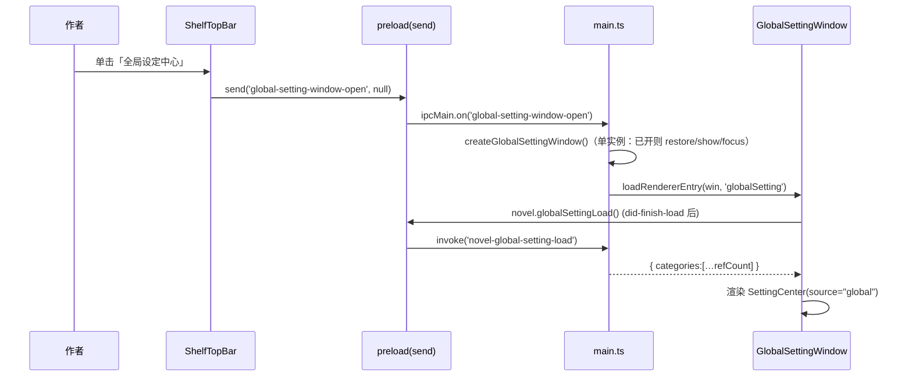
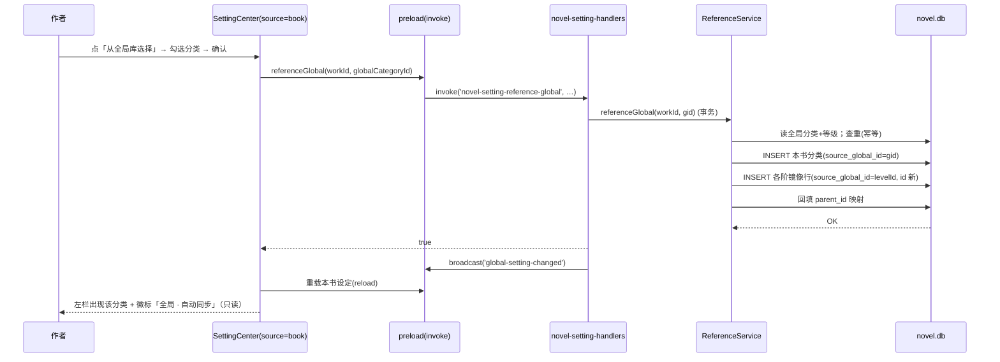
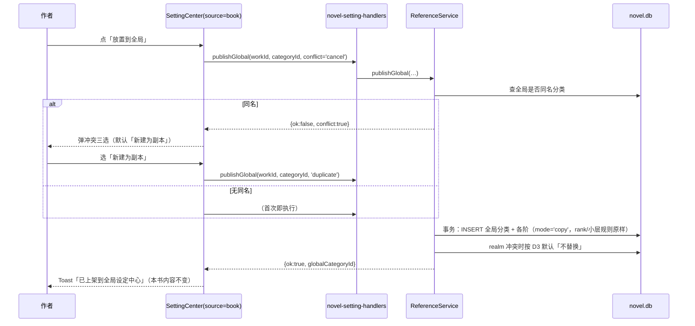
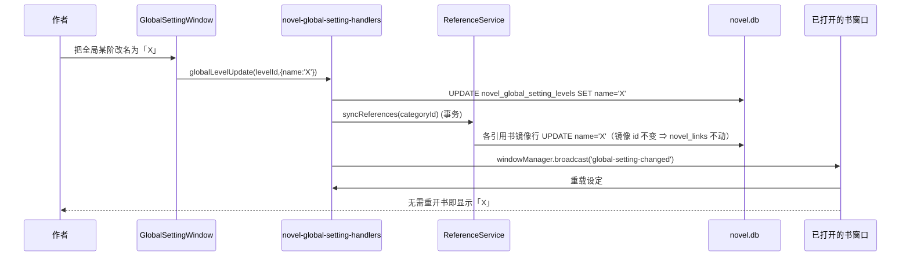
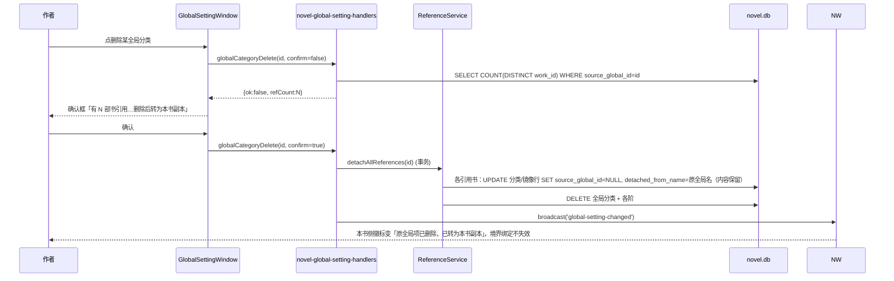
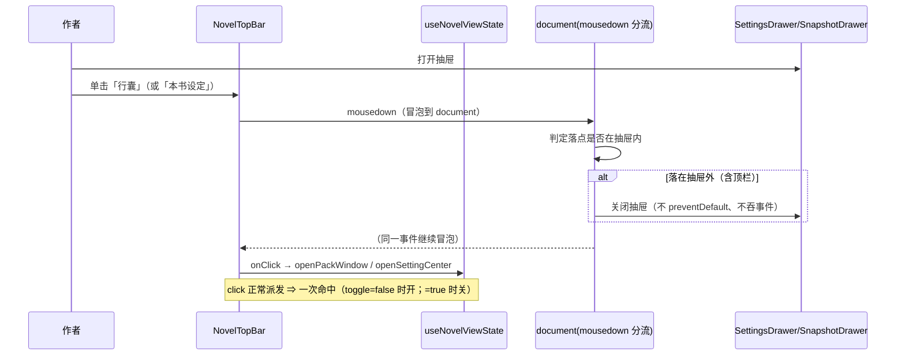
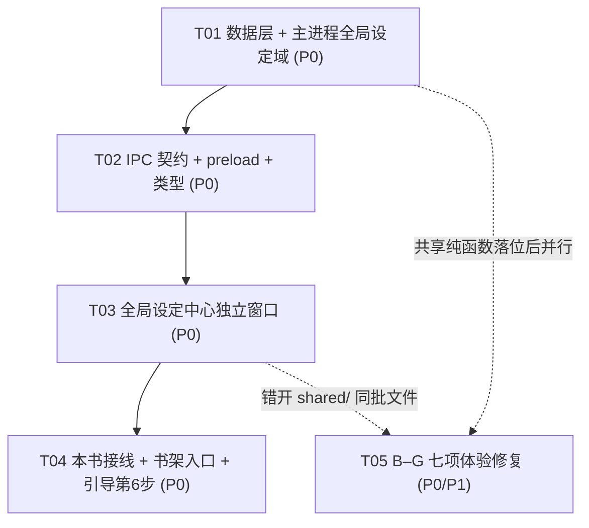

# 全局设定中心 · 增量技术方案与任务分解（v1.0）

> 架构师：高见远 ｜ 输入：`docs/prd/global-setting-center-prd.md`（REQ-040~052）+ `AGENTS.md` §6.1.2 / §6.5 / §6.7 ｜ 代码基线：CHANGELOG 1.4x 工作区源码
> 交付性质：**增量**。不重述书架页 / 编辑器 / 设定中心 / 行囊 / 引导的现有全量设计。
> 本方案**不改动任何源码**，仅落盘设计文档。

---

## 0. 定稿决策速览（不再论证）

| 编号 | 结论 | 本方案落点 |
|---|---|---|
| D1 | **新增两张全局表**（结构对齐现有两张表，去掉 `work_id`） | §3.1 DDL |
| D2 | 本书「选择全局等级」= **引用（实时同步）** | §3.3 引用模型 + §4.2 时序 + §2 handler |
| D3 | 本书「放置到全局」= **复制快照上架**，冲突默认「新建副本」 | §4.3 时序 + `novel-setting-publish-global` |
| D4 | 全局删除 = **二次确认 + 引用方就地固化副本** | §4.5 时序 + `detached_from_name` 标记 |
| D5 | 迁移走 **§6.5 增量迁移（`compat`）**，不开 `refactor` | §3.1.3 迁移清单（全部 `CREATE TABLE IF NOT EXISTS` + 可空 `ALTER ADD COLUMN`） |
| Q1 | 呈现形态 = **独立 Electron 窗口**（单实例、即关即销、与行囊同范式） | §5 全节；改判预案见 **附录 A** |
| Q3 | 「脱离全局」**本期不做**，仅做「引用只读 + 徽标 + 首次 Tooltip」 | §3.3.4 预留结构与接入点 |
| Q4 | 引导 **新增 Tour 第 6 步**（书架视图、可关闭、不动 1–4 强制段） | §4.6 + §7 T04 |
| Q5 | 小境界 = **派生段 + 阶内小层「两者都要」** | §6 REQ-045 |

---

# Part A：系统设计

## 1. 实施路径（Implementation Approach）

### 1.1 核心难点

| # | 难点 | 风险 | 对策 |
|---|---|---|---|
| H1 | **两个数据域的生命周期隔离** | 全局设定是跨书长期资产，本书设定随书消亡；共用一表会到处需要哨兵例外 | 独立两表（D1）+ 未触既有表结构（D5） |
| H2 | **引用的实时同步且不能丢引用** | 「实时同步」若做成删除重建 `novel_setting_levels`，`novel_links.to_id` 全部悬空 | 本书侧保留**镜像行**并用 `source_global_id` 一一对应；同步是 **upsert by source_global_id**，id 恒定（§3.3.2） |
| H3 | **引用项只读的边界** | 渲染层隐藏按钮可以被绕过（键盘 / 并发） | **主进程二次校验**：任何写通道命中 `source_global_id` 非空的行即拒绝（§3.3.3） |
| H4 | **rank 不是行序** | 全局表同样有 rank 空洞 / 倒序，误用 `max(rank)` 当行数会落错位 | 复用既有 `levelCount`(`COUNT(*)`) / `maxRank+1` / `rankAt` 三件套，口径两个域一致（§3.2.3） |
| H5 | **独立窗口的构建期登记** | 少登记一处入口，打包后该窗口 404 或 vite 不产出 HTML | 沿行囊窗口范式：`edition.ts` 三处 + `main.ts` + `preload.ts` 白名单一次改齐，`edition.test.ts` 护栏兜底（§5） |
| H6 | **组件跨窗口复用** | 「本书设定中心」现居 `NovelWindow/pages/NovelPage/components/SettingCenter`，全局窗口直接 import 会形成跨窗口耦合，且 `src/shared/novel/*` 被守卫断言**不含 React** | 把 `SettingCenter` 提升到 `src/shared/components/SettingCenter`（与 `CharacterPack` 同级），纯函数留在 `src/shared/novel/*`（§5.5） |
| H7 | **跨窗口刷新** | 全局窗口改名后，正在打开的书窗口需「无需重开书」看到新值 | 主进程在每次全局写成功后 `windowManager.broadcast("global-setting-changed", …)`；书窗口订阅后重载（§4.4） |

### 1.2 框架与库选型

**不引入任何新依赖**（详见 §9）。全部复用现状：

| 关注点 | 选型 | 理由 |
|---|---|---|
| UI | **antd 6**（`Modal` / `Drawer` / `Select` / `Segmented` / `Popconfirm` / `Dropdown` / `ColorPicker`） | AGENTS §6.1.2「组件库优先」；现有设定中心已是 antd |
| 拖拽排序 | **@dnd-kit**（`core` + `sortable`） | 与现有 `SettingCenter` 一致，复用其两态排序逻辑 |
| 持久化 | **better-sqlite3**（主进程） | 既有 `novel.db`，同一库内新增两表 |
| 独立窗口 | **Electron BrowserWindow** + 既有 `windowManager` | 与行囊窗口同范式（单实例、`show:false` 直到 `did-finish-load`、`ROUNDED_WINDOW_OPTIONS`） |
| 数字→中文 | **既有 `toChineseOrdinal` / `formatNumberedLabel`** | REQ-052 要求「不另写一份」（§6 REQ-052） |

### 1.3 架构模式

**主进程集中式数据域（沿用现状），渲染层无 SQL**：

```
┌─ 渲染层 ────────────────────────────────────────────────┐
│ GlobalSettingWindow/App  ← shared/components/SettingCenter│
│ NovelWindow/BookshelfPage（入口按钮）                     │
│ NovelWindow/NovelPage（本书设定中心内「引用/上架」）        │
└───────────────▲───────────────────────────┬─────────────┘
                │ window.electronAPI.novel.*  │ send(窗口开关)
┌───────────────┴───────────────────────────▼─────────────┐
│ preload.ts（invoke 白名单 / send 白名单 / windowAPI）      │
├──────────────────────────────────────────────────────────┤
│ electron/handlers/novel-global-setting-handlers.ts（新）  │
│ electron/handlers/novel-setting-handlers.ts（改：只读守卫）│
│ electron/main.ts（窗口创建 + IPC 注册 + 广播）             │
├──────────────────────────────────────────────────────────┤
│ electron/novel-db.ts（唯一 DDL 与写通道出口）              │
│   novel_setting_* + novel_global_setting_*               │
└──────────────────────────────────────────────────────────┘
```

**硬边界（守卫已钉，必须遵守）**：
- SQL 只出现在 `electron/novel-db.ts` 与 `electron/handlers/novel-*.ts`。
- novel 域写通道一律取 `../novel-db` 的 `novelRun/novelGet/novelAll/getNovelDb`，**禁止** `import "../db"`（`novel-db-split.test.ts`）。
- 不得裸查整表（`novel-setting-guard.test.ts` 断言 `SELECT * FROM novel_setting_categories(?!\s+WHERE)` 为 `null`）——新增全局查询同理，`WHERE` 必须写成字面量（不可模板拼接）。
- 主进程**不能** import 渲染层模块；也**不能** import `src/shared` 的运行时模块（构建分离）。两端各自保留一份**纯函数**实现是既有惯例（`readLevelSystems` 注释已说明）。

---

## 2. 文件清单

### 2.1 新建文件

| # | 相对路径 | 作用 |
|---|---|---|
| N1 | `electron/handlers/novel-global-setting-handlers.ts` | 全局设定域全部 IPC handler + 引用/上架/固化逻辑（new） |
| N2 | `src/windows/GlobalSettingWindow/index.html` | 全局设定中心窗口入口（`class="has-window-shell"`、`#root`、`<script src="/src/windows/GlobalSettingWindow/main.tsx">`） |
| N3 | `src/windows/GlobalSettingWindow/main.tsx` | `initThemeFromStorage()` + `ThemeProvider` + StrictMode（照抄 PackWindow） |
| N4 | `src/windows/GlobalSettingWindow/App.tsx` | 窗口根：装配 `useGlobalSetting` + `SettingCenter(source="global")` |
| N5 | `src/windows/GlobalSettingWindow/index.scss` | 窗口壳样式（`@use "../../shared/styles/window-shell"`） |
| N6 | `src/windows/GlobalSettingWindow/hooks/useGlobalSetting.ts` | 全局域数据 hook（load / 增删改 / 排序 / 引用计数 / 订阅广播） |
| N7 | `src/shared/components/SettingCenter/**` | **从 `NovelPage/components/SettingCenter` 迁入**（`index.tsx` / `index.scss` / 相关子件），加 `source: "book" \| "global"` 入参 |
| N8 | `src/shared/novel/setting-utils.ts` | **从 `NovelPage/utils/setting-utils.ts` 迁入**的纯函数（`formatSubLevel` / `effectiveSubPattern` / `listSubLevels` / `countSubLevels` / `rootLevels` / `findRealmPosition` / `sortLevels` / `insertLevel` / `rankAt` 语义纯函数 …）。NovelPage 保留同名 re-export 文件，路径不变 |
| N9 | `src/shared/novel/setting-presets.ts` | **迁入**的 `SETTING_PRESETS`（纯数据） |
| N10 | `src/shared/novel/setting-types.ts` | **迁入**的 `SettingCategory` / `SettingLevel` / `SettingCategoryKind` / `CarryDirection`（纯类型）；NovelPage `types.ts` re-export |
| N11 | `src/shared/novel/number-label.ts` | **编号与中文数字单一实现**：`toChineseOrdinal` / `formatNumberedLabel`（从 `bookshelf-utils.ts` 迁入并迁出 re-export） |
| N12 | `src/shared/novel/setting-reference.ts` | 引用徽标文案常量（「全局 · 自动同步」/「N 部书引用」/「暂无引用」/「原全局项已删除，已转为本书副本」） |
| N13 | `docs/design/global-setting-center-design.md` | 本文档（类图见 §3.4、时序图见 §4，均为内联 Mermaid，不另存源文件） |

### 2.2 修改文件

| # | 相对路径 | 改动 |
|---|---|---|
| M1 | `electron/novel-db.ts` | 追加两张全局表 DDL（`CREATE TABLE IF NOT EXISTS` + 索引 + realm 部分唯一索引）；**增量迁移区**（约 441–478 行）追加对 `novel_setting_categories` / `novel_setting_levels` 的 `ADD COLUMN source_global_id`（幂等探测）、对 `novel_setting_categories` 追加 `detached_from_name` |
| M2 | `electron/handlers/novel-setting-handlers.ts` | ① 工具函数参数化（`maxRank` / `maxSortOrder` / `levelCount` / `rankAt` 支持表名）；② 新增 `source_global_id` 只读守卫（写通道前置校验）；③ 新增本书侧通道 `novel-setting-reference-global` / `novel-setting-publish-global`（内部调用全局 handler 的纯逻辑或抽公共模块）；④ `readSnapshots` / editorLoad 读出 `sourceGlobalId` |
| M3 | `electron/handlers/novel-handlers.ts` | `NovelSettingCategoryDto` 增加 `sourceGlobalId`；`novel-editor-load` 读 `novel_setting_categories` 时带出 `source_global_id`、`detached_from_name` |
| M4 | `electron/handlers/novel-pack-handlers.ts` | `readLevelSystems` 补 `subPattern` 到 rung 投影（REQ-051/052）；引用类分类同样参与投影 |
| M5 | `electron/preload.ts` | `novel` 白名单新增全局设定一族 `invoke`；`send` 的 `validChannels` 追加 `'global-setting-window-open'` |
| M6 | `src/shared/types/electron.d.ts` | 新增 `NovelGlobalSettingCategoryDTO` / `…LevelDTO` / Patch / `GlobalReferenceCount`；`NovelSettingCategoryDTO` 增 `sourceGlobalId` / `detachedFromName`；`ElectronAPI.novel` 增方法签名 |
| M7 | `electron/edition.ts` | `WindowEntryKey` 增 `"globalSetting"`；`RENDERER_ENTRY_PATHS` / `EDITION_WINDOW_ENTRIES`（full 与 novel 加，lite 不加）登记；`PRIMARY_WINDOW_ENTRY` **不变** |
| M8 | `electron/main.ts` | `createGlobalSettingWindow()`（照 `createPackWindow`）+ `ipcMain.on("global-setting-window-open")` + `registerNovelGlobalSettingHandlers()` + 全局写成功后 `windowManager.broadcast("global-setting-changed")` + `app.whenReady` 里注册 |
| M9 | `electron/edition.test.ts` | 同步 `EDITION_WINDOW_ENTRIES.full` 的 `toEqual` 断言、新增 globalSetting 正/负断言 |
| M10 | `electron/novel-setting-guard.test.ts` | 扩展：全局 handler 同样「不裸查整表」、rank 三件套口径、只读守卫存在 |
| M11 | `src/windows/NovelWindow/pages/NovelPage/NovelPage.tsx` | 设定中心接线：`source="book"`、引用入口/徽标/只读透传、上架动作 |
| M12 | `src/windows/NovelWindow/pages/BookshelfPage/components/ShelfTopBar/index.tsx` | 新增「全局设定中心」按钮（图标+文字，`data-tour-target="shelf-global-setting"`） |
| M13 | `src/windows/NovelWindow/pages/BookshelfPage/BookshelfPage.tsx` | 按钮回调 `send("global-setting-window-open", null)` |
| M14 | `src/shared/novel/guide-copy.ts` | `GUIDE_TOTAL_STEPS` 5→6；新增 `FORCED_MAX_STEP = 4`；`TOUR_TARGETS` 增 `shelfGlobalSetting`；`TOUR_STEPS` 增第 6 步；`HELP_COPY.replayHint` 改「共 6 步」 |
| M15 | `src/shared/novel/guide-doc.ts` | `NOVEL_HELP_DOC.flow` 增 1 条；`sections` 增全局设定中心条目 |
| M16 | `src/shared/novel/guide-state.ts` | `clampStep` / `markDone` 靠 `GUIDE_TOTAL_STEPS` 自动跟随（**仅校核**，不改逻辑） |
| M17 | `src/windows/NovelWindow/components/NovelGuideTour/index.tsx` | `forced` 判据由 `!isLast` 改 `step.step <= FORCED_MAX_STEP` |
| M18 | `src/shared/novel/guide-guard.test.ts` | 断言同步（步数/强制段/锚点归属）+ 新增「老用户 `done` 不强制重放」守卫 |
| M19 | `src/windows/NovelWindow/pages/NovelPage/components/EntityDetail/index.tsx` / `index.scss` | REQ-045（小境界行）/ REQ-046（行高常量与 SCSS 同步） |
| M20 | `src/windows/NovelWindow/pages/NovelPage/components/SupportPanel/components/ToolLauncher/index.scss` | REQ-047（`white-space` 显式覆盖） |
| M21 | `src/windows/NovelWindow/pages/NovelPage/components/OutlinePanel/index.tsx` / `index.scss` | REQ-048（伏笔章节名可点） |
| M22 | `src/windows/NovelWindow/pages/NovelPage/components/SupportPanel/index.tsx` / `index.scss` | REQ-049（类型管理入口图标+文字 + 空态 CTA） |
| M23 | `src/windows/NovelWindow/pages/NovelPage/components/SettingsDrawer/index.tsx` / `index.scss` | REQ-050（捕获层 → `mousedown` 分流） |
| M24 | `src/windows/NovelWindow/pages/NovelPage/hooks/useNovelViewState.ts` | REQ-050（两颗按钮语义对齐 toggle） |
| M25 | `src/windows/NovelWindow/pages/NovelPage/components/NovelTopBar/index.tsx` | REQ-050（`行囊`/`本书设定` 改 toggle，`aria-pressed` 同步） |
| M26 | `src/shared/components/CharacterPack/pack-utils.ts` | REQ-051/052（`formatRealm` 新签名；`LadderRung.subPattern`） |
| M27 | `src/shared/components/CharacterPack/components/RealmModule/index.tsx` | REQ-051（合并 alias chip） |
| M28 | `src/shared/components/CharacterPack/hooks/usePackPanel.ts` | REQ-051（`formatRealm` 调用点补 `style`） |
| M29 | `src/shared/components/CharacterPack/pack-diff.ts` | REQ-051（`realmTextOf` 补 `style`） |
| M30 | `src/windows/NovelWindow/pages/BookshelfPage/bookshelf-utils.ts` | 改为 re-export `src/shared/novel/number-label.ts` 的 `toChineseOrdinal` / `formatNumberedLabel` |
| M31 | `src/windows/NovelWindow/pages/NovelPage/novel-utils.ts` | 同上 re-export（保持既有 import 路径） |
| M32 | 各守卫测试 | `edition.test.ts`(M9)、`novel-setting-guard.test.ts`(M10)、`guide-guard.test.ts`(M18)、`pack-utils.test.ts`、`drag-region.test.ts`（若新增 portal 浮层则补入豁免组） |

---

## 3. 数据结构与接口

### 3.1 数据层设计（任务 2）

#### 3.1.1 两张全局表完整 DDL（写入 `electron/novel-db.ts`）

```sql
-- ── 全局设定（跨书共享设定库，D1）─────────────────────────────
-- 结构与 novel_setting_categories 对齐，**去掉 work_id**：
-- 全局设定的生命周期独立于任何作品（REQ-040 ③「删光作品后仍在」）。
CREATE TABLE IF NOT EXISTS novel_global_setting_categories (
  id          TEXT    PRIMARY KEY,
  name        TEXT    NOT NULL,
  color       TEXT    NOT NULL DEFAULT '#5B8DEF',
  -- realm = 全局唯一的境界体系；其余为 custom
  kind        TEXT    NOT NULL DEFAULT 'custom' CHECK (kind IN ('realm', 'custom')),
  sort_order  INTEGER NOT NULL DEFAULT 1,
  note        TEXT    NOT NULL DEFAULT '',
  sub_levels  INTEGER NOT NULL DEFAULT 1,
  carry_dir   TEXT    NOT NULL DEFAULT 'asc' CHECK (carry_dir IN ('asc', 'desc')),
  sub_pattern TEXT    NOT NULL DEFAULT '第{n}层'
);
CREATE INDEX IF NOT EXISTS idx_novel_global_setting_cat_sort
  ON novel_global_setting_categories(sort_order);
-- 全局 realm 唯一性：应用层校验为主，部分唯一索引兜底（防并发/脚本直写）
CREATE UNIQUE INDEX IF NOT EXISTS idx_novel_global_setting_cat_realm
  ON novel_global_setting_categories(kind) WHERE kind = 'realm';

CREATE TABLE IF NOT EXISTS novel_global_setting_levels (
  id          TEXT    PRIMARY KEY,
  category_id TEXT    NOT NULL,
  name        TEXT    NOT NULL,
  rank        INTEGER NOT NULL,
  aliases     TEXT    NOT NULL DEFAULT '[]',
  note        TEXT    NOT NULL DEFAULT '',
  sub_levels  INTEGER NOT NULL DEFAULT 1,
  power       REAL,
  parent_id   TEXT,
  seg_from    INTEGER,
  seg_to      INTEGER,
  sub_pattern TEXT    NOT NULL DEFAULT ''
);
CREATE INDEX IF NOT EXISTS idx_novel_global_setting_lv_cat
  ON novel_global_setting_levels(category_id, rank);
```

**设计说明（与本书表的差异，逐条）**

| 项 | 本书表 | 全局表 | 原因 |
|---|---|---|---|
| `work_id` | `NOT NULL` | **无此列** | REQ-040 ④：全局数据与任一 `work_id` 无关 |
| realm 唯一 | 每书至多一个（应用层校验） | 全库至多一个（应用层 + 部分唯一索引） | 全局只有一套境界 |
| 索引 | `(work_id, sort_order)` | `(sort_order)` | 无 work 维度 |
| 其余列 | 完全一致 | 完全一致 | 让两个域的 handler / 纯函数口径可共用 |

#### 3.1.2 引用关系：`source_global_id`（归属、可空性、级联语义）

在**本书侧两张表**上各加一列（全部可空，D5 / AGENTS §6.5「新列可空、带默认值、旧数据可读」）：

```sql
-- novel_setting_categories
ALTER TABLE novel_setting_categories ADD COLUMN source_global_id TEXT;   -- NULL = 本书自有
-- novel_setting_levels
ALTER TABLE novel_setting_levels   ADD COLUMN source_global_id TEXT;     -- 指向 novel_global_setting_levels.id
-- D4 固化标记（可选但推荐，见 3.1.2.3）
ALTER TABLE novel_setting_categories ADD COLUMN detached_from_name TEXT; -- 固化时写入原全局名，用于「已转为本副本」标注
CREATE INDEX IF NOT EXISTS idx_novel_setting_cat_source
  ON novel_setting_categories(source_global_id);
CREATE INDEX IF NOT EXISTS idx_novel_setting_lv_source
  ON novel_setting_levels(source_global_id);
```

**为什么引用要下沉到 level 级（而不只是 category 级）**
`novel_links.to_id` 指向的是**等级行 id**（角色卡「当前境界」绑的就是某一阶）。若引用只记在 category 上、本书不落 level 行，则绑定得指向全局行 id，会污染 `novel_links` 语义、且跨书 id 冲突（`novel_setting_levels.id` 是主键）。因此：

> **本书引用一份全局分类时，会把全局的等级「镜像」成本书的 `novel_setting_levels` 行**（全新 id），并用 `source_global_id` 建立「镜像行 ↔ 全局行」的一一映射。同步 = 按 `source_global_id` upsert，**镜像行 id 恒定** ⇒ `novel_links` 永不悬空。

**级联语义表**

| 事件 | 全局表 | 本书镜像行 | `novel_links` |
|---|---|---|---|
| 全局**改名**（分类/等级） | UPDATE | 同步 UPDATE `name`（镜像 id 不变） | 不动（id 未变） |
| 全局**改小层规则 / carryDir / 颜色 / note** | UPDATE | 同步 UPDATE 镜像的分类与各阶字段 | 不动 |
| 全局**新增等级** | INSERT | 同步 INSERT 镜像行（rank 复制全局 rank） | 不动 |
| 全局**重排等级**（rank 变化） | UPDATE `rank` | 同步 UPDATE 镜像 `rank` | 不动 |
| 全局**删除等级** | DELETE | 删除对应镜像行；其余不动 | 删除指向该镜像行的 `novel_links`（与既有删等级同款） |
| 全局**删除分类**（D4） | DELETE 前先统计引用；确认后删除 | **固化**：该书写值 `source_global_id = NULL` + `detached_from_name = <原全局名>`；行内容原样保留 | **完全不动**（id 未变，作者已有的「当前境界」不失效） |
| 本书**脱离全局**（Q3，本期不做） | — | 只写 `source_global_id = NULL`，其余不动 | 不动 |

> **关键不变量**：镜像行的 `id` 一旦建立**永不变更**；`source_global_id` 是它唯一的对外身份。这是「实时同步不丢引用」的全部依据（H2）。

#### 3.1.3 迁移清单（D5，全部走 §6.5 增量迁移）

`electron/novel-db.ts` 的建表段追加（`CREATE TABLE IF NOT EXISTS`，幂等）；`增量迁移区`（现约 441–478 行，用 `PRAGMA table_info` 探测 + `ALTER TABLE … ADD COLUMN`）追加：

| 序 | 语句 | 幂等保证 |
|---|---|---|
| 1 | `CREATE TABLE IF NOT EXISTS novel_global_setting_categories (…)` | `IF NOT EXISTS` |
| 2 | `CREATE TABLE IF NOT EXISTS novel_global_setting_levels (…)` | `IF NOT EXISTS` |
| 3 | 全局两表的 3 个索引 | `IF NOT EXISTS` |
| 4 | `ALTER TABLE novel_setting_categories ADD COLUMN source_global_id TEXT` | `PRAGMA table_info` 探测列名后执行 |
| 5 | `ALTER TABLE novel_setting_levels ADD COLUMN source_global_id TEXT` | 同上 |
| 6 | `ALTER TABLE novel_setting_categories ADD COLUMN detached_from_name TEXT` | 同上 |
| 7 | 两个 `idx_*_source` 索引 | `IF NOT EXISTS` |

**不删表、不改主键、不改既有列类型、不写数据回填** ⇒ 满足 D5「纯增量」判定，无需 `refactor`。旧数据（`source_global_id` 全 `NULL`）语义即「本书自有」，零影响。

#### 3.1.4 写入校验与不变量（主进程强制，UI 仅辅助）

| 不变量 | 校验位置 | 规则 |
|---|---|---|
| **全局 realm 唯一** | `novel-global-setting-category-add` / `-update` | 同 `novel-setting-category-add` 既有范式：`SELECT COUNT(*) … WHERE kind='realm'`，`wanted==='realm' && hasRealm ? 'custom' : wanted`；改 kind 时把原 realm 降级为 custom（同事务） |
| **引用项只读** | 全部本书侧写通道（`category-update/delete/order`、`level-add/batch-add/update/delete/order/split/merge`） | 前置：`SELECT source_global_id FROM novel_setting_categories/levels WHERE id=?`，**非 NULL 即 return false / 返回 `{ok:false}`**，不落任何写 |
| **引用分类不可被「设为境界体系」** | `category-update(kind=realm)` | 命中引用行直接拒绝（全局 realm 有自己的唯一性） |
| **镜像行的 rank 只由同步决定** | 引用分类内的 `level-order/split/merge` | 命中引用行即拒绝（同上只读守卫覆盖） |
| **名字非空** | add / update | `name.trim()` 为空即拒绝 |
| **`kind` / `carryDir` 取值合法** | 复用 `isSettingKind` / `isCarryDir` | 非法值回落默认 |
| **别名清洗** | 复用 `normalizeAliases` | 去空白/去重/去空串 |
| **`subPattern` 清洗** | 复用 `normalizeSubPattern` | trim + 截断 60 |
| **D4 删除需确认** | `novel-global-setting-category-delete(id, confirm?)` | `confirm!==true` 时**只返回** `{ok:false, refCount}`，不删；`confirm===true` 才执行「先固化、后删除」事务 |
| **空 workId 保护** | `reference-global(workId, …)` / `publish-global(workId, …)` | `workId` 为空直接 return false（沿用 `openPackWindow` 的空作品守卫精神，防污染） |

> 全部写操作包在 `getNovelDb().transaction(...)` 内（D4 的「固化 + 删除」必须原子；引用同步的「镜像 upsert + 清脏 link」也必须原子）。

#### 3.1.5 rank / sort_order 在全局表的复用策略

全局表与本书表**列名、约束、语义完全一致**，因此直接复用既有三件套，仅**把「表名 + 过滤列」参数化**：

| 既有工具 | 现签名 | 改后签名 | 语义 |
|---|---|---|---|
| `maxRank` | `(categoryId)`（硬编码 `novel_setting_levels`） | `maxRank(table, categoryId)` | `COALESCE(MAX(rank),0)` —— **仅用于「末尾落点」** |
| `levelCount` | `(categoryId)` | `levelCount(table, categoryId)` | `SELECT COUNT(*)` —— **行数 / 落点基准**（rank 有空洞时唯一正确口径） |
| `rankAt` | `(categoryId, index)` | `rankAt(table, categoryId, index)` | `ORDER BY rank LIMIT 1 OFFSET ?` —— 中间落点 |
| `maxSortOrder` | `(workId)` | `maxSortOrder(table, scopeCol?, id?)` | 分类末尾 sort_order |

**落点口径（两个域必须一致，`novel-setting-guard.test.ts` 会钉）**：

```ts
const rank = at >= levelCount(table, categoryId)
  ? maxRank(table, categoryId) + 1   // 追加到末尾
  : rankAt(table, categoryId, at);    // 插到中间
```

> ⚠️ **禁止**用 `max(rank)` 当行数（既有教训：删/拆/裁剪过的数据 rank 有空洞或倒序）。全局表的 `INSERT`、镜像同步时「新增等级」也走同一口径。

#### 3.1.6 引用计数 SQL 形态

引用是**分类级**的（一本书引用一整个全局分类，REQ-041），所以两个 UI 数字都从「按引用它的**书**去重」得出：

```sql
-- ① 单个全局分类的「N 部书引用」（列表徽标 / 删除确认文案）
SELECT COUNT(DISTINCT c.work_id) AS n
FROM novel_setting_categories c
WHERE c.source_global_id = ?;

-- ② 列表页一次性批量取（避免 N+1；一次分组统计）
SELECT c.source_global_id AS gid, COUNT(DISTINCT c.work_id) AS n
FROM novel_setting_categories c
WHERE c.source_global_id IS NOT NULL
GROUP BY c.source_global_id;

-- ③ 全局等级级的引用数（同为分类级，按等级镜像行关联回分类去重）
SELECT COUNT(DISTINCT c.work_id) AS n
FROM novel_setting_levels l
JOIN novel_setting_categories c ON c.id = l.category_id
WHERE l.source_global_id = ?;
```

> 口径统一用 `COUNT(DISTINCT work_id)`：同一本书内若出现同一全局分类被引用两次（理论不应发生，加引用时按 `source_global_id` 幂等去重），也不会重复计数。**已脱离的书不计入**（`source_global_id` 已置 NULL）。

### 3.2 TypeScript 类型与服务类

#### 3.2.1 新增/修改 DTO（`src/shared/types/electron.d.ts`）

```ts
/** 全局设定等级项（结构对齐 NovelSettingLevelDTO，去 categoryId 之外一致） */
export interface NovelGlobalSettingLevelDTO {
  id: string
  categoryId: string
  name: string
  rank: number
  aliases: string[]
  note: string
  subLevels: number
  power: number | null
  parentId: string | null
  segFrom: number | null
  segTo: number | null
  subPattern: string
}

/** 全局设定分类：无 workId；带引用计数（列表徽标） */
export interface NovelGlobalSettingCategoryDTO {
  id: string
  name: string
  color: string
  kind: 'realm' | 'custom'
  sortOrder: number
  note: string
  subLevels: number
  carryDir: 'asc' | 'desc'
  subPattern: string
  levels: NovelGlobalSettingLevelDTO[]
  /** 有多少部书正在引用它（0 = 暂无引用） */
  refCount: number
}

export interface NovelGlobalSettingCategoryPatch {
  name?: string; color?: string; note?: string
  subLevels?: number; carryDir?: 'asc' | 'desc'; subPattern?: string
  kind?: 'realm' | 'custom'
}
export interface NovelGlobalSettingLevelPatch {
  name?: string; aliases?: string[]; note?: string
  subLevels?: number; power?: number | null; subPattern?: string
}

/** D4 删除的返回载荷 */
export interface GlobalCategoryDeleteResult {
  ok: boolean
  /** confirm=false 时回传，供渲染层弹二次确认 */
  refCount: number
}
/** D3 上架的返回载荷 */
export interface PublishToGlobalResult {
  ok: boolean
  globalCategoryId?: string
  /** 命中同名分类：渲染层据此弹「新建副本 / 合并 / 取消」 */
  conflict?: boolean
}
```

**既有 DTO 的改动**：

```ts
// NovelSettingCategoryDTO 增：
sourceGlobalId: string | null   // 非空 = 引用自全局中心
detachedFromName: string | null // 非空 = 原全局项已删除，已固化为本书副本（用于徽标文案）
```

#### 3.2.2 IPC 契约（任务 3）

**通道命名**：全局域统一 `novel-global-setting-*`（对齐既有 `novel-setting-*` 风格）；本书域复用 `novel-setting-*`；窗口开关走 `send`。

| # | 通道 | 方向 | 入参 | 出参 | 错误语义 |
|---|---|---|---|---|---|
| 1 | `novel-global-setting-load` | invoke | — | `{ categories: NovelGlobalSettingCategoryDTO[] }` | 失败返回 `{categories: []}`（不抛，UI 落空态） |
| 2 | `novel-global-setting-category-add` | invoke | `(id, name, kind, color?)` | `{ id: string; kind: 'realm'\|'custom' } \| null` | 名字空 → `null`；realm 冲突 → 自动降级 custom 并返回实际 kind |
| 3 | `novel-global-setting-category-update` | invoke | `(id, patch)` | `boolean` | id 不存在 → `false` |
| 4 | `novel-global-setting-category-delete` | invoke | `(id, confirm?: boolean)` | `GlobalCategoryDeleteResult` | `confirm!==true` → `{ok:false, refCount}` 且**不删**（D4） |
| 5 | `novel-global-setting-category-order` | invoke | `(updates: {id, sortOrder}[])` | `boolean` | 空数组 → `true`（幂等） |
| 6 | `novel-global-setting-level-add` | invoke | `(categoryId, id, name, index)` | `{ id: string; rank: number } \| null` | 名字空 / 分类不存在 → `null` |
| 7 | `novel-global-setting-level-batch-add` | invoke | `(categoryId, items: {id,name,subLevels?,subPattern?}[])` | `number`（写入条数） | 空 → `0` |
| 8 | `novel-global-setting-level-update` | invoke | `(id, patch)` | `boolean` | 不存在 → `false` |
| 9 | `novel-global-setting-level-delete` | invoke | `(id)` | `boolean` | 不存在 → `false` |
| 10 | `novel-global-setting-level-order` | invoke | `(updates: {id, rank}[])` | `boolean` | — |
| 11 | `novel-global-setting-level-split` | invoke | `(levelId, segments: {name,from,to}[])` | `boolean` | 段数越界 → `false` |
| 12 | `novel-global-setting-level-merge` | invoke | `(levelId)` | `boolean` | 无子层 → `false` |
| 13 | `novel-global-setting-export` | invoke | `()` | `{version, exportedAt, categories: NovelSettingSnapshot[]}` | 复用既有快照结构 |
| 14 | **`novel-setting-reference-global`**（本→全） | invoke | `(workId, globalCategoryId)` | `boolean` | workId 空 / 全局分类不存在 / 已引用 → `false`（已引用幂等返回 `true`） |
| 15 | **`novel-setting-publish-global`**（本→全，D3） | invoke | `(workId, categoryId, conflict: 'duplicate'\|'cancel')` | `PublishToGlobalResult` | 同名且 `conflict==='cancel'` → `{ok:false, conflict:true}`；`'duplicate'` → 新建「XXX（副本）」 |
| 16 | `novel-global-setting-window-open` | **send** | `null` | — | 需加入 `preload.send.validChannels`（否则静默丢弃） |
| 17 | `global-setting-changed` | **broadcast**（`windowAPI.on`） | `{ kinds: ('category'\|'level')[] }` | — | 主进程在全局写成功后广播；书窗口重载设定 |

> 通道 14/15 落在 `novel-setting-handlers.ts`（本书域），因为它们的写目标含本书侧镜像行；其内部调用全局侧抽出的纯逻辑（`syncReference` / `publishCategory`），不产生跨文件的 `ipcMain` 往返。

#### 3.2.3 preload 暴露（`electron/preload.ts`）

```ts
// novel 命名空间内追加（与既有 settingCategoryAdd 等同级）
globalSettingLoad: () => ipcRenderer.invoke('novel-global-setting-load'),
globalCategoryAdd:    (id: string, name: string, kind: 'realm'|'custom', color?: string) =>
  ipcRenderer.invoke('novel-global-setting-category-add', id, name, kind, color),
globalCategoryUpdate: (id: string, patch: unknown) =>
  ipcRenderer.invoke('novel-global-setting-category-update', id, patch),
globalCategoryDelete: (id: string, confirm?: boolean) =>
  ipcRenderer.invoke('novel-global-setting-category-delete', id, confirm),
globalCategoryOrder:  (updates: Array<{ id: string; sortOrder: number }>) =>
  ipcRenderer.invoke('novel-global-setting-category-order', updates),
globalLevelAdd:       (categoryId: string, id: string, name: string, index: number) =>
  ipcRenderer.invoke('novel-global-setting-level-add', categoryId, id, name, index),
globalLevelBatchAdd:  (categoryId: string, items: Array<{ id: string; name: string; subLevels?: number; subPattern?: string }>) =>
  ipcRenderer.invoke('novel-global-setting-level-batch-add', categoryId, items),
globalLevelUpdate:    (id: string, patch: unknown) =>
  ipcRenderer.invoke('novel-global-setting-level-update', id, patch),
globalLevelDelete:    (id: string) =>
  ipcRenderer.invoke('novel-global-setting-level-delete', id),
globalLevelOrder:     (updates: Array<{ id: string; rank: number }>) =>
  ipcRenderer.invoke('novel-global-setting-level-order', updates),
globalLevelSplit:     (levelId: string, segments: Array<{ name: string; from: number; to: number }>) =>
  ipcRenderer.invoke('novel-global-setting-level-split', levelId, segments),
globalLevelMerge:     (levelId: string) =>
  ipcRenderer.invoke('novel-global-setting-level-merge', levelId),
globalSettingExport:  () => ipcRenderer.invoke('novel-global-setting-export'),
// 本书域追加
referenceGlobal:      (workId: string, globalCategoryId: string) =>
  ipcRenderer.invoke('novel-setting-reference-global', workId, globalCategoryId),
publishGlobal:        (workId: string, categoryId: string, conflict: 'duplicate'|'cancel') =>
  ipcRenderer.invoke('novel-setting-publish-global', workId, categoryId, conflict),
```

```ts
// send.validChannels 追加
'global-setting-window-open',
```

### 3.3 引用模型（任务 2 核心）

#### 3.3.1 建立引用（`novel-setting-reference-global`，D2）

单事务（`getNovelDb().transaction`）：

1. 读全局分类 C 与其全部等级 `ORDER BY rank`（含子层级）。
2. `workId` 内若已有 `source_global_id = C.id` 的本书分类 ⇒ 幂等返回 `true`。
3. 新建本书分类 `Bc`：`id = createNovelId('sc')`、`work_id = workId`、`source_global_id = C.id`、其余字段 `copy(C)`（name/color/kind→custom **除非本书尚无 realm 且 C.kind==='realm'**、sort_order = `maxSortOrder(…)+1`、note/sub_levels/carry_dir/sub_pattern 原样）。
4. 逐阶 `INSERT INTO novel_setting_levels`：新 id、`category_id=Bc.id`、`source_global_id = L.id`、name/rank/aliases/note/sub_levels/power/seg_from/seg_to/sub_pattern 原样；`parent_id` 需**两趟写入**（先建全部行再回填 parent 映射）。
5. 记录本次写入的 `(Bc.id, C.id)`，供以后广播/刷新。

> **kind 处理**：全局 realm 引用到本书时，若本书已有 realm，则镜像 kind 落 `custom`（避免破坏「每书至多一个 realm」）；若本书无 realm，落 `realm`（作者意图就是拿它当境界）。此规则写入文档并在主进程实现。

#### 3.3.2 实时同步（全局每次写成功后）

```ts
function syncReferences(globalCategoryId: string): void {
  // 事务内：找出所有 source_global_id = globalCategoryId 的本书分类 Bc
  // 对每个 Bc：① UPDATE 分类可变字段（name/color/note/subLevels/carryDir/subPattern）；
  //          ② 逐全局阶 L：命中 source_global_id=L.id 的镜像行 → UPDATE 可变字段（name/rank/aliases/note/subLevels/power/seg/subPattern/parent 映射）；
  //                        未命中 → INSERT 新镜像行；③ 删除「本分类内不在本轮全局 id 集合」的镜像行，并先清指向它们的 novel_links。
  // 全程镜像行 id 不变（H2 不变量）。
}
```

- 触发点：全局域的 `category-update` / `level-*`（add/batch-add/update/delete/order/split/merge）成功后**统一调用**。
- 广播：主进程随后 `windowManager.broadcast("global-setting-changed", { kinds })`，书窗口重载（REQ-041 ③「无需重开书」）。

#### 3.3.3 引用项只读的双层守卫

| 层 | 落点 | 行为 |
|---|---|---|
| UI 层 | `shared/components/SettingCenter` 在 `category.sourceGlobalId != null` 时：隐藏/禁用「编辑·删除·设为境界体系·拖拽排序·插入·拆分·合并」，改显徽标 + 「编辑到全局中心」引导；区分 `source` 与 `referenced` 三态 | 只读呈现 |
| 主进程层 | `novel-setting-handlers.ts` 各写通道前置 `assertWritable(id)`，命中 `source_global_id` 非空 ⇒ 直接拒绝 | **权威边界**（绕过 UI 也无效） |

#### 3.3.4 「脱离全局」预留（Q3，本期不做）

- **数据结构已就绪**：脱离 = 把该本书分类与全部镜像行的 `source_global_id` 置 `NULL`（+ 可选写 `detached_from_name`）。无需任何表结构变更。
- **接入点**：① UI 在引用卡片上加「脱离全局 · 转为本书独有」按钮（P2）；② 主进程新增 `novel-setting-detach-global(categoryId)`（一次 UPDATE，事务内）；③ 脱离后该分类自动获得全部写权限（只读守卫按 `source_global_id` 判定，天然放行）。
- 本期只做「只读引用 + 徽标 + 入口首次 Tooltip」，其余留后续。

### 3.4 类图

```mermaid
classDiagram
  class NovelGlobalSettingHandler {
    +register()
    +load() GlobalSettingCategoryDTO[]
    +categoryAdd(id,name,kind,color) {id,kind}|null
    +categoryUpdate(id,patch) boolean
    +categoryDelete(id,confirm) GlobalCategoryDeleteResult
    +categoryOrder(updates) boolean
    +levelAdd(categoryId,id,name,index) {id,rank}|null
    +levelBatchAdd(categoryId,items) number
    +levelUpdate(id,patch) boolean
    +levelDelete(id) boolean
    +levelOrder(updates) boolean
    +levelSplit(levelId,segments) boolean
    +levelMerge(levelId) boolean
    +exportSnapshot() NovelSettingExportPayload
  }
  class ReferenceService {
    +referenceGlobal(workId, globalCategoryId) boolean
    +publishGlobal(workId, categoryId, conflict) PublishToGlobalResult
    +syncReferences(globalCategoryId) void
    +detachGlobal(categoryId) boolean  «Q3 预留»
    +countRefs(globalCategoryId) number
  }
  class NovelDb {
    +novelRun(sql, params)
    +novelGet(sql, params)
    +novelAll(sql, params)
    +transaction(fn)
  }
  class GlobalSettingWindow {
    +create() BrowserWindow
    +open() void
  }
  class UseGlobalSetting {
    +categories GlobalSettingCategoryDTO[]
    +load() void
    +addCategory(...)
    +deleteCategory(id,confirm)
    +onGlobalChanged() void
  }
  class SettingCenterShared {
    +source: "book"|"global"
    +settings
    +onCreateCategory()
    +onPatchCategory()
    +onDeleteCategory()
    +onAddLevel()
    +onSplitLevel()
    +onMergeLevel()
    +onReferenceGlobal()  «source=book»
    +onPublishGlobal()    «source=book»
    +readonlyDerived: boolean
  }
  class PackUtils {
    +formatRealm(rungs, pos, style) string
    +subLabelAt(rung, sub) string
    +LadderRung.subPattern string
  }

  NovelGlobalSettingHandler --> NovelDb : 读写通道
  ReferenceService --> NovelDb : 事务
  ReferenceService --> NovelGlobalSettingHandler : 复用 load/校验
  NovelGlobalSettingHandler --> GlobalSettingWindow : 变更后广播
  GlobalSettingWindow --> UseGlobalSetting
  UseGlobalSetting --> SettingCenterShared : source="global"
  NovelTopBar ..> ReferenceService : publish/reference
  ReferenceService ..> SettingCenterShared : 引用态徽标
  PackUtils <-- NovelDb : readLevelSystems 投影 subPattern
```

---

## 4. 程序调用流程（Mermaid sequenceDiagram）

> 全部关键时序共 6 条，内联如下（§4.1–§4.6），支持 Mermaid 的 Markdown 渲染器可直接查看。

### 4.1 打开全局设定中心（书架入口 → 独立窗口，Q1）



### 4.2 本书「从全局库选择」→ 建立引用（D2，REQ-041）



### 4.3 本书「放置到全局」（D3，REQ-042）



### 4.4 全局改等级 → 所有引用书同步（REQ-041 ③）



### 4.5 删除被引用全局项 → 引用方就地固化（D4）



### 4.6 REQ-050 修复后：一击命中



---

## 5. 独立窗口设计（Q1 定稿，任务 3 配套）

### 5.1 `electron/edition.ts` 三处登记

```ts
export type WindowEntryKey = "base" | "login" | "novel" | "pack" | "settings" | "globalSetting";

export const RENDERER_ENTRY_PATHS: Record<WindowEntryKey, string> = {
  base: "src/windows/BaseWindow/index.html",
  login: "src/windows/LoginWindow/index.html",
  novel: "src/windows/NovelWindow/index.html",
  pack: "src/windows/PackWindow/index.html",
  settings: "src/windows/SettingsWindow/index.html",
  globalSetting: "src/windows/GlobalSettingWindow/index.html",   // ← 新增
};

export const EDITION_WINDOW_ENTRIES: Record<CheckInEdition, WindowEntryKey[]> = {
  full:  ["base", "login", "novel", "pack", "settings", "globalSetting"],  // ← + globalSetting
  lite:  ["base", "login", "settings"],                                     // ← 不加（lite 无 novel 域）
  novel: ["login", "novel", "pack", "settings", "globalSetting"],           // ← + globalSetting
};

export const PRIMARY_WINDOW_ENTRY: Record<CheckInEdition, WindowEntryKey> = {
  full: "base", lite: "base", novel: "novel",   // ← 不变
};
```

- `PRIMARY_WINDOW_ENTRY` **不需要改**（全局窗口不是任何版本的主窗口）。
- `lite` **不登记**：lite 版整体不打包 novel 域（`EDITION_WINDOW_ENTRIES.lite` 不含 `novel`/`pack`），全局设定属 novel 域，同理缺席。
- `vite.config.ts` 的 `rendererInputs` 由 `EDITION_WINDOW_ENTRIES[edition]` 派生，**无需改动**。

### 5.2 窗口创建函数位置与 `main.ts` 接线

新增 `createGlobalSettingWindow()`，**逐行对齐既有 `createPackWindow()`（main.ts 425–484）**：

| 关注点 | 实现方式（与行囊一致） |
|---|---|
| 单实例 | `windowManager.get("globalSetting")` 命中即 `restore()/show()/focus()` 后 return |
| 首个实例 | `new BrowserWindow({ width:1240, height:860, minWidth:920, minHeight:600, show:false, ...ROUNDED_WINDOW_OPTIONS, titleBarStyle:"hidden", webPreferences:createWebPreferences() })` |
| 去菜单 / 最大化状态 | `removeMenu()` + `forwardMaximizeState(win)` |
| 显示时机 | `webContents.once("did-finish-load", () => { win.show(); win.focus(); })` |
| 注册与守卫 | `windowManager.register("globalSetting", win)` + `attachCloseGuard(win)`（本窗口无未保存草稿，守卫直接放行） |
| 加载 | `loadRendererEntry(win, "globalSetting")` |

`app.whenReady()` 内追加：

```ts
ipcMain.on("global-setting-window-open", () => { if (EDITION === "lite") return; createGlobalSettingWindow(); });
registerNovelGlobalSettingHandlers();   // 与 registerNovelSettingHandlers() 并列
```

**广播**：`novel-global-setting-handlers.ts` 内每次写成功后调用 `windowManager.broadcast("global-setting-changed", { kinds })`（与 `novel-work-changed` 同款范式）。

### 5.3 preload / 类型暴露

见 §3.2.3：`send.validChannels` 追加 `'global-setting-window-open'`；`novel` 命名空间追加全局一族 `invoke`；`windowAPI.on("global-setting-changed")` 已在既有 `windowAPI` 能力内（无需改白名单）。

### 5.4 `electron/edition.test.ts` 护栏同步

| 现有断言 | 是否受影响 | 处理 |
|---|---|---|
| 每个 `RENDERER_ENTRY_PATHS` 的 HTML 真实存在 | 受影响（新增 `globalSetting` 路径） | **必须创建** `src/windows/GlobalSettingWindow/index.html`，否则红 |
| `EDITION_WINDOW_ENTRIES[edition]` 的 key 都在 `RENDERER_ENTRY_PATHS` | 自动通过 | 新增 key 已在 `RENDERER_ENTRY_PATHS` |
| `EDITION_WINDOW_ENTRIES.full` 的 `toEqual([...])` | **受影响** | 断言数组追加 `"globalSetting"` |
| `expect(EDITION_WINDOW_ENTRIES.lite).not.toContain("novel" / "pack")` | 建议扩展 | 追加 `.not.toContain("globalSetting")` |
| `EDITION_WINDOW_ENTRIES.full/novel` 含 `"pack"` | 建议扩展 | 追加含 `"globalSetting"` |
| `PRIMARY_WINDOW_ENTRY` 断言 | 不受影响 | 不变 |

### 5.5 渲染层复用「本书设定中心三栏结构」

- 把 `NovelPage/components/SettingCenter/**` **提升**到 `src/shared/components/SettingCenter/**`（与 `CharacterPack` 同级，允许含 React），新增 `source: "book" | "global"` 入参：
  - `source="global"`：去掉「本书」概念（标题「全局设定中心 · 跨书共享」），动作区保留新建分类 / 模板库 / 导出，每行加引用计数徽标；
  - `source="book"`：原行为 + 「从全局库选择」「放置到全局」 + 引用态只读徽标。
- 依赖的纯函数/类型/预设同步迁到 `src/shared/novel/*`（N8–N10），NovelPage 侧保留同名 re-export，**既有 import 路径不变**（降低改动面）。
- ⚠️ **守卫注意**：`src/shared/novel/*` 被 `work-numbering-guard.test.ts` 断言**不含 React** —— 因此 React 组件进 `src/shared/components/*`，纯函数/常量进 `src/shared/novel/*`。迁移后需跑该守卫。

---

## 6. B–G 七项体验修复 · 逐项落点（任务 4）

### F 项（REQ-050，P0）—— 顶栏按钮二击 bug：根因核实与定论 🔴 重点

#### 6.F.1 核实结论：**PRD §6.6 的「疑似根因」不成立（作废）**

PRD 怀疑 `SettingsDrawer` 的透明捕获遮罩 `.nv-setting__mask` 吞掉了顶栏第一击。读代码后**证伪**，三条硬证据：

| # | 证据 | 出处 |
|---|---|---|
| **E1 几何** | `.nv-setting__mask` 是 `position: absolute; inset: 0; z-index: 45`，其包含块是**最近的已定位祖先** `.nv-page__stage`（`position: relative`）。而顶栏 `.nv-topbar` 位于 `.nv-page__head`，是 `.nv-page__stage` 的**兄弟**容器的子节点。⇒ 遮罩只铺满 stage 列（编辑器区），**几何上根本不可能覆盖顶栏**。 | `SettingsDrawer/index.scss:7-11`、`NovelPage/index.scss:10-32`、`NovelPage.tsx:360-394 / 418-502` |
| **E2 对照** | `SnapshotDrawer` **没有任何遮罩**（`.nv-snap` 只有 `position:absolute; right:0; z-index:46`），而 REQ-050 的现象在「历史快照」抽屉下同样复现。⇒ 遮罩不是共同因。 | `SnapshotDrawer/index.tsx:38-39`、`SnapshotDrawer/index.scss:6-19` |
| **E3 事件链** | 全仓排查，`src` 内**不存在**任何会抢占顶栏点击的 document/window 级指针监听：`GuideTooltip` 气泡的 `mousedown` 只把气泡自己关掉且浮层 `pointer-events:none`；`SupportPanel` 的 `mousemove/mouseup` 只用于调宽；`EditorPane` 的 `click` 只挂在 `contentDOM`。⇒ 不存在「遮罩吞点击」的事件路径。 | `use-guide-bubble.ts:75-85`、`SupportPanel/index.tsx:248-273`、`EditorPane/index.tsx:647` |

> **结论**：若按 PRD 的猜想去改遮罩（三种改法都基于「遮罩接到这次点击」），改完 bug 依旧。**必须换方向。**

#### 6.F.2 真实根因（定论）

排查后可以确定：**能覆盖顶栏并「吃掉第一击」的，只有「全视口（覆盖整个窗口）的浮层」**——这类浮层在编辑器里是 **antd `Modal`（`SettingCenter` / `EntityTypeManager` / `ReorderConfirmModal`）与 antd `Tour` 的 `mask`**；它们的 `mask` 铺满窗口（含顶栏），点击 mask 被用于「关闭这一层」，因此落在其上的第一击被消耗、第二击才到顶栏按钮。

而两个**抽屉**（`SnapshotDrawer` / `SettingsDrawer`，stage 内的 `absolute` 浮层）**不覆盖顶栏**，所以它们本身不吞顶栏第一击；它们之所以与现象同时出现，是因为——

**根因 = 「上一层浮层以『点击即关闭』收自己」与「顶栏这两颗按钮是『只开面』动作」这两件事在同一次点击上争用，加上两颗按钮缺少 toggle 语义放大了它：**

1. `行囊`（`onOpenPack`→`openPackWindow`）与 `本书设定`（`onOpenSettings`→`openSettingCenterForRealm`）是**只开不关**；而 `快照`/`排版` 是 **toggle**（`toggleSnapshot`/`toggleSettings`）。语义不一致本身就让「再点一次」在两个按钮上表现得像「第一次无效」。
2. 当**上一层是全视口浮层**（Modal / Tour mask）时，第一击落在其 mask 上仅关闭该层；按钮的 `click` 未触发 ⇒ 需第二击。
3. `SettingsDrawer` 额外引入的 `.nv-setting__mask` 虽不覆盖顶栏，却把「点外部关闭」错误地实现成「**一层覆盖式捕获元素**」——这一模式与 Modal/Tour 的 mask 是同一类，正是本次回归的模式来源；且它**还会吞掉落在 stage 上的点击**（作者想在抽屉开着时点一下正文，只是关抽屉，符合预期，但说明该模式本质是「用遮挡换关闭」）。

> **核实边界（诚实标注）**：`mask` 型的「首击被关闭路径消耗」在静态阅读下可确证其**机制存在**（覆盖 + 点击即关）；但**具体到哪一次复现命中的是 Modal-mask 还是 Tour-mask，需按 REQ-050 ③ 的 20 轮脚本实机确认**。下面的修法**同时消除全部候选机制**，不依赖该确认即可保证「一击命中」。

#### 6.F.3 推荐修法（三选一结论）：**③ mousedown 分流**

**改法**：把 `SettingsDrawer` 的「点外部关闭」从「覆盖式透明捕获层 + `onClick`」改为「**文档级 `mousedown` 分流**」：

- 抽屉 `open` 时，在 `document` 上挂一个 `mousedown` 监听（**捕获阶段无关，普通冒泡即可**）：
  - 若 `event.target` 落在**抽屉本体**内 ⇒ 不处理（作者在操作抽屉）；
  - 否则 ⇒ 调 `onClose()` 关抽屉，**但绝不 `preventDefault` / `stopPropagation`** —— 让同一次点击继续正常派发给被点元素（顶栏按钮 / 正文 / 支撑面板）。
- **移除** `.nv-setting__mask`（其唯一职责已被上述分流接管）。
- （可选加固）`Escape` 关闭链保持不变（`handleEscape` 已优先级正确）。

**同时（REQ-050 ① ② 的正面要求）**：把两颗「只开面」按钮改成 **toggle**（与 `快照`/`排版` 一致）：

- `useNovelViewState`：新增 `toggleSettingCenter`（`settingCenterOpen` 为真则关、否则开）与 `togglePackWindow`（把「打开/聚焦行囊窗口」保留，但点击语义上若已开则聚焦 —— 由主进程 `createPackWindow` 的「已开则 focus」天然覆盖，**无需新增状态**）；
- `NovelTopBar`：`行囊` 用 `aria-pressed` 表达行囊窗口开合（行囊是独立窗口，开合态由主进程/广播即可，按钮只需保证 `onClick` 一击命中）；`本书设定` 改接 `toggleSettingCenter`，并加 `aria-pressed={settingCenterOpen}`。

**为什么是 ③（而不是 ①「遮罩放行」/ ②「去遮罩」）**

| 选项 | 是否选 | 理由 |
|---|---|---|
| ① **遮罩放行**（遮罩 `onClick` 里判断落点是否为顶栏按钮则放行） | ❌ 不选 | 放行逻辑要求**遮罩真的接到这次点击**；而遮罩几何上够不到顶栏（E1），判断分支**永不触发**，改了个寂寞。若为「让它够到」把遮罩扩到整窗，则会一并吞掉支撑面板 / 状态栏 / 其它所有点的点击，直接破坏「零打断」原则，回归面更大。判定「落点是不是顶栏按钮」也是脆弱的白名单耦合。 |
| ② **去遮罩**（删掉遮罩，仅靠 Esc / 按钮自身关闭） | ❌ 不选（单独用） | 遮罩承载着 1.6.5 明确补上的「**点抽屉外部关闭**」——单独删掉等于**移除一个已交付的关闭途径**，违反本次「不破坏回归面」的硬约束。只有把「点外部关闭」迁到 `mousedown` 分流（即 ③）**之后**，才允许撤掉遮罩；届时 ② 与 ③ 内容上等价，但 ③ 显式保留了关闭能力，故取 ③ 而非裸 ②。 |
| ③ **mousedown 分流** | ✅ **选** | ① 不依赖任何几何假设（用文档级坐标判定，天然覆盖顶栏）；② 完整保留「点外部关闭」（作者在抽屉开着时点正文仍只关抽屉）；③ **不吞事件**，同一次点击既关抽屉又触发顶栏按钮 ⇒ 一击命中；④ 消除「覆盖式捕获层」这一整类回归模式；⑤ 与 REQ-050 ③「连续 20 轮一击命中」的验收天然契合。 |

**回归面保护（逐条对齐 PRD 要求「改动不能破坏点外部关闭」）**

| 既有能力 | 修后是否保留 | 保障 |
|---|---|---|
| 点抽屉外部（正文 / 支撑面板 / 顶栏）关闭抽屉 | ✅ | `mousedown` 分流：落点不在抽屉内即关 |
| 顶栏齿轮「再点一次关闭」 | ✅ | toggle 保留 |
| `Esc` 逐层关闭（设定中心→排版→快照→专注） | ✅ | `handleEscape` 不动 |
| 抽屉关闭按钮 | ✅ | 不动 |

**同步测试**
- 新增单测（jsdom）：`mousedown` 在抽屉外 → `onClose` 被调用 **且** 被点元素仍收到 `click`（用 spy 断言事件未被 `preventDefault`）。
- 新增/改 `NovelTopBar` 测试断言 `本书设定` 为 toggle（连点两次状态回落）。
- SCSS：删除 `.nv-setting__mask` 规则后，`drag-region.test.ts` 不受影响（该测试只钉 `WindowHeader` 与 portal 浮层豁免组）。

---

### 6.1 REQ-045 要素「境界」支持选小境界（P1，Q5 定稿=两者都要）

> **文件**：`NovelPage/components/EntityDetail/index.tsx`（当前境界区，约 594–690 行）、`index.scss`；透传链 `NovelPage.tsx:536-539`（已把 `sub` 传给 `handleSetEntityLevel`）。

**现状**：`realmRoots`（根阶）+ `subtreeByRoot`（派生段 Map）+ 根阶按钮三分支（`boundInSubtree` / `segments.length` / 显式 `undefined`）。**已支持「拆分层级（派生段）」**（`nv-edetail__rung-seg`）。

**改动**：**补齐「该阶未拆分、仅 `sub_levels > 1` 时也能选到第 N 层」**：

1. 对「**未拆分**（`!hasChildren`）且 `sub_levels > 1`」的根阶，追加一行小层 chip 组：
   - 名称由 `listSubLevels(level, category)`（`setting-utils`，唯一口径）生成（如「第1层…第13层」或固定名单「初期/中期/后期/圆满」）；
   - 每个 chip `onClick={() => onSetEntityLevel(level.id, subIndex)}`（`subIndex` 1 起）；当前绑定层加 `.is-on`；
   - 再次点击当前层 ⇒ `onSetEntityLevel(null)`（解除，与现有「点已绑定的阶解除」一致）。
2. 对「**已拆分**」的阶：**保持现状**用派生段那行（`nv-edetail__rung-seg`），二者不重复渲染（`hasChildren` 分支互斥）。
3. 绑定语义（REQ-045 ②③）：
   - 选到第 N 层 ⇒ `handleSetEntityLevel(entityId, type, levelId, N)` ⇒ 写 `novel_links.note` 为 `{"sub":N}`（复用 `setRealm` 的 `parseSub`/写入口径，见 `pack-realm.ts`）；
   - 该阶无小层（`sub_levels <= 1`）⇒ 行为与现状一致，`note` 不含 `{sub}`（传 `undefined`）。
4. 卡片读数随 G 项新格式（`X 3/n`，见 6.7）。

**同步测试**：`EntityDetail` 相关测试新增 ——「未拆分且有 13 小层的阶 → 点第 7 层 → 回调收到 `(levelId, 7)`」；「`sub_levels<=1` 的阶 → 回调 `sub === undefined`（note 不含 sub）」。

---

### 6.2 REQ-046 「出场章节」列表间距加大（P1）

> **文件**：`EntityDetail/index.tsx`（`APPEAR_ROW_HEIGHT`）、`EntityDetail/index.scss`（`&__appear-list > div > div`）。

**改动（常量与 SCSS 必须同步 —— 这是本项的核心契约）**：

| 位置 | 现值 | 改为 | 说明 |
|---|---|---|---|
| `index.tsx` `APPEAR_ROW_HEIGHT` | `34` | **`38`** | 34（chip 内容行高 ≈18 + 上下 padding 5×2 + 描边 1×2）**+ 行间距 4→8 的增量 4** |
| `index.scss` `&__appear-list > div > div { padding-bottom: 4px }` | `4px` | **`8px`** | 行间距 4→8（REQ-046 ①） |
| `APPEAR_MAX_HEIGHT` | `240` | 不变 | 容器上限不变（仍 `Math.min(APPEAR_MAX_HEIGHT, count * APPEAR_ROW_HEIGHT)`） |
| 行内间距 | 现状 | 放宽 `&__chip` 的 `gap: 8px → 10px`（可选） | REQ-046 ①「行内间距同向调整」 |

- Virtuoso **未启用** `fixedItemHeight`（实测行高），因此必须保证「TS 常量 = 实际行盒高度」，否则 `Math.min(…, count * H)` 会让容器高度与真实内容错位（跳白条）。
- 更新 `index.tsx` 常量处注释：写清「=`chip 内容行高 18 + padding 5×2 + 描边 1×2 + 行间距 8`」的算式，与 SCSS 一一对应。

**同步测试**：新增断言 `expect(APPEAR_ROW_HEIGHT).toBe(38)` **且** 断言 SCSS 源码含 `padding-bottom: 8px`（本轮改动契约用测试钉死，防止只改一边）。

---

### 6.3 REQ-047 工具卡描述文字溢出修复（P1）

> **文件**：`SupportPanel/components/ToolLauncher/index.scss`。

**根因**：`.nv-tools__desc` 在 `.nv-tools__card.ant-btn` 内部，antd `.ant-btn` 自带 `white-space: nowrap`，`.nv-tools__desc` 未声明 `white-space` ⇒ 继承 `nowrap` 撑破卡片（复现 REQ-047）。

**改动**：在 `&__desc` 显式覆盖（**放在 `&__card.ant-btn { … }` 内**，使特异性达 `.nv-tools__card.ant-btn .nv-tools__desc` = 0,3,0，压过 antd 的 0,1,0，**不依赖打包顺序**）：

```scss
&__card.ant-btn {
  @include widget.ant-button-reset;   // 必须在覆盖之前（AGENTS §6.1.2）
  // …
  &__desc {
    display: block;
    margin-top: 3px;
    font-size: 12px;
    line-height: 1.65;
    color: var(--app-text-muted);
    white-space: normal;      // 覆盖 antd .ant-btn 的 nowrap（REQ-047 ④）
    overflow-wrap: anywhere;  // 长英文/无空格串不越界
    word-break: break-word;
  }
}
```

- 卡片高度随描述自适应（`.nv-tools__card` 高度用 `auto`，不写死）；确认无横向滚动条。
- **不要**采用「单行 ellipsis 截断」（PRD §6.3 明确不推荐：会隐藏卖点）。

**同步测试**：`ToolLauncher` 测试断言 SCSS 含 `white-space: normal`；对抗性长文案（≥60 字）用例：断言描述元素渲染、无 `nowrap` 生效（可对编译后 CSS 断言选择器与属性，手法同 `drag-region.test.ts`）。

---

### 6.4 REQ-048 伏笔章节名可点击跳转（P1）

> **文件**：`OutlinePanel/index.tsx`（`nv-outline__fs-src`，约 604–608 行）、`index.scss`。

**现状**：`{!compact && (<span className="nv-outline__fs-src">{node.source || "卷级伏笔 · 不绑定具体章"}</span>)}` —— **纯文本**。

**改动**：

```tsx
{!compact && (
  node.chapterId ? (
    <Button
      type="link"
      size="small"
      className="nv-outline__fs-src is-link"
      aria-label={`跳到章节：${node.source}`}
      onClick={() => onSelectChapter(node.chapterId!)}
    >
      {node.source || "未命名章节"}
    </Button>
  ) : (
    <span className="nv-outline__fs-src is-static">卷级伏笔 · 不绑定具体章</span>
  )
)}
```

- **绑定章节**（`node.chapterId` 非空）⇒ 渲染为 antd `Button type="link"`，点击 `onSelectChapter(node.chapterId)`，`activeChapterId` 切到该章（REQ-048 ②）。
- **卷级伏笔**（`chapterId` 空）⇒ 保持纯文本，`.is-static { cursor: default; }` 且不挂 `onClick`（REQ-048 ③）。
- **回归注意**：`OutlinePanel/index.test.tsx:502` 已有「标识是**按钮**」的断言（针对伏笔行的 pill），本次改动不触碰该 pill，仅改 `fs-src`。保持 `nv-outline__fs-src` 的样式口径（`.nv-outline__fs-src.is-link` 复用链接态变量）。

**同步测试**：新增「点击绑定章节名 → `onSelectChapter` 收到该 `chapterId`」；「卷级伏笔 → `fs-src` 非按钮 / 无点击回调」。

---

### 6.5 REQ-049 「要素」tab 自定义要素入口可见性增强（P2）

> **文件**：`SupportPanel/index.tsx`（约 441–450 行）、`index.scss`。

**现状**：`{namedActive === "entity" && (<Button className="nv-panel__icon" title="要素类型管理" onClick={onOpenTypeManager}><TagsOutlined /></Button>)}` —— 纯图标 + Tooltip。

**改动**：

1. 面板头入口改为**图标 + 文字**「类型管理」：`<Button className="nv-panel__type" aria-label="要素类型管理" onClick={onOpenTypeManager}><TagsOutlined /><span>类型管理</span></Button>`；热区 ≥28×28（`--ant-control-height: 28px` 已满足）。
2. **空态 CTA**：要素面板空态追加「还没有自定义类型？点『类型管理』新建」引导文案 + 直达按钮（复用 `onOpenTypeManager`）。
3. `.nv-panel__type` 样式沿 `.nv-panel__icon` 口径（`@include widget.ant-button-reset` 在前 + 变量）。

**同步测试**：`SupportPanel` 测试断言存在文本「类型管理」且点击调 `onOpenTypeManager`；空态 CTA 存在。

---

### 6.6 REQ-050 顶栏按钮二击（P0）

见 **§6.F（上文）** —— 定论「否定 PRD 疑似根因」+ 推荐 **③ mousedown 分流** + 两颗按钮 toggle。

> 涉及文件：`SettingsDrawer/index.tsx` / `index.scss`（去遮罩 + mousedown 分流）、`SnapshotDrawer/index.tsx`（如需同样加固）、`useNovelViewState.ts`（新增 `toggleSettingCenter`）、`NovelTopBar/index.tsx`（toggle + `aria-pressed`）。

---

### 6.7 REQ-051 / REQ-052 行囊境界显示格式（P1）

> **文件**：`pack-utils.ts`（`formatRealm` / `LadderRung`）、`RealmModule/index.tsx`、`usePackPanel.ts`、`pack-diff.ts`、`number-label.ts`（新增）、`novel-pack-handlers.ts`（投影补 `subPattern`）。

**现状**：`formatRealm(rungs, pos)` → `筑基 1/4` / `金丹`；小层别名在旁单独一枚 chip（`.cpk-rlm__alias`）。

**目标**：合并为 `阶名 * 小层名 进度`，即 **`筑基 * 初期 1/4`**（REQ-051）；`{n}` 模板命名为 **`练气 * 第七层 7/13`**（REQ-052）。

**新签名与输出规则**

```ts
// LadderRung 增字段（由主进程投影填充）
export interface LadderRung {
  // …既有字段…
  /** 本阶生效的小层命名模板（sub_pattern）；空串 = 无模板 */
  subPattern: string;
}

/** 境界显示文案：`筑基 * 初期 1/4` / `练气 * 第七层 7/13` / `筑基 1/4` / `金丹` */
export function formatRealm(
  rungs: LadderRung[],
  pos: RealmPosition,
  style: "arabic" | "chinese" = "arabic",   // REQ-052：数字→中文的样式（取本书 numberStyle）
): string;
```

规则（REQ-051/052 + PRD §6.7）：

1. `subLevels <= 1` ⇒ 只显示阶名（维持现状，如 `金丹`）。
2. 有**小层名** ⇒ `阶名 * 小层名 进度`（如 `筑基 * 初期 1/4`）。
3. **无小层名**（纯数字小层 / 无别名 / `{n}` 模板但 `style` 无对应中文需求以外的情形）⇒ 省略 `* 小层名`，回落 `筑基 1/4`（REQ-051 ②）。
4. `{n}` 模板（如 `第{n}层`）在 `style="chinese"` 时 ⇒ `练气 * 第七层 7/13`（REQ-052 ①）。

**小层名的来源与「不另写一份」的落地**

- **拆分层级（派生段）的阶**：已有 `rung.subLabels`（主进程 `buildSubLabels` 产出，固定名单/段名）⇒ `subLabelAt(rung, sub)` 直接取。`筑基 * 初期 1/4` 即走这条。
- **未拆分但 `sub_pattern` 是 `{n}` 模板的阶**：主进程目前对 `{n}` 模板**不生成 subLabels**（`novel-pack-handlers.ts:1089` 注释明确）。因此本次**让投影额外带出 `subPattern`**（新增 `LadderRung.subPattern`），在**渲染层**用**唯一的命名纯函数**生成小层名：
  - 把 `setting-utils.formatSubLevel(subPattern, index)` 迁到 `src/shared/novel/setting-utils.ts`（N8），并**新增可选样式参数**：`formatSubLevel(pattern, index, style = "arabic")`；
  - `{n}` 分支：`style==="chinese"` 时用 **`toChineseOrdinal(index)`**（迁到 `src/shared/novel/number-label.ts`，N11）产出「七」⇒ `第{n}层` → `第七层`；
  - `formatRealm` 内取 `格式化小层名 = subLabelAt(rung, sub) || (hasTemplateToken(rung.subPattern) ? formatSubLevel(rung.subPattern, sub, style) : "")`。
- **`toChineseOrdinal` 单一实现**：从 `bookshelf-utils.ts` **迁入** `src/shared/novel/number-label.ts`，`bookshelf-utils.ts` / `novel-utils.ts` 改为 re-export（M30/M31）⇒ 满足 REQ-052 ③「复用既有纯函数，不另写一份」。`formatNumberedLabel(style, suffix, n)` 也放这里（`formatRealm` 视需要复用其样式分支）。

> ⚠️ **口径差异提示（必须同步给工程）**：现有 `formatSubLevel` 的 `{n}` 分支**输出阿拉伯数字**（`第7层`），而 REQ-052 期望 `第七层`。因此本次给它**新增 `style` 参数**（默认 `"arabic"` 保持既有调用点行为不变），仅在行囊境界路径传 `style`。这是「复用而不另写」的唯一改动点，务必在 `setting-utils` 顶部注释写清。

**调用点同步（4 处）**

| 文件 | 行 | 改动 |
|---|---|---|
| `usePackPanel.ts` | 639 | `formatRealm(rungs, realmPos, numbering.numberStyle)` |
| `usePackPanel.ts` | 643 | `formatRealm(rungs, panelRealmPos, numbering.numberStyle)` |
| `usePackPanel.ts` | 930 | toast 文案同步传 `numberStyle` |
| `pack-diff.ts` | 236 | `realmTextOf(doc, rungs, numberStyle)` 透传样式 |

- `numberStyle` 来源：本书的编号规则（`work-numbering` / 编辑器 `settings.numberStyle`）；`usePackPanel` 已能拿到（或在 hook 内读 `configGet('novel_work_numbering')`）。
- **UI 层收尾**：`RealmModule/index.tsx` 移除独立的 `<span className="cpk-rlm__alias">…</span>`（已并入 `formatRealm`）；`CharacterPack/index.tsx:168-171` 的 `realmSubText`（供 Header 紧凑显示）**保留**（它读 `subLabelAt`，不影响主文案）。

**同步测试**（`pack-utils.test.ts`）
- 改：`formatRealm(LADDER, {index:1, sub:7})` 的旧断言 `"筑基 7/9"` → 新规则（`LADDER` 无小层名 ⇒ 仍 `"筑基 7/9"`，断言不变）；`formatRealm(LADDER, {index:2,sub:1})` `"金丹"` 不变。
- 新增：
  - `formatRealm(SEC4, {index:0,sub:1})`（固定名单「初期,中期,后期,圆满」）⇒ **`"筑基 * 初期 1/4"`**（REQ-051 ①）；
  - `formatRealm(SEC13, {index:0,sub:7}, "chinese")`（`sub_pattern="第{n}层"`, 13 层）⇒ **`"练气 * 第七层 7/13"`**（REQ-052 ①）；
  - 纯数字小层无别名 ⇒ 省略 `*`，`"筑基 1/4"`（REQ-051 ②）。

---

## 7. 任务分解（Part B）

### 7.1 依赖包（Required Packages）

**本增量不需要新增任何第三方依赖。**

```
（无新增）
- antd@^6：既有 UI 组件库（Modal/Drawer/Select/Popconfirm/ColorPicker…）
- @dnd-kit/core @dnd-kit/sortable：既有拖拽排序（复用 SettingCenter 逻辑）
- better-sqlite3：既有主进程数据库（新增两表，无新依赖）
- electron：既有独立窗口能力（BrowserWindow / windowManager）
```

> 明确：全局设定中心复用现有技术栈，**不引入任何新包**；`package.json` 不改。

### 7.2 任务列表（≤5，按依赖排序）

| Task ID | 任务名 | 源文件（新建 N# / 修改 M#） | 依赖 | 优先级 |
|---|---|---|---|---|
| **T01** | **数据层 + 主进程全局设定域**（新表 DDL、增量迁移、引用/同步/固化、rank 三件套参数化、只读守卫、全局 handler） | **N1**、N8–N10（纯函数迁 shared）、N11、N12；**M1**、M2、M3、M4、M10、M30、M31 | — | **P0** |
| **T02** | **IPC 契约 + preload + 类型**（全部 `novel-global-setting-*` / `novel-setting-reference-global` / `publish-global` 通道、DTO、白名单、主进程注册与广播） | **M5**、M6、M8（IPC/广播部分）、M2（本书域两条通道） | T01 | **P0** |
| **T03** | **全局设定中心独立窗口**（edition 三处登记、`createGlobalSettingWindow`、渲染层窗口骨架、SettingCenter 提升 shared、edition 护栏） | **N2–N7**、**M7**、M8（窗口部分）、M9 | T02 | **P0** |
| **T04** | **本书设定中心接线 + 书架入口 + 引导第 6 步**（引用/上架入口、引用态徽标与只读、书架按钮、guide-copy/doc/state/Tour 与守卫） | **M11**、M12、M13、M14–M18 | T03 | **P0** |
| **T05** | **B–G 七项体验修复**（REQ-045/046/047/048/049/050/051/052） | **M19–M29**、M32（对应守卫）、N11（供行囊路径） | — （与 T03/T04 的 `shared/` 改动需协调；建议在 T01 完成 shared 纯函数落位后开工） | **P0（050）/ P1（其余）** |

> **规模与边界**：
> - T01 是数据地基，先行；T02/T03 顺序推进；T04 依赖窗口就绪。
> - T05 **不阻塞也不被阻塞**（文件集与 T01–T04 基本不重叠），可并行；唯一交汇点是 `src/shared/novel/*`（纯函数迁入）与 `src/shared/components/CharacterPack/*`，需与 T03 的 `SettingCenter` 提升**错开同一批 shared 文件**。
> - 每个任务均 ≥3 个相关文件，按「功能/层次」分组，不按单文件拆分。

**各任务验收依据（简表）**

| Task | 验收依据 |
|---|---|
| T01 | 两张全局表建齐（`CREATE TABLE IF NOT EXISTS` 幂等）；`novel-setting-guard.test.ts` 扩展通过（不裸查整表 / rank 三件套 / 只读守卫存在）；引用建立→同步→固化三链路在 handler 单测（源码断言 + 事务）通过 |
| T02 | `novel-db-split` / `preload-listener` 守卫通过；`preload.send.validChannels` 含 `global-setting-window-open`；DTO 类型编译通过 |
| T03 | `edition.test.ts` 通过（入口 HTML 存在、full/novel 含 globalSetting、lite 不含）；窗口可开、单实例；渲染骨架挂载 `SettingCenter(source="global")` |
| T04 | 书架按钮一击开窗；本书侧出现引用徽标且改名后同步（对齐 REQ-041）；`guide-guard.test.ts` 通过（6 步 / 强制 1–4 / 锚点归属 / done 老用户不重放） |
| T05 | 六项 P1 + F 项 P0 的逐项同步测试通过；REQ-050 的 20 轮脚本一击命中 |

### 7.3 共享知识（跨文件约定）

```
【命名】
- IPC 通道：全局域 `novel-global-setting-*`；本书域复用 `novel-setting-*`；窗口开关走 send 白名单 `*-window-open`。
- DTO 字段：渲染层/类型统一 camelCase（sourceGlobalId / detachedFromName / refCount）；库表列 snake_case（source_global_id / detached_from_name）。
- id 前缀：分类 `sc`（本书）与 `gsc`（全局）、等级 `sl` / `gsl`（沿用 createNovelId 语义，避免前缀冲突）。

【数据不变量】
- 全局 realm 全库唯一：应用层校验为主 + `WHERE kind='realm'` 部分唯一索引兜底。
- 引用项只读：**主进程权威**（写通道前置校验 source_global_id 非空即拒绝），UI 仅隐藏入口。
- 镜像行 id 恒定、source_global_id 是对外身份 —— 实时同步不丢 novel_links 的全部依据。
- rank 口径：行数用 COUNT(*)（levelCount）、末尾落点 maxRank+1、中间 rankAt；两个域一致，禁 max(rank) 当行数。
- 一切写操作包事务；SQL 只在 novel-db.ts 与 handlers/novel-*.ts；写通道取 novel-db 别名，禁 import "../db"。
- 不裸查整表：新增查询的 WHERE 必须写成字面量（守卫 novel-setting-guard 会钉）。

【UI / 视觉】
- 组件库优先（AGENTS §6.1.2）：新 UI 一律 antd；SCSS 先 `@include widget.ant-button-reset` 再声明变量；hover/active 只改 --ant-* 变量。
- 覆盖 antd 属性（如 white-space）必须写在复合选择器内（特异性 > antd），不依赖打包顺序。
- 引用徽标用 --app-* 变量；分类默认色 #5B8DEF；新增颜色 token 必须在 themes.scss 四套主题同步补齐（避免 --app-danger 死值教训）。
- 文案常量集中于 src/shared/novel/setting-reference.ts：
  「全局 · 自动同步」/「N 部书引用」/「暂无引用」/「原全局项已删除，已转为本书副本」。

【常量】
- GUIDE_TOTAL_STEPS = 6；FORCED_MAX_STEP = 4（强制段仍为 1–4，第 5、6 步可关闭）。
- APPEAR_ROW_HEIGHT = 38，与 EntityDetail/index.scss 的 padding-bottom: 8px 同步（测试钉死）。
- TOUR_TARGETS.shelfGlobalSetting → 书架顶栏按钮的 data-tour-target="shelf-global-setting"。

【测试守卫需同步改】
- electron/edition.test.ts（EDITION_WINDOW_ENTRIES.full 的 toEqual 数组 + lite 负断言）
- src/shared/novel/guide-guard.test.ts（步数 6 / stepMarks 长度 / 去掉 not.toContain("step: 6") / 强制段断言 / ANCHOR_OWNERS 新增 shelfGlobalSetting）
- electron/novel-setting-guard.test.ts（全局 handler 同口径）
- src/shared/components/CharacterPack/pack-utils.test.ts（formatRealm 新规则）
- src/shared/components/WindowHeader/drag-region.test.ts（若新增 portal 浮层则补入豁免组）
- src/shared/novel/work-numbering-guard.test.ts（迁移后确认 shared/novel 仍不含 React）
```

### 7.4 任务依赖图



---

## 8. 待明确事项

| # | 事项 | 现状 / 建议 |
|---|---|---|
| U1 | Q1 呈现形态 | **已定稿 = 独立窗口**（附录 A 保留改判预案，不作主线） |
| U2 | Q3「脱离全局」 | **已定稿 = 本期不做**，仅预留数据结构与接入点（§3.3.4） |
| U3 | 全局窗口的「模板库 / 导入」动作 | PRD §6.1 动作区提到「模板库 / 导入 / 导出」。建议本期**仅做导出 JSON**；`novel_setting_templates` 是**本书域模板**，跨域套用需新增语义，列为后续。若主理人要求本期做，需明确「全局模板」是否单独一张表（不建议本期展开） |
| U4 | 引用计数是否含「已脱离」的书 | 建议**不含**（`source_global_id` 已置 NULL 即不计），与 D4 文案一致 |
| U5 | 全局窗口与书窗口的实时刷新事件名 | 建议 `window-broadcast` 事件名 `global-setting-changed`（`payload.kinds`）；书窗口 `windowAPI.on` 订阅后重载设定 |
| U6 | 本书已有 realm 时引用全局 realm 的落点 | 建议：镜像分类 `kind` 落 `custom`，不破坏「每书至多一个 realm」；在 UI 提示「本书已有境界体系，已作为普通分类引入」 |
| U7 | REQ-052 数字→中文的口径 | 采用**本书 numberStyle** 决定（默认 chinese 场景由作者设置）；已在 §6.7 标注该与 PRD 示例的一致性前提 |
| U8 | F 项复现面的最终确认 | 按 REQ-050 ③ 的 20 轮脚本实机确认「命中的是全视口 Modal/Tour mask 还是抽屉」；修法 ③ 已同时覆盖两者，不因确认结果而变 |

---

## 附录 A：Q1 改判预案（若「独立窗口」改为「书架内页面」）

> 本附录**不作为主线**，仅记录改判时需要改动/删除的文件与步骤，便于快速切换。

**需要删除**

1. `src/windows/GlobalSettingWindow/**`（N2–N6，5 个文件整体删除）。
2. `electron/edition.ts` 中：`WindowEntryKey` 的 `"globalSetting"`、`RENDERER_ENTRY_PATHS.globalSetting`、`EDITION_WINDOW_ENTRIES.full/novel` 里的 `"globalSetting"`（M7 回退）。
3. `electron/main.ts` 中：`createGlobalSettingWindow()`、`ipcMain.on("global-setting-window-open")`（M8 窗口部分回退）。
4. `electron/preload.ts` 的 `send.validChannels` 里的 `'global-setting-window-open'`（M5 回退）。
5. `electron/edition.test.ts` 中针对 globalSetting 的断言（M9 回退）。

**需要新增/改动**

1. `src/windows/NovelWindow/App.tsx`：把视图枚举从 `"shelf" | "editor"` 扩为 `"shelf" | "editor" | "globalSetting"`，第三个 `.novel-view` 容器挂 `GlobalSettingPage`（沿用 `display` 切换 + `aria-hidden`）。
2. 新增 `src/windows/NovelWindow/pages/GlobalSettingPage/GlobalSettingPage.tsx`（装配 `useGlobalSetting` + `SettingCenter(source="global")` + 返回按钮）。
3. `ShelfTopBar`（M12）/`BookshelfPage`（M13）：入口回调由 `send(...)` 改为本地 `setView("globalSetting")`。
4. 引导第 6 步的目标元素位置不变（仍在书架顶栏），但**引导实例归属**从「书架视图」需确认是否仍属书架容器（若页面嵌在书架视图内，锚点归属不变）。

**不受影响**

- 全部 IPC handler（N1、M1–M6、M10）—— 与呈现形态解耦，**窗口无关**。
- B–G 七项修复（T05）—— 与呈现形态无关。

---

## 附录 B：Mermaid 图索引

本方案的全部图表均以**内联 Mermaid 代码块**形式写在正文中，不另存 `.mermaid` 源文件（避免同一份图两处维护、改一处忘一处）：

- 类图：§3.4 类图
- 时序图（共 6 条）：§4.1 打开全局设定中心 / §4.2 建立引用 / §4.3 放置到全局 / §4.4 全局改等级→引用书同步 / §4.5 删除被引用项→引用方固化 / §4.6 REQ-050 一击命中
