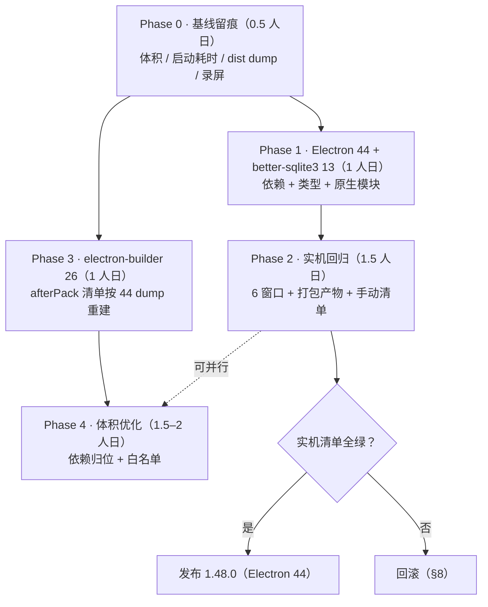
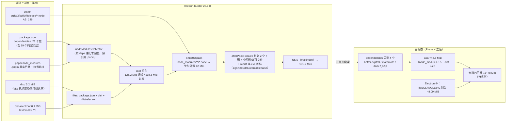

# Electron 42 → 44 升级预研报告（CheckIn 1.47.0）

> 类型：**预研（precheck）**。本文不改任何源码 / 配置 / 依赖清单，只做结论与方案。
> 数据来源：本仓 `1.41.0` 实构产物（`release/`，2026-10-14）+ `node_modules/electron/dist` 实盘 dump + Electron 官方 44 发布说明 / breaking-changes。
> **体积单位统一为 MiB（1 MiB = 1,048,576 B）**，与 `du -m` 和本文附件脚本输出一致；Windows 资源管理器显示的 "106.6 MB" 对应本文的 101.7 MiB 安装包。
> 不确定项一律标 `待实测`，不写"应该没问题"。

---

## 实施结果（2.1.0 / 2026-10-20）—— 与本文预研结论的差异

> 本节由实施阶段回填。**预研结论"代码层改动量 = 小"成立**，但原生模块与打包链路有
> **4 处预研没算到的坑**，均已在本仓修正。

| # | 预研说法 | 实测真相 | 影响 |
|---|---|---|---|
| 1 | `asarUnpack` 保持 `node_modules/better-sqlite3/build/Release/*.node` 即可 | 13.x 的二进制在**包根 `prebuilds/win32-x64.node`**（`lib/binding.js` 的 `getPrebuildPath()` 决定），`build/Release` 根本不存在 | 不改就是**静默失效**：asarUnpack 命中不到任何文件，`.node` 留在 asar 里，运行期 `Cannot locate the bindings file`。已改 `asarUnpack` + `packaging-guard.test.ts` 断言 |
| 2 | 13.x 是 N-API，**连 `electron:rebuild` 都可以删掉** | 结论对，但**安装会直接失败**：包内没有 install 脚本却留着 `binding.gyp`，npm/pnpm 的既有约定是「有 binding.gyp 且无 install 脚本 → 默认 `node-gyp rebuild`」→ 无 VS C++ 工作负载的机器 `gyp ERR! find VS`，整个 `pnpm install` exit 1 | 必须 `allowBuilds: better-sqlite3: false` **且用 pnpm 11**（9.x 不认这个字段） |
| 3 | 未提及 | npm 包内**8 个平台**的预编译各 2~3 MiB（合计 ≈18 MiB），本应用只出 win-x64 | `files` 增加 4 条排除，实测产物里非本平台 `.node` 为 **0** |
| 4 | `LICENSE.electron.txt` 是"死条目"（42/44 的 dist 里都没有） | dist 层确实没有，但 electron-builder 会由 `dist/LICENSE` **改名为 `appOutDir/LICENSE.electron.txt`** | 产物层**必须保留**（MIT 要求）；`after-pack.js` 的注释本来就是对的，预研这条判断只在 dist 层成立 |

**另外两处工程细节**
- `electron-builder` 26 移除了 `app-builder-bin`，原生模块处理改由 `@electron/rebuild`（作为
  `app-builder-lib` 的直接依赖）。本项目 `npmRebuild: false`，所以打包时**不会**触发重建 ——
  这正是 N-API 方案能"零重编译"落地的关键前提。
- 两个 pnpm 侧修正：`fast-uri` 钉到 3.1.8（3.1.9 发布仅 3 小时，被 pnpm 11 的
  `minimumReleaseAge` 供应链策略拦截）；`electron-builder-squirrel-windows` 由 25.1.8 对齐到
  26.17.0（消除 peer 告警，并清掉整棵 `app-builder-lib@25` 老树；本项目只用 nsis）。

### 实测体积（本机，`release/`）

| 项 | 2.0.0（Electron 42） | 2.1.0（Electron 44） | 变化 |
|---|---|---|---|
| `node_modules/electron/dist` 未压缩合计 | 300.82 MiB | 314.13 MiB | **+13.31 MiB** |
| 其中 `electron.exe` | 232,313,344 B | 247,184,896 B | +14.18 MiB |
| 其中 `resources.pak` | 6,876,399 B | 12,436,085 B | +5.30 MiB |
| 其中 `chrome_*_percent.pak` | 316,962 B | 1,988,671 B | +1.59 MiB |
| 其中 `libEGL.dll` + `libGLESv2.dll` | 8,478,720 B | **0（官方移除）** | −8.09 MiB |
| `app.asar` | 14,447,397 B | 14,338,215 B | −0.10 MiB |
| `release/win-unpacked` | 282,160,683 B | 295,880,814 B | **+13.08 MiB** |
| **安装包（NSIS）** | 89,403,036 B（85.26 MiB） | 104,625,391 B（99.78 MiB） | **+14.52 MiB（+17.0%）** |

> 结论：**升级本身带不来瘦身**，+14.52 MiB 安装包增量是 Electron 44 的固有成本（预研估 dist
> +13.5，实测 dist +13.31 / 安装包 +14.52 —— 新增部分集中在 `electron.exe` 与 `resources.pak`，
> 这两者压缩率比平均值差，所以安装包增幅略高于未压缩增幅）。
> 体积收益仍只能靠 2.0.0 那轮的依赖归位，两者不冲突。

---

## 0. 结论先行

### 0.1 两个问题的直接回答

| 问题 | 回答 | 分级 | 依据（本仓实测） |
|---|---|---|---|
| **Q1：42 直接升 44 稳定版，是否需要大改动？** | **不需要大改。** 全仓**0 处**命中 44 的 10 条破坏性变更中的"硬"条目；真正要做的是 1 个原生模块换版本 + 1 批实机回归验证 | **小**（改动量 3 级制：无 / **小** / 中 / 大） | 仓内无 `clipboard` 模块调用（6 处全是 `navigator.clipboard` Web API）、无 `net.request`/`net.fetch`、win-only x64、无 `setLoginItemSettings`、无 `select-client-certificate`、无 subframe Node 集成、无 Unity；唯一的原生模块 `better-sqlite3` 在 `13.x` 已改 N-API，连 ABI 都解耦了 |
| **Q2：打包与包体积策略是否需要改？** | **不需要"因为升级"而改；但当前策略本身有 ~100 MiB 级的纯浪费，该单独做一轮。** electron-builder 25→26 可选（收益与现有 rcedit 兜底无关）；Electron 44 本身实测 **净增约 +13.5 MiB 未压缩**（ANGLE 省 8.09，但 `electron.exe` +14.18、`resources.pak` +5.30、`chrome_*_percent.pak` +1.6 反噬） | 升级相关的打包改动 = **无**；体积优化 = **中**（结构改动，但不动业务代码） | asar 逻辑 125.2 MiB 里 **121.9 MiB 是 node_modules**，而运行时真正 `require` 的只有 `better-sqlite3` + `mammoth/docx/jszip` 闭包 = **21.7 MiB**；渲染层依赖已被 Vite 打进 `dist`（仅 3.2 MiB），却又被当 production dependency 整棵塞进 asar |

### 0.2 工期（人日，非承诺）

| 阶段 | 内容 | 人日 |
|---|---|---|
| Phase 0 | 基线留痕（体积 / 启动耗时 / dist dump） | 0.5 |
| Phase 1 | Electron 44 + better-sqlite3 13 + 类型对齐（代码层） | 1.0 |
| Phase 2 | 实机回归（6 窗口 + 打包产物 + 手动清单） | 1.5 |
| Phase 3 | electron-builder 26 + afterPack 清单重建 | 1.0 |
| Phase 4 | 体积优化（依赖归位 + 白名单） | 1.5–2.0 |
| **合计** | Phase 1–2 是"能不能升"的最小闭环（**2.5 人日**）；3–4 可独立并行 | **5.5–6.0** |

### 0.3 一句话风险画像

> 44 的破坏性变更**几乎全部与本仓无关**；本仓真正的风险不在 API 断裂，而在**三个"行为回归"点**：
> ① 透明 + 无边框圆角窗口在 Chromium 150/152 的合成器变化（ANGLE 进每个进程）；
> ② `afterPack` 删掉的那批图形 DLL（`dxcompiler.dll` 24.45 MiB）在 ANGLE 静态化后是否变成"必崩"；
> ③ `<a download>` 的落盘位置与 toast 文案是否仍然一致。
> 这三点**只能实机验证**，且都是"跑起来才知道"，静态分析给不出结论。

---

## 1. 版本事实基线

| 项 | Electron 42.4.1（当前） | Electron 44.9.0（目标） |
|---|---|---|
| Chromium | 148.0.7778.96 | 152.0.7977.167 |
| Node | 24.15.0 | 24.22.0 |
| V8 | 14.8 | 15.2 |
| **NODE_MODULE_VERSION** | **146** | **149** |
| 分发平台 | win x64/ia32、mac、linux | **仅 x64 / arm64**（ia32 & armv7l 移除） |
| `libEGL.dll` / `libGLESv2.dll` | 随包分发 | **不再分发**（ANGLE 静态链入 exe） |

> 44 版本选择建议：**`^44.9.0`**，地板不低于 **44.2.0**（44.2.0 修了 "native addon 继承 `node::ObjectWrap` 在 Node 24.19+ GC 时 abort" 的崩溃 —— 对 `better-sqlite3` 是直接相关的修复）。

---

## 2. 逐项影响面（本仓代码 × 43/44 变更）

判定口径：**必改** = 不改就跑不起来/必崩；**建议改** = 不改能跑但有明确技术债；**无需改** = 已核对为不受影响；**需实机验证** = 静态分析无法定论。

| # | 区域 | 文件:行 | 现有写法 | 43/44 的实际变化 | 判定 | 改法 |
|---|---|---|---|---|---|---|
| 1 | **透明 + 无边框圆角窗口** | `electron/main.ts:203-209`（`ROUNDED_WINDOW_OPTIONS`），6 个窗口创建处 | `frame:false, transparent:true, backgroundColor:"#00000000", hasShadow:false, roundedCorners:false` | 44：ANGLE 静态链入，**且被载入每个进程**而非仅 GPU 进程（官方明确"可能在特殊配置下暴露回归"）。43：Linux 无边框窗口默认圆角（Win 不受影响，且我们已显式 `roundedCorners:false`） | **需实机验证**（大概率无需改代码） | 不改配置。若出现四角发黑/白边/阴影方角：先排除 GPU 合成（`--disable-gpu-compositing` 对照），再排查 `transparent`+`backgroundColor` 组合。应急开关见 §8 |
| 2 | **`app://` scheme 特权** | `main.ts:145-156` | `standard/secure/supportFetchAPI/corsEnabled/codeCache:true` | 44 未列相关变更；`protocol.handle` 保持 | **无需改** | — |
| 3 | **V8 码缓存** | `main.ts:222` `v8CacheOptions:"bypassHeatCheck"` | 渲染侧跳过 heat check，与 scheme 侧 `codeCache` 配套 | 未列入 44 破坏性变更；但 Chromium 150/152 对自定义 scheme 的码缓存路径有过内部重构 | **无需改 / 需实测收益** | 升级后 `tsc` 会校验该 key 是否仍存在于 `WebPreferences` 类型；收益用 `%APPDATA%/CheckIn/Cache` 目录大小 + 二开窗口耗时对比 |
| 4 | **协议处理器** | `main.ts:969-983` | `protocol.handle("app", async …)` 返回 `Response` + `Cache-Control` 分档（`app-protocol-cache.ts`） | 无变化 | **无需改** | — |
| 5 | **webRequest CORS 注入** | `electron/httpSession.ts:51 / 57 / 77` | `onBeforeSendHeaders` 记 Origin → `onHeadersReceived` 重写 CORS 头 → `onErrorOccurred` 清 Map | 44 的 `net.request` Sec-Fetch 校验**只作用于主进程 net 模块**；本仓全仓无 `net.request`/`net.fetch`（已核实） | **无需改** | 实机跑一次第三方登录（渲染层 `fetch` 直连）确认 CORS 仍放行即可 |
| 6 | **Tray / 托盘菜单** | `main.ts:1192-1219` | `new Tray(TRAY_ICON_PATH)` + `setContextMenu` + `click` 切显隐 + `right-click` 弹菜单 | 无变化 | **无需改** | — |
| 7 | **Windows 通知身份** | `main.ts:74-78` | `app.setAppUserModelId(dev ? process.execPath : "com.checkin.app")` | 无变化（44 只改了 macOS 的 `Notification.remove*` 与 `setLoginItemSettings` 的 macOS≤12 字段） | **无需改** | — |
| 8 | **全局快捷键** | `main.ts:1186-1187, 1249` | 仅 `IS_DEV` 下注册 `Ctrl+Shift+I` / `F12`，`before-quit` 里 `unregisterAll()` | 无变化 | **无需改** | — |
| 9 | **电源/锁屏轮询** | `electron/activitiesTask.ts:151-168` | `powerMonitor.on('suspend'/'lock-screen'/'resume'/'unlock-screen')` + `removeListener` | 无变化。44 有"减少 Node 定时器导致的空闲主进程唤醒"的性能项 | **无需改** | 若 `startActivityPolling` 用 `setInterval` + 相对时间推进，性能项只减唤醒、不改语义；实机验证一次"锁屏 5 分钟 → 解锁，记录时间不跳" |
| 10 | **任务栏闪烁** | `activitiesTask.ts:114` | `mainWin.flashFrame(true)` | 无变化 | **无需改** | — |
| 11 | **系统对话框** | `handlers/memo-handlers.ts:164/215/277/301`、`handlers/todo-handlers.ts:315/339`、`handlers/novel-handlers.ts:1499/1633` | `dialog.showOpenDialog(win, opts)` / `showSaveDialog(win, opts)` | 44：仅 Linux 移除 `showHiddenFiles`、macOS≤12 移除相关字段；**Windows 无变化** | **无需改** | — |
| 12 | **`<a download>` 导出模板** | `src/windows/NovelWindow/pages/NovelPage/components/SensitivePanel/components/ImportTemplateModal/index.tsx:41-57` | `Blob` → `URL.createObjectURL` → `anchor.download = …` → `click()`，toast 写死「已下载到「下载」文件夹」 | 43 起"下载默认落到用户「下载」文件夹"被正式化为行为约定（此前依赖 session 默认行为的隐式结果） | **需实机验证** | 若实测落到别处或弹保存框：改成 `dialog.showSaveDialog` 走 `memo-handlers` 现成通道，toast 改为实际路径 |
| 13 | **剪贴板（6 处）** | `pack-export.ts:15`、`LevelSequence/index.tsx:402`、`MemoPreview/index.tsx:42`、`TodoListItem/index.tsx:105`、`NameGeneratorPanel/index.tsx:165`、`ImportTemplateModal/index.tsx:35` | 全部 `navigator.clipboard.writeText`（Web API） | 44：**渲染进程不再能拿到 `electron.clipboard` 模块**（模块本身也改成异步 + `ClipboardItem`，移除 `readImage/writeHTML/availableFormats`） | **无需改**（本仓本来就没用该模块；`preload.ts:68` 的 `electronAPI` 也未透出 clipboard —— 已核实） | 唯一要守的是"未来别往 preload 里塞 `clipboard`"；已有一条 `preload-listener.test.ts` 类守卫可扩展 |
| 14 | **托盘恢复闪白治理** | `main.ts:87-89` | `app.commandLine.appendSwitch("wm-window-animations-disabled")`（Win，ready 前） | 该 switch 属 Chromium 内部开关，跨大版本不保证；150/152 的窗口动画/合成路径有调整 | **需实机验证** | 若闪白复现：先确认开关仍生效（`--enable-logging` 看 command_line），再试 `transparent:false + backgroundColor` 方案或延迟 `show()` |
| 15 | **窗口显示时序** | `main.ts:270-283`（`raiseWindow`：`restore→show→focus→moveTop`）、`300+` 的 `did-finish-load` 兜底 | `show:false` 创建 → `did-finish-load` 后显示并抬 z 序 | 43/44 有 "native event / IPC dispatch / option 字典解析提速" + "首个沙箱窗口预启动"；**时序会变快**，`WINDOW_LOAD_FALLBACK_MS = 3000` 的相对裕度变大（安全方向） | **需实机验证** | 关注"点一次就弹出"是否仍成立（历史 bug 是"要点两次"）；若出现抢焦点，检查 `moveTop()` 在新合成器下的 z 序语义 |
| 16 | **preload / 沙箱** | `electron/preload.ts`（`contextBridge.exposeInMainWorld`），`main.ts:212-224`（`contextIsolation:true, nodeIntegration:false`） | 沙箱 preload + contextBridge | 44：preload 只在 DevTools 扩展顶层 frame 运行、subframe worker 的 Node 集成需 `nodeIntegrationInSubFrames` —— **两条都不适用**（无 DevTools 扩展、无 subframe Node） | **无需改** | — |
| 17 | **主进程模块格式** | `vite.config.ts`（vite-plugin-electron，输出 CJS），`package.json:6` `main: dist-electron/main.js` | CJS | Electron 44 仍支持 CJS 主进程 | **无需改** | — |
| 18 | **源码文本断言型测试** | `electron/*.test.ts` 共 **21 个**（如 `app-protocol-cache.test.ts:104/114` 断言 `codeCache:true`、`v8CacheOptions:"bypassHeatCheck"`；`window-load-guard.test.ts` 断言 `restore/show/focus/moveTop` 序列） | 用 `readFileSync` + 正则断言源码文本 | 与 Electron 版本无关，但**任何对 `main.ts` 的措辞/顺序改动都会让它们挂** | **建议改（流程约束）** | 改动 `main.ts` 前后都跑 `pnpm test`；不要"顺手"重排 `ROUNDED_WINDOW_OPTIONS` / `createWebPreferences` 的字面量 |
| 19 | **better-sqlite3** | `package.json:44`、`scripts/rebuild-native.mjs` | `12.11.1` + prebuild-install 下载 ABI 146 → 回退源码编译 | ABI 146 → **149**（详见 §3） | **必改** | 见 §3 |
| 20 | **electron-builder** | `package.json:88-129`、`scripts/after-pack.js` | `25.1.8` + `electronDist` 直连 + `npmRebuild:false` + `signAndEditExecutable:false` + afterPack 删文件 + rcedit 写图标 | 26.x：unsigned 构建不再解压 `winCodeSign`（符号链接问题消失）；`toolsets.winCodeSign` 可 opt-in；26 移除 `win.sign` 属性 | **建议改**（非必改） | 见 §4 |
| 21 | **Node 类型** | `package.json:65` `@types/node ^24.13.2` | 对齐 Node 24.15 | 目标 Node 24.22 | **建议改** | 随 `electron` 一起 minor 对齐，避免 `process.*` 类型噪音 |
| 22 | **窗口状态新 API** | — | 自管窗口尺寸/位置 | 44 新增 `windowStatePersistence` / `BaseWindow.clearPersistedState()` | **无需改（本期不采用）** | 与现有 `windowManager` + 自管尺寸逻辑冲突，且会写 `userData` 里的持久状态，回滚时多一个隐性数据源。**明确不做** |

### 2.1 44 破坏性变更逐条对照（完整性证明）

| 44 破坏性变更 | 本仓是否命中 | 依据 |
|---|---|---|
| ANGLE 全平台静态链接，`libEGL/libGLESv2` 不再分发，且载入每个进程 | **命中（行为层）** | §2#1、§4.1（afterPack 清单）、§6 风险 R1 |
| `clipboard` 不再暴露给渲染进程 + 全异步 + `ClipboardItem` | **不命中** | 6 处全是 `navigator.clipboard`；preload 未透出 |
| 移除 Windows ia32 / Linux armv7l 预编译 | **不命中** | `win.target = nsis`、x64 |
| macOS 12 不再支持 | **不命中** | Win-only |
| `net.request` 对 frame 类 `Sec-Fetch-Dest` 强制 `navigate` | **不命中** | 全仓无 `net.request`/`net.fetch` |
| 移除 Unity / `app.isUnityRunning()` | **不命中** | 无调用 |
| `setLoginItemSettings` 的 `openAsHidden` 等字段 | **不命中** | 无调用 |
| `select-client-certificate` 的 `webContents` 可能为 null | **不命中** | 未监听该事件 |
| subframe worker Node 集成需 `nodeIntegrationInSubFrames` | **不命中** | 未开启 |
| preload 只在 DevTools 扩展顶层 frame 运行 | **不命中** | 未加载 DevTools 扩展 |
| （43 行为）下载默认落「下载」文件夹 | **命中（行为层）** | §2#12 |
| （43 行为）`nativeImage` 像素归一化到 sRGB | **不命中** | 无 `nativeImage` 像素级处理（托盘图标是文件路径） |
| （43 行为）Linux 无边框默认圆角 | **不命中** | Win-only |
| （43 行为）Linux `dialog.showHiddenFiles` 移除 | **不命中** | Win-only |

> 结论复述：**"必改"只有 1 条（better-sqlite3）**，其余是"验证"与"可选优化"。

---

## 3. 原生模块链：`better-sqlite3` ABI 146 → 149

### 3.1 现状链路（为什么它脆）

```
pnpm install
  └─ better-sqlite3 postinstall: prebuild-install || node-gyp rebuild --release
       └─ 装的是 **Node 24.15 ABI** 或 **electron-v146 prebuild** 的 better_sqlite3.node
pnpm electron:rebuild   （scripts/rebuild-native.mjs，独立 script，不在 postinstall 里）
  ├─ prebuild-install -r electron -t <ver>   优先
  └─ @electron/rebuild -f -w better-sqlite3 -v <ver>   回退源码编译（需 MSVC）
electron-builder（npmRebuild:false）
  └─ 不 rebuild，直接把现有 build/Release/better_sqlite3.node 原样搬进 asar.unpacked
```

### 3.2 **为什么 `npmRebuild:false` 不会救你**

`npmRebuild:false` 的语义是"**打包期不要替我 rebuild 原生模块**"，它只关闭 electron-builder 的一个动作，**不改变三件事实**：

1. `node_modules/better-sqlite3/build/Release/better_sqlite3.node` 里躺着的仍然是上一轮 `pnpm electron:rebuild` 编出来的那个二进制（当前 ABI 146）；
2. `asarUnpack: ["node_modules/**/*.node"]` 会把它**原样**复制进产物（实测：`release/win-unpacked/resources/app.asar.unpacked/node_modules/better-sqlite3/build/Release/better_sqlite3.node`，1.83 MiB）；
3. Electron 44 启动时会用 `NODE_MODULE_VERSION 149` 校验这个二进制 → 直接 `Error: The module '…better_sqlite3.node' was compiled against a different Node.js version using NODE_MODULE_VERSION 146. This version of Node.js requires NODE_MODULE_VERSION 149`。

而且更隐蔽的一层：`pnpm electron:rebuild` **不在 `postinstall` 里**（`package.json:31` 的 postinstall 只有 `fix-pnpm-links --check --warn-only` + `ensure-electron`）。所以"升了 electron 版本 → 忘了跑 rebuild → 出了一个能装不能用的包"是这条链路的默认失败模式，**且 CI 上没有任何东西会红**（除非把 `electron:rebuild` 加进构建脚本）。

### 3.3 三条路对比

| 方案 | 动作 | 可行性 | 风险 | 判定 |
|---|---|---|---|---|
| **A. `better-sqlite3@12.11.1` + 重建到 ABI 149** | 升 electron 后跑 `pnpm electron:rebuild` | **不通**：12.11.1 的 prebuild 矩阵只发到 electron-v146；`prebuild-install` 会 warn "No prebuilt binaries found (runtime=electron, target=44)"，然后回退 `node-gyp` 源码编译 | 回退源码编译要 MSVC + Python；无 VS 的机器直接失败。另有 `node-abi` 未收录 44 时报 `Could not detect abi for version 44.0.0` | **不推荐** |
| **B. `better-sqlite3@12.x` + 强制源码编译** | `@electron/rebuild -f -w better-sqlite3 -v 44.x` | 理论可行（社区有失败案例：12.x 对 44 的 V8 API 编译不过） | 每次 Electron 升级都要重编；本机/CI 必须常备 MSVC；编译产物体积与时序不定 | **兜底方案** |
| **C. `better-sqlite3@^13.0.3`（推荐）** | `13.0.0` 起**首个 N-API 版本**：`node-addon-api` 重写，**prebuilt 直接随 npm 包分发**（包内 `prebuilds/`），一个二进制跨 Node/Electron ABI 通用；`prebuild-install` 依赖被移除 | **通**（社区已在 Electron 44 / ABI 149 上实测通过：`v13.0.3` 的 win32-x64 prebuild 可直接加载，无需 `electron-rebuild`） | ①大版本跨越（12→13）需回归 SQL 行为（v13 API 只增不减：新增 `db.explain()`、`preparedStatement.toString()`）；②`@types/better-sqlite3` 是否需同步升版 `待实测`；③pnpm 会因包内仍有 `binding.gyp` 而触发 install script，需确认 prebuild 命中后不触发编译 `待实测` | **采用** |

### 3.4 采用方案 C 的具体动作

1. `package.json`：`"better-sqlite3": "^12.11.1"` → `"^13.0.3"`（保持 `dependencies`，因为主进程 `require`）。
2. 删掉重建链路（**可选但推荐**，避免"以为还需要 rebuild"的误解）：
   - `package.json` 的 `electron:rebuild` script（`:24`）
   - `scripts/rebuild-native.mjs`（整文件，`TARGETS=['better-sqlite3']` 已无意义）
   - `devDependencies` 的 `@electron/rebuild`（`:60`）
   - `electron:setup`（`:25`）里的 `pnpm electron:rebuild`
   - **保留** `npmRebuild:false`（v13 不需要 rebuild，这个开关继续当"保险"）
3. `asarUnpack: ["node_modules/**/*.node"]` **保持不变** —— 关键点：v13 的 `.node` 位置从 `build/Release/` 移到包内 `prebuilds/`，`**/*.node` 仍能命中；但 `lib/index.js` 里 `require` 该二进制的相对路径也变了，**从 asar 内 `require` 一个外置 `.node` 依赖 Electron 的 `fs` 重定向**，这一组合历史可用，但 `待实测`（验收信号见 §7 Phase 1-S3）。
4. **pnpm 缓存 / 本地 `node_modules`**：换版本后 `.pnpm/better-sqlite3@12.11.1` 会变成孤儿目录，`node_modules/better-sqlite3` 符号链接会被重写；建议 `pnpm install` 后跑一次 `pnpm fix:deps`（仓内已有 `scripts/fix-pnpm-links.mjs`）+ `pnpm check:deps`，确认符号链接没断（这是本仓已知的 pnpm 非扁平坑，`vite.config.ts:46-52` 的注释就是它的历史记录）。
5. **CI**：把"原生模块 ABI 自检"变成硬门禁 —— 打包前用 `node -e "require('better-sqlite3')"` 在 **electron 运行时**下跑一次（`ELECTRON_RUN_AS_NODE=1 electron.exe -e ...`）比跑在系统 Node 下更有意义；或者更简单：把 `pnpm electron:rebuild` 从手动 step 里**删掉**，改成断言"`node_modules/better-sqlite3/prebuilds/win32-x64.node` 存在"。
6. **`why npmRebuild:false 不会救你` 的收尾**：方案 C 之后这条风险**结构性消失**（N-API 二进制与 ABI 无关），这是本次升级最大的"少一件事"。

### 3.5 待实测（原生链）

- `13.0.3` 在 pnpm 11 下 install 时是否仍跑 `node-gyp`（观察 `node_modules/better-sqlite3/build/` 是否被创建）。
- `prebuilds/win32-x64.node` 被 `asarUnpack` 外置后，从 asar 内 `require` 是否能正常加载。
- `@types/better-sqlite3@7.6.13` 是否覆盖 v13 的 `Database` 类型（`tsc -b` 会立刻暴露）。
- WAL 文件 + 现有 `checkin.db` / `novel.db` 在 v13（新 SQLite）下读写、`pragma table_info` 探测（`novel-db.ts:483+`）是否一致。

---

## 4. 打包链路：electron-builder 25.1.8 → 26.15.x

### 4.1 `afterPack` 删除清单必须"从 44 的 dist 实测 dump 后再定稿"

这是本节最重要的结论：**现有删除清单里有死条目、有漏项，而 44 会改变清单本身**。

`node_modules/electron/dist`（42.4.1）**实盘清单**：

| 文件 | 大小 | 现 `DELETE_FILES` 是否覆盖 | 备注 |
|---|---|---|---|
| `electron.exe` | 221.55 MiB | — | 44 起 Win 主二进制启用 ThinLTO，大小 `待实测` |
| `LICENSES.chromium.html` | 19.42 MiB | ✅ 删 | 安全 |
| `LICENSE` | 1.1 KiB | ❌ **未覆盖** | 清单里写的是 `LICENSE.electron.txt` —— **42 里根本不存在这个文件名**，该条是死条目（无害，但说明清单已漂移） |
| `version` | 6 B | ✅ 删 | 安全 |
| `dxcompiler.dll` | 24.45 MiB | ✅ 删 | **⚠️ 44 单点风险，见 §5.5** |
| `dxil.dll` | 1.44 MiB | ❌ **漏项** | 产物里确实还在（`release/win-unpacked/dxil.dll`） |
| `d3dcompiler_47.dll` | 4.52 MiB | ✅ 删 | 安全（Chromium 自带备用） |
| `vk_swiftshader.dll` | 5.26 MiB | ✅ 删 | 软件渲染回退，已长期验证 |
| `vk_swiftshader_icd.json` | 106 B | ✅ 删 | 同上 |
| `vulkan-1.dll` | 0.88 MiB | ✅ 删 | 同上 |
| `libEGL.dll` | 0.46 MiB | — | **44 消失** |
| `libGLESv2.dll` | 7.63 MiB | — | **44 消失**（合计 −8.09 MiB 自然瘦身） |
| `icudtl.dat` | 10.37 MiB | — | **不可删** |
| `resources.pak` | 6.56 MiB | — | **不可删** |
| `chrome_100/200_percent.pak` | 0.11 / 0.19 MiB | — | 不可删 |
| `snapshot_blob.bin` | 0.33 MiB | — | **不可删**（44 起主进程由内嵌 Node 启动快照引导） |
| `v8_context_snapshot.bin` | 0.69 MiB | — | 不可删 |
| `ffmpeg.dll` | 2.92 MiB | — | 见 §5.5 |
| `locales/` | 48 MiB / 55 个 | ✅ 只留 `zh-CN.pak`+`en-US.pak`（≈1.7 MiB，省 ≈46 MiB） | 安全 |
| `resources/default_app.asar` | 0.11 MiB | — | electron-builder 会替换 |

**方法（不要凭空断言 44 的文件名）**：升级后先 `pnpm add -D electron@44.9.0`，再跑只读 dump，人工 diff 42 vs 44，**最后**才改 `after-pack.js` 的 `DELETE_FILES`。

```bash
# 只读：dump electron dist 清单（文件名 + 字节 + sha256 前 12 位）
node -e "
const fs=require('fs'),p=require('path'),c=require('crypto');
const root='node_modules/electron/dist';
const rows=[];
(function walk(d,pre){for(const n of fs.readdirSync(d)){const f=p.join(d,n);const s=fs.statSync(f);
  if(s.isDirectory())walk(f,pre+n+'/');else rows.push([pre+n,s.size,c.createHash('sha256').update(fs.readFileSync(f)).digest('hex').slice(0,12)]);}})(root,'');
rows.sort((a,b)=>a[0].localeCompare(b[0]));
console.log('file\tsize\tsha12');
for(const r of rows)console.log(r.join('\t'));
" > /tmp/electron-dist-44.txt
# 与 42 的 dump 做 diff：diff -u /tmp/electron-dist-42.txt /tmp/electron-dist-44.txt
```

判定规则：
- **44 里不存在的文件名** → 从 `DELETE_FILES` 删掉（否则就是死条目，像现在的 `LICENSE.electron.txt`）；
- **42 有、44 没有** → 自然瘦身，记账即可（`libEGL`/`libGLESv2`）；
- **44 新增** → 逐个判断能不能删（默认**不删**，除非有明确的替代路径）；
- 「已删的那批图形 DLL」在 44 里是否还必需 → **只有实机能回答**（§5.5）。

### 4.1.1 `electron@44.9.0` win32-x64 实盘清单（2026-10-19 实测，替代 §4.1 的"待实测"）

来源：`https://npmmirror.com/mirrors/electron/44.9.0/electron-v44.9.0-win32-x64.zip`（158,625,558 B）下载后 `unzip -l`，非推算。

| 文件 | 42.4.1 | 44.9.0 | Δ | 现 `DELETE_FILES` |
|---|---|---|---|---|
| `electron.exe` | 221.55 MiB | **235.73 MiB** | **+14.18** | — |
| `resources.pak` | 6.56 | **11.86** | **+5.30** | — |
| `chrome_200_percent.pak` | 0.19 | **1.21** | +1.02 | — |
| `chrome_100_percent.pak` | 0.11 | **0.69** | +0.57 | — |
| `LICENSES.chromium.html` | 19.42 | 20.48 | +1.06 | ✅ 删 |
| `dxcompiler.dll` | 24.45 | 24.55 | +0.10 | ✅ 删（**风险项见 §5.5**） |
| `vk_swiftshader.dll` | 5.26 | 5.26 | 0 | ✅ 删 |
| `d3dcompiler_47.dll` | 4.52 | 4.52 | 0 | ✅ 删 |
| `vulkan-1.dll` | 0.88 | 0.90 | +0.02 | ✅ 删 |
| `dxil.dll` | 1.44 | 1.44 | 0 | ❌ **漏项**（产物里仍在，`win-unpacked/dxil.dll`） |
| `ffmpeg.dll` | 2.92 | 2.97 | +0.05 | — |
| `icudtl.dat` | 10.37 | 10.37 | 0 | — |
| `snapshot_blob.bin` / `v8_context_snapshot.bin` | 0.33 / 0.69 | 0.35 / 0.71 | ≈0 | — |
| `libEGL.dll` + `libGLESv2.dll` | 0.46 + 7.63 | **不存在** | **−8.09** | 无需再写（写了就是死条目） |
| `LICENSE` | 1.1 KiB | 1.1 KiB | 0 | ❌ 未覆盖（清单里写的是 `LICENSE.electron.txt`，**该文件名 42/44 都不存在**） |
| `locales/` | 48.00（55 个） | 48.30（55 个） | +0.30 | ✅ 只留 zh-CN + en-US |
| `resources/default_app.asar` | 0.11 | 0.11 | 0 | — |

**净结论（必须修正"44 更小"的直觉）**：整份 dist 未压缩 **≈355 → ≈368.5 MiB（+13.5）**。即：

- ANGLE 静态化确实省了 **−8.09 MiB**，但被 `electron.exe`（ThinLTO 后反而变大）+14.18、`resources.pak` +5.30、chrome paks +1.6 全部吃掉还倒欠；
- 走完现有 afterPack 删除后，44 的 `win-unpacked` 仍会比 42 **大约 +13 MiB**（asar 不变的前提下）。→ **体积优化不是"升级的附带好处"，而是"升级的配套动作"**（与 §5 的 +100 MiB 级浪费一起做，才看得到净下降）。

**清单修正（可直接落到 `after-pack.js`）**：

```js
const DELETE_FILES = [
  'LICENSES.chromium.html',   // 20.48 MiB
  'LICENSE',                  // 1.1 KiB（旧条目 LICENSE.electron.txt 是死条目，删除）
  'version',
  'dxcompiler.dll',           // 24.55 MiB —— 先按 §5.5 双跑验证再决定保留
  'dxil.dll',                 // 1.44 MiB —— 新增，历史一直漏删
  'vk_swiftshader.dll',
  'vk_swiftshader_icd.json',
  'vulkan-1.dll',
  'd3dcompiler_47.dll',
]
// 显式不要写 libEGL.dll / libGLESv2.dll：44 起不存在
```

### 4.2 `electron-builder 25 → 26` 的收益与风险

| 项 | 25.1.8（当前） | 26.15.x | 对本仓的影响 |
|---|---|---|---|
| `winCodeSign` 解压（Windows 下创建 macOS 符号链接 → "客户端没有所需的特权"） | 只要走 rcedit/签名链路就会下载并解压，非管理员环境必炸 | **unsigned 构建不再解压该 bundle**（社区已在 Win11 + electron-builder 26 + electron 44 上实测无需开发者模式）；需要签名时可 opt-in `toolsets: { winCodeSign: "1.1.0" }`（26.8.0+） | **我们的 `signAndEditExecutable:false` + afterPack rcedit 本来就是绕开它**，所以 26 的这条收益对我们是"冗余保险"，不是"必须升"的理由 |
| `win.sign` 属性 | 存在 | 移除（改用 `signAndEditExecutable`） | 本仓未用 `sign`，不受影响 |
| NSIS / blockmap / 增量更新 | — | 无破坏性变化 | 见 §4.4 |
| Electron 44 元数据感知（`electronVersion` 推断、`node-abi`） | 25.x 未针对 44 验证 | 26.x 已随 44 验证 | 因为 `electronDist` 直连 + `npmRebuild:false`，我们绕开了绝大部分版本感知逻辑 → **25 很有可能能直接打 44**，但没有验证背书 |

**结论**：`electron-builder` 升 26 **不是升级 Electron 44 的前置条件**（技术上 25.1.8 大概率能出包），但建议在 Phase 3 一起升，理由是 25.x 已停止维护、且"unsigned 构建不碰 winCodeSign"能减少一条环境依赖。**若 Phase 2 时间紧，可以先不升**。

### 4.3 `signAndEditExecutable:false` 是否仍需要？

**仍然需要，但理由变了。** 现状理由（`after-pack.js:60-64` 的注释）是"开启会走 winCodeSign 工具链，非管理员因符号链接失败"——这条在 26 上**不再是硬失败**。但继续保留 `false` 的三条理由：

1. **图标来源唯一性**：`afterPack` 用项目自带 `rcedit@5` 写 `public/icon.ico`，是"桌面快捷方式 / 任务栏图标"的唯一来源（`after-pack.js:65-77`，失败直接 throw）。若同时打开 electron-builder 的 exe 改写，会有两条写 exe 的路径（先 builder 后 rcedit），虽然顺序上 rcedit 覆盖、结果一样，但没有收益只有不确定性。
2. **构建完全离线可复现**：`false` 让构建不依赖 `winCodeSign` 下载（内网 / 镜像缺包时更稳）。仓里已经在用 `ELECTRON_BUILDER_BINARIES_MIRROR`，少一个下载源是好事。
3. **改动最小**：升级期不引入"exe 改写方式"这个变量。

→ **保持 `win.signAndEditExecutable:false` + afterPack rcedit 不变，零改动。**

### 4.4 `electronDist: "node_modules/electron/dist"` 是否仍成立？

**成立。** 该字段语义是"从本地目录取 Electron 二进制，不走下载"，26.x 保留。两个注意点：

1. **它把"Electron 版本"和"electron-builder 的版本感知"解耦** —— 这既是优点（25 也能打 44）也是风险（`electron-builder` 不会提示你 `better-sqlite3` ABI 不匹配，因为 `npmRebuild:false` 已经关掉了那条告警）。→ 验收必须包含"运行时加载原生模块"这一步，而不是"打包成功"。
2. `electronDist` 目录里必须有 `version` 文件（当前有，6 字节）。`afterPack` 删的是**产物**里的 `version`，不影响源目录 —— 这点现有实现是对的。

### 4.5 NSIS / blockmap / 增量更新

| 项 | 影响 | 建议 |
|---|---|---|
| NSIS 脚本 | 无破坏性变化；`oneClick:false` + `allowToChangeInstallationDirectory:true` 保持 | 不动 |
| `compression: "maximum"` | 不变；但注意 asar 内容从 125 MiB 掉到 ~12 MiB 后，**压缩耗时主要在 exe（221 MiB）**，构建总时长变化不大 | 不动 |
| `.blockmap`（差分更新） | **改 `files` 白名单这类"结构性瘦身"会让该版本的 blockmap 差分大面积失效** → 老用户升级到这一版要下全量 | 体积优化版本**单独发版**，不要和功能版混发；并在 release note 里说明"本次更新包较大" |
| `latest.yml` / 自动更新 | 仓内**无 `publish` 配置**，没有自动更新通道（`latest.yml` 是 nsis 默认产物） | 回滚不需要服务端配合（见 §8） |

---

## 5. 包体积策略（量化 + 优先级）

### 5.1 实测构成（1.41.0 产物）

| 层 | 体积 | 说明 |
|---|---|---|
| 安装包 `CheckIn Setup 1.41.0.exe` | **101.7 MiB** | Explorer 显示 106.6 MB |
| `win-unpacked/` | **384 MiB** | |
| ├ `CheckIn.exe` | 221.6 | Chromium + Node 主体 |
| ├ `locales/`（afterPack 后） | 1.7 | 原始 48（55 个） |
| ├ `icudtl.dat` | 10.37 | |
| ├ `resources.pak` + `chrome_*.pak` | 6.86 | |
| ├ `ffmpeg.dll` / `dxil.dll` | 2.92 / 1.44 | |
| ├ `libGLESv2.dll` + `libEGL.dll` | 8.09 | **44 消失** |
| └ `resources/` | 131 | `app.asar` 118.3（磁盘）+ `app.asar.unpacked` 12 |
| **`app.asar` 逻辑内容** | **125.2** | 19,602 个文件 |
| ├ `node_modules/` | **121.9** | **160 个包** |
| ├ `dist/` | 3.2 | Vite 产物（渲染层真实代码就这么多） |
| └ `dist-electron/` | 0.1 | 主进程 + preload |

`app.asar` 内 node_modules TOP（MiB）：`antd 57.08`（其中 `antd/dist/` 39.69）、`@ant-design/icons 11.59`、`react-dom 6.98`、`framer-motion 4.44`、`docx 4.32`、`react-router 3.61`、`motion-dom 3.10`、`mammoth 2.26`、`lunar-typescript 1.22`、`@codemirror/view 1.03`、`@dnd-kit/core 0.89`、`underscore 0.86`、`pako 0.74`、`jszip 0.73`、`better-sqlite3 11.73`…

**关键反差**：`dist/` 只有 **3.2 MiB**，而它的"源依赖"在 asar 里占 **~100 MiB**。

### 5.2 优先级排序（收益已实测/已量化）

| 优先级 | 措施 | 收益（asar 逻辑 MiB） | 安装包预估收益 | 风险 | 备注 |
|---|---|---|---|---|---|
| **P0-1** | **依赖归位**：把 100% 被 Vite 打进 `dist/` 的渲染层依赖从 `dependencies` 移到 `devDependencies` | **−100.20**（18,578 个文件；node_modules 121.9 → 21.7） | **≈ −24 MiB** | 低–中：改 `package.json` 归类，不动一行业务代码；风险在"以后有人用 `pnpm install --prod` 构建" | 详见 §5.3 |
| **P0-2** | 白名单内的死重：`better-sqlite3/deps/` + `src/`（`sqlite3.c` 9.07）、`docx` 非 cjs 产物 | **−13.16**（node_modules 21.7 → 8.5） | ≈ −1.5 MiB | 低：`sqlite3.c` 只在源码编译时用；v13 后位置变 | 详见 §5.3 |
| **P1** | Electron 44 的"自然变化"：`libEGL.dll` + `libGLESv2.dll` 不再分发（−8.09），但 exe +14.18 / paks +6.9 / 许可 +1.06 | 0（不在 asar 内） | **净 +4~5 MiB（变差）** | 无（官方行为） | 实测见 §4.1.1；**升级本身不减肥，反而增重** |
| **P2** | 补删 `dxil.dll` | 0 | ≈ −0.3 MiB | **中**：D3D12 着色器编译，ANGLE 静态化后作用不明 | `待实测` |
| **P2** | `mammoth/docx/jszip` 从 external 改回 bundle | **−9.9**（含传递依赖闭包） | ≈ −2~3 MiB | 中–高：见 §5.4 | 不建议本期做 |
| ~~P0~~ | （若只做过滤不做归位）`!**/node_modules/**/*.map` | −33.00（antd 独占 26.94） | ≈ −8 MiB | 低 | 被 P0-1 覆盖，不必单列 |
| ❌ | 删 `icudtl.dat` / `resources.pak` / `snapshot_blob.bin` / `ffmpeg.dll` | — | — | 高 | 见 §5.5 |

> P0-1 + P0-2 之后：`app.asar` ≈ **11.8 MiB 逻辑**（`dist` 3.2 + externals 闭包 ≈ 6.7 + better-sqlite3 1.85，其中 1.85 MiB 走 `asar.unpacked` 外置 → asar 本体 ≈ 9.9 MiB），整包 `win-unpacked` ≈ 384 − 113 ≈ **271 MiB**，安装包 ≈ **101.7 → 72~78 MiB**（用下方压缩率推算，`待实测`）。
> 压缩率实测：`gzip -3 app.asar` = **28.90 MiB**（118.32 → 28.90，**0.244**）。asar 内容几乎全是文本（JS/JSON/map），按同比例推算剩余 11.8 MiB → ≈2.9 MiB，故 asar 项在安装包里约省 **26 MiB**。

### 5.3 `files` 当前写法为什么把整棵 node_modules 带进去，怎么改

**机理**：electron-builder 的 `files` 是"**在默认规则上覆盖/追加**"，而 **production dependencies 的 node_modules 是一条独立于 `files` 的强制收集通道**（从 `package.json.dependencies` 递归求闭包；pnpm 下会解引用 `.pnpm` 真实目录后复制）。

所以现在这三条：

```jsonc
"files": [
  "package.json",
  { "from": "dist", "to": "dist", "filter": ["**/*", "!**/*.map"] },
  { "from": "dist-electron", "to": "dist-electron", "filter": ["**/*"] }
]
```

**并没有"只打这三个"的语义** —— 它只是"额外加 dist/dist-electron"，`dependencies` 闭包照样整棵进来。证据：asar 里 160 个包、18578 个非白名单文件、33 MiB sourcemap。

**方案 A（推荐，终态）：依赖归位**

判据用 `vite.config.ts:52` 的 `external` 名单：

```ts
external: ['electron', 'better-sqlite3', 'mammoth', 'docx', 'jszip']
```

→ 只有这 5 个是"运行时从 node_modules `require`"的；**其余全部被 Vite 打进 `dist/`**。因此：

| 位置 | 包 |
|---|---|
| `dependencies`（保留） | `better-sqlite3`、`mammoth`、`docx`、`jszip` |
| `devDependencies`（迁入） | `antd`、`@ant-design/icons`、`react`、`react-dom`、`react-router-dom`、`framer-motion`、`zustand`、`dayjs`、`codemirror`、`@codemirror/*`、`@dnd-kit/*`、`lunar-typescript`、`marked`、`react-virtuoso` |

迁移后 `dependencies` 闭包 = **21.69 MiB / 961 个文件**（实测按白名单算过），node_modules 从 121.9 → 21.7 MiB。

三个必须注意的 pnpm 细节：
1. **符号链接**：`dependencies` 里只剩 4 个包，electron-builder 的 collector 对这 4 个走 `.pnpm` 解引用，其余 devDependencies 根本不进收集 → **不需要额外处理 `.pnpm` 真实路径**（这正是方案 A 比"手写黑名单"稳的原因）。
2. **`asarUnpack` 与 `.node` 的关系（实测发现，很反直觉）**：配置写的是 `node_modules/**/*.node`，但产物 `app.asar.unpacked/` 里躺的是 **整个 better-sqlite3 包（48 个文件 / 12 MiB，含 `deps/sqlite3/sqlite3.c` 9.07 MiB）** —— electron-builder 的 **smartUnpack** 检测到包内有原生模块就**整包外置**。所以：
   - "只改 `files` 白名单"**不够**，`deps/`、`src/` 会跟着外置一起进产物；
   - 必须显式排除：`"!**/node_modules/better-sqlite3/{deps,src}/**"`（v13 后确认 `.node` 在 `prebuilds/`，外置目录结构会变，需重新核对）；
   - `sqlite3.c` 的 9.07 MiB 在 asar 头里记为 `unpacked:true`（数据外置），**不是两份**，别重复计算。
3. **`dist/*.map` 已被排除**（`files` 里有 `!**/*.map`），但 node_modules 里的 33 MiB map 没被排除 —— 归位后自然消失。

**方案 B（应急，不改依赖清单）**：追加黑名单

```jsonc
"!**/node_modules/**/*.map",
"!**/node_modules/*/{test,tests,__tests__,docs,example,examples,benchmark}/**",
"!**/node_modules/{antd,@ant-design,react-dom,framer-motion,react-router,motion-dom,lunar-typescript,@codemirror,@dnd-kit,@rc-component}/**"
```

缺点：黑名单要持续维护（新增依赖就漏）；pnpm 非扁平结构下 filter 的路径展开容易踩坑。**只作 P0-1 未落地前的降级手段。**

**必须同步改的两处配套**（否则打出来是坏包）：
- 若把某个包移进 devDependencies，但它其实被主进程 `require`（当前只有那 4 个）→ 产物缺包，运行时 `Cannot find module`。**判据就是 `vite.config.ts` 的 `external` 数组，不要凭感觉。**
- `check:deps` / `fix-pnpm-links` 在迁移后要重跑一次，确认符号链接完好（仓内已有工具）。

### 5.4 `mammoth/docx/jszip` 是否值得从 external 改回 bundle？

| 维度 | 数值/事实 |
|---|---|
| 收益 | asar −9.9 MiB（`docx 4.32` + `mammoth 2.26` + `jszip 0.73` + 闭包 `underscore 0.86` + `pako 0.74` + `xml-js 0.37` + `@xmldom/xmldom 0.16` + `readable-stream 0.11` + `argparse 0.10` + 零头）；若同时裁掉 docx 的非 cjs 产物（esm/iife/umd，3.28 MiB）合计 ≈ **13.2 MiB asar → 安装包 ≈ −3 MiB** |
| 成本/风险 | ①当初 external 的原因（`vite.config.ts:46-51` 注释）会在 bundle 时**原样重现**：pnpm 非扁平下 rolldown 解析 `jszip→readable-stream→core-util-is` 失败，需要 alias / `resolve.dedupe` / node-resolve 配置；②这 3 个包依赖 Node 的 `stream`/`buffer`/`zlib`，打进 CJS 主进程 bundle 要么保留 `require` 语义（那就白打了），要么上 polyfill（体积和兼容性双输）；③`dist-electron/main.js` 从 0.1 MiB 涨到 ~10 MiB，主进程冷启动的解析成本上升（主进程码缓存不如渲染侧成熟） |
| 结论 | **不建议本期做**。P0-1/P0-2 做完后 asar 已经只有 ~8.5 MiB，再省 9.9 MiB 的边际收益（安装包 −2~3 MiB）不抵"一次真实回归 + 一套构建期 hack"的成本。列为 P2/可选，若将来主进程要瘦身再评估。 |

### 5.5 Electron 44 的自然收益 & **哪些经典瘦身在 44 上不该做**

**实测的净变化（见 §4.1.1，修正"44 更小"的直觉）**
- `libEGL.dll 0.46` + `libGLESv2.dll 7.63` = **−8.09 MiB 磁盘**；
- 但 `electron.exe 221.55 → 235.73`(+14.18)、`resources.pak 6.56 → 11.86`(+5.30)、chrome paks(+1.6)、`LICENSES.chromium.html`(+1.06) → **整份 dist 未压缩净增 ≈ +13.5 MiB**，安装包口径约 **+4~5 MiB**；
- 所以"升级 + 依赖归位（§5.3 P0-1）"要一起做，否则用户看到的是"版本号涨了、安装包也涨了"。
- "Linux 分发体积减少 37 MiB"（44 官方）→ **Windows 无收益**（我们已把 locales 删到 2 个）。
- `CheckIn.exe` 因 43 起 Windows 主二进制启用 **ThinLTO**，体积可能变化 → `待实测`，**不要事先写死预期**。

**不该做 / 已失效**
| 做法 | 为什么不该做 |
|---|---|
| ❌ 继续在 `DELETE_FILES` 里写 `libEGL.dll` / `libGLESv2.dll` | 44 里不存在，写了就是死条目（像现在的 `LICENSE.electron.txt`）。用 §4.1 的 dump 脚本对齐 |
| ⚠️ **继续删 `dxcompiler.dll`（24.45 MiB，当前已在删）** | **本次升级单点风险最高的一项**。42 上删掉后一切正常（历史产物已验证）；但 44 把 ANGLE **静态链入 exe 并载入每个进程**，`dxcompiler.dll` 是 D3D 的 HLSL→DXIL 编译器，静态化后它是否变成"ANGLE 静态部分依赖的外部 DLL"**必须实测**（验证法：在 44 产物上保留 `dxcompiler.dll` 跑一遍全窗口 + WebGL 探测页，再删掉跑一遍，对比 `about:gpu` 与渲染进程崩溃日志）。风险形态是"GPU 进程崩溃 → 全窗口白屏"，且只在用户机器上偶发 |
| ⚠️ `vulkan-1.dll` / `vk_swiftshader.dll`（当前已删） | 同上，属"软件渲染回退路径"。删了在正常机器上看不出问题，在显卡驱动异常的机器上会从"能跑但慢"变成"起不来" |
| ❌ 删 `icudtl.dat`（10.37 MiB） | `Intl` / `toLocaleString` / 中文日期格式化全挂；本仓用 `dayjs` + 大量中文日期展示，必崩 |
| ❌ 删 `resources.pak`（6.56 MiB）或 `chrome_*_percent.pak` | Chromium UI 资源（滚动条、表单控件、字体 fallback），删了白屏或控件样式丢失 |
| ❌ 删 `snapshot_blob.bin` / `v8_context_snapshot.bin` | 44 起主进程由**内嵌 Node 启动快照**引导（43 已开始），删了直接起不来 |
| ❌ 删 `ffmpeg.dll`（2.92 MiB） | 本仓当前无 `<video>/<audio>`，理论上可删；但收益 2.92 MiB 换"将来加音频/预览就崩"的隐雷，且 Chromium 启动时会尝试加载 → **不动** |
| ❌ 给 `asar` 加 `compression`/自定义 `7z` 参数压榨 exe | 安装包主要是 exe，`maximum` 已在用；再压收益递减且构建时间爆炸 |

---

## 6. 风险矩阵

概率/影响：高/中/低。**R1–R3 是"跑起来才知道"的真风险**，其余是可控工程项。

| ID | 风险 | 概率 | 影响 | 缓解 / 验证手段 |
|---|---|---|---|---|
| **R1** | **透明 + 无边框圆角窗口在 Chromium 150/152 的合成器变化下回归**（四角发黑/白边/方角阴影/托盘恢复闪白复现）。ANGLE 静态化后载入每个进程，透明窗口的 GPU 合成路径可能变 | 中 | **高**（6 个窗口全是这套外壳，视觉层面全线可见） | Phase 0 先录基线录屏（托盘恢复、窗口首开、最大化/还原）；Phase 2 逐窗口比对。应急：`--disable-gpu-compositing` 对照定位是否 GPU 合成问题；再不行临时 `app.disableHardwareAcceleration()`（性能代价大，仅兜底） |
| **R2** | **删掉 `dxcompiler.dll` 在 44 上从"省 24 MiB"变成"GPU 进程崩溃 → 白屏"** | 中 | **高** | 见 §5.5 的双跑对照法；`about:gpu` 截图 + 渲染进程 `render-process-gone` 日志（`main.ts:294-298` 已有该日志链路，直接可用） |
| **R3** | `<a download>` 落盘位置与 toast 文案不一致（用户点了"已下载到下载文件夹"但文件在别处/弹保存框） | 中 | 中（功能可见、可解释） | Phase 2 手动清单含此项；不一致就改走 `dialog.showSaveDialog`（`memo-handlers` 已有现成通道） |
| **R4** | `better-sqlite3` 13 的 `.node` 从 asar 内 `require` 失败（`prebuilds/` 相对路径 + `asarUnpack` 组合未验证） | 低–中 | **高**（数据层全挂，应用无法启动到可用态） | Phase 1-S3 专项验收：主进程 `SELECT sqlite_version()`；若失败，回退方案是把 `better-sqlite3` 整包显式 `extraResources` 外置，或降级到方案 B（源码编译 12.x） |
| **R5** | 依赖归位后漏迁某个"其实被主进程 require"的包 → 产物 `Cannot find module` | 低 | **高**（打包后才发现） | 判据只用 `vite.config.ts` 的 `external`；产物验收必跑 `pnpm electron:build:dir` + 起包冒烟（Phase 4 验收信号） |
| **R6** | `antd v6` cssinjs 在 Chromium 152 上的样式回归（`CSSStyleSheet`/`adoptedStyleSheets`/`:has()` 等特性行为变化） | 低 | 中（局部样式错位） | Phase 2 逐页截图对比；本仓已有大量 `--ant-*` 变量覆写，改动面集中在变量层，排查成本低 |
| **R7** | IPC / native event 提速带来的**时序假设**变化（"点两次才弹窗""登录窗最短展示 2s""`did-finish-load` 与 `show()` 的相对顺序"） | 低–中 | 中 | Phase 2 清单含"每个窗口点一次就出"；`main.ts` 已有 `WINDOW_LOAD_FALLBACK_MS=3000` 与 `render-process-gone`/`did-fail-load` 三条可观测链路，出问题日志能定位 |
| **R8** | 21 个源码文本断言测试因"顺手改了 `main.ts` 措辞"批量失败 | 中 | 低（CI 立刻红） | 改动 `main.ts` 前后各跑 `pnpm test`；不要重排 `ROUNDED_WINDOW_OPTIONS` / `createWebPreferences` 字面量顺序 |
| **R9** | `v8CacheOptions:"bypassHeatCheck"` 在新版本被移除/改名 → `tsc` 报错 | 低 | 低 | `pnpm typecheck` 会立刻暴露；退化为默认行为只是"慢一点" |
| **R10** | 体积优化版本让 blockmap 差分失效，老用户被迫全量下载 | 高 | 低（一次性） | 体积优化**单独发版** + release note 说明（§4.5） |
| **R11** | electron-builder 26 的 `files`/`asarUnpack` 行为微调导致产物结构变化 | 低 | 中 | Phase 3 单独提交，出包后对比 asar 文件数（`asar list` 输出行数）与白名单文件数 |

---

## 7. 分阶段实施计划（含可验证验收信号）



| 阶段 | 任务 | 依赖 | 涉及文件 | 优先级 | **验收信号（可自动）** |
|---|---|---|---|---|---|
| **P0** | 基线留痕 | — | 新增 `docs/electron-44-baseline.md`（预研产物，非代码） | P0 | ① 记录 `release/` 现有数字（本文 §5.1 已给）；② `electron --version`；③ dist dump（§4.1 脚本）；④ 录屏 3 段（冷启动、托盘恢复、窗口首开）+ 6 窗口截图；⑤ `about:gpu` 截图 |
| **P1-S1** | 升 Electron | P0 | `package.json:71`（`electron: ^42.4.1` → `^44.9.0`）、`@types/node` | P0 | `pnpm electron --version` = `v44.x`；`pnpm typecheck` 通过（会顺带验证 `v8CacheOptions` 等类型是否还在） |
| **P1-S2** | 升 better-sqlite3 | P1-S1 | `package.json:44`（`^13.0.3`）、（可选）删 `scripts/rebuild-native.mjs`、`@electron/rebuild`、`electron:rebuild` script、`electron:setup` | P0 | `pnpm install` 成功；`ls node_modules/better-sqlite3/prebuilds/` 含 `win32-x64.node`；`pnpm check:deps` 通过 |
| **P1-S3** | 原生模块运行态验收 | P1-S2 | 无（验证） | P0 | `pnpm test` 21 个守卫全绿；`pnpm dev` 起得来且日志无 `NODE_MODULE_VERSION`；主进程成功打开 `checkin.db`（日志出现 `journal_mode=WAL` 之后的首次查询） |
| **P2** | 实机回归 | P1 | 无（验证，产出 `docs/electron-44-regression.md`） | P0 | §7.1 手动清单 **14 项全绿**；`pnpm electron:build:dir` 出包，`release/win-unpacked` 能起 |
| **P3** | electron-builder 26 | P0 | `package.json:72`（`^26.15.x`）、`scripts/after-pack.js`（按 44 dump 重建 `DELETE_FILES`） | P1 | `diff` 42/44 dist 清单已人工过一遍；每个 `DELETE_FILES` 条目在 44 dist 中**真实存在**（无死条目）；出包后 `app.asar.unpacked` 只含预期文件；exe 图标正确（`afterPack` 的 rcedit 分支不 throw） |
| **P4** | 体积优化 | P3 | `package.json`（deps 归类 + `files` 白名单 + `!**/node_modules/better-sqlite3/{deps,src}/**`） | P1 | ① `app.asar` 逻辑 ≤ **13 MiB**（现 125.2）；② 安装包 ≤ **80 MiB**（现 101.7）；③ `pnpm electron:build:dir` 后起包，6 窗口全开 + 导入 .docx + 导出 Markdown + 备份 zip 全通（验证 mammoth/docx/jszip 仍可 `require`）；④ asar 内仍能找到 `prebuilds/*.node` 对应的 unpacked 文件 |

### 7.1 用户手动验证清单（沙箱禁跑 `electron.exe`，必须真人执行）

| # | 场景 | 期望 | 观察点 |
|---|---|---|---|
| 1 | 冷启动（双击桌面图标） | 进登录窗 ≤ 基线 +200ms | 录屏对比 Phase 0；`%APPDATA%/CheckIn/logs` 首条时间戳 |
| 2 | 6 个窗口逐个打开 | **点一次就出来**，无"第二次才弹" | 登录窗 / 主窗 / 小说 / 行囊 / 设置 / 全局设定 |
| 3 | 窗口圆角 + 透明 + 阴影 | 12px 圆角、**四角外无方角底**、CSS 阴影完整 | **R1 主战场**：放大到 200% 截图四角 |
| 4 | 最大化 / 还原 | 图标切换正确、方角样式切换正确 | `window-maximize-state` IPC |
| 5 | 托盘点击隐藏 / 恢复 | **不闪白**、能前置 | **R1**：连点 10 次录屏 |
| 6 | 托盘右键菜单「显示窗口」「退出」 | 正常；退出走 `before-quit` 未保存询问 | 有未保存内容时点退出 → 应弹询问 |
| 7 | WebGL / 硬件加速 | `about:gpu` 显示 GPU 进程正常、无 fallback 警告 | **R2**：与 Phase 0 截图对比 |
| 8 | 剪贴板（6 处） | 复制成功、无 `NotAllowedError` | 行囊导出、等级序列、备忘预览、待办备注、取名、敏感词模板 |
| 9 | 模板下载（`<a download>`） | 文件出现在预期目录、toast 文案与实际一致 | **R3** |
| 10 | 导入 .docx / 导出 .docx / 导出 Markdown | 全通（mammoth / docx / 文件对话框） | `memo-handlers` / `novel-handlers` 的 `showSaveDialog` |
| 11 | SQLite CRUD（新增/编辑/删除待办、记账、打卡、小说章节） | 全通，**重启后数据在** | 关掉应用重开验证持久化 |
| 12 | 小说域独立库（`novel.db` 与 `checkin.db` 分库） | 切换用户后各自数据正确 | 登出 → 换账号 → 数据隔离 |
| 13 | 锁屏 / 睡眠恢复 | 活动轮询恢复、记录时间不跳变 | `activitiesTask` 的 `powerMonitor` 四条事件 |
| 14 | 系统通知（Windows 通知中心） | 显示 "CheckIn" 而非 "electron.app.…" | `setAppUserModelId` 生效 |

---

## 8. 回滚方案

| 维度 | 方案 |
|---|---|
| **版本回退点** | ① `git tag electron-42.4.1-baseline`（提交在升 44 之前）；② 存档 `pnpm-lock.yaml`（含 `electron@42.4.1`、`better-sqlite3@12.11.1`、`electron-builder@25.1.8`）；③ 保留 `release/CheckIn Setup 1.41.0.exe`（已验证可用）作为"最后一版可用安装包"。**四个 Phase 各自独立提交**，保证能单独 revert（尤其 P3/P4） |
| **数据兼容（better-sqlite3 12 ↔ 13）** | 两者都是 SQLite 3.x，**db 文件格式双向兼容**，`journal_mode=WAL` 的 `-wal`/`-shm` 也兼容；v13 只是 N-API 化 + 新增 API（`db.explain()`、`preparedStatement.toString()`），**SQL/表结构零变化**。本仓无 `user_version` 迁移框架，建表用 `CREATE TABLE IF NOT EXISTS` + `pragma table_info` 探测（`novel-db.ts:483-561`）→ 对"多出来的列"是容忍的，回退不会因 schema 变化炸 |
| **混合版本用户** | 44 版与 42 版 `appId`/`productName` 相同 → `%APPDATA%/CheckIn` 同一路径，数据不丢。回退时用户直接装旧安装包覆盖即可（NSIS `oneClick:false`，可改目录 → 建议安装到**同一目录**覆盖）。**风险**：44 版若在回滚前写过 42 不认识的**新文件**（当前无此计划），旧版会忽略但不会损坏 → 回滚前提示用户导出备份（备忘备份包 / 小说导出） |
| **二进制回退窗口** | 仓内**无 `publish` 配置 / 无自动更新通道**（`latest.yml` 只是 nsis 默认产物）→ 回滚**不需要服务端配合**，重发旧安装包即可，也不会出现"用户已被自动更新到 44"的不可逆情形 |
| **应急开关（不换版本先救场）** | ① 透明窗口大面积回归：`app.disableHardwareAcceleration()`（必须在 `app.whenReady()` 前，`main.ts` 顶部）—— 性能代价大，仅应急；② 闪白复现：确认 `wm-window-animations-disabled` 是否仍生效，退化为 `transparent:false` 需改视觉，不建议；③ 原生模块加载失败：把 `better-sqlite3` 从 `asarUnpack` 改为 `extraResources` 整体外置 |
| **不可回退项** | 一旦 P4（依赖归位）随版本发布，**从用户机器上无法感知**，但开发者本地需要 `pnpm install` 重装（`dependencies` 结构变了）；`git revert` P4 即可恢复 |

---

## 9. 待实测清单（把不确定性显式列出来）

| # | 待实测项 | 怎么测 | 影响 |
|---|---|---|---|
| 1 | ~~44.9.0 的 `dist` 文件清单~~ **已实测完成（2026-10-19）** | 下载 `electron-v44.9.0-win32-x64.zip` + `unzip -l` | 见 **§4.1.1**：`libEGL/libGLESv2` 消失、`dxil.dll` 漏删、`LICENSE.electron.txt` 是死条目、exe +14.18、net +13.5 |
| 2 | `dxcompiler.dll` 在 44 上是否仍可删 | 保留/删除双跑 + `about:gpu` 对比 | 24.45 MiB 与"GPU 崩溃"的取舍（R2） |
| 3 | 透明窗口/圆角/阴影/闪白在 Chromium 152 的表现 | §7.1 #3 #5 录屏 | R1，决定是否需要动窗口参数 |
| 4 | `v8CacheOptions:"bypassHeatCheck"` 是否仍生效、跨窗口码缓存命中率 | 二开窗口耗时 + `Cache` 目录体积 | 只影响性能，不影响正确性 |
| 5 | `<a download>` 实际落盘路径 | §7.1 #9 | R3 |
| 6 | `better-sqlite3@13.0.3` 的 `.node` 从 asar 内 `require` 是否通 | P1-S3 | R4，决定是否需 `extraResources` |
| 7 | `better-sqlite3@13` 在 pnpm 11 下 install 是否触发 `node-gyp` | 观察 `build/` 是否生成 | 决定 CI 是否需要 MSVC |
| 8 | `@types/better-sqlite3@7.6.13` 对 v13 API 的覆盖度 | `pnpm typecheck` | 类型债 |
| 9 | electron-builder 26 出包后 `files` 白名单的实际落盘结果（pnpm 符号链接解引用是否正确） | `asar list` + 白名单文件数对比 | R11 |
| 10 | 归位后安装包真实体积（验证本文 72~78 MiB 的推算） | 出包后量 | 汇报口径 |
| 11 | 44 是否仍有 `wm-window-animations-disabled` 效果 | 托盘恢复连点 10 次 | §2#14 |

---

## 附录 A：打包链路全景（现状 → 目标）



## 附录 B：本报告用到的只读实测命令（可复现）

```bash
# 1) app.asar 内容构成（按包聚合体积）
node -e "
const asar=require('@electron/asar');
const hdr=asar.getRawHeader('release/win-unpacked/resources/app.asar').header;
function walk(n,p,o){if(!n.files)return;for(const [k,c] of Object.entries(n.files)){const q=p?p+'/'+k:k;if(c.files)walk(c,q,o);else o.push([q,c.size||0,!!c.unpacked]);}}
const f=[];walk(hdr,'',f);const m={};
f.forEach(function(x){var s=x[0].split('/');if(s[0]!=='node_modules')return;var k=s[1][0]==='@'?s[1]+'/'+s[2]:s[1];m[k]=(m[k]||0)+x[1];});
Object.keys(m).sort(function(a,b){return m[b]-m[a];}).slice(0,20).forEach(function(k){console.log((m[k]/1048576).toFixed(2).padStart(8),k);});
"

# 2) 压缩率（决定安装包收益推算）
gzip -3 -c release/win-unpacked/resources/app.asar | wc -c   # → 30,287,794 B / 28.90 MiB，118.32 MiB 源（0.244）

# 3) electron dist 清单 dump（42 vs 44 diff，见 §4.1）

# 4) 各处体积
du -sm release/win-unpacked release/win-unpacked/resources release/win-unpacked/resources/app.asar.unpacked node_modules/electron/dist
```

---

## 附录 C：本文档的边界

- **未执行**：`pnpm install`、`electron-builder`、`electron.exe`、任何写操作（除本文件）。
- **可采信数字**：§5 全部体积、§4.1 dist 清单、asar 内 160 个包 / 19,602 文件 / .map 33.00 MiB / 白名单闭包 21.69 MiB —— 均在本机实盘解析得出。
- **估算数字**：安装包 72~78 MiB 由 gzip 实测压缩率外推（NSIS 用 LZMA，实际可能略优）；`CheckIn.exe` 44 版已实测 **235.73 MiB**（§4.1.1）。
- **外部事实来源**：Electron 44 官方发布说明与 `breaking-changes.md`（ANGLE 静态化 / clipboard / ia32 移除 / Unity / `setLoginItemSettings` / `select-client-certificate` / `net.request` Sec-Fetch）、Electron 44 各 patch 版本矩阵、`better-sqlite3` v13.0.0 release notes（首个 N-API 版本、prebuild 随包分发、移除 `prebuild-install`）、electron-builder `#8530`（26.x unsigned 构建不再解压 winCodeSign / `toolsets.winCodeSign: "1.1.0"` opt-in）。
