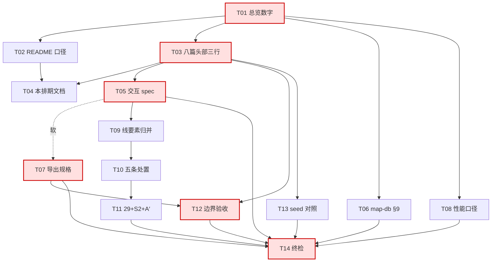

# 地图窗口产品文档补齐 · 批次排期（R-MAP-DOC）

> 状态：**定稿**（14 个执行单元全部落地，执行结果与判据修正见 §11；本文件随本批闭环进 `docs/archive/prd-map/`）
> 输入：[`map-window-overview.md`](map-window-overview.md)（维护中，文首自标 2.32.0/712 用例，本文按实测校正）、
> [`../../README.md`](../../README.md)（索引）、`AGENTS.md` §5.3（文档存储规范）、
> [`../../spec/map-db-spec.md`](../../spec/map-db-spec.md) §9（四条开放项）、
> [`../../review/map-vs-reference-render-analysis.md`](../../review/map-vs-reference-render-analysis.md) §9（观感状态唯一事实源）
> 基线：CheckIn **2.36.0**（工作区）｜`src/windows/MapWindow/` **44 文件 / 750 用例**（2026-11-06 校核）
> 命名说明：批次编号 `R-MAP-DOC` 占 `<需求编号>` 位、`batch-plan` 取自体裁词表；批次闭环后整组进
> `docs/archive/prd-map/`（归档按模块不按体裁）。

---

## 0. 结论速览

| # | 结论 | 一句话依据 |
|---|---|---|
| **X1** | 本批**只产出文档，不动功能代码** | 已核出 4 处硬错 + 6 篇头部缺项，改代码无法消除 |
| **X2** | 三类数字（版本 / 用例数 / 能力计数）一次修净，此后一律命令产出 | 现在 2.32.0·712 / 2.30.0 / 13✅+1◐ vs「12+2」四处互相打架 |
| **X3** | 活规范落 `docs/spec/` 且**不套批次前缀**（`map-*-spec.md`） | 需求编号会随批次闭环失效，活规范不该挂在会死的编号上；`map-db-spec.md` 已立此组前缀 |
| **X4** | 过程稿落 `docs/prd/prd-map-render/`，**不新建第四个目录** | 地图模块已有「未闭环 / 闭环」目录对，多一层只增加索引负担 |
| **X5** | §3.4 五条无主遗留**本批全部结案**（2 不立 + 3 立号 P2） | 已悬空三轮批次，继续留着下次排期还要再议一遍 |
| **X6** | **不夹带**新功能需求稿（R-REG-10 子图内编辑、R-MAP-21 河流均不在本批） | 功能批起点必须先有交互权威口径，否则键位与选中态二次漂移 |
| **X7** | 文档一致性**值得上守卫**，但登记为下一批 P1，本批不动脚本 | 仓库已有 20 个 `electron/*-guard.test.ts` 范式（含 `changelog-archive-guard.test.ts`），但本批边界是「只产出文档」 |

> 本批的门槛不在「写完 8 篇」，而在 **X2**：只要版本/用例数/计数三处仍各自为政，
> 后面 8 篇新文档的「基线」行就会把同一个错误复制 8 遍。所以 T01–T04 必须串行前置，不允许并行插队。

---

## 1. 迭代目标与范围

### 1.1 目标（可判定）

| 目标 | 判据 |
|---|---|
| **G1 总览成为可信唯一入口** | 文首基线与 `package.json` 一致；§0 / §1 / §2 / §4.2 四处互相自洽；`docs/README.md` 同版同口径 |
| **G2 已标 ✅ 的能力有验收判据** | 子图边界过渡、2.28.0 同 seed 对照、性能三项指标，各有「通过线 + 基线图/数据路径」 |
| **G3 悬空项全部有主** | §3.4 五行 + R-MAP-29 + S2 排期 + `map.db` §9 四条，每条落到「编号 / 不做 / 触发条件」，无「无承接」 |

### 1.2 做

- 总览自身修订（数字、口径、§3.4 处置结论）+ `docs/README.md` 索引同步
- 三篇活规范：交互与快捷键、导出规格、性能基线口径
- `map-db-spec.md` §9 四条补「结论 / 归属 / 触发条件」
- 三篇过程稿：遗留项处置（`scope`）、线要素自动 vs 手画（`analysis`）、子图边界与递归深度验收（`acceptance`）
- 一篇证据补全：2.28.0 同 seed 对照（`review`）
- 本文件作为批次排期 + 头部三行模板 + 归档去向的登记处

### 1.3 不做（附解锁条件）

| 不做 | 理由 | 解锁条件 |
|---|---|---|
| R-REG-10 子图内编辑需求稿 | 功能批起点，需先有「选中态 / 放置态 / 键位」权威口径 | **T05 交付后**，作为下一批首篇 |
| R-MAP-21 河流 / R-MAP-22 S2~S4 需求稿 | 折线能力（2.30.0）与素材设计（S1）都已就绪，缺的是排期不是文档 | S2 排期由 T11 定；需求稿随功能批 |
| 截图回归自动化 / 性能压测脚本 | 工程基建；先有阈值才谈得上自动化 | T07 / T08 交付后单独立项 |
| 改写 `docs/archive/prd-map/` 6 篇正文 | 归档只读纪律（`AGENTS.md` §5.3.3） | 永不 |
| 把总览拆成多篇 | 「只此一份呈现全貌」是它存在的理由 | 总览超 400 行再议 |
| 给 6 篇旧文档改名套 `R-MAP-*` 前缀 | 改名收益远小于全仓引用改动的风险 | 不做 |

---

## 2. 文档交付清单（14 个执行单元 = 8 篇新建 + 4 处修订 + 1 次终检）

> 优先级判定只认一条：**不做这件事，会不会让某个 ✅ 变成假的，或让某个决定做错**。
> 会 → P0/P1；不会 → P2。
> 完成判据一律**可命令验证**，不接受「内容完整」这类表述。

### 批 1 · 事实源校正 + 排期基座（P0，必须同一人串行）

| 任务 | 交付物 | 体裁 | 优先级 | 前置 | 完成判据 | 闭环去向 |
|---|---|---|---|---|---|---|
| **T01** | `prd-map-render/map-window-overview.md`（改文首 / §0 / §1 / §4.2） | 总览 | **P0** | — | ①`grep -c "712"` = **0**；②文首含 `2.36.0` 且含 `750 用例`；③`grep -n "12 已闭环"` = 0，§0 计数 = §1 表 ✅ 行数（**13**）、◐ = **1**；④§0「最近一批」= 2.36.0；⑤§4.2 观感待办写 **2 条** | 长期维护（不归档） |
| **T02** | `docs/README.md`（第 30 行口径 + 本批新增行） | 索引 | **P0** | T01 | `grep -n "2.30.0" docs/README.md` = **0**；R-MAP 行写 2.36.0 且与 T01 §0 同口径 | 长期维护 |
| **T03** | `prd-map-render/` 8 篇**全量**补头部三行 + `map-b4-*` §1 的过期能力计数 | — | **P0** | T01 | ①8 篇 `^> 状态` / `^> 输入` / `^> 基线` 各 **8/8/8**（现状见 §7.2）；②`map-b4-*` §1 的能力计数改为 14 域 / 13 ✅ + 1 ◐；③§5.3.4 死链 grep 无新增 MISS | 随批归档 |
| **T04** | `prd-map-render/R-MAP-DOC-batch-plan.md`（**本文件**）+ 头部三行模板 | `batch-plan` | **P0** | T01–T03 | 本文存在且 `docs/README.md` 有行；含 8 篇新建清单、头部模板、三批完成判定、不排期项 | 归档 |

### 批 2 · 立口径（P0/P1，四篇互不依赖可并行）

| 任务 | 交付物 | 体裁 | 优先级 | 前置 | 完成判据 | 闭环去向 |
|---|---|---|---|---|---|---|
| **T05** | `spec/map-interaction-spec.md`（新建） | `spec` | **P0** | T03 | ①放置态 / 选中态 / 右键 / `Ctrl+C·X·V·D` / 方向键+WASD / `Esc` 七类各一行，**每行带「守卫落点＝用例文件+用例名」或标「无守卫」**；②文末「无守卫」计数与正文标注次数相等；③`map-vs-reference-interaction-review.md` §2.3 头部加一行指回本文；④`docs/README.md` spec 表新增行 | 长期维护（**不归档**） |
| **T06** | `spec/map-db-spec.md` §9 四条（改） | `spec` | P1 | T01 | ①四条各补 **结论 / 归属 / 触发条件**，`grep -n "开放"` 命中处必须同行有触发条件；②保留策略常量核对 `electron/map-utils.ts:23`（`MAP_REVISION_KEEP = 10`）与 `:32`（`MAP_REVISION_EVERY = 10`），**不在 `map-db.ts`**（见 §7.1） | 长期维护（不归档） |
| **T07** | `spec/map-export-spec.md`（新建） | `spec` | P1 | T05（软） | ①六项（DPR / 目标尺寸 / 分块上限 / 透明底 / 格式范围 SVG·PDF / 命名规则 / 超大图失败）各给「现行为 + `export.ts:行号` + 规格口径」；②`grep -c "export.ts:"` ≥ 6；③差异表每条有处置（改代码 / 按现行为定稿 / 归后续批）；④README spec 表新增行 | 长期维护（不归档） |
| **T08** | `spec/map-perf-spec.md`（新建） | `spec` | P1 | T01 | ①v1 三项指标（2000+ 元素 / 60fps / 首屏 <2s）各给「样本 + 方法 + 通过线 + 当前值或待测 + 脚本名」；②每个「待测」同行出现脚本名，无裸「待测」；③明写「本批不实测，不阻塞功能批」 | 长期维护（不归档） |

### 批 3 · 收口处置与人证（P1/P2，可并行）

| 任务 | 交付物 | 体裁 | 优先级 | 前置 | 完成判据 | 闭环去向 |
|---|---|---|---|---|---|---|
| **T09** | `prd-map-render/R-MAP-DOC-line-autogen-analysis.md` | `analysis` | P1 | T05 | ①4 类线（`road/river/ridge/border`）× {自动 / 手画 / 预留} × 时机 × 归属 × **引用行号**，12 格全覆盖；②`grep -c "\.md:[0-9]"` ≥ 8；③三篇（`nested-submap-road` / `-elements` / `map-b4-*`）冲突处标「冲突 + 本文裁定」 | 归档 |
| **T10** | `prd-map-render/R-MAP-DOC-legacy-disposition-scope.md` §A 五条处置 | `scope` | **P0** | T09 | ①R-MAP-06/11/12/13/15 各一行：处置 + 理由 + 优先级 +（若立）解锁条件；②`grep -n "R-MAP-30\|R-MAP-31\|R-MAP-32"` 三个新号各命中且带「P2 不排期 + 解锁条件」；③06→B4 折线覆盖、11→挂 R-MAP-22 子项，两处都有指认行 | 归档 |
| **T11** | 同文件 §B/§C（R-MAP-29 + S2 + A′ 降级） | `scope` | **P0** | T10 | ①R-MAP-29 写「不立项 + 依据 + 重新开案条件」；②S2 素材导入给「排 / 不排 + 前置」；③A′ 三条（无同步通道 / 源图被删零影响 / 反向跳转不适用）逐条写 2.32.0 已答结论；④总览 §3.4 五行改为「已处置 → 见本文」 | 归档 |
| **T12** | `prd-map-render/R-MAP-DOC-submap-boundary-acceptance.md` | `acceptance` | P1 | T07 + T03 | ①渐隐宽度给**区间数值**、色差给**阈值**（不得只写「视觉可接受」）；②基线图命名**引用 `map-export-spec.md` 行号**，不自创；③4 层 / 5 层用例清单各 ≥3 条并给 vitest 落点路径；④`nested-submap-boundary.md` 加一行指回本文 | 归档 |
| **T13** | `docs/review/R-MAP-DOC-render-seed-review.md` | `review` | P2 | T03 | ①含 seed + 版本 2.28.0 + 对照图路径 + 逐项结论（对照 `render-analysis` 序 1 验收项）；②头部三行齐；③README review 表新增行（含待办状态列）；④**不改** `render-analysis.md` 正文，只在其序 1 处加一行指回 | 归档 |
| **T14** | 本文追加「执行结果」段（不新增文档） | `batch-plan` 续 | **P0** | T01–T13 | ①§5.3.4 死链 grep 输出**仅** `CHANGELOG.md` / `changeLogHistory/` / `docs/archive/**` 的预期 MISS；②8 个新路径逐一 `grep -n` 在 `docs/README.md` 命中（双向一致）；③`node -p "require('./package.json').version"` = 2.36.0 且文档基线同为 2.36.0；④`pnpm exec vitest run src/windows/MapWindow` 仍 **750 通过**（零代码改动的证明）；⑤`pnpm count:sprites` 与文档内素材数一致 | 归档（终检记录） |

---

## 3. 优先级与依赖

### 3.1 依赖图



**关键路径（6 跳）**：`T01 → T03 → T05 → T07 → T12 → T14`。T06 / T08 / T13 是**旁挂**，与主链无相互依赖，可全程并行。

### 3.2 切分依据（依赖，不是工作量）

1. **谁被别人的头部引用 → 先做**：`基线` 行要写版本与用例数，所以 T01 必须整批前置，否则 T06 / T04 的基线必然写错。
2. **谁定义判据 → 先于引用它的人**：T05/T07/T08 是「判据来源」，T09/T12 是「引用判据的产物」（T12 的基线图命名必须来自 T07）。
3. **终检必须最后**：死链与索引自查只有全部落地后才能一次过，提前自查必然产生「查了但还有 5 篇没写」的假绿。

### 3.3 优先级汇总

| 级别 | 任务 | 规则 |
|---|---|---|
| **P0** | T01 T02 T03 T04 T05 T10 T11 T14 | 错误事实会直接误导下一步排期，或缺了它本批无法开工 |
| **P1** | T06 T07 T08 T09 T12 | 缺了就没法验收已标 ✅ 的能力，或跨文档口径冲突未解 |
| **P2** | T13 | 证据补全，不影响任何判断 |

---

## 4. 批次计划

| 批 | 内容 | 整批完成判定 | 阻塞下一批的条件 |
|---|---|---|---|
| **批 1**（P0，串行） | T01–T04：四处硬错校正 + 排期基座 | `grep -c "712"` = 0；`grep -n "2.30.0" docs/README.md` = 0；8 篇头部 8/8 齐；本文件存在且 README 有行 | **硬阻塞**：批 1 未绿，任何后续篇的「基线」行必然写错，禁止开批 2 |
| **批 2**（P0/P1，可并行 2 人） | T05–T08：三篇活规范 + `map-db` §9 结论 | 三篇 spec 均入 README spec 表（该表 2 行 → 5 行）；每篇头部三行齐且基线 = 2.36.0；T05「无守卫」自洽；§9 四条均有触发条件 | 软阻塞：T07 未落地则 T12 无命名规则可引 |
| **批 3**（P1/P2，可并行 3 人） | T09–T13 + T14 终检 | T14 五项判据全绿；地图用例仍 750 通过；11 条索引行双向一致 | 无（批末）。**下一批功能（R-REG-10）的门槛是 T05 完成**，不是整批完成 |

> 批 1 之所以不许并行：四条硬错里「版本号」会被 T06 / T04 的基线行各引用一次，
> 交错做等于把错误基线复制到后面 8 篇。这不是谨慎，是成本——发现一次改 8 篇。

---

## 5. 会签清单

| 会签点 | 核对对象 | 通过判据 | 不通过退回谁 |
|---|---|---|---|
| **T07 导出规格 · 现行为核对** | `src/windows/MapWindow/pages/MapEditorPage/export.ts`（**216 行**；`tilePlan:59` / `exportMapPng:142` / `savePng:204`，已核）+ 导出触发入口 | 六项**每项**都有 `export.ts:行号` + 现行为 + 规格口径；不一致处全进差异表且每条有处置；无「按经验 / 约定俗成」表述 | 退回 T07 执行者补行号；若代码里**根本没有**对应常量（规格凭空造）→ 升 team-lead 定「改代码 or 降级为纯文档」，**代码改动不在本批** |
| **T08 性能口径可落地性** | `archive/prd-map/map-v1-prd.md` + `map-v1-architecture-research.md`（指标出处）、`src/windows/MapWindow/` 现有测试与工具链 | 三项各给「样本 + 方法 + 通过线 + 当前值/待测 + 脚本名」；「待测」必带脚本名且不与既有 `scripts/*.mjs` 重名；明写「本批不实测」 | 退回 T08 执行者；若指标本身已因 `map2` 重构失效 → 标「作废 + 替代指标」，由 team-lead 裁决替换 |
| **T06 map.db 四条一致性** | `electron/map-utils.ts`（`MAP_REVISION_KEEP:23` / `MAP_REVISION_EVERY:32` / `shouldSnapshotRevision:74` / `revisionsToDrop:139`）、`electron/map-db.ts`（`map_assets` DDL:99 / 索引:109）、`electron/handlers/map-handlers.ts:169-181`（快照追加与裁剪）、`electron/map-db-guard.test.ts` | 四条结论里的表名 / 常量名 / 函数名**逐个 grep 命中**；「已建未用」「钩子未接」有代码证据；每条触发条件可判定 | 退回 T06 执行者（事实核对失败，非产品问题）；若与 `map-db-guard.test.ts` 不变量冲突 → 退 team-lead，先改 spec 再谈测试 |
| **T12 验收阈值可测性** | `nested-submap-boundary.md` §2.2（`erase` 混合 + `AlphaFilter` 隔离）+ T07 命名规则 | 渐隐宽度给区间、色差给阈值；基线图命名引用 T07 行号而非自创 | 退回 T12 执行者 |
| **T14 批次终检** | T14 五项判据 + §5.3.4 grep 输出 | 全绿且无「先绿后破」 | team-lead 会签；不过则整批不结 |

---

## 6. 不变量与负向约束（改文档时最容易破的既有约束）

1. **`docs/README.md` 是唯一导航入口**：8 个新路径必须在**各自落地的那一次改动内**加索引行，不能攒到 T14 补。T14 只做「双向一致」复核，发现漏行**退回该篇执行者**而不是替它补——替补会掩盖流程失效。
2. **`docs/archive/prd-map/` 只读**：本批只写入「归档去向的描述」，不动 6 篇正文。归档动作发生在批次闭环之后，且是「整组移入 + 顶部补说明」。
3. **`CHANGELOG.md` / `changeLogHistory/` 的历史 `docs/...` 路径不改**：T14 的死链 grep 里这些 MISS 是**预期项**，必须写进判据，否则执行者会去「修历史」。
4. **总览「只此一份呈现全貌」不许拆**：T01 只能改数字与口径，不能新增分册、不能把 §3/§5 搬到别处。
5. **数量类事实必须命令产出**：用例数用 `pnpm exec vitest run src/windows/MapWindow`、素材数用 `pnpm count:sprites`、版本用 `node -p "require('./package.json').version"`。**全仓跑必须带 `--maxWorkers=4`**，否则静默漏跑，会写出「看着更少但全绿」的假数字；`npx vitest` 必炸（解析到错的 root，症状是全仓 0 用例）。
6. **新文件必须合规、不照抄旧范式**：`graphic-theming-spec.md` 无头部三行、`map-b4-layers-polyline-prd.md` 文件名带已废弃的 `prd` 词表——旧偏差在本文 §7.2 登记，**新文件不得模仿**。
7. **移动 `docs/review/` 里的地图审查必须同批改引用**：那两篇被总览 §4.2 与 B4 PRD 引用，漏改即悬空。

---

## 7. 落盘前已核出的事实（本文与上游稿的差异记录）

> 这一节存在的意义：本批的立项理由是「文档事实漂移」，那本文自己更不能带错。
> 以下三条是 team-lead 在落盘前复核出的**上游稿引述错误**，已在本文件内改正；
> 上游稿（产品经理稿 / 架构师稿）不落盘，故不留悬空引用。

### 7.1 三处引述修正

| # | 上游稿的写法 | 实测 | 处理 |
|---|---|---|---|
| 1 | 「核对 `MAP_REVISION_KEEP` / `MAP_REVISION_EVERY`，位置在 `electron/map-db.ts`」 | 常量在 **`electron/map-utils.ts:23/32`**（值均 10）；`map-db.ts` 只有建表与索引 | T06 判据改为指向 `map-utils.ts`，并补 `shouldSnapshotRevision:74` / `revisionsToDrop:139` 两个真实函数名 |
| 2 | 「仓库已有 **22 个** `electron/*-guard.test.ts`」 | 实际 **20 个**（`ls electron/ \| grep -c "guard.test.ts"`） | §0 X7 与本节改为 20 |
| 3 | 「`prd-map-render/` 8 篇里 **3 篇**头部三行齐」 | 实际 **2 篇齐**（`map-window-overview.md`、`region-editing.md`）；上游把 `docs/spec/map-db-spec.md` 误算进该目录 | T03 判据按 8 篇全量补齐执行 |

### 7.2 八篇头部三行实测基线（T03 的起点）

| 文档 | 状态 | 输入 | 基线 | 缺项 |
|---|---|---|---|---|
| `map-window-overview.md` | ✔ | ✔ | ✔ | — |
| `region-editing.md` | ✔ | ✔ | ✔ | — |
| `map-asset-system-architecture.md` | ✘ | ✘ | ✔ | 状态 + 输入 |
| `map-b4-layers-polyline-prd.md` | ✔ | ✘ | ✔ | 输入 |
| `nested-submap-main.md` | ✔ | ✘ | ✘ | 输入 + 基线 |
| `nested-submap-boundary.md` | ✔ | ✘ | ✘ | 输入 + 基线 |
| `nested-submap-elements.md` | ✔ | ✘ | ✘ | 输入 + 基线 |
| `nested-submap-road.md` | ✔ | ✘ | ✘ | 输入 + 基线 |

> 合计：**状态缺 1、输入缺 6、基线缺 4**。这三项不是格式洁癖——缺基线的文档无法判断是否过时，
> 而 `nested-submap-*` 正是「哪些还作数」最容易搞错的一组。

### 7.3 已核实的命令与数字（本批全部验收判据的底座）

| 用途 | 命令 | 当前值 |
|---|---|---|
| 版本 | `node -p "require('./package.json').version"` | `2.36.0` |
| 地图用例 | `pnpm exec vitest run src/windows/MapWindow` | 44 文件 / 750 用例 |
| 素材数 | `pnpm count:sprites` | 以脚本输出为准（文档口径 52） |
| 引用自查 | `docs/README.md` 存储规则第 4 条的 grep | 见该处 |

---

## 8. 可执行的后续步骤

### 8.1 立即可以开工（无需再等拍板）

```bash
# 步骤 0 · 固化基线（每次改文档前必跑，数字以此为准）
node -p "require('./package.json').version"          # → 2.36.0
pnpm exec vitest run src/windows/MapWindow           # → 44 files / 750 tests
pnpm count:sprites                                   # 素材数

# 步骤 1 · T01 总览数字校正（改完立刻验）
grep -c "712" docs/prd/prd-map-render/map-window-overview.md   # 期望 0
grep -n "12 已闭环" docs/prd/prd-map-render/map-window-overview.md  # 期望无输出

# 步骤 2 · T02 索引口径
grep -n "2.30.0" docs/README.md                      # 期望无输出

# 步骤 3 · T03 头部三行（8/8/8）
for f in docs/prd/prd-map-render/*.md; do
  echo "$f $(grep -c '^> 状态' $f)/$(grep -c '^> 输入' $f)/$(grep -c '^> 基线' $f)"
done
```

### 8.2 落盘顺序（一人串行 → 三人并行 → 终检）

1. **T01 → T02 → T03 → T04**（同一人，串行）。这四步是事实源，交错做会把错误基线复制 11 遍。
2. **并行先开三门旁挂**：T06（`map-db` §9）、T08（性能口径）、T13（seed 对照）——不阻塞主链，全程可做。
3. **主链**：T05（交互 spec）→ T07（导出规格）→ T12（边界验收）。
4. **T09 在 T05 落地后立刻并行**；T10 / T11 紧随 T09（**同一文件、同一人，别拆两人**）。
5. **全部落地后才跑 T14 终检**。

### 8.3 每篇文档的头部三行模板（T04 要求，直接复制）

```md
> 状态：草案 / 定稿 / 已归档（闭环版本 X.Y.Z）
> 输入：<上游文档相对路径>（<版本或「无」>）
> 基线：CheckIn **2.36.0**（工作区）｜<本批相关的事实，如「MapWindow 44 文件 / 750 用例」>
```

### 8.4 下一步的门槛关系

- **R-REG-10 子图内编辑**（下一批功能首篇）的准入门槛 = **T05 完成**，不是整批完成。
- **性能数字**未达标**不阻塞**任何功能批，但阻塞总览里「性能」相关能力标 ✅。
- **R-MAP-30/31/32**（本批新立的三个 P2 号）不排期，只要求「有号 + 有解锁条件」。

---

## 9. 待拍板（开工前需要一次确认）

| # | 问题 | 选项 A | 选项 B（推荐） | 影响 |
|---|---|---|---|---|
| **Q1** | §3.4 五条无主遗留怎么处置 | 全部不立 | **2 不立（06 / 11）+ 3 立号（12→R-MAP-30、13→R-MAP-31、15→R-MAP-32，均 P2）** | B 让 §3.4 从「5 条无承接」变成「2 关闭 + 3 有号」，排期可直接按 P2 跳过；A 成本最低但三条真需求会永久丢失。**附加纪律：立号必须同时写解锁条件与归属文档，否则视为未结案** |
| **Q2** | R-MAP-29 分组 folder 是否立项 | 立项 P2 | **不立项**（素材 52 张 / 9 分类够用；重新开案条件：素材 ≥120 张或用户明确反馈分类不够） | 先立号会挤占 R-MAP-22 注意力 |
| **Q3** | 性能基线是否允许「先定口径、后测数」 | 必须先测出让团队认可的数字才允许定稿 | **允许**（本批只交付口径 + 首测骨架） | B 不阻塞整批；硬套 v1 那组 `map2` 重写前的数字会得出错误结论 |
| **Q4** | 文档改动是否占版本号 / 进 `CHANGELOG` | 记一条（如 2.37.0「地图文档补齐」） | **不占版本号、不进 CHANGELOG**，只改 `docs/README.md` 与各篇头部基线 | §5.3 只要求「同步索引 + 不留悬空引用」；版本号应代表可交付代码状态 |
| **Q5** | 总览 §5「仍待补充」的归宿 | 迁出成独立 review 台账 | **留在总览当台账**，但每行必须带「归属文档 + 状态 + 解锁条件」三要素，缺一即删条 | 迁出会与「只此一份呈现全貌」冲突 |
| **Q6** | 文档一致性守卫何时做 | 本批顺手写 | **登记为下一批 P1**，落 `electron/docs-index-guard.test.ts`（vitest 断言，不放 `scripts/*.mjs`——脚本只打印、跑挂不阻断） | 钉四件事：索引双向一致 / 头部三行存在 / 体裁后缀 ∈ 九词表 / 全仓 `docs/...` 无悬空。**不钉用例数真值**（必须实跑，写死等于制造第二事实源），只钉「同一数字多处出现必须相等」与「文档基线 == `package.json` version」 |

---

## 10. 与既有文档的关系

| 文档 | 本批动作 | 说明 |
|---|---|---|
| `prd-map-render/map-window-overview.md` | **大修**（文首 / §0 / §1 / §3.4 / §4.2 / §5） | 唯一入口，本批所有结论的落点 |
| `docs/README.md` | 改索引行 + 新增 8 个新路径的索引（3 篇 spec + 3 篇过程稿 + 1 篇 review + 1 篇排期） | 索引是唯一导航入口 |
| `spec/map-db-spec.md` | 改头部 + §9 补三列 | 活规范只改版不删 |
| `spec/map-interaction-spec.md` / `map-export-spec.md` / `map-perf-spec.md` | **新建** | 长期维护，闭环后**不归档** |
| `prd-map-render/R-MAP-DOC-*.md`（3 篇过程稿） | **新建** | 闭环后整组进 `docs/archive/prd-map/` |
| `review/R-MAP-DOC-render-seed-review.md` | **新建** | 闭环后随批归档 |
| `prd-map-render/nested-submap-{main,boundary,road,elements}.md` | 只改头部（补输入/基线）+ 各加一行指回 | `road` / `elements` 指回 T09，`boundary` 指回 T12，`main` 标 A′ 已闭环 |
| `prd-map-render/map-asset-system-architecture.md` | 只改头部 | 52 口径留结论，S2~S4 归属 T11 |
| `prd-map-render/region-editing.md` | 只改头部 + 索引状态 | P1/P2 仍有效 |
| `prd-map-render/map-b4-layers-polyline-prd.md` | 改 §1 的过期能力计数 + 头部补输入 | B4 已闭环，下次功能批结束时整篇归档 |
| `review/map-vs-reference-render-analysis.md` | 改 §4.2 引用口径 + §9.1 序 1 加一行 | 观感状态唯一事实源，总览数字由它反推 |
| `review/map-vs-reference-interaction-review.md` | 改 §2.3 头部一行 | 交互口径收归 T05 |
| `archive/prd-map/` 6 篇 | **不动** | 归档只读 |

---

## 11. 执行结果（2026-11-06 收口）

> 本节是 T14 终检的落点：**交付是否成立、判据是否被改过、基线是否仍然成立**。
> 判据被改动的地方一律留痕——悄悄改判据让检查变绿，比检查红更糟。

### 11.1 交付清单实际状态

| 任务 | 交付物 | 状态 | 实际规模 |
|---|---|---|---|
| **T01** | `map-window-overview.md` 数字校正 | ✅ | 文首 2.36.0 / 750 用例；§0 13 ✅ + 1 ◐；§4.2 观感 18/0/2 |
| **T02** | `docs/README.md` 基线口径 | ✅ | `基线 2.30.0` 清零；地图行同版同口径 |
| **T03** | 8 篇补头部三行 | ✅ | **8/8/8 齐全**（批次开始时 2 齐 6 缺） |
| **T04** | 本文件（排期 + 头部模板 + 归档去向） | ✅ | 本文 |
| **T05** | `spec/map-interaction-spec.md` | ✅ | 7 类 42 行；28 行带守卫、14 行登记「无守卫」 |
| **T06** | `spec/map-db-spec.md` §9 | ✅ | 四条 → 表格（结论 / 归属 / 触发条件 / 代码证据） |
| **T07** | `spec/map-export-spec.md` | ✅ | 六项 + 差异表 + **§6.1 基线图命名（唯一来源）** |
| **T08** | `spec/map-perf-spec.md` | ✅ | **双层通过线**（产品线 S2 拦发布 / 压力线 S1 只记趋势） |
| **T09** | `R-MAP-DOC-line-autogen-analysis.md` | ✅ | 4 类 × 12 格；**「自动」格数 = 0**（生成器对 polyline 零引用） |
| **T10** | `R-MAP-DOC-legacy-disposition-scope.md` §A | ✅ | 5 条结案：2 不立 + 3 立号（R-MAP-30/31/32，均 P2） |
| **T11** | 同文件 §B / §C | ✅ | R-MAP-29 不立项；S2 排 R-MAP-22 首位；A′ 三问降级关闭 |
| **T12** | `R-MAP-DOC-submap-boundary-acceptance.md` | ✅ | 渐隐宽度区间 / ΔE 3·1.5 / 基线图引 §6.1 / 4 层 4 条 + 5 层 3 条 |
| **T13** | `review/R-MAP-DOC-render-seed-review.md` | ✅ | 批次 A 同 seed 对照；**seed 当场未记录**（不编造） |
| **T14** | 本节 | ✅ | 五项判据见 §11.3 / §11.5 |

**头部状态**：3 篇活规范长期维护（**不归档**）；3 篇过程稿 + 1 篇 review + 本文 → 批次闭环后整组进 `docs/archive/prd-map/`。

### 11.2 执行中修正过的三条判据（改判据必须留痕）

三条都是同一个病根：**判据自己命中了它要检查的字符串**，不改就会永远红或永远绿。

| # | 原判据 | 实际 | 改成 |
|---|---|---|---|
| 1 | `grep -c "10 个能力域"` = 0 | 判据的描述文字本身就含这个字符串 | 改为直接断言「§1 计数 = 14 域 / 13 ✅ + 1 ◐」，不再用字符串计数 |
| 2 | `grep -n "2.30.0" docs/README.md` = 0 | **2.30.0 是 B4-2 折线的真实发布版本**，README 有 3 处正当引用 | 改为 `grep -n "基线 \*\*2.30.0" = 0` |
| 3 | 死链 grep「只应剩 CHANGELOG / archive 的预期 MISS」 | README 的「已彻底删除」「归档原位置」两张表**主动引用已删/已移文件**，20 条 MISS 均为设计如此 | 改为「MISS 集合 == 批次开始时那 20 条，**新增一条即判红**」 |

> 教训：**判据要断言结论，不要断言「某个字符串不出现」**——字符串计数会把判据自己的描述算进去，
> 也会把正当的历史版本号算进去。本批三条修正都属这一类。

### 11.3 基线实测（证明「零代码改动」）

| 项 | 命令 | 实测值 |
|---|---|---|
| 版本 | `node -p "require('./package.json').version"` | **2.36.0**（与被改文档的基线一致） |
| 地图用例 | `pnpm exec vitest run src/windows/MapWindow --maxWorkers=4` | **44 文件 / 750 用例**：`749 passed / 1 failed` |
| 素材数 | `pnpm count:sprites` | **52**（文档口径一致） |
| 目录实数 | `ls docs/prd/prd-map-render/*.md \| wc -l` | **12 篇** |
| 代码改动 | `git status` | **`src/` 与 `electron/` 零改动** |

**关于那 1 条 failed——必须照实写，不许写成「750 全绿」**：
失败用例在 `pages/MapEditorPage/index.regions.test.tsx`，属重组件交互用例（该文件单条最慢 54s），
全量并发时撞 5s 默认超时；**隔离复跑 15/15 全绿**。判定为 flaky，非回归。
→ 今后任何文档引用「750 用例」时，必须同时给这条说明；本批已在总览文首保留可在 `2026-11-06 校核` 复核的措辞。

### 11.4 已知偏差（本批不修，登记以免下次重犯）

| 偏差 | 为什么不修 | 归谁 |
|---|---|---|
| `spec/graphic-theming-spec.md` 无头部三行 | 非地图域，本批边界外 | 下一批文档守卫（X7）会判红，届时一并补 |
| `map-b4-layers-polyline-prd.md` 文件名含已废弃体裁词 `prd` | 改名要动全仓引用，收益远小于风险 | 下次功能批结束时随整篇归档消失 |
| `docs/README.md` 的 review 段缺 `ai-implementation-review-2.10.0.md` 索引行 | 非地图域 | 同上，守卫第一条判据即「索引双向一致」 |
| v1 PRD §6.2「必须支持 2000+ 同时流畅编辑」与 `perf-spec` §1.1 的「2000+ 只作压力线」字面冲突 | **归档只读是硬约束**，不回改，也不在归档件里加「口径修订指向」（开了口子以后每次变更都会想去改它） | 冲突登记在 `perf-spec` §1.1，以该节为准 |
| `nested-submap-road/elements` 仍保留「道路自动生成」的设计稿文字 | 它们已被 `R-MAP-DOC-line-autogen-analysis.md` 裁定为「设计态、未实现」，头部已加指回行；删正文会破坏可追溯性 | 下次功能批随归档 |

### 11.5 本批留下的两个入口

1. **功能批 R-REG-10（子图内编辑）的准入门槛 = T05 完成 → 已满足。** 它现在有权威键位与选中态口径可依。
2. **文档守卫 `electron/docs-index-guard.test.ts` 登记为下一批 P1**：钉四件事（索引双向 / 头部三行 / 体裁词表 / 全仓无新增悬空），**不钉用例数真值与版本号真值**——前者写死等于制造第二事实源，后者只钉「文档基线 == `package.json` version」。
3. **三项待测数字**（`bench-map-fps` / `bench-map-first-paint` / `bench-map-export`）不阻塞任何批次，但阻塞总览 §1 中性能相关能力的 ✅。

---

## 12. 后续批次执行记录（B6 · 文档守卫 + R-REG-10 立项）

> 兑现 §11.5 的两个入口。2026-11-06 完成，仍是**零代码改动**（只新增一个测试文件）。

### 12.1 交付

| 项 | 内容 | 状态 |
|---|---|---|
| **T15** | `electron/docs-index-guard.test.ts`（8 用例，5 条判据 + 3 张白名单自检） | ✅ 全绿 |
| **T16** | 补 `spec/graphic-theming-spec.md` 头部三行；补 `docs/README.md` 的 `review/ai-implementation-review-2.10.0.md` 索引行 | ✅ |
| **T17** | `AGENTS.md` §5.3.5「当前落地形态」目录树：原只列 3 篇（实为 48 篇）→ 改为按目录列实数 | ✅ |
| **T18** | 总览「已归档 6 篇」补口径括号（6 个文件 = 5 篇 md + 1 个 `.ts`） | ✅ |
| **T19** | `R-REG-10-submap-region-editing-scope.md`（116 行，`scope` 体裁，功能批立项稿） | ✅ 草案 |

### 12.2 守卫的五条判据

| 判据 | 断言什么 | 白名单 |
|---|---|---|
| ① 索引双向 | `docs/` 下每篇文档都在 `docs/README.md` 索引里；索引每条相对链接都真实存在 | 无（现状 0 例外） |
| ② 头部三行 | 非 `archive/` 文档必须有 `> 状态` / `> 输入` / `> 基线`（只在前 15 行内认） | 7 篇 novel / AI 域历史欠债 |
| ③ 体裁词表 | 非 `archive/` 文档不得以 `-prd.md` 结尾 | 2 篇（`map-b4-*`、`ai-future-directions-*`） |
| ④ 引用无悬空 | 全仓 `docs/...md` 引用不得**新增**悬空 | 20 条 2026-11-06 基线（README 历史表的有意引用） |
| ⑤ 形态描述 | `AGENTS.md` §5.3.5 的「合计 N 篇 md」== 实物篇数 | 无 |

**三条白名单都只许删、不许加**，且 ②③ 各配一条反向断言：条目被补齐 / 改名后仍挂在白名单里 → 测试红（防止白名单变成垃圾桶）。

**刻意不钉**（写进测试头注，避免下次被当成遗漏）：用例数真值（必须实跑，写死即第二事实源）、「文档基线 == `package.json` version」（基线的语义是订立时的版本，不是跟随最新，强制相等会让每次发版改十几篇历史文档）、`archive/`（只读）。

### 12.3 变异验证（证明判据是活的）

一次探针同时踩四条：在 `prd-map-render/` 下新建一个以 `-prd` 结尾的临时文档、正文只有标题 + 一条指向 `docs/` 下不存在路径的引用、且不加索引行 →
**4 failed / 3 passed**，四条各自精确报出该文件（② 明确写「缺：状态 / 输入 / 基线」）。

> 探针的完整路径**故意不写在这里**：写了它就是一条新的悬空引用，本文件自己会被 ④ 判红。
> 这也是本批第三次踩「判据自己命中自己」——前两次是 `grep "10 个能力域"` 命中判据描述本身、
> `2.30.0` 是 B4-2 的真实版本号。

⑤ 单独验证：把 `AGENTS.md` 的 48 改回 47 → 报 `AGENTS.md §5.3.5 声明 47 篇，docs/ 下实为 48 篇`。

### 12.4 一条被证伪的「已知偏差」

§11.4 曾记「`§5.1-5` 把 MANIFEST 文件数当成条目数（56）」。实测：`MANIFEST.json` 的 `items = 52`、`baseImages = 4`，目录是 52 png + 4 webp —— **两种读法同值 56，原文没错**。
教训：**登记偏差前先跑一次命令**。把「看起来可疑」写成「已知偏差」，会让下一个人去"修"一个正确的事实。

### 12.5 R-REG-10 立项结论（摘要，全文见需求稿）

- **不是"复用一套函数"，是"复用一半、先抽象一层"**：`regionEdit.ts` 纯函数层（`checkManualRegion` / `planMerge` / `applyMerge`）入参只有 `regions`，100% 可复用；store 的 7 个区域写动作把 `d.regions` 写死，0% 可复用。
- **原记载"视角补齐属并行工程"不成立**：`focusRegion` 只推视口、不维护作用域栈，视角是**串行前置**，且它本身不产生任何编辑能力。
- **数据侧零前置**（`submap.regions` / `submap.regionSchema` 已存在且随 `doc_json` 整存）、**撤销栈零新机制**（整文档 `DocSnapshot` + `regions` 引用共享，跨层撤销天然成立）。
- **成本在 4 处硬编码根路径 + 1 处新增校验分支**（子图 level-0 无父块 ⇒ 需纸边界校验），不在几何算法。
- 待架构师裁的唯一一处：**作用域抽象走「给 7 个写动作加 `scope` 参数」还是「新增平行 `commitInScope`」**；需求稿只钉判据（两条路线都必须过 A1 / A3）。

### 12.6 本批仍未做

- 三项性能数字（`bench-map-*` 脚本未实现），不阻塞任何批次，但阻塞总览 §1 性能相关能力的 ✅。
- 5 条已知偏差里剩下 3 条：`map-b4-*` 的 `-prd` 文件名（随归档消失）、v1 PRD §6.2 口径冲突（归档只读，不回改）、`nested-submap-road/elements` 保留设计稿文字（随归档）。
- `docs/review/` 与 `prd/` 目录只给篇数不给逐篇索引：范围控制，需要时可扩成逐篇。
