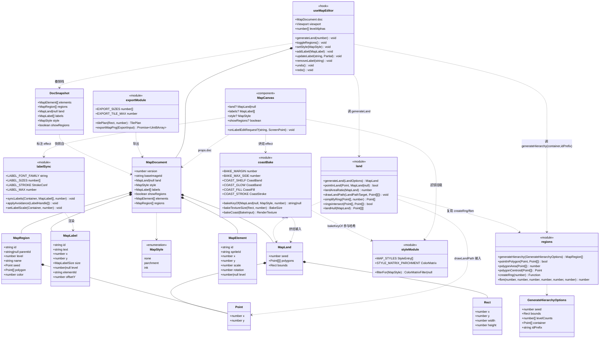
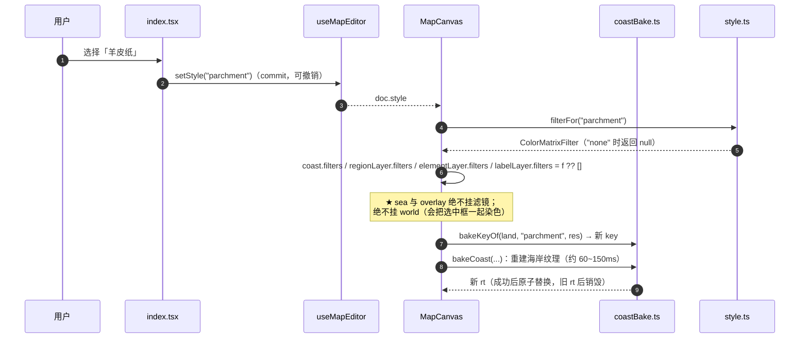
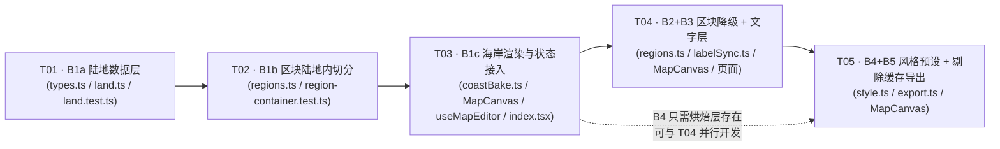

# 地图渲染观感对齐改造 · 增量架构设计与任务分解

> 本文是 `prd-map-render-alignment.md`（下称 **PRD**）的**工程化落地方案**。
> PRD 定义"要什么画面"，本文定义"代码怎么长、按什么顺序改"。
> 两者冲突时以本文的**「修订点」**小节为准（每条都给了理由），未列出的部分一律照 PRD 执行。

| 项 | 值 |
|---|---|
| 作者 | 高见远（架构师） |
| 基线分支 | `map2`（工作树仅 `vitest.config.ts` 有改动） |
| 基线验证 | `node node_modules/vitest/vitest.mjs run src/windows/MapWindow` → **Test Files 5 passed \| Tests 91 passed**（已复跑确认） |
| Pixi 版本 | `8.22.0`（`node_modules/pixi.js`） |
| 目标目录 | `src/windows/MapWindow/pages/MapEditorPage/`（下称 **`MapEditorPage/`**） |

---

## 0. 基线核实结论（PRD 行号漂移一览）

我对 PRD 里引用的每一处代码位置做了实际核对。**下表是必须先知道的偏差**，工程师请直接按下表改，不要按 PRD 写的行号去找。

| PRD 的说法 | 实际情况 | 处置 |
|---|---|---|
| `regions.ts:128` `REGION_WOBBLE.hueSpread = 8` | 实际在 **`regions.ts:212`**，当前值 **15**（不是 8） | B2 的目标值是 **15 → 3**；PRD 写的"8 → 3"是基于过期代码 |
| `regions.ts:1008` 取色公式 | ✅ 准确（`buildChildren` 内 `color: hslToRgb(hue, 0.3 + rng()*0.2, 0.56 + rng()*0.14)`） | 照 PRD 改 |
| `regions.ts:101 / 110 / 119` 三个常量 | ✅ 准确（0.32 / 1.6 / 0.6） | 照 PRD 改 |
| `regions.ts:234 / 265 / 285` `createRng` / `valueNoise` / `fbm` | ✅ 准确，且三者均为 `export` | 直接 import，禁止重写 |
| `regions.ts:404` `voronoiCellIn` | ✅ 准确，但**是模块私有函数**（未 export） | 只需换入参，函数体不用动；不需要 export |
| `regions.ts:754` `sampleSeeds` 需要加"种子必须在 container 内"的过滤 | ❌ **不需要改** —— `pullInside`（`regions.ts:732`）已经保证每个种子落在多边形内（见 §1.5） | 删掉这一步，改在 `generateHierarchy` 的根容器上做 |
| `regions.ts:1024` `generateHierarchy` 的 `nextId` | ✅ 准确（`rg_${seed36}_${counter}`，counter 是**每次调用**新建的闭包变量） | 多岛必须传 `idPrefix` |
| `MapCanvas/index.tsx:101` `BORDER_WIDTH_QUANTIZE` | ✅ 准确 | 不动 |
| `MapCanvas/index.tsx:601` 素材按层级容器分组 | ✅ 准确（`elementLayersRef` 权重 effect 在 `:601`） | 不动 |
| `MapCanvas/index.tsx:327` `world.addChild(sheet, baseSprite, regionLayer, elementLayer, overlay)` | ✅ 准确 | 本次改造成 `[sheet, sea, coast, region, element, label, overlay]` |
| `MapCanvas/index.tsx:609` 视口 effect | ✅ 准确 | 不动 |
| `useMapEditor.ts:46` `DocSnapshot` 只含 `{elements, regions}` | ✅ 准确 | **必须扩**（PRD §6.2 要求 `showRegions` 可撤销） |
| `coords.ts:29` 缩放上下限 | ✅ 准确（`ZOOM_LIMITS` 在 `:41`） | 不动 |
| `lod.ts:129 / 179 / 193` | ✅ 准确 | 不动 |
| PRD §7.0 开工路径 `D:/mine/CheckIn` | 实际工作区是 `C:/Users/A/Desktop/CheckIn` | 按实际路径 |

---

# Part A · 系统设计

## 1. 实现方案

### 1.1 技术难点与选型

| # | 难点 | 选型 | 理由 |
|---|---|---|---|
| 1 | 陆地形状既要"有机"又要"可复现" | **极坐标半径扰动 + fbm**（复用 `regions.ts` 的 `fbm`），不用形态学/腐蚀膨胀 | 一次成型、天然闭合无自交（θ 单调）、顶点数可控；形态学要额外做去自交，成本不成比例 |
| 2 | 海岸四层带 `BlurFilter`，挂在运行期容器上会每帧做 3 次高斯模糊 | **`RenderTexture` 烘焙 + 运行期只画一张纹理** | 海岸四层只随"陆地几何 / 风格"变，不随 viewport 变 —— 这是烘焙成立的充要条件 |
| 3 | 陆地多边形**非凸**，而 `voronoiCellIn` 依赖凸性 | 接受浅湾风险 + 护栏测试兜底；逃生方案是 `landHull()` 凸包 | 见 §1.5 |
| 4 | 多岛时 `generateHierarchy` 多次调用会 id 重号 | `GenerateHierarchyOptions.idPrefix?: string` | 缺省保持现有行为，`regions.test.ts` 不受影响 |
| 5 | 新增字段要能撤销 | 扩 `DocSnapshot` 为 `{elements, regions, land, labels, style, showRegions}` | 快照是**引用共享**（数组/对象不变则不复制），扩容几乎零内存代价 |
| 6 | `MapCanvas` 的 pixi mock 只有 5 个导出 | 新增运行时 import 必须同步扩两个 mock（见 §6.4） | vitest 的 `vi.mock` 工厂**缺导出会直接抛错**，不是"取到 undefined" |

### 1.2 图层栈落地（对 PRD §4.1 的修订）

PRD §4.1 给了 10 层 z 序，但 §6.1.4 的 `bakeCoast` 又把 `shelf / coastGlow / landFill / landStroke` 四层**烘进同一张 RenderTexture**。
运行时场景图里因此**只会有 1 个海岸节点**，不存在 4 个兄弟节点。§8.1 的自检清单要求打印 10 个子节点名 —— **这条自相矛盾**。

> **修订点 1（必须）**：运行期 `world` 的子节点固定为 **7 个**：
> `sheet, sea, coast, region, element, label, overlay`
> 四层海岸在**烘焙期**（`bakeCoast` 内部的 `holder` 容器）里仍是 4 个独立 Graphics，顺序即 `shelf → glow → fill → texSprite → stroke`。
> 因此：
> - §8.1 第 1 条的"子节点顺序"自检改为看这 7 个；
> - `render-stack-guard.test.ts` 断言的是这 7 个名字的顺序，不是 10 个。

落地后的场景图（**`MapCanvas/index.tsx:327` 一处改动**）：

```
stage
└ world                    ← 仅 viewport 变换（position + scale）
   ├ sheet       Graphics      z0 纸张投影（沿用 SHEET_SHADOW，不动）
   ├ sea         Sprite/NineSlice  z1 海面（承接 BASE_IMAGE 纹理）
   ├ coast       Container     z2~5 海岸烘焙层
   │   └ coastSprite  Sprite   ← 承接 bakeCoast 产出的 RenderTexture
   ├ regionLayer Container     z6 区块层（内部按层级分容器，**逻辑不变**）
   ├ elementLayer Container    z7 素材层（**逻辑不变**）
   ├ labelLayer  Container     z8 标注层（内部按层级分容器，与 elementLayer 同构）
   └ overlay     Graphics      z9 选中框（**不挂滤镜**）
```

**为什么 `coast` 用 Container 而不是直接放 Sprite**：风格滤镜要挂在"整组静态层"上（`sea` 之外），且未来 B5 的 `cacheAsTexture` 需要一个稳定的容器句柄。一层 Container 成本可忽略。

**新增图层的挂载位置纪律**（写进代码注释）：
- 新增节点一律在初始化 effect 里 `world.addChild(...)` **一次性**按数组顺序加入；**禁止**在后续 effect 里 `addChild`（那会让 z 序变成 effect 执行顺序的函数，极难排查）。
- `sea` 缺省继续渲染当老用法（`doc.land === null` 时 `coast` 容器 `visible = false`，不销毁）。

### 1.3 烘焙（RenderTexture）的挂载点与生命周期

**烘焙产出**：一张覆盖世界矩形 `[land.bounds 外扩 BAKE_MARGIN]` 的 `RenderTexture`。
**挂载点**：运行时挂在 `coast` 容器下的 `coastSprite`（`Sprite`，`anchor 0`，`position = (b.x - MARGIN, b.y - MARGIN)`，`width/height = 世界矩形尺寸`）。

**生命周期**（全部在一个 effect 内，见 §4 时序图）：

| 阶段 | 动作 | 注意 |
|---|---|---|
| key 计算 | `bakeKeyOf(land, style, res)` → `string \| null` | 纯函数，放 `coastBake.ts`，可单测 |
| 触发 | `bakeKey` 变化（含 `null → 有值`、`有值 → null`、内容变化） | **不用布尔脏标记**（PRD §5.5 已论证） |
| 重建 | `bakeCoast({ renderer, land, paperTexture, resolution })` 返回新 RT | 先算新 RT，**成功后**再 `sprite.texture = rt`，最后 `old.destroy(true)` —— 避免"闪一帧空白" |
| 清理 | effect cleanup / key 变 null → `rt.destroy(true)` + `sprite.texture = Texture.EMPTY` + `coast.visible = false` | `holder.destroy()` **不能**带 `texture: true`（PRD §6.1.4 第 5 坑） |

**五个坑的落地检查表**（逐条对应 PRD §6.1.4，工程师照抄）：

1. `BAKE_MARGIN = 64 ≥ max(blur) × 3 = 36` ✅；若改模糊半径必须同步改 margin。
2. `RenderTexture.create({ width: 已乘 res, height: 已乘 res, resolution: 1, antialias: true })` —— **尺寸与 resolution 只能乘一次**。
3. `holder.position.set(-(b.x - MARGIN), -(b.y - MARGIN))`；`holder.scale.set(res * k)`。`renderer.render({ container: holder, target: rt, clear: true })` **不应用 world 变换**，平移必须由 holder 自己承担。
4. 纹理叠加**不能**一次 `fill()` 搞定：用「底色 Graphics + 纹理 Sprite（`mask = 陆地路径`，`blendMode = "multiply"`，`alpha = 0.35`)」两条子节点。
5. `holder.destroy({ children: true })`，**不带** `texture: true`。

**`bakeKey` 的取值**（对 PRD §6.1.4 的修订）：

> **修订点 2（建议）**：PRD 给的 `${land.seed}|${polygons.length}|${style}|${res}`，加 `polygons[0].length` 仍不足以区分"顶点数相同但形状不同"（未来支持编辑陆地时会踩）。
> 采用**廉价指纹**，不引入深哈希：
> ```
> bakeKeyOf = null                                  当 land == null
>           = `${seed}|${n}|${各环顶点数用逗号连接}|${P0.x.toFixed(2)}|${P0.y.toFixed(2)}|${style}|${res}`
> ```
> 其中 `P0 = polygons[0][0]`。成本 O(环数)，确定性，且顶点被改时必然变化。

**分辨率**：`res = Math.min(window.devicePixelRatio || 1, 2)`。
**降采样**：`side = max(wWorld, hWorld) * res > 4096` 时 `k = 4096 / side` 并 `console.warn` 一次（PRD §6.1.5 要求"不要静默"）。

### 1.4 视觉常量的归属（唯一出处）

| 常量组 | 文件 | 说明 |
|---|---|---|
| `COAST_SHELF` / `COAST_GLOW` / `COAST_FILL` / `COAST_STROKE` | **`coastBake.ts`（新建）** | 海岸三件套 + 陆地填色，PRD §4.3 |
| `LABEL_*`（字号档、字体、描边、上限） | **`MapCanvas/labelSync.ts`（新建）** | PRD §4.4 |
| `STYLE_MATRIX_PARCHMENT` / `STYLE_INK_*` | **`style.ts`（新建）** | PRD §4.5 |
| `REGION_FILL_ALPHA` / `REGION_BORDER_*` / `REGION_WOBBLE` | **`regions.ts`（既有）** | 只改值，不改位置 |
| `BAKE_MARGIN` / `BAKE_MAX_SIDE` | **`coastBake.ts`** | 烘焙专属 |
| 纸张投影 `SHEET_SHADOW`、底图矩形 `BASE_RECT` | **`MapCanvas/index.tsx`（既有）** | 不动 |

> **纪律**：PRD §4 的所有数值只能出现在上表对应的文件里，禁止在组件里写字面量。
> 理由：PRD §8.2 的 8 个反模式里，有 5 个的根因是"参数散落在两处后不同步"。

### 1.5 区块树改为"陆地内切分"（对 PRD §6.1.3 的修订）

**改动面极小** —— 只需动 `generateHierarchy` 的**虚拟根节点**，其余层级逻辑一行不改：

```ts
// generateHierarchy 内（regions.ts:1050 附近）
const rootPoly: Point[] = options.container ?? rect;   // rect = 由 bounds 算出的四角（现有逻辑）
...
frontier = [{
  id: "root", level: -1, seed: {x:0,y:0}, hue: 0,
  base: rootPoly,                                       // ← 原来是 rect
  edges: rootPoly.map((p, i) => {                       // ← 原来是 rect.map
    const q = rootPoly[(i + 1) % rootPoly.length];
    return { host: makeFrameHost(p, q), from: p, to: q };
  }),
  display: rootPoly,                                    // ← 原来是 rect
}]
```

关键推论（已核对代码）：
- `voronoiCellIn(i, seeds, parent.base)` —— level 0 时 `parent.base` 就是 `container`；更深层级 `parent.base` 是 Voronoi 单元（**恒凸**）。所以**只有 level 0 会拿到非凸容器**。
- `makeFrameHost` 的 `n = 1, line = [a, b]` ⇒ 根边界是**直弦**。区块外轮廓 = container 多边形的边，与绘制的海岸线**逐点重合**（见 §1.6 关于平滑的说明，误差 < 0.5 世界单位）。
- `sampleSeeds` / `pullInside` / `settleInside` 全部以"点是否在多边形内"为准，**不需要改**（`pointInPolygon` 支持任意简单多边形）。PRD §6.1.3 第 3 步删掉。
- `bounds` **继续传 `BASE_BOUNDS`（整纸 1024²）**，不要传岛的包围盒。理由：① `ctx.step / finestR` 保持与现有行为一致，LOD 自然缩放不漂移；② `borderFade` / `clampToBounds` 仍以纸边为界，不会把区块夹到岛的 bbox 里产生新 bug。

> **修订点 3（风险登记）**：`r(θ) = R·(0.72 + 0.28·fbm(...))` 生成的是**星形**多边形，**不是凸的**。
> `voronoiCellIn` 用 Sutherland–Hodgman 逐个半平面裁剪，对非凸"被裁剪多边形"理论上可能产出退化/不连通结果。
> 但因为 `r` 的取值下限是 `0.72R`（湾很浅），实测风险极低。
> **处置**：
> 1. `land.ts` 额外导出 `landHull(land): Point[][]`（凸包）作为**逃生开关**；
> 2. `region-container.test.ts` 断言"传陆地多边形时，**全部区块顶点都在陆地内（容差 3 世界单位）**"；
> 3. 若该断言红，`useMapEditor` 改成传 `landHull(land)[i]`（改一行），并把容差问题记入 CHANGELOG。
> **不要**试图在本次修掉 `regions.ts` 模块头已记录的"0.09% 自交 / 0.6% 越出"残余缺陷。

### 1.6 陆地轮廓必须做曲线平滑（PRD 未提及，本方案新增）

PRD §6.1.2 说"取 N = 64 个方向角"、§6.1.4 用 `Graphics.poly()` 画。
按 64 点直弦算：周长约 2500 世界单位 / 64 ≈ **39 单位一条弦**，在适应窗口（scale ≈ 0.8）下约 **31 屏幕像素一条直边** —— 那正是 PRD §2.1 明确不要的"多边形的折线感"。

> **修订点 4（必须）**：`drawLandPath` **不用 `poly()`**，改用 **Catmull-Rom → 三次贝塞尔**输出平滑闭合路径。
> Pixi 8.22.0 的 `Graphics` 具备 `moveTo / bezierCurveTo / closePath`（已核对 `Graphics.d.ts:635/812/655`），不需要额外依赖。
>
> ```
> 每个环：moveTo(P0) → 对 i = 0..n-1 走 bezierCurveTo(cp1, cp2, P[i+1]) → closePath()
>   a = P[(i-1+n)%n], b = P[i], c = P[(i+1)%n], d = P[(i+2)%n]
>   cp1 = b + (c - a) / 6
>   cp2 = c - (d - b) / 6
> ```
> 之后由调用方执行**一次** `fill()` 或**一次** `stroke()`（PRD §8.2 第 2 条：填充与描边必须分两份 Graphics，先全填再全描）。
>
> 采样数 `LAND_SAMPLES` 默认 **96**（PRD 写 64；96 让贝塞尔控制点更贴形状，成本可忽略）。

### 1.7 `sea` 层要不要上 `NineSliceSprite`（待确认，倾向不上）

PRD §4.1 要求 `sea` 用 `NineSliceSprite`（四边 32 不拉伸）。

**我的意见：本轮不上，沿用 `Sprite`。** 理由：

1. `BASE_IMAGE` 是 1024×1024，纸张 `BASE_RECT` 也是 1024×1024 —— **长宽比 1:1，九宫格是彻底的视觉 no-op**，四边 32 保护在当前尺寸下不会有任何可观察差异。
2. 上 `NineSliceSprite` 要新增一个运行时 import，而两个既有的 `vi.mock("pixi.js", ...)` 工厂都没导出它 —— **会直接让 5 个现有测试文件在 import 阶段抛错**（见 §6.4）。
3. 收益只在"未来纸张改成非正方形"时才兑现。

**若坚持上**（PRD 是产品文档，最终以产品决策为准）：成本就是 §6.4 的 mock 扩展多一个类名，工程师可直接做，不会返工。

> **待确认 #1**：请产品确认 `sea` 是否接受"沿用 Sprite + 后续纸张变非正方形时再上九宫格"。**默认按"沿用 Sprite"实施。**

---

## 2. 文件清单（修订 PRD §7.6）

> 路径前缀统一为 `src/windows/MapWindow/pages/MapEditorPage/`。

| 文件 | 类型 | 批次 | 预估行数 | 职责 |
|---|---|---|---|---|
| `types.ts` | 改 | B1 / B3 | 63 → ~150 | `Point` 复导出、`MapLand`、`MapLabel`、`MapStyle`、`MapDocument` v2、`createEmptyDocument`、`migrateDoc` |
| `land.ts` | **新建** | B1 | ~180 | `generateLand` / `pointInLand` / `landAreaRatio` / `drawLandPath` / `simplifyRing` / `ringsIntersect` / `landHull`（纯函数，只 `import type { Graphics }`） |
| `land.test.ts` | **新建** | B1 | ~140 | PRD §6.1.6 六条 + 曲率平滑不抛错 |
| `coastBake.ts` | **新建** | B1 | ~150 | `COAST_*` 常量、`BAKE_MARGIN/MAX_SIDE`、`bakeKeyOf`、`bakeCoast`、`bakeTextureSize`（纯几何部分可单测） |
| `coastBake.test.ts` | **新建** | B1 | ~90 | `bakeKeyOf` 稳定性/敏感性、尺寸与降采样计算 |
| `region-container.test.ts` | **新建** | B1 | ~90 | `container` 缺省走矩形（老行为不变）；传多边形时顶点全在陆地内；`idPrefix` 防重号 |
| `components/MapCanvas/render-stack-guard.test.ts` | **新建** | B1 | ~50 | 源码守卫：7 个子节点顺序 |
| `components/MapCanvas/bake.test.ts` | **新建** | B1 | ~90 | 同 key 不重建 / 变 key 重建 1 次 / `land=null` 清空 |
| `regions.ts` | 改 | B1 / B2 | +25 | `GenerateHierarchyOptions` 加 `container?` / `idPrefix?`；根容器替换为 container；B2 改 5 处常量与取色 |
| `hooks/useMapEditor.ts` | 改 | B1 / B2 / B3 | +130 | `DocSnapshot` 扩容；`generateLand` 动作；`toggleRegions`；标注 CRUD 与素材联动 |
| `components/MapCanvas/index.tsx` | 改 | B1 / B3 / B4 / B5 | +300 | 场景图 7 层、烘焙 effect、`labelLayer` 挂载、风格滤镜挂载、视口剔除、`cacheAsTexture` |
| `components/MapCanvas/index.test.tsx` | 改 | B1 | +45 | 扩展 pixi mock（新增类）、`makeDoc()` 补新字段 |
| `components/MapCanvas/labelSync.ts` | **新建** | B3 | ~90 | `LABEL_*` 常量、`syncLabels(root, labels, levelCount)`、`applyAvoidance(handles)` |
| `components/MapCanvas/label.test.tsx` | **新建** | B3 | ~110 | PRD §6.3.4 四条 |
| `components/MapCanvas/index.scss` | 改 | B3 | +25 | `.map-canvas__label-input` 绝对定位覆盖层 |
| `style.ts` | **新建** | B4 | ~70 | `MAP_STYLES`、`STYLE_MATRIX_PARCHMENT`、`filterFor` |
| `style.test.ts` | **新建** | B4 | ~60 | 三档矩阵对纯白的映射区间 |
| `export.ts` | **新建** | B5 | ~160 | `EXPORT_SIZES`、`tilePlan`、`exportMapPng`（纯逻辑与副作用分离） |
| `export.test.ts` | **新建** | B5 | ~80 | 分块数与 8192 阈值；导出前 `overlay` 清空 |
| `index.tsx`（页面） | 改 | B1 / B2 / B3 / B4 | +110 | 工具栏：生成陆地 / 显示分区 / 加标注 / 风格下拉；标注 DOM 编辑覆盖层 |
| `coords.ts` | **不改** | — | 0 | 复用 `worldToScreen`，禁止另写换算 |
| `lod.ts` | **不改** | — | 0 | 复用 `levelAlphas` / `elementWeight` / `resolveElementLevel` |

**合计**：新建 10 个文件（约 1030 行，其中测试 ~650 行），修改 6 个文件（约 +610 行）。

> **修订点 5（相比 PRD §7.6）**：
> ① 新增 `coastBake.ts` —— PRD 把 `bakeCoast` 塞进 `MapCanvas/index.tsx`，会让它从 753 行涨到 1100+ 行，且烘焙逻辑无法脱离组件单测；
> ② 新增 `components/MapCanvas/labelSync.ts` —— 同理，`syncLabels` 抽出去后 `MapCanvas` 只负责"挂容器 + 跑 effect"；
> ③ 新增 `coastBake.test.ts`（纯函数层）与 PRD 的 `MapCanvas/bake.test.ts`（组件层）并存；
> ④ 新增 `components/MapCanvas/index.scss` 改动（PRD §7.6 遗漏了 DOM 覆盖层的样式）。

---

## 3. 数据结构与接口

### 3.1 类图



### 3.2 确切 TS 定义

```ts
// ── types.ts ────────────────────────────────────────────────────
// Point 已在 regions.ts:48 定义，此处只做类型复导出，禁止重复声明
export type { Point } from "./regions";
import type { Point } from "./regions";

/** 世界矩形（与 regions.ts 的 RegionBounds 结构一致） */
export interface Rect { x: number; y: number; width: number; height: number }

/** 陆地：只存几何，不存位图（位图是派生物） */
export interface MapLand {
  /** 生成种子，同种子必得同一形状 */
  seed: number;
  /** 一个或多个岛，每个是闭合多边形（首尾不重复存），世界坐标 */
  polygons: Point[][];
  /** 生成时的世界矩形，烘焙时算纹理原点用 */
  bounds: Rect;
}

/** 全局风格预设 */
export type MapStyle = "none" | "parchment" | "ink";

/** 标注字号档（世界单位，视觉上屏幕恒定） */
export type MapLabelSize = 10 | 12 | 16;

export interface MapLabel {
  id: string;
  text: string;
  /** 世界坐标，锚点居中 */
  x: number;
  y: number;
  size: MapLabelSize;
  /** 归属层级；null = 层级无关（任何缩放都可见） */
  level: number | null;
  /** 联动素材 id；有值时随素材移动、删除 */
  elementId?: string;
  /** 避让偏移（世界单位，向下为负） */
  offsetY?: number;
}

export interface MapDocument {
  version: number;              // 2 = 本次改造
  baseImageId: string;
  land: MapLand | null;
  style: MapStyle;
  labels: MapLabel[];
  /** 分区显隐开关（默认 true），随撤销栈回滚 */
  showRegions: boolean;
  elements: MapElement[];
  regions: MapRegion[];
}

export function createEmptyDocument(): MapDocument;          // version: 2, land: null, style: "none", labels: [], showRegions: true
export function migrateDoc(raw: unknown): MapDocument;       // 纯函数，v1→v2，未知字段原样保留
export function createElementId(): string;                   // 沿用现有实现
export function createLabelId(): string;                     // `lb_${...}`，与 createElementId 同款
```

```ts
// ── land.ts ─────────────────────────────────────────────────────
export const LAND_SAMPLES = 96;            // 每岛方向角采样数（PRD 写 64，见修订点 4）
export const LAND_AREA_RATIO = { min: 0.55, max: 0.70 } as const;  // 目标占纸比
export const LAND_RADIUS = { floor: 0.72, amp: 0.28, freq: 1.6 } as const;
export const LAND_ISLAND_GAP = 24;         // 两岛圆心最小额外间距（= 海岸最大外扩 ×2）
export const LAND_SIMPLIFY_TOL = 1.5;      // Douglas–Peucker 容差（世界单位）

export interface LandOptions {
  seed: number;
  bounds: Rect;
  /** 岛数；缺省由 rng 取 1~3 */
  islands?: number;
  samples?: number;
}

/** 最小绘图目标（只依赖 poly/moveTo/bezierCurveTo/closePath，便于测试替身） */
export interface LandPathTarget {
  moveTo(x: number, y: number): unknown;
  bezierCurveTo(c1x: number, c1y: number, c2x: number, c2y: number, x: number, y: number): unknown;
  closePath(): unknown;
}

export function generateLand(options: LandOptions): MapLand;
export function pointInLand(p: Point, land: MapLand | null): boolean;      // 任一环内即 true
export function landAreaRatio(land: MapLand): number;                      // Σ环面积 / bounds 面积
export function drawLandPath(g: LandPathTarget, polygons: readonly Point[][]): void;  // Catmull-Rom → 贝塞尔，闭合
export function simplifyRing(pts: Point[], tolerance: number): Point[];    // Douglas–Peucker
export function ringsIntersect(a: Point[], b: Point[]): boolean;           // 包围盒 + 采样点互判
export function landHull(land: MapLand): Point[][];                        // 凸包（凸性逃生开关）
```

```ts
// ── coastBake.ts ────────────────────────────────────────────────
export const BAKE_MARGIN = 64;
export const BAKE_MAX_SIDE = 4096;

export const COAST_SHELF  = { width: 28, color: 0x2f4a3c, alpha: 0.35, blur: 12, quality: 3 } as const;
export const COAST_GLOW   = { width: 10, color: 0xf2ead6, alpha: 0.50, blur: 6,  quality: 3 } as const;
export const COAST_FILL   = { color: 0xc8bd9d, blur: 1.6, quality: 2 } as const;
export const COAST_STROKE = { width: 2.4, color: 0xf6f0e0, alpha: 0.92 } as const;
export const LAND_TEXTURE_ALPHA = 0.35;    // 纸纹 multiply 叠加强度

export interface BakeSize { width: number; height: number; scale: number; downsampled: boolean }

/** 最小的渲染器面：只用到 `render({container, target, clear})` */
export interface BakeRenderer {
  render(options: { container: Container; target: RenderTexture; clear: boolean }): void;
}

export interface BakeInput {
  renderer: BakeRenderer;
  land: MapLand;                          // polygons 为空 → 全透明纹理，不抛
  /** 全局风格预设（PRD §6.4）。**必填**：矩阵在烘焙期乘一次、烤进纹理 */
  style: MapStyle;
  paperTexture?: Texture | null;           // 纸纹；缺省不叠纹理，只出米黄底
  paperRect?: Rect;                        // 纸纹覆盖的世界矩形；缺省用 land.bounds
  resolution: number;                      // min(devicePixelRatio, 2)
}

export function bakeKeyOf(land: MapLand | null, style: MapStyle, res: number): string | null;
export function bakeTextureSize(bounds: Rect, res: number): BakeSize;      // 纯函数，可单测
export function bakeCoast(input: BakeInput): RenderTexture;
```

**`bakeCoast` 的风格矩阵挂载范围（实现约定，改动前先读 `coastBake.ts` 注释）**

| holder 子节点 | 已有滤镜 | 加完矩阵后 | 为什么 |
|---|---|---|---|
| `shelf`（浅海大陆架，带 blur） | `[blur]` | `[blur, matrix]` | 先模糊后上色；反序会让模糊核在色域里混合，暖色带发灰 |
| `glow`（海岸外发光，带 blur） | `[blur]` | `[blur, matrix]` | 同上 |
| `fill`（陆地底色，带 blur） | `[blur]` | `[blur, matrix]` | 同上 |
| `texSprite`（纸纹，`blendMode="multiply"`） | `[]` | **`[]`（不上色）** | multiply 非线性，「先乘后上色」≠「先上色后乘」；纸纹是**纹理不是颜色**，上色会让暖度乘两遍（实测偏暗偏饱和 ~4.3%，最大 11/255） |
| `mask`（陆地遮罩 Graphics） | `[]` | **`[]`（不上色）** | 遮罩不是画出来的颜色，矩阵会改写 alpha 行、污染软边 |
| `stroke`（海岸白边，无 blur） | `[]` | `[matrix]` | 整张图最锐的一笔，只需上色 |

矩阵实例每次烘焙**新建**一个、四个节点共用，并在 `try { render } finally { holder.destroy({children:true}); filter.destroy() }` 里销毁 —— 不销毁就是每烘一次（含失败重试）漏一个 uniform group。


```ts
// ── style.ts ────────────────────────────────────────────────────
import type { MapStyle } from "./types";
export const MAP_STYLES: ReadonlyArray<{ key: MapStyle; label: string }>;   // 原色 / 羊皮纸 / 墨色
export const STYLE_MATRIX_PARCHMENT: ColorMatrix;                          // 20 元，行主序（PRD §6.4）
export function filterFor(style: MapStyle): ColorMatrixFilter | null;      // "none" → null
```

```ts
// ── components/MapCanvas/labelSync.ts ───────────────────────────
export const LABEL_FONT_FAMILY = '"Songti SC", "Noto Serif SC", serif';
export const LABEL_SIZES: readonly MapLabelSize[];         // [10, 12, 16]
export const LABEL_STROKE = { color: 0xf6f0e0, width: 3 } as const;
export const LABEL_FILL = 0x1b1f1c;
export const LABEL_MAX = 300;
export const LABEL_AVOID_STEP = 6;      // 避让步长（世界单位）
export const LABEL_AVOID_MAX = 3;       // 最多让 3 次

export interface LabelHandle { id: string; node: Text; level: number; }

/** 增量同步：按 level 建/拆容器，按 id 建/改/删 Text */
export function syncLabels(root: Container, labels: readonly MapLabel[], levelCount: number): Map<string, LabelHandle>;
/** 视口变化：只改每个 Text 的 scale（1/scale），不重建 */
export function setLabelScale(handles: Iterable<LabelHandle>, viewportScale: number): void;
/** 同层级内贪心避让：只改渲染句柄的 y，不写回 doc */
export function applyAvoidance(handles: LabelHandle[]): void;
```

```ts
// ── export.ts（B5）──────────────────────────────────────────────
export const EXPORT_SIZES = [1024, 2048, 4096] as const;
export const EXPORT_TILE_MAX = 8192;
export interface TilePlan { cols: number; rows: number; tileW: number; tileH: number; scaled: number }
export function tilePlan(world: Rect, longSide: number, tileMax?: number): TilePlan;   // 纯函数
export function exportMapPng(input: {
  renderer: unknown; stage: unknown; world: Rect; longSide: number;
}): Promise<Uint8Array>;                                    // 走 window.electronAPI.exportBinary 落盘
```

```ts
// ── regions.ts 增量（只列新增签名）───────────────────────────────
export interface GenerateHierarchyOptions {
  seed: number;
  bounds: RegionBounds;
  levelCounts?: readonly number[];
  /** 切分容器（陆地多边形）；缺省 = bounds 矩形（老行为） */
  container?: Point[];
  /** id 前缀；多岛多次调用时必须传同一个值，否则 id 重号 */
  idPrefix?: string;
}
```

### 3.3 `MapCanvas` props 契约（只增可选）

```ts
interface MapCanvasProps {
  // …既有 11 个 props 全部保留，签名不变…
  /** 陆地；缺省 null = 不画海岸四层（老用法照常渲染） */
  land?: MapLand | null;
  /** 标注；缺省 [] */
  labels?: readonly MapLabel[];
  /** 风格预设；缺省 "none" */
  style?: MapStyle;
  /** 分区显隐；缺省 true（缺省值保证老用法与现在完全一致） */
  showRegions?: boolean;
  /** 双击标注请求编辑（画布本地屏幕坐标） */
  onLabelEditRequest?: (id: string, screen: { x: number; y: number }) => void;
}
```

---

## 4. 程序调用流程

### 4.1 主链路：生成陆地 → 陆地内切分区块 → 烘焙海岸

```mermaid
sequenceDiagram
    autonumber
    participant U as 用户
    participant P as MapEditorPage/index.tsx
    participant H as useMapEditor
    participant L as land.ts (纯函数)
    participant R as regions.ts (纯函数)
    participant C as MapCanvas
    participant B as coastBake.ts (纯函数)
    participant G as Pixi Renderer

    U->>P: 点击「生成陆地」
    P->>H: generateLand(seed?)
    H->>H: rng 取种子（渲染期外，允许 Math.random）
    H->>L: generateLand({seed, bounds: BASE_BOUNDS})
    L->>R: createRng(seed) / fbm(...)（复用，不重写）
    L-->>H: MapLand { seed, polygons, bounds }
    H->>R: generateHierarchy({seed, bounds: BASE_BOUNDS, container: polygons[i], idPrefix})
    note over R: 虚拟根 base/edges/display 换成 container；<br/>voronoiCellIn 入参随之变为陆地多边形；<br/>sampleSeeds/pullInside 一行不改
    R-->>H: MapRegion[]（多岛逐岛调用后 concat）
    H->>H: commit(d => ({...d, land, regions}))（快照含 land/labels/style/showRegions）
    H-->>P: doc 变更 → 重渲染
    P->>C: props { doc, land, style, levelAlphas }
    C->>C: useMemo bakeKey = bakeKeyOf(land, style, res)
    alt bakeKey 与上次不同（含 null→有值）
        C->>B: bakeCoast({renderer, land, paperTexture, resolution})
        B->>B: bakeTextureSize(bounds, res) → 尺寸/降采样 k
        B->>B: holder.position.set(-(bx-MARGIN), -(by-MARGIN)); holder.scale.set(res*k)
        B->>G: render({container: holder(shelf→glow→fill→texSprite→stroke), target: rt, clear: true})
        G-->>B: RenderTexture
        B->>B: holder.destroy({children:true})（不带 texture:true）
        B-->>C: rt
        C->>C: coastSprite.texture = rt; coast.visible = true; 旧 rt.destroy(true)
    else bakeKey 未变
        C->>C: 完全跳过（不重建）
    end
```

### 4.2 视口变化：只改 world + 标注 scale

```mermaid
sequenceDiagram
    autonumber
    participant U as 用户（滚轮/拖动）
    participant C as MapCanvas
    participant W as world (Container)
    participant LS as labelSync.ts

    U->>C: onWheel / onPan
    C->>H: handleWheel / handlePan（上层改 viewport state）
    H-->>C: viewport 新值
    C->>W: world.scale.set(scale); world.position.set(...)
    note over C,W: ★ 这一步只写 2~3 个数值，<br/>绝不遍历 elements / regions / labels
    C->>C: borderScale = quantizeScale(scale)
    alt 跨了 1.06 幂次档
        C->>C: 重建区块边界（width = REGION_BORDER_PX / borderScale）
    else 未跨档
        C->>C: 跳过
    end
    C->>LS: setLabelScale(handles, 1 / viewport.scale)
    LS->>LS: for (h of handles) h.node.scale.set(inv)
    note over LS: 只改标量；Text 不重建、不重新上传纹理
```

### 4.3 切风格预设



---

## 5. 任务列表（Part B）

### 5.1 依赖包

**本次不引入任何新的第三方包。** 全部能力来自已安装的 `pixi.js@8.22.0`：

```
- pixi.js@8.22.0（已安装）：RenderTexture / BlurFilter / ColorMatrixFilter / Text / TextStyle /
                           Graphics(moveTo·bezierCurveTo·closePath·poly·fill·stroke) / Container / Sprite
- antd（已安装）：工具栏 Select / Switch / Button
- @ant-design/icons（已安装）：新按钮图标
```

> 若 §1.7 决定上 `NineSliceSprite`，它也在 `pixi.js@8.22.0` 内，无需装包。

### 5.2 批次与任务映射

PRD §5.4 的批次依赖 `B1 → B2 → B3/B4 并行 → B5`。本方案把它压成 **5 个任务**（每个任务内含有序子步骤，粒度到"一个文件的一处改动"）：



---

### T01 · B1a 陆地数据层（纯函数 + 类型）

**优先级**：P0 ｜ **依赖**：无 ｜ **文件**：`types.ts`、`land.ts`、`land.test.ts`

| # | 文件 | 改什么 | 依赖本任务哪一步 | 怎么验 |
|---|---|---|---|---|
| 1.1 | `types.ts` | 复导出 `Point`；新增 `Rect` / `MapLand` / `MapStyle` / `MapLabelSize` / `MapLabel`；`MapDocument` 加 `land / style / labels / showRegions`；`version` 改 2；`createEmptyDocument()` 补字段；新增 `migrateDoc(raw)` 与 `createLabelId()` | — | `pnpm typecheck`（会因 `MapCanvas/index.test.tsx:149` 的 `makeDoc()` 报缺字段 → 一并修，见 T03 第 6 步；本步可先跑 `vitest run src/windows/MapWindow` 全绿） |
| 1.2 | `land.ts` | 常量块（`LAND_SAMPLES` / `LAND_AREA_RATIO` / `LAND_RADIUS` / `LAND_ISLAND_GAP` / `LAND_SIMPLIFY_TOL`）+ `LandOptions` / `LandPathTarget` | 1.1 | 类型过 |
| 1.3 | `land.ts` | `generateLand()`：复用 `createRng` / `fbm`（**禁止重写噪声**）；极坐标半径扰动；多岛圆心抖动网格 + 间距 > r1+r2+24；相交则缩 8% 重试（≤5 次）；DP 抽稀 | 1.2 | `land.test.ts`：同种子逐点相等 |
| 1.4 | `land.ts` | `pointInLand()` / `landAreaRatio()` / `ringsIntersect()` / `simplifyRing()` | 1.3 | 测试：面积占比 25%~85%、多岛不重叠、极端 seed 不抛 |
| 1.5 | `land.ts` | `drawLandPath()` —— **Catmull-Rom → 三次贝塞尔**（见修订点 4），闭合，`import type { Graphics } from "pixi.js"` 用**类型导入**（运行时被擦除，不破坏 mock） | 1.3 | 测试：对替身目标断言 `moveTo` 1 次 / `bezierCurveTo` n 次 / `closePath` 1 次 |
| 1.6 | `land.ts` | `landHull()`（Andrew monotone chain）—— 凸性逃生开关 | 1.3 | 测试：凸包顶点 ⊆ 原点集、面积 ≥ 原面积 |
| 1.7 | `land.test.ts` | PRD §6.1.6 六条 + 平滑路径不抛错 | 1.3~1.6 | `vitest run src/windows/MapWindow/pages/MapEditorPage/land.test.ts` 全绿 |

**完成判据**：`land.test.ts` 全绿 + 现有 5 个测试文件仍全绿 + `pnpm typecheck` 通过。

---

### T02 · B1b 区块树改为陆地内切分

**优先级**：P0 ｜ **依赖**：T01 ｜ **文件**：`regions.ts`、`region-container.test.ts`

| # | 文件 | 改什么 | 依赖 | 怎么验 |
|---|---|---|---|---|
| 2.1 | `regions.ts:846` | `GenerateHierarchyOptions` 加 `container?: Point[]` 与 `idPrefix?: string`（都可选，缺省保持现有行为） | T01 | 类型过 |
| 2.2 | `regions.ts:1045` | `nextId` 改为 `rg_${idPrefix ?? ""}${seed36}_${counter}`；`idPrefix` 缺省为空串 ⇒ **现有 id 一字不变** | 2.1 | `regions.test.ts` 全绿（38 用例） |
| 2.3 | `regions.ts:1051~1071` | 虚拟根的 `base` / `edges` / `display` 由 `rect` 换成 `container ?? rect`（`makeFrameHost` 逐边生成，n=1 直弦） | 2.1 | `regions.test.ts` 全绿 —— **矩形路径未动，老断言不受影响** |
| 2.4 | **不改** `sampleSeeds` / `pullInside` / `voronoiCellIn` / `settleInside` | 见 §1.5：这些函数以"点是否在多边形内"为准，对非凸容器同样成立 | — | 代码 diff 里不得出现这些函数的改动 |
| 2.5 | `region-container.test.ts` | ① `container` 缺省时输出与改动前逐点一致（老行为不变）；② 传陆地多边形时所有区块顶点都在陆地内（容差 3）；③ 两次调用传同一 `idPrefix` 时 id 不重号，不传时重号（把坑钉死） | 2.1~2.3 | 新测试全绿 |
| 2.6 | 若 2.5 的 ② 红 | 打开逃生开关：`useMapEditor` 改传 `landHull(land)[i]`（一行）；并在 CHANGELOG 记录 | 2.5 | 断言转绿 |

**完成判据**：`regions.test.ts` 的 **38 个用例必须全绿且未改任何判据逻辑**；`region-container.test.ts` 全绿。

---

### T03 · B1c 海岸渲染 + 状态接入（本次最大的一步）

**优先级**：P0 ｜ **依赖**：T01、T02 ｜ **文件**：`coastBake.ts`、`coastBake.test.ts`、`components/MapCanvas/bake.test.ts`、`components/MapCanvas/render-stack-guard.test.ts`、`components/MapCanvas/index.tsx`、`components/MapCanvas/index.test.tsx`、`hooks/useMapEditor.ts`、`index.tsx`

| # | 文件 | 改什么 | 依赖 | 怎么验 |
|---|---|---|---|---|
| 3.1 | `coastBake.ts` | 常量块（`BAKE_MARGIN` / `BAKE_MAX_SIDE` / `COAST_SHELF` / `COAST_GLOW` / `COAST_FILL` / `COAST_STROKE` / `LAND_TEXTURE_ALPHA`）+ `bakeTextureSize()` 纯函数（含 4096 降采样与 `downsampled` 标记） | T01 | 类型过 |
| 3.2 | `coastBake.ts` | `bakeKeyOf(land, style, res)`（修订点 2 的指纹算法） | T01 | `coastBake.test.ts`：同输入同 key；改 seed / 改 style / 改 res / land=null 各自产生不同 key |
| 3.3 | `coastBake.ts` | `bakeCoast()`：holder 平移与缩放、四层装配（**填充与描边分成独立 Graphics**）、纸纹 Sprite + mask + multiply、`renderer.render({container, target, clear:true})`、`holder.destroy({children:true})` | 3.1 | `coastBake.test.ts` 用假 renderer：断言 `render` 被调用 1 次、`target` 尺寸等于 `bakeTextureSize` 结果、holder 各层顺序 |
| 3.4 | `components/MapCanvas/index.tsx` | 初始化 effect：新增 `sea`（默认沿用 `Sprite`，见 §1.7）、`coast`（Container + coastSprite）、`labelLayer`；`world.addChild(sheet, sea, coast, regionLayer, elementLayer, labelLayer, overlay)` —— **一处改完，后续 effect 不得再 addChild** | 3.1 | 手点：控制台无报错 |
| 3.5 | `components/MapCanvas/index.tsx` | 烘焙 effect：`bakeKey` 变化 → 重建 / 清空；成功后原子替换再销毁旧 RT；`land = null` 时 `coast.visible = false` | 3.3, 3.4 | `bake.test.ts`：同 key 重建计数 0；key 变计数 1；`land=null` 时 `coast.visible === false` |
| 3.6 | `components/MapCanvas/index.test.tsx` | **扩展 `vi.mock("pixi.js")` 工厂**：补 `NineSliceSprite`(可选)、`Text`、`TextStyle`、`RenderTexture`、`BlurFilter`、`ColorMatrixFilter` 的最小替身；`makeDoc()` 补 `land/style/labels/showRegions` | 3.4 | 现有 5 文件 91 用例仍全绿 |
| 3.7 | `components/MapCanvas/render-stack-guard.test.ts` | 源码守卫：`path.resolve(process.cwd(), ...)` 读 `MapCanvas/index.tsx`，先 `.replace(/\r\n/g,"\n")`，用**容错正则**（`[\s\S]{0,240}?` 连接）断言 7 个名字的顺序 | 3.4 | 新测试全绿；把顺序改乱一次验证它会红 |
| 3.8 | `hooks/useMapEditor.ts` | `DocSnapshot` 扩为 `{elements, regions, land, labels, style, showRegions}`；`snapshotOf` / `undo` / `redo` 同步；`generateLand(seed?)` 动作（生成陆地 + 逐岛 `generateHierarchy({container, idPrefix})` 后 concat，**同一次 commit**） | T02, 3.1 | 单测（可在 `index.test.tsx` 或直接手测）：生成后 `doc.land !== null`；撤销后回 `null` |
| 3.9 | `index.tsx`（页面） | 工具栏加「生成陆地」按钮 + seed 显示（可手填，PRD §10.1 要求截图可比）；已有区块时 `modal.confirm` 提示"将重新划分区块" | 3.8 | 手点 + 控制台无报错 |
| 3.10 | 全链路 | 出 B1 截图对比（改前 / 改后，同 seed，适应窗口） | 全部 | PRD §8.1 结构自检 + §8.2 反模式 1~4 逐条对 |

**完成判据**：91 个既有用例全绿 + 4 个新测试文件全绿 + `pnpm typecheck` 通过 + 截图能看到"一块陆地浮在海上"。
**⚠️ B1 结束前不要动 B2 的参数**（PRD §5.4）。

---

### T04 · B2 + B3 区块视觉降级 + 文字标注层

**优先级**：P0（B2）/ P1（B3）｜ **依赖**：T03 ｜ **文件**：`regions.ts`、`types.ts`、`hooks/useMapEditor.ts`、`components/MapCanvas/labelSync.ts`、`components/MapCanvas/label.test.tsx`、`components/MapCanvas/index.tsx`、`components/MapCanvas/index.scss`、`index.tsx`

| # | 文件 | 改什么 | 依赖 | 怎么验 |
|---|---|---|---|---|
| 4.1 | `regions.ts` | B2 五处：`REGION_FILL_ALPHA` 0.32→**0.10**；`REGION_BORDER_PX` 1.6→**1.2**；`REGION_BORDER_ALPHA` 0.6→**0.32**；`REGION_WOBBLE.hueSpread` **15**→**3**（注意不是 8→3）；`regions.ts:1008` 取色改 `hslToRgb(hue, 0.10 + rng()*0.06, 0.62 + (rng()-0.5)*0.08)` | T03 | `regions.test.ts` 全绿（它只断言颜色是 [0,0xffffff] 的整数，不会红） |
| 4.2 | `types.ts` + `hooks/useMapEditor.ts` | `showRegions`（默认 true）+ `toggleRegions()`；进 `DocSnapshot` 可撤销 | T03 | 单测：切换后值翻转，撤销后回滚 |
| 4.3 | `components/MapCanvas/index.tsx` | `regionLayer.alpha = showRegions ? 1 : 0`（**只改容器 alpha，不条件渲染、不改几何**） | 4.2 | `bake.test.ts` 旁加一条：关掉后 `regionLayer.alpha === 0` 且 `doc.regions.length` 不变 |
| 4.4 | `index.tsx` | 工具栏「显示分区」开关（antd `Switch` 或 `Button`），接 `toggleRegions` | 4.2 | 手测：关掉后只剩地貌与地名 |
| 4.5 | `components/MapCanvas/labelSync.ts` | `LABEL_*` 常量 + `syncLabels()`：按 `levelAlphas` 长度建/拆层级容器（含 `LOOSE_LEVEL_KEY = -1` 哨兵），按 id 增量建/改/删 `Text`；`Text.resolution = min(devicePixelRatio, 2)`；`TextStyle.stroke = { color: 0xf6f0e0, width: 3 }` | T03 | 类型过 |
| 4.6 | `components/MapCanvas/labelSync.ts` | `setLabelScale(handles, 1/viewport.scale)`（`viewport.scale` 下限钳 1e-6）；`applyAvoidance()` 同层级贪心，只改渲染句柄 y | 4.5 | `label.test.tsx`：300 条挂载后改视口，`Text` 构造计数不增加、`scale.set` 被调用 |
| 4.7 | `components/MapCanvas/index.tsx` | 挂 `labelLayer` 的两个 effect：内容同步（`[labels, levelAlphas.length, app]`）+ 权重（`[levelAlphas, app]`，**依赖必须含 app**，理由见 `MapCanvas:506` 注释）+ 视口 scale（`[viewport.scale, app]`） | 4.5, 4.6 | `label.test.tsx`：容器 alpha 等于 `levelAlphas[i]`，与素材同源 |
| 4.8 | `components/MapCanvas/index.tsx` + `index.scss` | 双击标注 → `onLabelEditRequest(id, worldToScreen(...))`；页面渲染绝对定位 DOM `<input>`，Enter 提交 / Esc 取消；定位**复用 `coords.ts` 的 `worldToScreen`** | 4.7 | 手测 + IME 输入不丢字 |
| 4.9 | `hooks/useMapEditor.ts` | 标注 CRUD：`addLabel` / `updateLabel` / `removeLabel`；素材移动时联动 `label.x/y`（同一 effect）、素材删除时联动删标注（**同一 commit，不留孤儿**） | 4.5 | 单测：删素材后 `labels` 无 `elementId` 残留 |
| 4.10 | `index.tsx` | 属性区「地名」输入框（素材选中时读写）+「加标注」工具（画布单击落位，空文本不创建） | 4.9 | 手测：填字后画布出现标注 |

**完成判据**：`regions.test.ts` 全绿 + `label.test.tsx` 全绿 + 91 既有用例全绿。

---

### T05 · B4 + B5 风格预设 + 剔除 / 缓存 / 导出

**优先级**：P1（B4）/ P2（B5）｜ **依赖**：T03（硬）、T04（软，B4 可与 T04 并行开发）｜ **文件**：`style.ts`、`style.test.ts`、`export.ts`、`export.test.ts`、`components/MapCanvas/index.tsx`、`index.tsx`

| # | 文件 | 改什么 | 依赖 | 怎么验 |
|---|---|---|---|---|
| 5.1 | `style.ts` | `MAP_STYLES`（原色/羊皮纸/墨色）+ `STYLE_MATRIX_PARCHMENT`（PRD §6.4 的 20 元矩阵）+ `filterFor(style)`；`"none"` 返回 `null` | T01 | 类型过 |
| 5.2 | `style.test.ts` | 三档对纯白的映射落在预期区间；`"none"` 返回 `null` | 5.1 | 新测试全绿 |
| 5.3 | `components/MapCanvas/index.tsx` | 风格 effect：滤镜挂 `coast` / `regionLayer` / `elementLayer` / `labelLayer`；**`sea` 与 `overlay` 与 `world` 绝不挂**（PRD §6.4 纪律） | 5.1, T03 | `style.test.ts` 断言 `overlay.filters` 恒为空 |
| 5.4 | `index.tsx` | 工具栏风格下拉；切换时 `bakeKey` 变化触发重烘一次 | 5.3 | 手测：三档切换后选中框颜色恒定；`performance.now()` 打点 < 200ms |
| 5.5 | `components/MapCanvas/index.tsx` | 视口剔除：`viewport` 变化时（**不是每帧**）按层级容器包围盒与画布世界矩形（扩 64）求交，写 `container.visible` | T03 | 手测：缩到国家看时绘制调用下降 |
| 5.6 | `components/MapCanvas/index.tsx` | `sheet` / `coast` 组 `cacheAsTexture()`；`zoomTier = Math.round(Math.log2(scale))` 跨档才 `updateCacheTexture()`（复用 `BORDER_WIDTH_QUANTIZE` 同款幂次档思路） | 5.5 | 手测：连续滚轮不卡 |
| 5.7 | `export.ts` | `EXPORT_SIZES` / `EXPORT_TILE_MAX` / `tilePlan()` 纯函数 + `exportMapPng()`（分块 `renderer.extract.canvas` → 拼 canvas → `toBlob` → `Uint8Array`） | T03 | `export.test.ts`：4096 长边时 `cols×rows` 与 8192 阈值的关系 |
| 5.8 | `export.ts` | 落盘走 `window.electronAPI.exportBinary(defaultName, bytes, "png", "PNG 图片")` —— **绝不复用 `novel-export-file`**（utf8 写会损坏 PNG 且零报错，AGENTS §2.1 有记录） | 5.7 | `export.test.ts`：断言源码含 `exportBinary` 且不含 `exportFile(` |
| 5.9 | `export.ts` | 导出前清空 `overlay` 并临时隐藏标注编辑 DOM；导出后恢复视口 | 5.7 | `export.test.ts`：导出流程中 `overlay.clear()` 被调用 |
| 5.10 | `index.tsx` | 工具栏「导出 PNG」按钮 + 尺寸档选择 | 5.8 | 手测：4096 导出，抽样 3 条拼缝相邻像素差 < 2 |

**完成判据**：`style.test.ts` / `export.test.ts` 全绿 + 全仓 `pnpm exec vitest run` 无回归 + 三档风格各一张截图（同视口）。

---

## 6. 共享知识 / 跨文件约定

### 6.1 状态与数据流

```
useMapEditor（唯一状态源）
  ├ doc: MapDocument v2 { land, style, labels, showRegions, regions, elements }
  ├ viewport / levelAlphas / regionScales / zoomLimits（不变）
  ├ DocSnapshot 撤销栈（扩容后含 6 个字段；数组/对象引用共享，零额外内存）
  └ 派生：bakeKey = bakeKeyOf(doc.land, doc.style, res)   ← 烘焙唯一触发源
        ↓ props（全部新增项可选）
MapCanvas（纯消费）
  ├ 初始化：一次 addChild，7 层顺序固定
  ├ 烘焙 effect：bakeKey 变 → 重建 RT
  ├ 视口 effect：只改 world.position / world.scale
  ├ 标注 effect：viewport.scale 变 → 只改 Text.scale
  └ 其余 effect 不变
```

### 6.2 硬约定（违反即返工）

1. **坐标换算只在 `coords.ts`**：任何地方需要 world↔screen 一律 `worldToScreen` / `screenToWorld`。画布点击回传的**已经是世界坐标**，上层不得二次换算。
2. **视口变化不触碰元素**：`world` 只改 `position` / `scale`。任何"每帧遍历 elements / regions / labels"的写法都是回退。
3. **`levelAlphas` 由上层算、画布只消费**：标注层与素材层、区块层共用**同一份** `levelAlphas`。层级容器 alpha 与样式里的 fill alpha 是**相乘**关系（PRD §8.2 第 5 条）。
4. **依赖里必须含 `app`**：凡是"往 Pixi 容器写属性"的 effect，依赖数组里必须有 `app`（`MapCanvas:506` 与 `:598` 有完整论证）。新增的标注权重 effect、风格 effect 同样遵守。
5. **噪声不许重写**：`createRng` / `valueNoise` / `fbm` 一律从 `regions.ts` import。
6. **跨窗口禁止互导**：MapWindow 是独立窗口，新代码只能落在 `MapWindow/` 内；只有两个以上窗口用到的东西才进 `src/shared/`（AGENTS §2.2.1）。本次**不新增 shared 文件**。
7. **渲染期不许 `Date.now()` / `Math.random()`**（eslint `react-hooks/purity`）：种子由调用方传入或提为 state；`performance.now()` 只允许出现在**事件处理器与 effect 内**（打点用）。
8. **setState 声明早于使用它的 effect / useCallback**；updater 必须是纯函数。
9. **新 Pixi 类只在"功能激活"时实例化**：`land = null` 时不建 RT、不建 `BlurFilter`；`style = "none"` 时不建 `ColorMatrixFilter`；`labels = []` 时不建 `Text`。这既保证"缺省 = 老用法"，也把 mock 爆炸的风险降到最低。
10. **撤销栈**：任何改 `doc` 的动作必须走 `commit()`（T03 之后 `commit` 已覆盖新字段）。拖拽走 `commitDragStart`，不入栈的只有 `moveElementBy` 这类高频中间态。

### 6.3 命名约定

| 类别 | 约定 | 例 |
|---|---|---|
| id | `el_*` 素材 / `rg_*` 区块（`regions.ts` 内部）/ `lb_*` 标注 | `lb_lz3k1_7` |
| 常量 | 模块级 `UPPER_SNAKE`，`as const` 冻结 | `COAST_STROKE`、`BAKE_MARGIN` |
| 视觉参数组 | 一律对象常量，禁止散落字面量 | `COAST_GLOW.blur` |
| Pixi 层变量 | `xxxRef`（ref 持有，`MapCanvas` 现有风格） | `coastRef`、`labelLayerRef` |
| 纯函数文件 | 与被测文件同名 `.test.ts`，同目录（AGENTS §6.6） | `land.ts` / `land.test.ts` |
| 组件 | 目录形式，禁止"单文件 + 兄弟样式文件" | `MapCanvas/index.tsx` + `index.scss` |

### 6.4 测试约定（**本次最容易翻车的一处**）

> ⚠️ `vi.mock("pixi.js", ...)` 的工厂返回对象**缺导出会在 import 阶段直接抛错**，不是"取到 undefined 再崩"。
> 因此 T03 第 6 步必须同步扩展下面两个 mock：
> - `components/MapCanvas/index.test.tsx:65` 的工厂
> - `index.test.tsx:36` 的工厂
>
> 需补的最小替身：`Text`（含 `scale.set` / `position.set` / `resolution` / `destroy`）、`TextStyle`、`RenderTexture.create`、`BlurFilter`、`ColorMatrixFilter`（`saturate` / `brightness` / `matrix`）、（可选）`NineSliceSprite`。
> **这不是"改判据"**，是给测试替身补齐新的模块面。

其它：
- 跑测试用 `pnpm exec vitest run <路径>` 或 `node node_modules/vitest/vitest.mjs run <路径>`。**不要用 `npx vitest run`**（会解析到错误 root，0 用例）。
- 源码守卫两条禁忌：① 不断死一整行（用容错正则 `toMatch`）；② 读源码用 `path.resolve(process.cwd(), ...)`，**不用 `new URL(..., import.meta.url)`**。
- 跨行断言前先 `.replace(/\r\n/g, "\n")`。
- 每完成一个子步骤就跑一次 `vitest run src/windows/MapWindow` + `pnpm typecheck`，**不要攒到最后**（PRD §7.0）。

### 6.5 绝不能改的地方

| 位置 | 为什么 |
|---|---|
| `lod.ts` 全文 | 帽函数权重和恒为 1，是"无极缩放"的地基 |
| `coords.ts` 全文 | 坐标换算唯一出处 |
| `MapCanvas/index.tsx:101` `BORDER_WIDTH_QUANTIZE` 与 `:483` 边界重建 | 屏幕恒定线宽 + 量化档 |
| `MapCanvas/index.tsx:601` 素材层级容器权重 | 滚轮只写几个浮点数 |
| `regions.ts` 的 `createRng` / `valueNoise` / `fbm` / `clipPolygon` / `voronoiCellIn` 函数体 | 复用，禁止重写或"顺手优化" |
| `regions.ts` 模块头记录的残余缺陷（0.09% 自交 / 0.6% 越出） | 已知可接受，本次不修 |
| `SHEET_SHADOW` / `BASE_RECT` | 已验证，不动 |
| `overlay` 的滤镜 | 挂滤镜会把蓝色选中框染色，用户会以为选中态坏了 |

---

## 7. 待明确事项 / 风险 / 对 PRD 的修订意见

### 7.1 需要产品拍板的 3 件事

| # | 问题 | 我的意见与理由 | 不决断时的默认 |
|---|---|---|---|
| 1 | `sea` 是否上 `NineSliceSprite`（§1.7） | **倾向不上**：图纸与纹理都是 1024² 正方形，九宫格是视觉 no-op；代价是两个既有 mock 要多补一个类名 | 沿用 `Sprite`，命名为 `sea` |
| 2 | `REGION_BORDER_COLOR` 要不要从 `0x27352e` 改成 PRD §4.3 写的 `#2B3A31` | PRD §4.3 与 §6.2 的改动清单**互相矛盾**（§6.2 只列了 5 项，不含颜色）。`#2B3A31` 比现存值略亮略绿，与"退到背景里去"的目标**反而相悖** | **不改**，沿用 `0x27352e` |
| 3 | 多岛时区块如何分配层级数量 | 按各岛面积权重分配（`shareCounts` 的面积加权版），保证每岛的郡级密度一致 | 按面积加权 |

### 7.2 我认为 PRD 里不合理 / 必须修订的地方（已在正文展开）

| # | PRD 位置 | 问题 | 修订 |
|---|---|---|---|
| 1 | §4.1 vs §6.1.4 vs §8.1 | 10 层 z 序与"四层烘进一张 RT"自相矛盾 | 运行期 7 个节点；四层只存在于烘焙期的 holder |
| 2 | §6.1.4 `bakeKey` | `polygons[0].length` 不足以区分同顶点数的不同形状 | 改用廉价指纹（seed + 各环顶点数 + P0 坐标 + style + res） |
| 3 | §6.1.3 第 3 步 | 要求给 `sampleSeeds` 加"种子在 container 内"过滤 —— `pullInside` 已保证，改了反而可能破坏现有行为 | 删掉；真正要改的是 `generateHierarchy` 的虚拟根 |
| 4 | §6.1.2 / §6.1.4 | `Graphics.poly()` 画 64 点直弦 ⇒ 适应窗口下约 31px 一条直边，正是 §2.1 不要的"折线感" | `drawLandPath` 改 Catmull-Rom → 三次贝塞尔；采样数 96 |
| 5 | §7.6 文件表 | `bakeCoast` / `syncLabels` 全塞进 `MapCanvas/index.tsx`，会让它涨到 1100+ 行且不可单测 | 拆出 `coastBake.ts` 与 `components/MapCanvas/labelSync.ts` |
| 6 | §6.2 | `hueSpread` 写的"8 → 3"基于过期代码，实际是 **15** | 改为 15 → 3 |
| 7 | §7.6 | 遗漏了 DOM 标注编辑覆盖层的 scss | 补 `components/MapCanvas/index.scss` 改动 |
| 8 | §7.0 | 工作区路径写成 `D:/mine/CheckIn` | 实际 `C:/Users/A/Desktop/CheckIn` |
| 9 | §6.3.2 避让 | "后放置的 `offsetY -= 6`"若写回 `doc` 会造成"渲染层改业务状态"的循环依赖 | 避让**只改渲染句柄的 y**，`offsetY` 字段保留给未来的手动微调 |
| 10 | §6.4 挂载点 | `labelLayer` 也要挂滤镜（墨色风格下文字要一起变暗）已在 PRD 里写了，但 §4.1 的表格没列 —— 实施时别漏 | 已在 §6.4 纪律中重申 |

### 7.3 实施顺序上的依赖陷阱（按踩坑概率排序）

| # | 陷阱 | 症状 | 预防 |
|---|---|---|---|
| 1 | **新增 pixi 运行时 import 忘记扩 mock** | 5 个既有用例在 import 阶段集体抛错，且报错信息指向 mock 工厂，极易误判为"测试环境问题" | T03 第 6 步与第 4 步**同批做**；先扩 mock 再写渲染代码 |
| 2 | `MapDocument` 加必填字段 → `MapCanvas/index.test.tsx:149` 的 `makeDoc()` 类型报错 | `vitest` 不校验类型会**照常绿**，但 `pnpm typecheck` 红 —— 等到交付前才炸 | T01 第 1 步就顺手改 `makeDoc()` |
| 3 | 新增节点在后续 effect 里 `addChild` | z 序变成 effect 执行顺序的函数，表现为"素材钻进区块底下"且**不报错** | 一律在初始化 effect 一次性 addChild；`render-stack-guard.test.ts` 兜底 |
| 4 | 忘记 `holder` 的世界原点平移 | 烘焙"成功"但画面上什么都没有，且不报错（PRD §8.2 第 4 条） | `coastBake.test.ts` 断言 holder 的 position/scale |
| 5 | `holder.destroy({ texture: true })` | 连烘焙结果一起销毁 | 代码评审逐字检查；只允许 `{ children: true }` |
| 6 | 多岛 `generateHierarchy` 不传 `idPrefix` | id 重号 → React key 冲突、撤销栈错乱，**测试不一定报** | `region-container.test.ts` 明确断言"不传则重号、传则不重号" |
| 7 | `DocSnapshot` 没扩 → `showRegions` / `land` 撤销不回滚 | 撤销后画面不回退，用户以为"撤销坏了" | T03 第 8 步一次性扩完，并加撤销断言 |
| 8 | 填充与描边画在同一份 Graphics | 海岸白边断断续续（PRD §8.2 第 2 条） | 烘焙期四层各自独立 Graphics；`coastBake.test.ts` 断言 holder 子节点数 |
| 9 | B1 未出截图就动 B2 参数 | 分不清"观感变化是陆地带来的还是降权带来的" | 严格按 T03 → T04 顺序；T03 第 10 步出图后再进 T04 |
| 10 | `BlurFilter` 挂到运行期图层 | 滚轮一顿一顿，区块越多越卡（PRD §8.2 第 8 条） | 代码守卫：运行期图层 `filters` 只允许来自 `filterFor(style)`，且 `sea` / `overlay` / `world` 恒为空 |
| 11 | 烘焙 RT 未释放 | 切风格几次后显存暴涨（4096² RT ≈ 64MB） | 重建成功后立即 `old.destroy(true)`；`bake.test.ts` 断言销毁次数 |

### 7.4 已知不做的（与 PRD §10.2 一致，另外两条）

- 不做画笔 / 真实投影 / 像素级拾取 / 超分 / 持久化 —— 同 PRD。
- **不做**陆地多边形的手动编辑（本轮 `bakeKey` 的指纹已为它留位，但不在范围内）。
- **不做**标注的全局最优排版（NP 问题；只做贪心避让 3 次，且只影响渲染句柄）。

---

## 8. 附：验收检查表（交付前逐条打勾）

- [ ] `node node_modules/vitest/vitest.mjs run src/windows/MapWindow` → **91 + 新增用例全绿**
- [ ] `pnpm typecheck`（`tsc -b`）通过
- [ ] 场景图子节点顺序 = `sheet, sea, coast, region, element, label, overlay`
- [ ] 烘焙首次耗时 60~150ms（`performance.now()` 打点）；> 300ms 说明分辨率或模糊质量取高了
- [ ] 连读滚轮时一帧内遍历元素数量 ≈ 0
- [ ] 眯眼能看出一块完整陆地；站远第一印象是"地图"不是"色块"（PRD §8.1 第 4/5 条）
- [ ] 缩到郡级（scale ≈ 3.5）海岸白边不糊、文字不变胖（PRD §2.2）
- [ ] 三档风格切换后选中框颜色恒定；切换 < 200ms
- [ ] 撤销「生成陆地」→ 海岸四层随之消失
- [ ] 撤销「显示分区」开关 → 状态回滚
- [ ] 导出 4096 图，抽样 3 条拼缝相邻像素差 < 2
- [ ] 6 张交付截图（PRD §8.3），**全部带同一 seed**

---

## 9. 已知限制（本批不改）

以下七条都是**已确认存在、但不影响本批验收**的偏差。写在文档里而不是留成
口头约定，是为了避免下一个人把它们当成 bug 重新"发现"一遍、或者反过来
把它们当成正确行为去依赖。

| 编号 | 限制 | 说明 |
|---|---|---|
| L-1 | 按层级粗剔除 ≈ 永不剔除 | 每级容器装下该级的全部多边形，包围盒 ≈ 整张纸，所以 PRD §6.6.1 "缩到国家看时不再绘制 160 个郡块" **未达成**。要达成必须按块 / 按瓦片分容器（成本高得多），PRD 自身也写明"不做逐块剔除"。记录为后续优化项。**注意**：本批修的 S-1（缓存直接复用舞台包围盒）是另一个独立缺陷，与这条无关 —— 修完之后剔除的**正确性**成立，只是**收益**上限受这条限制。 |
| L-2 | 多岛总面积低于 `LAND_AREA_RATIO` 的 55% | 单岛均值 56.2% 达标；2 岛 51.8%、3 岛 36.2%（`fitExtents` 只收缩、不放大）。PRD §6.1.6 的验收区间是 25%~85%，所以**验收通过**；但常量名与注释容易让人以为"任何岛数都该到 55%"。已在 `land.ts` 把注释改为"单岛目标值"。 |
| L-3 | 区块边界色与 PRD §4.3 不一致 | 代码是 `0x27352e`，PRD 写 `#2B3A31`。本批按既定决策保留原值（`#2B3A31` 更亮，与"区块退到背景"的目标相悖）。要么改 PRD、要么下批改代码，不要一直悬着。 |
| L-4 | `sea` 未用 `NineSliceSprite` | 1024² 正方形底图下，九宫格拉伸是视觉 no-op（没有需要保持比例的边缘）。底图一旦换成非正方形就会回来，届时再上。 |
| L-5 | `cull.ts` / `labelSync.ts` 放在 `components/MapCanvas/` 下 | 与 AGENTS §2.2.1.1「不负责 UI 渲染的逻辑维护在 hooks / services」有表述出入。就地共置的理由是"只服务这一个组件、且与场景图结构强耦合"。统一口径留给架构层面裁决。 |
| L-6 | `commit` 在 `setDoc` 的 updater 里调 `setUndoStack` | 既有模式、非本批引入。StrictMode 下 updater 会被双调用，理论上可能一次操作推两条快照（表现是"按两次才回退一步"）。需要在 dev 版实测，本环境（jsdom，且 `commit` 的 updater 未以 StrictMode 双调用方式断言过）无法验证。 |
| L-7 | 深缩放（>3×）后海面底图发糊 | 缩放上限按「最细一级的一块铺满画布短边」反推后是 19.7~21.8 倍（旧公式 8.89），而静态层缓存的倍率封顶 `STATIC_CACHE_MAX_RES = 3`（1024² 的纸烤成 3072² ≈ 36MB）。3 倍以上是**把同一张 3072² 纹理继续放大**，海面/纸纹必然变软：21 倍时约相当于看一张被拉伸 7 倍、40 倍时 13 倍的图。**这是源图分辨率决定的，不要试图修**：`bakeKey` 只含 land/style/paper/res，把 viewport 加进去会变成"滚一格重烘一次"（PRD §8.2 明令禁止的反模式），而提高缓存上限只是拿内存换一点锐度（再涨一档就 6144² ≈ 144MB）。真正的解法是换更高分辨率的底图或做瓦片金字塔，属后续批次。注意它只影响**底图纹理**：区块边界是屏幕恒定线宽、地名是屏幕恒定字号，深缩放时反而更清楚。 |
