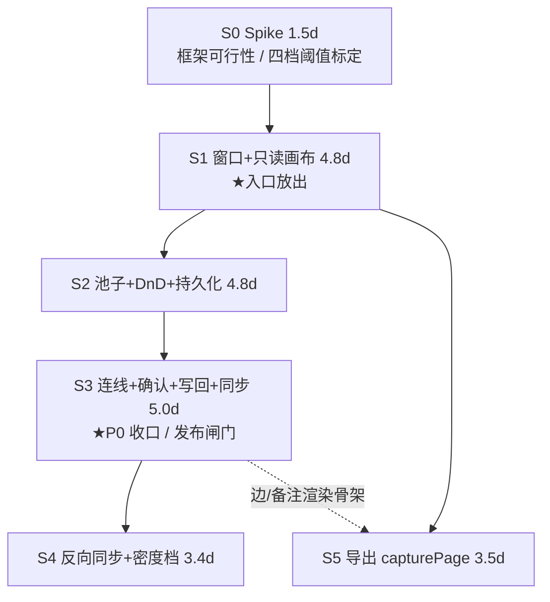

# R27 人物关系网络 · 分批开发计划 v2（独立窗口 / React Flow / 有限写回）

> 状态：排期方案。**只写规划，不改源码、不碰 `AGENTS.md`。**
> 输入：`r27-relationship-network-delta-v2.md`（PM 增量稿，W-01~W-18 + §4 新基线 ≈180 例）· `r27-architecture-decision-v2.md`（ADR-27-01~04）· `scope v1.6` · `preresearch v1.4` · `acceptance 167 例`
> 已裁定、本文不重开：① 框架 = `@xyflow/react@12.12.0` + `d3-force@3.0.0`；② 窗口键 = `relation`；③ **不启用** `novelArch = "refactor"`（不建表 / 不改 `novel_links` / 不加唯一约束 / 旧库零迁移）；④ 写回 = 连线新建 + 备注编辑；⑤ 导出改用 `capturePage`（见附录 A）。
> 口径冲突以 **§8 附录 B** 为准（PM 增量稿有 5 处与 ADR / team-lead 收口不一致，已逐条处置）。

---

## §1 划分原则

| # | 原则 | 本计划的体现 |
|---|---|---|
| ① | **每一步都要能单独开一眼** | S0 用真实数据压测框架（不产出界面），S1 结束就能开窗看全图；不存在"必须做完 4 批才看得见"的阶段 |
| ② | **纯函数与主进程先于交互** | 派生层（`relation-graph.ts`）+ `novel-graph-commit` 事务 + 事件链都能在无界面时被单测钉死；S3 之前它们已全部就位，S3 只剩"接线" |
| ③ | **用户可见的不一致必须同批** | W-14（写入）与 W-15（主窗口三处同步）**同批**；拆开就是"图上建了关系、右栏还是旧的"（§5.2） |
| ④ | **会打红既有测试的改动与其修复同批** | `edition.test.ts` 与窗口注册同批；`window-load-guard.test.ts` 的 `WINDOWS` 清单与 `createRelationWindow` 同批；`ToolLauncher` 4 处断言与其同批 |
| ⑤ | **入口早于完整功能** | 独立窗口不污染主窗口 → S1 就能把入口放出去（只读），不必等 P0 全绿（§3.3） |

**为什么不是 4 批（按 P0/P1 切）**：S1 是"窗口 + 框架 + 资料卡 + 只读图"，它本身跨 4 层（窗口注册 / 主进程 / 组件 / 主题）。再往下切会得到"窗口能开但没有图"或"有图但开不了窗"两种都不可验收的中间态。
**为什么不是 8 批（按文件切）**：`RelationWindow/App.tsx` 一个文件要承载上下文投递、三栏编排、确认弹层、导出抑制——按文件切会把同一次改动拆成四批，回归窗口翻倍。

---

## §2 批次总览

| 批 | 名称 | 目标（一句话） | 覆盖 | 人日 | 用户可见性 | 前置 |
|---|---|---|---|---|---|---|
| **S0** | **Spike：框架可行性验证** | 用 200 张真资料卡在 React 19.2.6 + StrictMode 下压出四项真实数字，决定这条路走不走得通 | W-01 风险前置 | **1.5** | **无**（零界面） | — |
| **S1** | 窗口骨架 + 只读画布（**入口放出**） | `relation` 窗口能开能看能关；本书有关系的要素自动铺开、能缩能 fit、四主题无斑；池子只读列出全要素 | W-01·W-02·W-04·W-06·W-17(卡片) · P0-1/2/4/5/7 | **4.8** | **是（只读）**：能看不能改 | S0 |
| **S2** | 池子 + 拖拽 + 成员持久化 | 拖入即上图、拖回即移出、坐标与成员按作品存住、切书不静默、关窗可恢复 | W-03·W-05·W-07·W-08·W-09·W-10·W-11 · P0-3/P0-8 | **4.8** | **是**：能摆不能连 | S1 |
| **S3** | 连线建关系 + 二次确认 + 写回 + 主窗口同步（**P0 收口 / 发布闸门**） | 拖线 → 关系名 → 四类阻断 → 五项确认 → 单事务落库 → 右栏三处 ≤1s 更新 | W-12·W-13·W-14·**W-15**·W-17(边详情) | **5.0** | **是（P0 首发）** | S2 |
| **S4** | 反向同步 + 密度档 + 可达性 | 主窗口删关系图上跟着变；① 密度档落地；④ 三数字状态栏；池子键盘可达；W-18 埋点 | W-16·W-18 · P0-6 | **3.4** | **是（P1 增量）** | S3 |
| **S5** | 导出 PNG（capturePage） | 所见即所得导出，四主题必对；`novel-export-binary` 二进制通道落地 | RG-X 12 例 | **3.5** | **是（P1）** | S1（可 ∥ S2~S4） |
| | | | **合计** | **23.0** | | |

- **每批 ≤5 人日** ✅；**批次 = 6** ✅；**S0 在最前** ✅。
- **S4 ∥ S5**：互不依赖（S5 只依赖 S1 的窗口），可交换顺序或并行。
- **P0 收口点 = S3 结束（16.1 人日）**；入口放出点 = S1 结束（6.3 人日）。

### 2.1 依赖图

**关键路径**（依赖链最长）：`S0 1.5 → S1 4.8 → S2 4.8 → S3 5.0 → S5 3.5 = **19.6 人日**`（S4 3.4 不在链上，可与 S5 互换）。

---

## §3 覆盖闭合

### 3.1 W-01~W-18 逐条落批（无孤儿）

| ID | 档 | 批次 | ID | 档 | 批次 |
|---|---|---|---|---|---|
| W-01 独立窗口载体/单实例 | P0 | **S1** | W-10 拖回即移出 | P0 | **S2** |
| W-02 携带 workId / 数据不出本书 | P0 | **S1**（校验侧在 S3 的 commit 事务里二次把关） | W-11 成员集合持久化 | P0 | **S2** |
| W-03 关闭行为（含草稿确认） | P0 | **S1**（销毁/不写业务表/恢复）+ **S3**（草稿二次确认） | W-12 连线建关系 | P0 | **S3** |
| W-04 主窗口零副作用 | P0 | **S1**（开窗侧断言）→ S2/S3 复跑 | W-13 二次确认内容契约 | P0 | **S3** |
| W-05 多书切换横幅 | P1 | **S2** | W-14 保存与失败回滚 | P0 | **S3** |
| W-06 主题跟随 | P0 | **S1** | W-15 写回后主窗口同步（三处） | P0 | **S3**（与 W-14 同批，见 §5.2） |
| W-07 左侧资料卡池 | P0 | **S2** | W-16 反向同步 | P1 | **S4** |
| W-08 池子检索 | P1 | **S2** | W-17 卡片内容与只读边界 | P0 | **S1**（卡片）+ **S3**（边详情） |
| W-09 拖入即上图 | P0 | **S2** | W-18 写回埋点 | P1 | **S4** |

> W-03 与 W-17 是**跨批同一条需求的两个面**（前者"关窗时草稿"只能在 S3 有草稿后才成立；后者"卡片 5 字段"在 S1、"边详情只读"在 S3）。两条各自的 P0 子项都有明确归属，不留孤儿。

### 3.2 原 P0-3~P0-9 仍有效部分

| 原项 | 新归属 | 说明 |
|---|---|---|
| P0-1 一键渲染 | **S1**（改写：铺 degree ≥ 1） | 自动布局 + 自动 fit，不等用户点按钮 |
| P0-2 小卡→资料卡 | **S1**（小卡删除，字段常驻卡片） | 见 §7 删除清单 |
| P0-3 拖拽 + 坐标持久化 | **S2** | 落点即坐标 + 默认 pin + 不 reheat 全图 |
| P0-4 pan / zoom / fit | **S1** | React Flow 内置，代价 ≈ 0 |
| P0-5 类型筛选 | **S1** | 降为窗口内**会话态**，不持久化（`tf` 已删） |
| P0-6 空态与降级 | **S1**（空态/提示条）+ **S4**（① 密度档 + ④ 三数字） | ②③⑤ 作废 |
| P0-7 零丢失 | **S1 + S3**（升级为 W-04 主窗口零副作用 + W-03 草稿确认） | 更强口径 |
| P0-8 孤立可见 | **S2**（改为池子可见 + 可数 + 可拖入） | 不再画虚浮孤立点 |
| P0-9 双入口单一 opener | **作废** → 由 W-01「单实例窗口」取代 | 新窗口天然只有一个入口语义 |

### 3.3 入口放出的时点与"缺什么"（S1 结束即可放出）

| 项 | S1 放出时的状态 | 用户会看到 | 可接受吗 |
|---|---|---|---|
| 开窗 | 完整 | 独立窗口，标题「《作品名》· 关系网络」 | ✅ |
| 看 | 完整 | 有关系的要素自动铺开、可拖画布/缩放/fit、四主题正确 | ✅ |
| 池子 | 只读列表（能看不能拖） | 「池中还有 N 个要素未上图」，卡片状态标注 | ✅ 用户知道"能做但还没做"的证据是**没有拖拽光标**，不是点了没反应 |
| 连线 | **无**（手柄不渲染） | 卡片上没有连接点 | ✅ 没有"点了没反应"的死路 |
| 关闭 | 完整 | 关窗即销毁，不写业务表 | ✅ |

> **判定**：S1 是"能开、能看、能关"的**完整只读形态**，不是半成品——所有不可用能力都**不渲染**（手柄、拖拽光标、确认按钮），因此不存在"点了没反应"。**建议放出**，因为它能让真实作者提前验证"布局铺开是否可用"这个最大的产品未知（原 P0-1 的核心价值）。

---

## §4 各批交付内容

### S0 · Spike：框架可行性验证（1.5d）

**目标**：把 ADR 里"推算"的四个数字换成实测值，并回答"React 19 + StrictMode 下 React Flow 会不会翻车"。**不产出任何产品代码**（spike 目录 `spike/relflow/`，不进 `src/`，完成后删除）。

**交付物**
- `spike/relflow/`：200 张资料卡（5 字段 + 2 handle）· 300 条边 · `onlyRenderVisibleElements` 开关对照 · 四主题切换。数据用模板书真实形状（11 要素扩样到 200）。
- `spike/relflow/framework-stubs.ts`：jsdom 桩（`ResizeObserver` / `PointerEvent` / `setPointerCapture` / `getBoundingClientRect` 非零）——**这是 S1 单测的前置件，必须在本批定型**。
- `docs/prd/r27-spike-report.md`：四项实测 + StrictMode 结论 + 阈值标定结果，**回填 ADR §6.2**。

**判定标准（必须全部达标才转 S1）**

| # | 项 | 通过线 | 实测方法 |
|---|---|---|---|
| 1 | 首绘（200 卡，fit 后视口内 ~50） | ≤ **400ms** | 3 次冷启取中位；`PerformanceObserver('paint')` |
| 2 | 单节点拖动 | ≥ **50fps**（帧间隔 <20ms 占 >90%） | `requestAnimationFrame` 采样 2s |
| 3 | 连线 | handle 按下 → `onConnect` < **16ms**；松手 → 弹层 < **100ms** | 打点 |
| 4 | 切主题 | `data-theme` 切换 → 全量重绘完成 < **300ms**，无白闪 | 4 主题各 5 次，录屏目视 |
| 5 | **StrictMode** | ① 节点注册数 === 200（不是 400）② 拖一次只产生 **1 批** position change ③ `onConnect` 不重复触发 ④ 卸载后无残留 listener | React 19 StrictMode 双挂载 |
| 6 | 密度档阈值 | 给出 60/120/200/400 四档的**实测依据**（每档的帧率与首绘） | 四档各压一遍 |

**失败预案（触发条件 → 动作）**

| 观察 | 动作 |
|---|---|
| 首绘 400~800ms，或拖拽 30~50fps | ① 强制 `onlyRenderVisibleElements` + 密度档降到 compact；② 若仍不达标，把 S1 的"资料卡"降为二段（默认 minimal，hover 展开）→ 不变框架 |
| 首绘 > 800ms 或拖拽 < 30fps（降级后仍如此） | **退 G6**：代价 +1.5d 主题桥接层（`--app-*` → theme object + 换肤重设），且 RG 主题类用例风险上升一档 |
| StrictMode 导致重复注册 / 丢事件 | 先修（属实现问题）；若确认是框架 bug → 仅本窗口关 StrictMode，**必须**在 `RelationWindow/main.tsx` 写注释 + spike 报告记录已知 issue 链接 |
| `d3-force` 300 tick > 150ms | 迁 Worker（纯函数，只搬数组，不改协议）；不改布局方案 |

**用户可见性**：无。**回归面**：零（不碰 `src/`）。唯一硬约束：**装包必须进 `devDependencies`**——`electron/packaging-guard.test.ts` 断言 production `dependencies` 恰为主进程 `require` 的 4 个包（better-sqlite3 / docx / jszip / mammoth），放进 `dependencies` 会立刻红，且 asar 会胖。

---

### S1 · 窗口骨架 + 只读画布（4.8d）★入口放出

**目标**：`relation` 窗口全链路可开可关；本书有关系的要素自动铺开并 fit；四主题无斑；池子只读列出全要素与「未上图 N」。

**交付物**
- **窗口注册**（7 处，缺一不可）：`src/windows/RelationWindow/{index.html,main.tsx,App.tsx,index.scss}` · `electron/edition.ts` 的 `WindowEntryKey`/`RENDERER_ENTRY_PATHS`/`EDITION_WINDOW_ENTRIES`（full/novel 加、lite 不加）· `electron/main.ts` 的 `createRelationWindow()` + `relation-window-open` IPC（lite 忽略 + 空 workId 拒开 + 到达日志）· `electron/preload.ts` 的 `send` 白名单 · `auth-logout` 关窗清单 · **`electron/window-load-guard.test.ts` 的 `WINDOWS` 清单加一行**。
- **画布**：`RelationCanvas/index.tsx`（`<ReactFlow>` + `nodeTypes` + `onlyRenderVisibleElements`）、`components/EntityNodeCard/`（三档：full/compact/minimal + 2 handle + 操作条）、`RelationCanvas/index.scss`。
- **数据**：`utils/relation-graph.ts`（G1~G9 + `diagnostics` 五键，**保留原契约**）、`utils/graph-layout.ts`（圆环播种 → `d3-force` → `tick(300)` → 读回）、`hooks/useGraphDoc.ts`（只读装载 + 缺省播种）、`services/relation-service.ts`（窗口本地薄封装，**不**进 `useNovelData`）。
- **池子（只读）**：`components/EntityPool/index.tsx`（全要素 + 状态标注 + 「未上图 N」）。
- **主题**：`src/shared/styles/entity-type-colors.scss`（从 `EditorPane/index.scss:224-244` 上移 6 色，两端引用）。
- **主窗口**：`EntityPanel` 首行入口（**无 DEV 闸门**）+ `SupportPanel/ToolLauncher` R27 卡转「已上线」。

**退出标准**：窗口恒 1 个（二次打开只聚焦）；模板书 → 画布 **9 节点 / 8 边**、池中未上图 **2**、池子 **11 张卡**、入口 meta 仍「11 个要素 · 8 条关联」；四主题截图无外来色；开/关窗后主窗口 `activeChapterId`/光标/滚动/左右栏**全不变**且无额外 `chapter_save`；`RG-I` 30 + `RG-D` 12 + `RG-S` 6 + `RG-N` 2 + `RG-G` 4 + `RG-L` 3 = **57 例**绿。

**用户可见性**：**是（只读）**——见 §3.3。**缺**：拖入/拖回、连线、池子检索、写回。

**回归面**：`electron/edition.test.ts`（`:23` 遍历 `RENDERER_ENTRY_PATHS` 断言文件存在 → HTML 必须同提交；`:63` 是 `arrayContaining`，新增键不会红）；`electron/window-load-guard.test.ts`（`WINDOWS` 是**硬编码清单**，漏加不会红而是**变哑**——新窗口从此不被守，必须同批加）；`ToolLauncher/index.test.tsx` 4 处断言（`is-planned` 2→1 等）；`topbar-overlay-guard.test.ts` **不动且必须绿**（本次零新增浮层）；`useNovelViewState.test.ts` **零改动**；`themes.test.ts` **零改动**（新 scss 只铺 `--app-bg` / `--app-surface` / `-hover` / `-active`，不自绘浮层）。

**风险与对策**：① 漏 `preload` 白名单 → dev 通、打包后点了没反应 ⟹ S1 第一条提交就补，并手测一次 `electron:build:dir`；② 卡片 200 张同屏 → 必须 `onlyRenderVisibleElements` 常开 + S0 标定的档位；③ 类型色双份 → 只允许 `entity-type-colors.scss` 一个出口（`RG-G-04` 改写版守）。

---

### S2 · 池子 + 拖拽 + 成员持久化（4.8d）

**目标**：从池子拖入即上图（落点 + pin）；拖回即移出；成员与坐标按作品存住；切书不静默；关窗重开一致。

**交付物**
- **DnD**：`@dnd-kit`（已在依赖）拖池子卡 → `screenToFlowPosition` → 新成员 `[x,y,1]`；画布卡拖到池子区域 → 移出（删坐标与 pin，**不删关系**）。落点**不 reheat 全图**（只固定该点）。
- **持久化**：`utils/graph-doc.ts`（PM §2.4 结构：`graphs[]` / `members` / `view` / `rev` / `autoSeeded`，**删 `tf`**）+ `graph-doc.test.ts`；`novel-graph-doc-set`（写 `novel_config`）；500ms debounce + 关窗 `beforeunload` flush；`rev` 冲突 → 重拉 + 合并提示。
- **切书**：`novel-work-changed` 订阅 + **不静默换书**横幅（「当前查看《A》，主窗口已切到《B》」+ [切到《B》]/[关闭]）；有草稿时切换先确认。
- **关窗**：`attachCloseGuard` + 草稿确认（S2 的"草稿"= 未 flush 的坐标；S3 追加"未确认的连线"）。
- **池子检索**（W-08，P1）：名称 + 别名 + 一句话（与 `EntityPanel.matchKeyword` 同口径）、按类型分组可折叠。
- **主窗口**：`novel-work-delete` 级联末尾追加 `DELETE FROM novel_config WHERE key LIKE 'novel_rel_graph_v1:<id>:%'`（**必须排在 modifiers 之后**）。

**退出标准**：拖入 → 关窗 → 重开，坐标与 pin 都在；两本书来回切成员互不覆盖；删作品后 config 无残留；`X + M = Y` 恒成立；`RG-I` 24 + `RG-S` 9 + `RG-D` 4 + `RG-L` 2 = **39 例**绿。

**用户可见性**：**是**（能摆不能连）。此时"混合画布"这个产品核心已可被真实作者试用。
**回归面**：`novel-write-guard.test.ts` **先跑**（级联插入位置）；5 个穷举 mock `novel-service` 的测试（`useNovelData.global-setting-sync` / `note-sync` / `setting-preset` / `useNovelPage.qa` / `useNovelViewState`）——**约束：`useNovelData`/`useNovelPage` 不得新增 `relation-service` import**，否则五处同时崩；`novel-db-split.test.ts` 不改且保持绿。
**风险**：① 写记忆写成整体覆盖 → 抹掉别书成员 ⟹ 强制读-改-写 + `rev`；② `rev` 与 debounce 打架 → 只在"成功写回后"用返回值更新本地 `rev`，不用本地自增。

---

### S3 · 连线建关系 + 二次确认 + 写回 + 主窗口同步（5.0d）★P0 收口 / 发布闸门

**目标**：拖线 → 关系名 → 四类阻断 → 五项确认 → **单事务**落库 → 右栏三处 ≤1s 更新。失败则边消失、无残留、可重按。

**交付物**
- **交互**：卡片 handle → 实时虚线 → 落到另一卡片 → 「新建关系」弹层（关系名 `AutoComplete` 必填 + 实时校验）；**四类阻断**：自身 / 跨作品 / 空名 / 同两端同关系已存在（红字，但仍允许以"合并"语义提交）。
- **确认弹层（W-13 五项）**：起点名+类型 / 终点名+类型 / 关系名原文 / 重复判定（`将新建` 或 `已存在同关系（合并为「X +1」）`）/ 目标作品名。按钮文案「创建关系」。
- **主进程**：`novel-graph-commit`（单事务：① 端点属本书校验 ② 四元组 SELECT 去重 ③ `INSERT … ON CONFLICT(id) DO NOTHING` ④ `UPDATE note` ⑤ `rev` 比对后 upsert doc）；返回 `{ ok, rev, created, merged, notes, rejected }` 或 `{ ok:false, code:"stale"|"invalid-target"|"db" }`。
- **同步（W-15）**：成功后 `broadcast("novel-links-changed", { workId, rev, created, merged, notes })`；主窗口按 id 合并进 `bundle.links`（**不重载 bundle**），三处自动派生（`EntityCard` 关联数 / `EntityDetail` 关系列表 / `EntityPanel` meta）。
- **边详情**：只读列出平行边 + 备注（`Input.TextArea maxLength=200`）+ 「去右栏删除」链接。
- **失败态**：弹层**不关**、内容不清空、按钮保持可点；`stale` → 「这本书的图已在别处改过」+ [重新载入]。

**退出标准**：`RG-I` 26 + `RG-D` 6 + `RG-S` 2 + `RG-G` 3 = **37 例**绿；手测：建一条关系 → 右栏三处 1s 内变；主窗口遮挡时切回来自动是最新；断网式失败（临时把 handler 抛错）→ 边消失、弹层还在、重按成功；连点确认只产生 1 条；同端点同关系再建 → 确认弹层显示「合并」。

**用户可见性**：**是（P0 首发）**。本批合并后才允许对外说"R27 上线"。
**回归面**：`novel-db-split.test.ts`（新 handler 必须 `from "../novel-db"`，不得 `from "../db"`）；`novel-pack-save-order.test.ts`（`upsertRealmLinkRow` **不动**）；`preload-listener.test.ts`（新事件走 `windowAPI.on` 的 wrapper，不得手工 `ipcRenderer.on`）；`EntityDetail/index.test.tsx` 若撞行数/顺序断言 → 改 `toContain` 式。
**风险**：① 用 `novel-link-set` 建边 → 同端点同关系被四元组删掉（静默丢平行边）⟹ 只允许 `novel-graph-commit`；② 成功后整表重载 → 200 要素闪一下且打断编辑器 ⟹ 只允许 delta 合并；③ 事务里先写边再校验端点 → 半提交 ⟹ 校验必须是事务第一条语句。

### 4.1 为什么 W-15 必须与 W-14 同批、W-16 可以拆

| 项 | 拆开的中间态 | 用户能否看见 | 结论 |
|---|---|---|---|
| W-14 写入 ∥ W-15 同步 | "图上建好了，右栏还是旧的" | **能，且必然看见**（用户建完关系第一件事就是看右栏确认） | **必须同批** |
| W-14 写入 ∥ W-16 反向 | "主窗口删了关系，图上还挂着那条边" | 能，但只在**跨窗口连续操作**时出现，且重开图窗自愈 | **可拆**（放 S4） |
| W-18 埋点 | 无（不可见） | 否 | 可拆（S4） |

---

### S4 · 反向同步 + 密度档 + 可达性（3.4d，P1 增量）

**目标**：主窗口删关系/改关系名 → 图上跟着变且**不重排**；① 密度档按 S0 实测阈值落地；④ 状态栏三数字；池子键盘可达；W-18 埋点。

**交付物**
- W-16：主窗口 `onAddRelation/onRemoveRelation` 成功后同发 `novel-links-changed`；图窗口按 id 增删成员之外的节点与边（**成员集合不变、坐标不变、不 reheat**）；**不弹确认框**。
- ① 密度档：按 S0 标定（建议 60/120/200/400）切换 full/compact/minimal；阈值写进 `graph-density.ts` 纯函数 + 单测。
- ④ 状态栏：`画布 X · 池中 M · 全书 Y`，不变式 `X + M = Y`；**筛选只改可见，不改 X**。
- 可达性：池子 `Tab` → `↑↓` 选卡 → `Enter` 上图；卡片不进 tab 序。
- W-18：`rel_graph_link_created`（`fromType`/`toType`/`relationLen`/`merged`/`ms`/`failReason`），失败也记，区分"用户取消"与"校验阻断"。

**退出标准**：`RG-I` 10 + `RG-D` 4 + `RG-N` 2 + `RG-G` 2 = **18 例**绿；手测：主窗口删一条关系 → 图窗边消失、其余节点**一个都不挪**；密度四档切换帧率达标。

**用户可见性**：**是（P1 增量）**，四项各自独立可单独 revert。
**回归面**：5 个穷举 mock 文件（同 S2 约束）；`EntityPanel` 关联数若由 `bundle.links` 派生则零改动（已验证是派生）。
**风险**：① 反向同步触发 reheat → 用户摆了一小时的布局被打散 ⟹ 只做 map/filter，禁止 `simulation.restart()`；② 把 ③ 收窄偷偷加回来 → 会造出"三种可见状态"（PM §2.3 明确作废）。

---

### S5 · 导出 PNG（3.5d，可 ∥ S2~S4）

**目标**：所见即所得导出；四主题必对；二进制通道落地。

**交付物**
- 主进程 `relation-window-export`（`capturePage(rect)` + 重试 + 空图兜底）+ `novel-export-binary`（**新建**，`fsp.writeFile(path, buffer)`；**不得**复用 `novel-export-file`，那条是 `utf8` 写、会损坏 PNG）。
- 渲染层：`is-exporting` CSS 类抑制覆盖物（`visibility:hidden` + `box-shadow:none`，纯合成层无 reflow）→ `2×rAF` → `invoke` → 移除类。
- 导出前选项：默认「当前视口」；提供「先 fit 再导出」按钮（默认不点）。
- `export-png.test.ts`（纯函数：rect 计算 / 文件名清洗 / 覆盖物清单）+ 项目外脚本（四主题各导一张，抽中心与四角像素）。

**退出标准**：`RG-X` **12 例**绿；四主题导出**中心与四角非黑**、无工具栏/选中描边/提示条入图；窗口被其他应用遮挡时导出仍成功；取消保存框不抛错。

**用户可见性**：**是（P1）**。上线即完整，无半成品态。
**回归面**：`preload.ts` 新增 `invoke` 通道（`preload-listener.test.ts` 不动，它守的是 `windowAPI.on` 的 wrapper 注销）；`novel-export-file` 不动。
**风险**：① 忘记在 `finally` 里移除 `is-exporting` → 图永久灰掉 ⟹ 必须 `try/finally` + 单测；② 用 `novel-export-file` 写 PNG → 乱码不报错 ⟹ 源码守卫断言二进制通道存在。

---

## §5 验收例数分配（与 PM §4 自洽）

| 批 | RG-D | RG-L | RG-I | RG-P | RG-S | RG-X | RG-N | RG-G | 例数 |
|---|---:|---:|---:|---:|---:|---:|---:|---:|---:|
| S0 | 0 | 0 | 0 | 6 | 0 | 0 | 0 | 2 | **8** |
| S1 | 12 | 3 | 30 | 0 | 6 | 0 | 2 | 4 | **57** |
| S2 | 4 | 2 | 24 | 0 | 9 | 0 | 0 | 0 | **39** |
| S3 | 6 | 0 | 26 | 0 | 2 | 0 | 0 | 3 | **37** |
| S4 | 4 | 0 | 10 | 0 | 0 | 0 | 2 | 2 | **18** |
| S5 | 2 | 0 | 3 | 2 | 0 | 12 | 0 | 2 | **21** |
| **合计** | **28** | **5** | **93** | **8** | **17** | **12** | **4** | **13** | **180** |

> 列合计与 PM §4 的组新总数逐列相等（`28/5/93/8/17/12/4/13`），`Σ = 180` = PM 的 `39 改写 + 94 保留 + 47 新增`。例数只做"整例换批"，不改任何一例的 `P0/P1/P2` 标签。

### 5.1 四类分层（每批 + 合计）

| 批 | 单测（纯函数/源码守卫） | 组件（RTL/jsdom） | 脚本（项目外） | 手测 | 合计 |
|---|---:|---:|---:|---:|---:|
| S0 | 2 | 0 | 4 | 2 | **8** |
| S1 | 20 | 31 | 4 | 2 | **57** |
| S2 | 12 | 21 | 3 | 3 | **39** |
| S3 | 14 | 17 | 3 | 3 | **37** |
| S4 | 6 | 9 | 2 | 1 | **18** |
| S5 | 6 | 10 | 4 | 1 | **21** |
| **合计** | **60** | **88** | **20** | **12** | **180** |

> `自动 = 单测 60 + 组件 88 = **148**`；`脚本 20`；`手测 12`。（v2.1 后 PM 侧记 **≈146 / ~20 / ~12**，差额即下方那 2 例透明档。）手测从 34 降到 12 的来源：SVG+DOM 渲染让"节点存在/数量/标签/选中/连线出现"从手测变组件断言（PM §4 已明示）；保留的 12 条是**真机才成立**的：帧率、四主题肉眼、跨窗口焦点、系统 × 行为、真实拖拽手感、导出图像素抽样。

> ⚠️ **与 PM 稿 v2.1 的 2 例差额**：导出改 `capturePage` 后透明背景档（原 `RG-X-06` / `RG-X-07`，P2）砍掉，PM 侧总数因此记 **≈178**，本表仍按 **180** 编制——差额就是这 2 条 P2 手测项，落在 S5。**以 PM 稿为范围权威**；实现期按 178 结账即可，不需要改任何批次的退出标准（两条都不在任何红线内）。

---

## §6 人日重估（基线 19.0 → 23.0）

| 方向 | 项 | 人日 |
|---|---|---:|
| **省** | 自研三力模型 `force-sim` + 收敛调参 + 8 例布局单测（改 `d3-force`，只留薄适配） | **−1.2** |
| | 自研画布 `GraphCanvas` / `GraphNodeLayer` / `useGraphViewport`（绘制/命中/边路由/视口变换） | **−2.0** |
| | 浮层容器 / `.nv-page__body` 挂载 / Esc 三级链 / z-index 抬升排查 / DEV 闸门拆除 / 双入口 opener | **−1.5** |
| | ②折叠孤立 + ③收窄角色 + ⑤Top-500 的判定与执行体 | **−0.8** |
| | 原 B5「超大图兜底」整批 | **−0.7** |
| | "不打扰码字"（RG-N 5 例作废）对应的防守式加固 | **−0.5** |
| | 浮层与 antd 弹层堆叠层级的排查成本 | **−0.3** |
| **增** | S0 Spike（框架验证 + jsdom 桩 + 密度档标定 + 报告） | **+1.5** |
| | 独立窗口骨架（5 文件 + edition 3 处 + main.ts + IPC + preload + 登出 + 2 处守卫扩充） | **+2.2** |
| | 框架接入 + 资料卡三档 + 主题 CSS | **+1.8** |
| | 左侧池子（全要素 / 状态 / 未上图 N / 检索 / 分组 / 键盘） | **+1.0** |
| | 拖入拖回 DnD + 落点 pin + 不重排 + 池子状态联动 | **+0.8** |
| | 连线交互（出柄 / 拖线 / 关系名 / 四类校验 / 五项确认） | **+1.5** |
| | `novel-graph-commit` 单事务 + `rev` + 去重 + 返回码 | **+0.6** |
| | 跨窗口单向同步 + 主窗口 Map 合并 + 三处派生复核 | **+0.6** |
| | 导出换路（capturePage + 覆盖物抑制 + 新二进制通道 + 12 例）净增 | **+1.0** |
| | | **净 +4.0** |

> 逐项人日只解释增减**方向与量级**；批次人日（§2）为权威口径，差值是跨批摊销与缓冲（同上一版 §3 末注做法）。
> **不变的部分**：纯函数派生层（G1~G9 / `diagnostics` / 跨作品与自环过滤）、边详情、关系筛选、搜索、埋点骨架——这些与承载形态无关，人日沿用上一版。

### 6.1 排期

| 情形 | 总工期 | 说明 |
|---|---:|---|
| **1 人** | **23.0** | 按 S0→S1→S2→S3→S4→S5；S4/S5 可互换顺序。P0 可用（S0+S1+S2+S3）= **16.1** |
| **2 人** | **≈14.5** | A（渲染层）：S0 1.5 → S1 画布 3.3 → S2 DnD+关窗 1.1 → S3 交互 3.0 → S5 2.5。B（数据/主进程/样式）：S0 协作 0.5 → 窗口骨架 2.2 → 资料卡+主题 1.8 → 池子 1.0 → 持久化 1.2 → S3 数据收口 2.0 → S4 3.4 → 回归 1.5。瓶颈仍是「骨架→画布→池子→连线」这条渲染链；第 3 人无收益（S4/S5 已是末端） |

---

## §7 回归面总表（既有测试逐批）

| 既有测试 | 何时动 | 处置 | 漏了会怎样 |
|---|---|---|---|
| `electron/packaging-guard.test.ts` | S0（装包那刻） | 无需改，但新依赖**必须**进 `devDependencies` | 立刻红；且 asar 胖一圈 |
| `electron/edition.test.ts` | S1 | **不改**（`:23` 双向遍历；`:63` 是 `arrayContaining`） | 若 HTML 未同提交 → `:23` 红（文件不存在） |
| `electron/window-load-guard.test.ts` | S1 | **必须加** `["createRelationWindow", '"Relation"']` | 不加**不会红而是变哑**：新窗口永久失去装载守卫 |
| `themes.test.ts`（`ELEVATED_ALLOWED`） | S1 | **不改**（不自绘浮层；antd 弹层走 `colorBgElevated`） | 若手写 `var(--app-surface-elevated)` 才需加白名单 |
| `topbar-overlay-guard.test.ts` | 全程 | **不动、保持绿** | 变红 = 有人把浮层状态又加回主窗口（反向证据） |
| `useNovelViewState.test.ts` | 全程 | **零改动** | 变红 = 有人在主窗口加图相关 overlay 状态 |
| `ToolLauncher/index.test.tsx` | S1 | 4 处断言（`is-planned` 2→1 等） | CI 红且红在"入口批"，易被误判为功能回归 |
| `novel-write-guard.test.ts` | S2 | 不改，**先跑** | 级联插入位置错 → 顺序断言红，或"书还在图没了" |
| 5 个穷举 mock `novel-service`（`useNovelData.*3` / `useNovelPage.qa` / `useNovelViewState`） | S2/S4 | 零改动，靠**架构约束**保护 | 五个文件同时 `undefined is not a function` |
| `novel-db-split.test.ts` | 全程 | **不改、保持绿** | 变红 = 有人越过 `novel-db.ts` 取写通道 |
| `novel-pack-save-order.test.ts` | S3 | 不改（`upsertRealmLinkRow` 不动） | 变红 = 有人复用了四元组先删后插 |
| `preload-listener.test.ts` | S3/S5 | 不改（新事件走 `windowAPI.on`） | 变红 = 有人手工 `ipcRenderer.on` 造成监听泄漏 |

---

## §8 附录

### 附录 A · 导出 PNG 方案（ADR-27-05，候选 C = `capturePage`）

| 维度 | **C `capturePage`** | A `html-to-image` | B 按 `GraphDoc` canvas 重绘 |
|---|---|---|---|
| 新增依赖 | **0** | +1（且破 `RG-G-05` 白名单） | 0 |
| 分辨率 | = 视口 DPR（1× 屏 1×，HiDPI 屏 2×） | 可设 `pixelRatio: 2` | 任意，可 2×/3× |
| 主题正确性 | **天然正确**（截的就是用户所见） | 需处理 CSS 变量内联（易漏） | 需维护 `graph-theme.ts` 双份色值（**永久发散风险**） |
| 透明背景 | **不可得** | 可得 | 可得 |
| 范围 | 当前视口 | 任意元素（含全图，需先 fit） | 任意（自己算包围盒） |
| 与产品口径 | **完全一致**（Q6：导出当前视口，先点 fit 导全图） | 一致 | 一致 |
| 实现量 | 2.5d（含覆盖物抑制 + 兜底 + 通道） | 3.0d（依赖 + 字体/图片/变量保真） | 4.0d（第二套渲染器 + 4 主题色桥接） |
| 主要失败模式 | 首次帧为空 / 覆盖物入图 | 变量未内联 → 色斑；字体回退 | 屏幕与导出不一致（`RG-X-02` 历史红线） |

**决策：采用 C。** 关键理由不是"省"，而是**它消灭了"第二套渲染器"这个永久性风险源**——B 方案会让"屏幕上是什么"和"导出的是什么"由两份代码决定，这正是 `RG-G-04` / `RG-X-02` 一直在防的东西；A 方案在"CSS 变量 + 自定义组件"场景下保真度最差。

| C 细则 | 结论 |
|---|---|
| **分辨率 / 原 `RG-X-01`「2× = 2000×1440」** | **改写为「长边 = 视口 DPR 原生尺寸」**（1× 屏 1440×860、2× 屏 2880×1720）。**否决 `zoomFactor=2`**：它缩的是 CSS 视口（布局重排、内容变半张），不是提高采样；真要同取景 2× 必须把窗口撑到 2× 设备像素，受显示器工作区上限约束，不可靠。**否决** `offscreen: true`（等于再开一套渲染，且无 GPU）。 |
| **透明背景档（原 P2）** | **砍掉**。要让背景透明必须去掉画布底色与点阵，等于改变用户所见；为一个 P2 项引入 `html-to-image` 不成立。 |
| **只截可见视口** | 与产品 Q6 一致，不算损失。导出前给「先 fit 再导出」按钮（默认不点）。 |
| **覆盖物抑制** | `capturePage(rect)` 只截**画布矩形** → 工具栏/池子在 rect 外天然不入图；rect 内覆盖物（选中描边、handle、提示条、待确认虚线、hover 高亮）用 CSS 类 `is-exporting` 统一 `visibility:hidden; box-shadow:none`。**不用 React state**（会触发重渲染，可能引起 fit 变化与闪动）。`try/finally` 保证移除。 |
| **遮挡 / 最小化** | Electron 文档明确：`capturePage` 期间页面**被视为可见**（capturer count > 0），并支持 `stayHidden` 选项——因此**被其他应用遮挡不影响**。最小化理论上也可，但用户无法点击最小化窗口内的按钮 → 仍加 `if (win.isMinimized()) win.restore()` 兜底。 |
| **首帧为空** | 已知风险（Electron 生态通行做法是"每次前作废 + 重试"）：`img.isEmpty()` 判空 → 重新 `2×rAF` → 再截，最多 3 次；仍空 → toast「导出失败，请将窗口置于前台后重试」。 |
| **通道** | `novel-export-binary` **仓库内不存在**（`grep` 无匹配），需新建；**不得**复用 `novel-export-file`（`novel-handlers.ts:1639` 是 `fsp.writeFile(..., "utf8")`，写 PNG 会损坏且不报错）。 |

### 附录 B · 口径冲突处置（PM 增量稿 vs ADR vs team-lead 收口）

| # | 冲突 | 处置 | 谁改文档 |
|---|---|---|---|
| 1 | PM §1-6 / §2.1 写 `refactor` 授权、`links` 补 `work_id`、RG-G-08/09 作废 | **以 team-lead 收口为准：保持 `compat`，不建表/不改 `links`/不加唯一约束**。RG-G-08/09 **保留**；PM 的 3 条迁移守卫**不启用**（无迁移可守） | PM 改 delta §1-6 与 §2.1 对应行 |
| 2 | PM §2.4 把记忆写成 `STORAGE_KEYS.relGraphLayout`（localStorage 形态） | **结构照 PM（`graphs`/`members`/`rev`/`autoSeeded`），介质按 ADR §4.1（`novel_config` 单键 + IPC）**。`STORAGE_KEYS` 那条不实现——localStorage 进不了主进程、无原子性、跨窗口要在两个渲染进程各存一份 | 架构补注（本文已记） |
| 3 | `tf` 字段：PM 删 / ADR 原保留 | **按 PM 删除**（③ 作废后无消费者；类型筛选降为会话态） | 架构在 S2 前补 ADR 修订 |
| 4 | ②③⑤ 降级：PM 作废 / ADR §6.1 保留"收窄"档 | **按 PM 作废**。ADR 的三档改为「① 密度档」，阈值 60/120/200/400 由 S0 标定 | 架构在 S4 前改 ADR §6.1 |
| 5 | 切书：ADR 说"自动重载" / PM W-05 要求横幅 + 用户选择 | **按 PM**（W-05，S2） | 架构补注 |
| 6 | 关窗草稿：ADR 说"丢弃 + toast" / PM W-03 要求二次确认 | **按 PM**（W-03，S3 半段） | 架构补注 |
| 7 | 导出 2×：PM `RG-X-01` 仍要求 2× | **改写为 DPR 原生**（附录 A）；`RG-X` 10 例重写为 12 例 | PM 改 acceptance |
| 8 | PM W-10「拖回池子」vs ADR「删要素时惰性清成员」 | **不冲突**：W-10 是用户动作（只删成员，不删关系）；ADR 是数据消失后的收敛（`droppedUnknown`） | 无需改 |

---

## §9 删除清单（原计划里作废，**不要有人再去实现**）

| # | 条目 | 出处 | 为什么删 |
|---|---|---|---|
| 1 | `RelationGraph/index.tsx` 作为**页内浮层**容器、挂到 `.nv-page__body` 末尾 | 旧 B1 | 改独立窗口 |
| 2 | `relGraphOpen` / `openRelGraph` / `closeRelGraph` / `pageOverlayOpen` 追加 / `dismissPageOverlays` 追加 | 旧 B1 | 主窗口不得新增图相关 overlay 状态（S1 起就是**反向守卫**） |
| 3 | Esc 三级链 + `handleEscape` 链首插入 + 顶栏 `z-index` 1600 抬升 | 旧 B1 | 无浮层可关 |
| 4 | 入口整行包 `import.meta.env.DEV` + ToolLauncher「规划中 · R27」占位 | 旧 B1/B2 | S1 即放出真入口 |
| 5 | 双入口单一 `openRelGraph({entry})` + `entry` 三值埋点 | 旧 B2 | 单实例窗口取代；埋点改窗口级 |
| 6 | ②折叠孤立 / ③收窄角色 / ⑤Top-500 | 旧 B3/B5 | PM §2.3 全部作废；取代物 = 成员集合 + 显式「精简上图」 |
| 7 | 节点小卡（悬浮）+"先关浮层再 `openEntityDetail`"的调用序列断言 | 旧 B1/B3 | 卡片常驻 5 字段；跳转改为跨窗口导航 |
| 8 | `utils/force-sim.ts`（自研三力）+ `GraphCanvas.tsx` + `GraphNodeLayer.tsx` + `useGraphViewport.ts` | 旧 B0/B1 | 换 `d3-force` + React Flow |
| 9 | `export-graph-png.ts` 的 `canvas.toBlob()` 2× 离屏重绘 + 透明背景档 | 旧 B4 | 换 `capturePage` |
| 10 | `tf`（`typeFilterTouched`）字段及其持久化 | 旧 B2 | ③ 作废后无消费者 |
| 11 | 用 `novel-link-set` / `upsertRealmLinkRow` 建关系 | 旧 B4 风险项 | 四元组先删后插会误删平行边 |
| 12 | 断言"浮层在 body 内 / 窗口 DOM 里出现图节点" | 旧 RG-I-05/06 | 断言对象反转（主窗口 DOM 内**不得**出现图节点） |

---

## §10 开工前必须闭环（5 条）

| # | 事项 | 谁 / 哪一步 | 漏了会怎样 |
|---|---|---|---|
| 1 | **装包位置**：`@xyflow/react@12.12.0` / `d3-force@3.0.0` 进 `devDependencies`，与 lockfile 同一次提交 | 实现者，S0 第一个提交 | `packaging-guard.test.ts` 立刻红；或 asar 胖、安装包变大 |
| 2 | **jsdom 框架桩**在 S0 定型（`ResizeObserver` / `PointerEvent` / `setPointerCapture` / 非零 `getBoundingClientRect`） | 实现者，S0 | S1 的全部组件用例无法写；临时补桩会让 31 条用例各自 hack 一遍 |
| 3 | **`window-load-guard.test.ts` 的 `WINDOWS` 清单**与 `createRelationWindow` 同批加行 | 实现者，S1 | 新窗口**静默失去装载守卫**（测试不会红，这是最坏的一种漏） |
| 4 | **架构约束**：`useNovelData` / `useNovelPage` / `useNovelViewState` 不得 import `relation-service` 或新增图相关 IPC 封装 | 架构师写进 S2/S3 任务卡；评审把关 | 5 个穷举 mock 文件同时 `undefined is not a function`，红在无关批上 |
| 5 | **失败态契约**：`stale` / `invalid-target` / `db` 三种 `code` 的文案与按钮语义（弹层不关、内容不清空） | PM 定文案，架构定 code，S3 开工前 | "确认了但没生效"是本需求唯一直接摧毁信任的失败态 |
