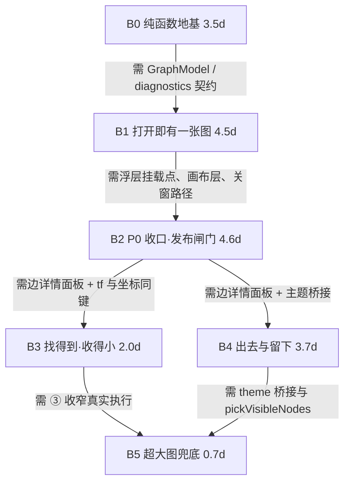

# R27 人物关系网络 · 分批开发计划

> 状态：排期方案（只做规划，不写业务代码、不改既有源码）
> 输入：`r27-relationship-network-scope.md`（产 v1.6）· `r27-relationship-network-preresearch.md`（研 v1.4）· `r27-relationship-network-acceptance.md`（验 167 例）· `r27-relationship-network-analysis.md`（PM 解读稿）
> 已由 team-lead 裁定、本文不重开：**A** 坐标持久化 P0（紧跟"能拖"）· **B** 埋点 P0（与开关同批）· **C** 导出 PNG P1 · **D** 边备注 P1（与边详情同批）· **E** 降级拆两层（判定 P0 / ②③ P1 / ⑤ P2）· **F** 关系名筛选 P1（∥ 持久化）

---

## §1 计划前提

| 项 | 值 | 依据 |
|---|---|---|
| 代码基线 | 工作区 **R27 零代码**；`components/RelationGraph/` 与 `utils/relation-graph.ts` 均**不存在**；`pages/NovelPage` 下 **43 个测试文件** | 验 §7.1-6；本轮 `ls` 复核 |
| 数据基线 | `novel_*` **30 张表**（15 基础 + 15 `novel_pack_*`）；`novel_links` **无 `work_id`**、`note` 列存在且从未被写 | 验 RG-G-08/09；研 F12 |
| 总人日 | **19.0**（预研 17.8 + 1.2 详见 §3 末注） | 研 §10.2 逐项 15.3 + 未拆分缓冲 2.5 + 新增 1.2 |
| 关键路径 | **17.0 人日**（B0→B1→B2→B4→B5）；P0 可用（B0+B1+B2）= **12.6** | 本文 §5.3 |
| 并行度上限 | **2 人**。B1（画布/节点层/浮层）强耦合不可切；第 3 人无收益，建议配 1 名 QA 并行跑脚本 | 研 §11-9 |

---

## §2 划分依据

### 2.1 四条划分原则

| # | 原则 | 在本计划中的体现 |
|---|---|---|
| ① | **每批必须能被独立验收、独立回滚** | 六批各自有"合并后可亲手验到什么"（§4 退出标准）；B3/B4 互不依赖，任一可单独 revert 而不影响 P0 |
| ② | **纯函数层先于 UI 层**，让"画错"在无 UI 时就被测出来 | B0 零 React/零 DOM/零 IPC，吃掉 RG-D 22 + RG-L 8；G2（跨作品边）与 G6（平行边合并）这两个"画错不报错"的坑在 B0 就被 30 例钉死 |
| ③ | **需要新 IPC 的能力各自成批**，不与渲染批共用回归窗口 | 两条新通道（`novel-export-binary` / `novel-link-note`）同批但**互不依赖**（研 T07 ∥ T08），落在 B4；渲染批 B1/B2 零 IPC 新增 |
| ④ | **会打断既有测试的改动必须与其修复同批** | `ELEVATED_ALLOWED` 与 `index.scss` 同批（B1）；ToolLauncher 4 处断言与卡片切换同批（B2）；`novel-work-delete` 级联与其守卫同批（B2） |

### 2.2 为什么不用另外两种切法

| 切法 | 具体问题 |
|---|---|
| **按 P0/P1/P2 直接切（3 批）** | ① P0 内部没有可独立验证的中间态：渲染、拖拽、持久化、入口四件事必须同时在一次合并里成立，任何一件坏了整批打回，102 条 P0 用例无法定位到"哪一层错"；② **入口一上线就是半成品**：P0 批要么先放纵坐标（违裁定 A）、要么先放半成品界面，两者都违反"不允许用户点进去是半成品"；③ 降级 ④ 的守卫判定必须早于 ③ 的执行体（裁定 E），按 P0/P1 切会把它切成两半且中间没有验证点 |
| **按文件切（14 件新建各一批）** | ① 一批内跨 5 个层（utils / 组件 / hook / 主进程 / 测试），无法独立验收（`GraphToolbar.tsx` 单独合并等于零功能）；② 契约面被切碎：`GraphEdge` 签名、`diagnostics` 五键、`entry` 三值分属不同批，改一次要动三批；③ 回归窗口最大化：`useNovelViewState`、`ToolLauncher` 这些"同一处被两个能力改"的文件会被反复打开 |

---

## §3 批次总览

| 批 | 批次名 | 目标（一句话） | 覆盖需求 | 覆盖任务 | 人日 | 内部可并行 | 前置 |
|---|---|---|---|---|---:|---|---|
| **B0** | 纯函数地基 | 不打开任何界面，先把"图该长什么样"算到可断言 | P0-1(数据) · P0-6(判定) · P0-8(派生) | T01 · T02 · T04.5(`planDegrade`) | **3.5** | T01 ∥ T02；T04.5 串行 | — |
| **B1** | 打开就有一张图 | 一条仅开发可达的路径，首帧即有结构，能筛/能缩/能关，埋点一次到位 | P0-1 · P0-2(小卡/打开资料卡) · P0-4 · P0-5 · P0-6(D1/D2/①/④) · P0-7 · P0-8 · A-10 埋点 | T03 · T04.1 | **4.5** | 内部串行（T03→T04.1） | B0 |
| **B2** | 拖得住、记得住（**P0 收口 / 发布闸门**） | 拖拽 pin + 按作品持久化 + 双入口单一 opener + 边详情只读 | P0-2(取消固定) · P0-3 · P0-9 | T04.2 · T04.4 · T05 · T06 | **4.6** | T05 ∥ (T06+T04.2)；T04.4 串行 | B1 |
| **B3** | 找得到、收得小 | 搜索/双击/关系名筛选/反跳回图/隐藏孤立开关 + 降级 ②③ 执行体 | P1-1 · P1-2 · P1-6 · P1-8 · P0-6(②③) | T04.3 · T04b · T04.6 · T04.7 · P1-8 | **2.0** | ∥ B4 | B2 |
| **B4** | 出去与留下 | 导出 PNG + 边备注写入 + 主角锚点 + 方向箭头 | P1-3 · P1-4 · P1-5 · P1-9 | T07 · T08 · P1-5 · P1-9 | **3.7** | T07 ∥ T08；∥ B3 | B2 |
| **B5** | 超大图兜底 | ⑤ Top-500 只在「>1200 且 ③ 已执行 且 收窄后 >800」时出现、明示且可逆 | P2（D3⑤） | T09 | **0.7** | — | B3+B4 |
| | | | | **合计** | **19.0** | | |

**人日口径（可核对）**：
`T01 1.5 + T02 1.5 + T03 3.0 + T04 3.8 + T04b 0.5 + T05 1.5 + T06 0.5 + T07 1.5 + T08 1.0 + T09 0.5 = **15.3**`。
预研总估 **17.8** 与逐项之和差 **2.5**，是它未拆分的集成/联调/回归缓冲——本计划把它显式摊到 B1 0.5 / B2 1.0 / B3 0.3 / B4 0.5 / B5 0.2。
本计划另加 **+1.2** 的四条"产 P1 有、研任务表无落点"的落地任务：`T04.7 反跳回图 0.3`、`P1-5 主角锚点 0.3`、`P1-8 隐藏孤立开关 0.2`、`P1-9 方向箭头 0.4` → **19.0**。
`T04 3.8` 的子项拆解：`T04.1 类型筛选+小卡+pan/zoom/fit 1.0` / `T04.2 拖拽pin+取消固定+重布局 0.9` / `T04.3 搜索+双击 0.4` / `T04.4 边详情(只读+解除) 0.7` / `T04.5 planDegrade 0.5` / `T04.6 降级②③执行体 0.3`。

### 3.1 覆盖闭合（P0 / P1 / Non-goal 逐条有归属）

| 需求 | 归属 | 需求 | 归属 |
|---|---|---|---|
| P0-1 一键渲染 | B1（数据侧 B0） | P1-1 关系名筛选 | **B3** |
| P0-2 小卡→资料卡 | B1 | P1-2 搜索定位 | **B3** |
| P0-3 拖拽+坐标持久化 | **B2**（同一批，裁定 A） | P1-3 边备注 | **B4** |
| P0-4 平移缩放 fit | B1 | P1-4 导出 PNG | **B4** |
| P0-5 类型筛选 | B1 | P1-5 主角锚点 | **B4** |
| P0-6 空态与降级 | B0(判定)+B1(D1/D2/①/④)+B3(②③)+B5(⑤) | P1-6 反跳回图 | **B3** |
| P0-7 零丢失关闭 | B1 | P1-7 章数分级尺寸/角标 | **出范围 → R27.1** |
| P0-8 孤立可见 | B0(派生)+B1(虚线/提示条) | P1-8 隐藏孤立开关 | **B3**（复用 ② 的折叠态） |
| P0-9 双入口单一 opener | **B2** | P1-9 方向箭头 | **B4**（仅单关系边，见 §7 第 8 行） |

- **P1-7 出范围理由**：① 前置决策"尺寸即权重"产品侧未拍板（产 §2.2 原文承认"章数多 ≠ 重要"）；② `useAppearances` 的 `pending` 态需要占位角标，而 401+ 档"只画色点不画字"、121+ 档"隐藏角标"——**角标在三个密度档里都可能不存在**，要改的是密度规则本身，属独立口径；③ 它不给任何 P0/P1 用例提供支撑（167 例中零条依赖它）。处置：产 §2.2 标 R27.1，PM 改文档。
- **Non-goal 十一条**：全部**不排期**（不做）。其中两条需正向守卫，已落批：`N-2` 跨作品不合并 → B0 的 `RG-D-08`；`N-11` 不做静默裁剪 → B0 `planDegrade` 的"⑤ 默认 false" + B5 `RG-I-40f`（明示 + `[显示全部]` 可点）。

---

## §4 各批交付内容

### B0 · 纯函数地基（3.5d）

**目标**：无 UI、无 React、无 IPC，产出可断言的 `GraphModel` 与布局内核，并先把降级裁决（③ 守卫 / ④ 文案 / ⑤ 默认关）做成纯函数。

**交付物**
- 新建 `pages/NovelPage/utils/relation-graph.ts`：`buildRelationGraph`（G1~G9）、`collectRelationOptions`、`compareRelation`、`planDegrade`。
- 新建 `.../utils/relation-graph.test.ts`、`.../utils/force-sim.ts`、`.../utils/force-sim.test.ts`。
- 修改 `hooks/useNovelData.ts`：`addLink` 在 `if (!bundle) return false;` 后加 `if (fromId === toId) return false;`（1 行，Q-02）。
- 契约（**先定死，后面五批都吃它**）：
  ```ts
  GraphNode { id; type; name; subtitle?; degree; aliases: readonly string[]; summary: string; seed: {x;y} }
  GraphEdge { id; source; target; label; linkIds: string[]; relations: string[]; hasNote: boolean;
              parts: Array<{ linkId; relation; note? }> }   // parts 是唯一真相，后三者为同序派生
  diagnostics { droppedByOtherWork; droppedLevel; droppedSelfLoop; droppedUnknown; isolatedIds: string[] }
  planDegrade(input) → { step: 0|1|2|3|4; visibleCount; totalCount; restorable; fifth: false }
  ```

**退出标准**：`RG-D` 22 + `RG-L` 8 全绿；夹具 11/8/1/2；`Object.keys(diagnostics)` 排序后**恰五键**；`planDegrade` 在 `1199 / 1201 / (1200,80) / (1200,250) / (1300,700)` 五组输入上给出 `step` 与 `fifth === false`；`addLink(A,A)` 返回 `false`。
**用户可见性**：**无**。零界面、零 IPC、零 config 写入。
**回归面**：`pages/NovelPage` 下 43 个测试文件零改动；其中 5 个对 `novel-service` 做穷举 mock 的文件受 §8-3 架构约束保护（本批及后续批都不得让两个 hook 新增该模块 import）。
**风险与对策**：① `label` 写成 `·` 拼接 → `RG-D-13` 红 ⟹ 只允许在 `buildRelationGraph` 一处生成「首条 + `+N`」；② 派生用 `Array.find` 变 O(n²) ⟹ 一律 Map 索引（`RG-P-06 < 5ms`）；③ 播种用随机数 ⟹ 环形确定性播种（G9，同输入两次 `deepEqual`）。

### B1 · 打开就有一张图（4.5d）

**目标**：一条通往浮层的路径 + 首帧即有结构的图 + 单类型筛选 + 缩放平移 fit + 五条关闭路径中的四条 + 埋点。

**交付物**
- 新建 `components/RelationGraph/index.tsx`（浮层容器 / 状态编排）、`index.scss`、`GraphCanvas.tsx`、`GraphNodeLayer.tsx`、`GraphToolbar.tsx`、`useGraphViewport.ts`、**`graph-theme.ts`**（`--app-*` → canvas 的 7 token + 6 类型色桥接；**预研 13 件清单漏列，验收 `RG-G-04` 点名**）、`index.test.tsx`。
- 修改 `hooks/useNovelViewState.ts`（`relGraphOpen` + `openRelGraph/closeRelGraph` + `dismissPageOverlays` 追加一行）、`hooks/useNovelPage.ts`（`handleEscape` 链首插入）、`NovelPage.tsx`（`.nv-page__body` 末尾挂载）、`components/EntityPanel/index.tsx`（入口行 UI + 计数 meta，**整行外包 `import.meta.env.DEV`**）、`src/shared/theme/themes.test.ts`（`ELEVATED_ALLOWED` +1）。
- 埋点 `rel_graph_open`（首帧后一次：`entry` 三值 + `nodeCount/edgeCount` + `ignored{level,dangling,selfLoop}` + 三耗时 + `stopReason`）。

**退出标准**：`RG-I` 40 例 + `RG-G-01~05` + `RG-N` 8 例 + `RG-P-01~05` 全绿。手测可亲手验到：dev 打开后 **11 节点 / 8 边 / 2 条虚线**，提示条「另有 2 个要素暂无关联」与「已忽略 1 条关联」**两个数字分开**；单击节点出小卡（名称/类型/一句话/副标题/关联数），小卡「打开资料卡」**先关浮层再 `openEntityDetail`**（断言调用序列）；Esc 第一次只关浮层、不关排版抽屉；顶栏第一次点击即生效；四主题切换无斑。
**用户可见性**：**否**。入口行在生产构建中不存在（`import.meta.env.DEV` 为假时整行不渲染），ToolLauncher 卡仍显示「规划中 · R27」（此时它说的是真话）。**闸门在 B2 拆除**。
**回归面**：`themes.test.ts` 必改（白名单 +1，路径是 `src/shared/theme/`）；`useNovelViewState.test.ts` 追加 2 例（不进 `pageOverlayOpen` / `dismiss` 关图）；ToolLauncher 测试**本批不动**。
**风险与对策**：① 并入 `pageOverlayOpen` → 顶栏抬到 1600 盖住 antd 下拉（红线 2）⟹ 源码守卫 `RG-G-02`；② 布局循环 `setState` → 200+ 才卡、CI 测不出（红线 3）⟹ `RG-G-01` + `RG-N-05`；③ 忘改 `ELEVATED_ALLOWED` → 主题守卫直接红 ⟹ 与该 scss 同一次提交。

### B2 · 拖得住、记得住（P0 收口 / 发布闸门，4.6d）

**目标**：拖拽固定 + 坐标与 pin 按作品持久化 + 双入口共用单一 opener + 边详情（只读列出）+ 降级 ④ 提示条接真数据。**这一批合并后，P0 才第一次对真实用户开放。**

**交付物**
- 新建 `utils/graph-layout-memory.ts` + `graph-layout-memory.test.ts`（读改写、版本丢弃、脏 id、300ms 防抖 + 卸载 flush）。
- 修改 `src/shared/novel/constants.ts`（`relGraphLayout: "novel_rel_graph_layout"`）、`services/novel-service.ts`（`fetchGraphLayout/saveGraphLayout` 薄封装）、`electron/handlers/novel-handlers.ts`（`novel-work-delete` **级联末尾**追加清 config）、`components/EntityPanel/index.tsx`（**拆 DEV 闸门**）、`components/SupportPanel/components/ToolLauncher/index.tsx` + `index.test.tsx`。
- `RelationGraph/index.tsx`：拖拽（>4px 判拖）、pin、小卡「取消固定」、「重新布局」（N>0 才 Popconfirm）、边详情只读面板（逐行 relation + 备注只读 + 「解除」`Popconfirm`）、`tf`（`typeFilterTouched`）与坐标同键写入。
- `entry` 三值打通：`entity-panel` / `tool-launcher`（`entity-detail` 由 B3 补）。

**退出标准**：`RG-S` 14 + `RG-I` 20 + `RG-G-08/09/12` + `RG-P-07/08/09` 全绿。手测：拖一个节点 → 关窗 → 重开，**坐标与图钉都在**；两本书来回切各自坐标不覆盖；ToolLauncher 卡显示「已上线」且**不弹规划中 toast**；Esc 三级（边详情 → 小卡 → 浮层）；切作品图自动关。
**用户可见性**：**是（P0 首发）**。闸门拆除 = 删 `import.meta.env.DEV` 守卫 + 删 `plannedHint` + `state → "已上线"`（`is-planned` 2→1）。拆除前不得合并。
**回归面**：`ToolLauncher/index.test.tsx` 4 处断言按产 §3.4.3 阶段② 七条改；`novel-write-guard.test.ts` 必须先跑（清理插在 modifiers 之后，否则 `:50-55` 顺序断言红）；`useNovelViewState.test.ts` 追加 2 例（记 entry / 切作品关图）。
**风险与对策**：① 写记忆写成整体覆盖 → 抹掉别书布局且不可恢复（红线 4）⟹ `RG-S-07/08` + 强制读改写；② 级联清理插错位置 ⟹ 只允许放末尾；③ 两入口各拼一套「关面板+开浮层」→ `entry` 写死（`RG-I-50b` 专抓）⟹ 只允许一个 `openRelGraph({entry})`。

### B3 · 找得到、收得小（2.0d）

**目标**：搜索定位、双击开卡、关系名筛选、资料卡反跳、隐藏孤立开关，并把降级 ②③ 的执行体接到 B0 的裁决结果上。

**交付物**
- `GraphToolbar.tsx`：关系 `Select mode="multiple"`（`showSearch` 常开、空选=不过滤）+ 搜索框（↑↓/Enter，命中居中 + `is-flash`）。
- `RelationGraph/index.tsx`：`visibleRelations(edge, selected)` 决定标签与淡出；② 折叠态 `[展开]↔[收起]`；③ 收窄到「角色」（`Segmented` 高亮 + 「显示全部类型」出口）；`tf` 落记忆；双击 = 打开资料卡（**不解除 pin**）。
- 修改 `components/EntityDetail/index.tsx`：关系区加一行「在图里看」→ `openRelGraph({entry:"entity-detail", focusId})`。
- `P1-8`：「隐藏无关联要素」开关 = **复用 ② 的折叠态**（同一 state、同一提示条），不新造第二套隐藏机制。

**退出标准**：`RG-I` 20 例全绿（含 `40b/40c/40e`，并复验 `40g`）。手测：一条边有「亦敌亦友」「旧识」，只勾「旧识」→ 边**保留**且标签只显示「旧识」；`1300/700 角色` → 自动收窄且高亮，`1200/80` → 不收窄且无 Top-500 提示条；展开孤立后数量与提示条 N 一致，再点收起复原。
**用户可见性**：**是（P1 增量）**。P0 已可用，本批只加不改；五项各自独立，可单项 revert。
**回归面**：`EntityDetail/index.test.tsx` 关系区若撞"行数/顺序"断言 → 改成 `toContain` 式（实现后先跑一次）；`useNovelViewState.test.ts` **不动**（`tf` 与筛选态都在 `RelationGraph` 内部）。
**风险与对策**：① 把 ②③ 提前到 400/800 触发（被撤回的中间版本）⟹ 只有 `>1200` 一个门，`RG-I-39` 断言"401–800 档可见节点数 === 总节点数"；② 直接用 `edge.label` 当显示串 → 部分选中时把未选关系也画出来（`RG-I-55`）⟹ 只走 `visibleRelations`；③ 关系筛选把孤立节点滤掉 → 违 `I-13`⟹ 孤立不受关系筛选影响。

### B4 · 出去与留下（3.7d）

**目标**：两条新 IPC 通道落地（导出二进制 / 备注单列更新）+ 主角强高亮 + 方向箭头。

**交付物**
- 新建 `RelationGraph/export-graph-png.ts` + `export-graph-png.test.ts`（离屏 2× 重绘 → `toBlob`）。
- 修改 `electron/handlers/novel-handlers.ts`（`novel-export-binary`、`novel-link-note` —— 后者体必须是 `UPDATE novel_links SET note = ? WHERE id = ?`）、`electron/preload.ts`、`src/shared/types/electron.d.ts`、`services/novel-service.ts`（`exportBinary` / `linkNoteSet`）。
- 边详情面板：`Input.TextArea maxLength={200} showCount` 转可编辑（**B2 的只读版在此收口**）；乐观更新 + `changes===0` 回滚 toast。
- `P1-5` 主角锚点：只读 `usePackProtagonist`，唯一强高亮（不写入）。
- `P1-9` 方向箭头：默认关；**仅 `linkIds.length === 1` 的边绘制**，合并边在边详情逐条标 `from → to`。

**退出标准**：`RG-X` 10 + `RG-I-48` + `RG-G-10/11/13` 全绿。手测：四主题各导一张**中心与四角像素非黑**；取消保存框不抛错；同端点两条关系各自备注互不影响；输入 250 字截到 200 且不丢。
**用户可见性**：**是（P1）**。导出与备注是两个独立按钮，任一可单独下线；方向箭头默认关（上线即"看不见"，无半成品态）。
**回归面**：`electron/novel-db-split.test.ts`（新 handler 必须从 `novel-db` 取 `dbRun`）、`electron/preload-listener.test.ts`（新增是 `invoke` 非 `on`，不动）、`novel-setting-guard.test.ts`（不碰分类表，不动）。
**风险与对策**：① 用 `novel-export-file` 写 PNG → 乱码且不报错（`RG-G-10` 守）；② 用 `novel-link-set` 写备注 → 按四元组删掉同端点平行边（`RG-G-11` 守）；③ canvas 不桥接色值 → 深色主题导出全黑（红线 5，`RG-X-02`）。

### B5 · 超大图兜底（P2，0.7d）

**目标**：⑤ Top-500 只在「`>1200` **且** ③ 已执行 **且** 收窄后仍 `>800`」三条同时成立时出现，且明示、可逆、不裁孤立。

**交付物**：`relation-graph.ts` 补 `pickVisibleNodes(nodes, {top: 500, isolatedCap: 200})`（`≤1200` 原样返回入参的短路分支）+ `planDegrade` 的 ⑤ 段（`fifth` 开关在此打开）+ 提示条「仅显示关联最多的 500 个要素 **[显示全部]**」（点击 = 取消裁剪 + reheat，本次会话不再自动裁剪）。
**退出标准**：`RG-I-40f` 全绿 + 手测。`1500/900 角色`：收窄后 900 > 800 → ⑤ 启用，可见 = Top500 有连线节点 + 全部孤立（≤200）；提示条 N = 总数 − 实际渲染数（**含被 200 上限挤掉的孤立**）；「显示全部」可点、点后恢复到 900。
**用户可见性**：**是（P2）**。入口条件苛刻（三条件同时成立）且上线即带提示条，不存在"悄悄少画"的中间态。
**回归面**：无既有测试受影响；`relation-graph.test.ts` 追加 ⑤ 分支（B0 的 `fifth === false` 断言在此批改为条件性）。
**风险与对策**：① `N` 只算被裁的有连线节点 → 提示数字与展开后不符（`RG-I-40f③`）；② 孤立节点被裁 → 违 R-1、`RG-D-02` 精神；③ 「显示全部」被置灰 ⟹ 等于把可逆变成不可逆，条件当场失效（N-11）。

---

## §5 依赖关系

### 5.1 批次依赖图



### 5.2 批内任务并行表（保留 T 编号）

| 批 | 可并行 | 必须串行（及原因） |
|---|---|---|
| B0 | **T01 ∥ T02**（互不依赖，只共用 `GraphNode/GraphEdge` 类型） | `T04.5 planDegrade` 在 T01 之后（吃 `GraphModel` 与 `diagnostics`） |
| B1 | （无） | `T03 → T04.1`：工具栏与小卡要挂在 `RelationGraph/index.tsx` 上；`GraphCanvas` 与 `GraphNodeLayer` 强耦合同一套世界坐标，同人做 |
| B2 | **T05 ∥ (T06 + T04.2)** | `T04.4 边详情` 在 `T04.2` 之后：两者都改 `RelationGraph/index.tsx` 的选中态与面板槽位 |
| B3 | **T04.3 ∥ T04.6**（搜索 vs 降级 ②③） | `T04b 关系筛选` 在 `T04.3` 之后（同一 `GraphToolbar`）；`T04.7` 只改 `EntityDetail`，可任意并 |
| B4 | **T07 ∥ T08**（两条 IPC 互不依赖，研已定） | `P1-5 / P1-9` 在 T07 之后（都改 canvas 绘制函数，与导出共用 `drawGraph`） |
| B5 | （无） | `T09` 单线：`pickVisibleNodes` 与提示条在同一处状态编排 |

### 5.3 关键路径与人力情形

- **最长批次链**：`B0 3.5 → B1 4.5 → B2 4.6 → B4 3.7 → B5 0.7 = **17.0 人日**`（B3 2.0 不在链上，可与 B4 并行）。
- **P0 可用版本**（真实用户第一次能用到）：`B0+B1+B2 = **12.6 人日**`。
- **1 人**：按 `B0→B1→B2→B3→B4→B5` 串行 = **19.0 人日**。建议顺序不变；若必须提前看到导出，把 B4 提到 B3 之前（两者互不依赖，代价是关系筛选晚一周）。
- **2 人**：`A = B0(T01+planDegrade) → B1(T03) → B2(T05+T04.2) → B4 → B5`，`B = B0(T02) → B1(T04.1) → B2(T06+T04.4) → B3` ≈ **12.8 人日**（B3 与 B4 在 B2 之后并行）。
- **与预研 11.3 的差异**：预研的关键路径止于 T07（导出），其 P0 切片只含 `T01+T02+T03+T06+0.8d(类型筛选/小卡/缩放)` ≈ **7.3 人日**，持久化与拖拽都在 P1。按裁定 A/D/E 把 `持久化 1.5`、`拖拽 pin 0.9`、`边详情只读 0.7`、`planDegrade 0.5` 提前进 P0，再计入收口批缓冲 `1.5` 与工具栏增量 `0.2` → P0 可用 **12.6**（任务侧 +3.6、缓冲与增量 +1.7）；全量 **19.0** 比 17.8 多 **1.2**（见 §3 末注）。

### 5.4 批次间的硬约束传递（早期定错，后面全部返工）

| 约束 | 必须定在 | 谁依赖它 | 定错的实际后果 |
|---|---|---|---|
| `GraphEdge.label` = **首条 + `+N`**（如「亦敌亦友 +1」），`·` 拼接**只用于边详情** | B0 | B1 画布标签、B3 关系筛选、B4 导出 | `RG-D-13`（P0）直接红；3 条以上关系时宽度表现完全不同，导出图里标签横跨两个节点 |
| `diagnostics` **恰五键**（`droppedByOtherWork/droppedLevel/droppedSelfLoop/droppedUnknown/isolatedIds`），无 `duplicate` | B0 | B1 提示条两个数字、B5 的 N、埋点短键 | `RG-D-01` 键集合断言红；提示条混算得 3，用户开始怀疑统计 |
| 埋点 `entry` **三值** `entity-panel \| tool-launcher \| entity-detail`，不得写死 | B1（B2/B3 各补一值） | B2 双入口、B3 反跳 | `RG-I-50b` 专抓；写死后"砍哪个入口"永久无据 |
| 坐标**只存世界坐标**（屏幕坐标只在事件里现算 `(s-t)/k`） | B1 | B2 持久化、B2 拖拽、B5 reheat | 缩放/平移后拖拽必跳位；记忆里存屏幕坐标换窗口尺寸即全错 |
| `tf`（`typeFilterTouched`）**必须与布局记忆同键** | B2 | B3 的 ③ 收窄 | 另开键 → 两份读写 + 不同步；用户切回「全部」后重开又被收窄一次（`RG-I-40c⑥`） |
| `GraphEdge` 的 `linkIds/relations/hasNote` 与 `parts` **同序** | B0 | B2 边详情、B3 标签、B4 备注 | 备注写到错误的那条平行边上（用户不可见、数据已错） |
| `graph-theme.ts` 是**唯一**色值出口（7 token + 6 类型色） | B1 | B4 导出 | 屏幕一套、导出一套 → 深色主题导出全黑（红线 5） |

---

## §6 每批退出标准汇总表（给 QA）

| 批 | 必须全绿的组 | 必须通过的手测项 | 阻断红线（验 §7.2） | 允许遗留 | 例数 |
|---|---|---|---|---|---:|
| **B0** | `RG-D` 22 · `RG-L` 8 · `RG-G-06/07` · 脚本 `RG-P-06/10` | 无（纯函数） | — | `RG-D-17/19/20`（P1 子项）、`RG-L-02/04/05/08` 可留痕 | **34** |
| **B1** | `RG-I` 40 · `RG-G-01~05` · `RG-N` 8 · 脚本 `RG-P-01~05` | 11/8/2 夹具三数字 · 两提示条分离 · Esc 不穿透 · 顶栏一击生效 · 四主题无斑 | **#2**（`RG-G-02/03`）· **#3**（`RG-G-01/RG-N-05`） | `RG-I-25`（P2，2 节点 fit）、`RG-I-05b`（三档宽，待 B2 真实入口后复测） | **58** |
| **B2** | `RG-S` 14 · `RG-I` 20 · `RG-G-08/09/12` · 脚本 `RG-P-07~09` | 拖→关→重开坐标与图钉都在 · 两书互不覆盖 · ToolLauncher「已上线」不 toast · Esc 三级 · 切作品关图 | **#1**（`RG-D-08/09/10/13` 复跑）· **#4**（`RG-S-07/08`） | 无（P0 收口批，全绿才可合并） | **40** |
| **B3** | `RG-I` 20 | 部分选中只显示「旧识」· 1300/700 收窄高亮 · 1200/80 不收窄且无 ⑤ · 展开/收起双向 | —（`40g` 属 P0 反例，本批复验） | `RG-I-57`（P2，>20 搜索） | **20** |
| **B4** | `RG-X` 10 · `RG-I-48` · `RG-G-10/11/13` | 四主题导出非黑 · 取消保存框不报错 · 平行边备注互不影响 · 200 字截断不丢 | **#5**（`RG-X-02`）· `RG-G-11`（误删平行边按同等级） | `RG-X-06/07`（P2 透明档） | **14** |
| **B5** | `RG-I-40f` | 1500/900 → 500+孤立 · N 含被挤掉的孤立 · 「显示全部」可点且本次会话不再裁 | —（N-11：按钮不得置灰） | 无 | **1** |
| | | | | **合计** | **167** |

> 数字自洽：`34+58+40+20+14+1 = **167**`（不重不漏）。用例只做"整例换批"，不改任何一例的 `层级 / 优先级` 标签，因此验 §1 的 `P0 102 / P1 61 / P2 4` 与 `117 自动 / 16 脚本 / 34 手测` 两组三分口径均不变；每例的 P0/P1/P2 标签以验 §4 行内为准。

---

## §7 口径冲突的处置结果

| # | 冲突 | 最终归属批次 | 落地口径 | 需改的文档（谁 / 何时） |
|---|---|---|---|---|
| 1 | 布局坐标持久化 P0 vs P1 | **B2**（紧跟"能拖"的 T04.2 同批） | 产 P0-3 + 验"更严"侧；`RG-S` 全 14 例按 P0 阻断 | 研 §10.2 分期行"T05 在 P1" → 改 P0（架构师，B2 前） |
| 2 | 导出 PNG P1 vs P2 | **B4** | 产 P1-4；不进 P0、不压 P2 | 研 §10.2"P2 = T07…" → 改 P1（架构师，B4 前） |
| 3 | 埋点 `rel_graph_open` P0 vs P2 | **B1**（与开关同批） | 产 A-10；每次打开都报（验 RG-I-50b），`settleMs<2000` 只对首次样本成立 | 研 §5.6"只在首次打开报一次" → 补一句"验侧按每次打开"（架构师，B1 前） |
| 4 | 降级 ③⑤ 归属 | **B0 判定 + B1 ④ 文案 + B3 ②③ + B5 ⑤** | 裁定 E；⑤ 默认 `fifth=false`，B5 才开 | 无需改（产 D3 已分层） |
| 5 | 关系名筛选分期 + `showSearch` | **B3**，与 B4 并行 | 产 P1-1；`showSearch` 取研的"常开"（>20 是下限不是条件） | 验 RG-I-57 标 P2 → 保留 P2 标签、在 B3 顺带验（QA） |
| 6a | `duplicate` 是否进分母 | 不影响批次（B0 契约） | **以产 §4.4 五键为准**；payload 报则可、值恒 0（验 RG-I-50 宽容） | 产 §8.2 payload 形状删 `duplicate`（PM，B1 前） |
| 6b | 平行边标签 `·` vs `+N` | 不影响批次（B0 契约） | **首条 + `+N`**；`·` 只在边详情 | 产 §4.3「理由」列删反例（PM，B0 前）；研 §3.2/§3.3-G6 改签名（架构师，B0 前） |
| 7 | 边备注 P1 vs P2 | **B4**（与边详情同批） | 裁定 D：B2 边详情首版只读列出，**RG-I-33 在 B2 以"列出+解除全绿、备注只读"降级验收，B4 转可编辑** | 无需改（产 §8.3 已定 `novel-link-note`） |
| 8 | P1 五条无落点 | P1-5/P1-6/P1-8/P1-9 → **B3/B4**；**P1-7 → 出范围 R27.1** | 见 §3.1 两条理由 | 产 §2.2：P1-7 标"R27.1"；P1-9 补"仅单关系边画箭头"（PM，B4 前） |
| — | `GraphEdge` 字段名：研用 `parts`，验用 `linkIds/relations/hasNote` | 不影响批次（B0 契约） | **`parts` 为唯一真相 + 三字段同序派生**，两套断言都成立 | 研 §3.2 补三字段（架构师，B0 前） |
| — | `GraphNode`：研用 `search:{aliases,summary}`，验用 `node.aliases` | 不影响批次（B0 契约） | **顶层 `aliases` / `summary`**（与 `EntityPanel.matchKeyword` 同形） | 研 §3.2 改（架构师，B0 前） |
| — | `graph-theme.ts` 不在研 13 件新建清单 | **B1** | 验收 `RG-G-04` 点名该文件；补为第 14 件 | 研 §10.1 补（架构师，B1 前） |

---

## §8 开工前必须闭环的 5 件事

| # | 事项 | 谁 / 哪批 | 漏了会怎样 |
|---|---|---|---|
| 1 | `ELEVATED_ALLOWED` 白名单加 `.../RelationGraph/index.scss`（路径是 `src/shared/theme/themes.test.ts:430-443`，**不是** `styles/`） | 架构师在 B1 开工前确认落点；实现者与 scss **同一次提交** | 主题守卫 `themes.test.ts` 直接红，且是"新建 scss 那一刻"就红，卡住 B1 全部 UI |
| 2 | `STORAGE_KEYS.relGraphLayout = "novel_rel_graph_layout"` 的键名、以及 `tf` **写在同一对象里** | 架构师在 B2 开工前定稿（`constants.ts` 唯一处） | 键名两处不一致 → 记忆写了读不到（表现为"拖了记不住"，且无报错）；`tf` 另开键 → 用户切回「全部」后每次重开又被收窄 |
| 3 | **架构约束**：`useNovelViewState` / `useNovelPage` 不得 import 布局记忆 / 导出 / 备注的 service | 架构师写进 B1/B2 任务卡，评审把关 | 5 个穷举 mock 的测试文件同时 `undefined is not a function`（`useNovelData.*` 3 个 + `useNovelPage.qa` + `useNovelViewState`） |
| 4 | `novel-work-delete` 级联里追加"清 config 布局条目"的**插入位置**（必须排在 modifiers 之后） | B2 实现者；`novel-write-guard.test.ts` 先跑 | 顺序断言 `:50-55` 红；或更糟——清理排在 modifiers 前，删作品时先清 config 再因外键失败回滚，留下"书还在、布局没了"的半状态 |
| 5 | ToolLauncher 4 处断言的**具体改法**（`:41` 3 张卡不变 / `:46` 3 buttons 不变 / `:49-65` 换成「架空地图」/ `:74-80` `is-planned` 2→1 / 新增"调 opener 不调 onNotify"） | B2 实现者照产 §3.4.3 阶段② 七条执行 | CI 红且红在"入口批"而不是"功能批"，会被人误判为功能回归而回滚整批 |
